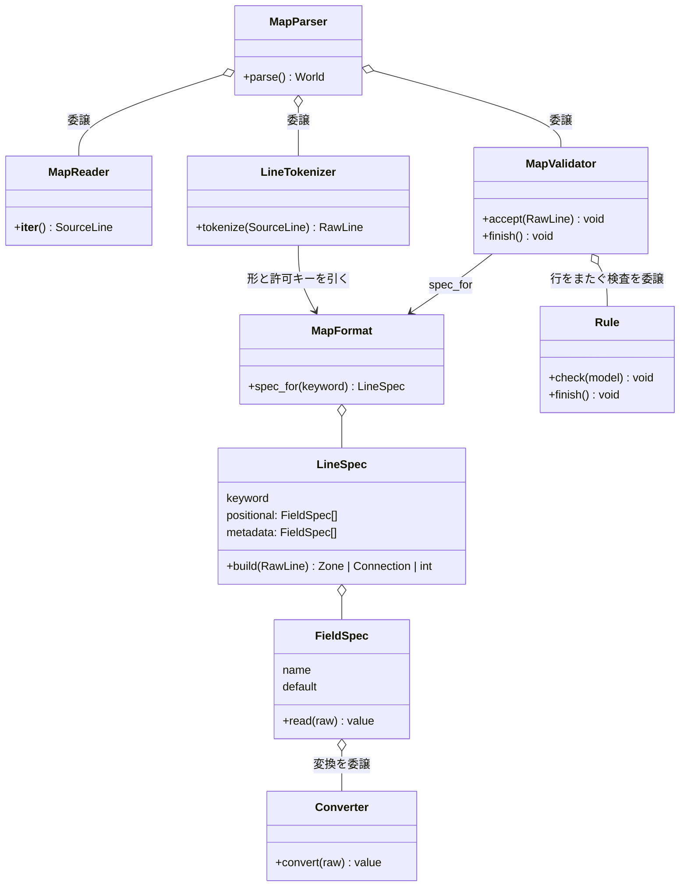
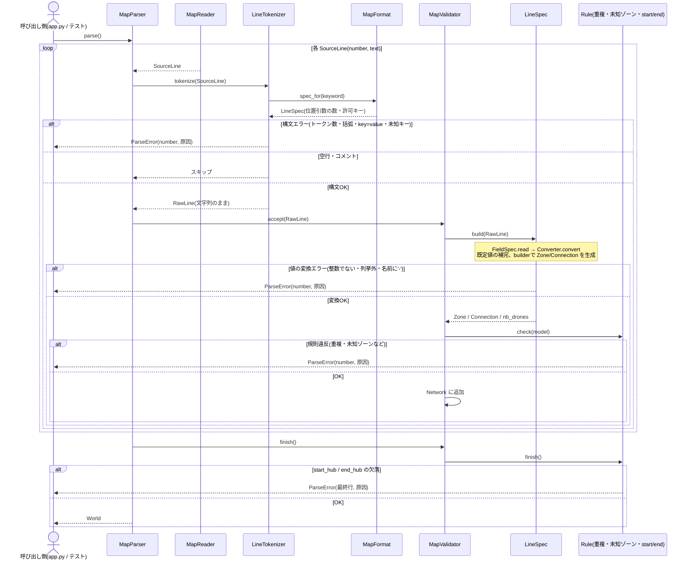

# 意思決定記録(Decision Log)

設計方針・技術選定・アルゴリズム選択などの意思決定をここに追記していく。
レビュー前後に必ず参照すること。

フォーマット:

```
## YYYY-MM-DD: <決定の見出し>
- 決定内容:
- 理由:
- 検討した代替案:
```

---

## 2026-09-05: リポジトリ初期化とブランチ構成

- 決定内容: `main`/`develop` の2ブランチ構成でリポジトリを初期化し、
  `https://github.com/saikawakiruya-droid/fly_in.git` にpush。
  `fly_in.pdf`(課題本文PDF)は `.gitignore` で除外し、`maps.tar.gz`(付属テストマップ)は追跡対象とした。
- 理由: cc_space共通ルール(`cc_space/CLAUDE.md`)のブランチ戦略(main/develop + feature/fix/test)に従うため。
  PDFは成果物ではなく配布された課題資料であり、サイズも大きいためリポジトリに含めない方針とした。
  マップは今後の実装・テストで直接使うため追跡対象とした。
- 検討した代替案: PDFも含めて全ファイルをコミットする案もあったが、
  「配布資料」と「成果物」を分ける方が管理上明確なため見送った。

## 2026-09-17: Stage 1(Domain Model)の設計方針3点

- 決定内容:
  1. `Network` は無防備な入れ物にする。`add_zone`/`add_connection` は重複名・重複接続(a-b==b-a)・
     start/endの一意性を一切検証しない。これらのバリデーションは全てStage 2(パーサ)側の責務とする。
  2. `ZoneType.turn_cost` を `BLOCKED` に対して呼び出した場合は `ValueError` を送出する契約とする。
     呼び出し側(Pathfinding等)は必ず `is_traversable` を先にチェックしてから `turn_cost` を呼ぶ利用契約になる。
  3. `Network.get_zone` / `start_zone` / `end_zone` が対象を発見できない場合のために、
     `errors.py` に専用例外(例: `ZoneNotFoundError(FlyInError)`)を追加し、組み込みの `KeyError` は使わない。
- 理由:
  1. パーサが検証を完了した上でNetworkに渡す前提にすることで、Network自身のクラスを単純に保てる。
     パーサ側のStage 2実装で、パース制約(章VII.4: 重複名・重複接続・start/end一意性)違反を
     行番号付きの`ParseError`に変換する処理を一箇所に集約できる。
  2. `int`型の`turn_cost`に「blockedのコスト」という概念自体が存在しないため、
     戻り値で誤魔化す(例: 0やInt.MAXを返す)よりも、実行時契約として呼び出しを禁止する方が
     呼び出し側の実装ミスを早期に検知できる。
  3. パーサ・シミュレーション両方から一貫して`FlyInError`系の例外体系で捕捉できるようにするため。
     `KeyError`のまま伝播させると、呼び出し側でのcatch節がバラバラになりうる。
- 検討した代替案:
  1. Network自身が重複チェックやstart/end一意性をガードする案。Stage2の実装が単純になる利点はあるが、
     Networkがバリデーション責務まで持つとクラスが厚くなるため見送った。
  2. `turn_cost`がblockedに対して便宜的な数値(0など)を返す案。「コスト0=タダで移動できる」という
     誤解を招きやすく、呼び出し側の実装ミスに気づきにくくなるため見送った。
  3. 専用例外を追加せず組み込みの`KeyError`をそのまま使う案。実装コストは最小だが、
     `FlyInError`系の例外体系から外れてしまうため見送った。

## 2026-09-17: start_hub / end_hub の max_drones を None に正規化する責務

- 決定内容: マップファイルで `start_hub` / `end_hub` に `max_drones=N` が指定されていても、
  パーサ(Stage 2)がその値を捨てて `Zone.max_drones` を必ず `None` に正規化する。
  `Zone`(Stage 1のdataclass自体)は `role` と `max_drones` の整合性を一切検証・強制しない。
- 理由: `Zone.has_unlimited_capacity`(role が START/END なら True)を利用側が先にチェックする
  契約だけでも動作上は成立するが、`zone.py`のdocstring(`max_drones: ... always the case for
  the start and end zones` = 常にNoneであるべき)という不変条件を実際に保証する主体を
  明確にしておく必要があった。「Networkは無防備な入れ物、検証はパーサの責務」という
  既存の設計方針(本ファイル内 2026-09-17 決定1)と一貫させ、ここでもパーサ側の責務とした。
- 検討した代替案:
  1. `Zone`自身が`__post_init__`等で`role`がSTART/ENDなら`max_drones`を強制的に`None`に
     上書きする案。データの不変条件をクラス自身が保証できる利点はあるが、
     「Zoneは無防備なデータ入れ物、バリデーション/正規化はパーサの責務」という
     既存方針から逸脱するため見送った。
  2. 正規化を行わず、`has_unlimited_capacity`の契約だけに頼る案(パースした値をそのまま保持)。
     `max_drones`の値がrole次第で意味を持ったり持たなかったりする状態になり、
     デバッグ時に「なぜstart_hubなのにmax_drones=5が入っているのか」と混乱を招くため見送った。

### 補足: get_zone / start_zone / end_zone の使い分け

- 決定内容:
  - `Network.get_zone(name)` は名前検索の失敗として `ZoneNotFoundError(FlyInError)`(要`errors.py`に追加、
    `zone_name: str` 属性を持つ)を送出する。
  - `Network.start_zone` / `end_zone` は「roleで一意なはずのゾーンが0件または複数件」という、
    本来パーサ制約(章VII.4: start_hub/end_hubはそれぞれちょうど1つ)で防がれているべき不変条件違反であり、
    実運用のパーサが正しく動いていれば発生しないケースのため、既存の `SimulationError` を送出する
    防御的チェックとして扱う。新規の専用例外は追加しない。
- 理由: `get_zone`は「与えられた名前」という具体的な検索キーを持つため`zone_name`属性を持つ専用例外が自然に噛み合うが、
  `start_zone`/`end_zone`の異常は「探すべき名前」ではなく「あるべき不変条件の破れ」なので、性質が異なる。
  後者に無理に`zone_name`を割り当てる(例: 疑似的に`"start_hub"`という文字列を渡す)よりも、
  既存の`SimulationError`(あり得ない状態を表す汎用例外)を使う方が意味的に正しい。
- 検討した代替案: `ZoneNotFoundError`の`zone_name`属性を`identifier`のような汎用名にリネームし、
  `start_zone`/`end_zone`でも使い回す案。クラス数は減るが、属性の意味が「名前」なのか「役割」なのか
  曖昧になり可読性が下がるため見送った。

## 2026-09-17: Stage 2(Parser)着手前の設計質問4点

- 決定内容:
  1. 重複検出(ゾーン名の重複、接続の重複 a-b/b-a)は、全行読了後の`_validate()`にまとめず、
     行単位で検出した時点で即座に`ParseError`を送出する。
  2. メタデータブロック(`[...]`)に未知のキー(例: `colr=`)が来た場合は`ParseError`にする。
  3. 座標の重複(同一(x, y)に複数ゾーンが存在すること)は許可し、パーサはこれを検証しない。
  4. 接続の自己ループ(`connection: a-a`、同一ゾーンを指す接続)は許可し、パーサはこれを検証しない。
- 理由:
  1. 行単位で即座にエラーにする方が実装がシンプルで、エラーメッセージの行番号も
     「実際に重複が判明した行」と一致し直感的。`_validate()`は「start/end の個数」のように
     行単位では判定できない、本当に全体を見ないと分からない制約だけに絞る。
  2. 章VII.4の「メタデータブロックは構文的に正しいこと」という要件を厳格に解釈し、
     タイポ(`colr=`等)や仕様外キーの早期検知を優先した。
  3. 章VII.4に座標重複を禁止する言及がなく、座標は主に可視化用の位置情報のため、
     要件にない制約を独自に追加しない方針とした。
  4. 自己ループは章VII.4に言及がなく許可/禁止どちらの立場もあり得たが、
     ユーザー判断として「要件にない制約を追加しない」方を優先し、パーサ側では検証しないことにした。
     ただしStage 3/4(経路探索・シミュレーション)が自己ループを実際にどう扱うかは別途検討が必要
     (経路探索アルゴリズムが自己ループを無限ループの原因にしない設計にする、等)。
- 検討した代替案:
  1. 全行読了後に`_validate()`でまとめて判定する案。ロジックを集約できる利点はあったが、
     「何行目をエラーとして報告するか(初出/再出現/検出順)」を別途決める必要があり、
     行単位方式より複雑になるため見送った。
  2. 未知キーを無視する案。将来のメタデータ拡張に寛容になるが、タイポを検知できず
     見送った。
  3. 座標重複を禁止する案。要件にない制約を独自に追加することになり、
     「後でなぜ弾いているのか」の説明が必要になるため見送った。
  4. 自己ループを禁止する案(Stage 2レビュー時の推奨案)。経路探索・シミュレーション上意味を持たない
     ため早期に弾く方が安全という判断もあったが、要件に明記がないためユーザーの意向で不採用とした。
     Stage 3/4実装時に自己ループが実害を持つと分かった場合は、本決定を見直す。

## 2026-10-03: 目的地までの距離はダイクストラ法で事前計算する

- 決定内容: `end_hub`までの距離は、パース完了後に`end_zone`を始点とする**ダイクストラ法**で
  全ゾーンに対して一度だけ計算し、辞書に記録して以降はO(1)参照する。`ZoneType.BLOCKED`
  (`is_traversable == False`)のゾーンは緩和(relaxation)の対象から除外し、そこを経由する経路は
  最短路計算に現れないようにする。重みは「入るゾーンの`turn_cost`」(normal/priority=1、
  restricted=2)であり、辺そのものには重みが付かない点に注意する。実装(`droneflow/pathfinding/`)
  が着手され次第、アルゴリズム選定とAPIについてプロジェクト直下の`README.md`にも記載する予定
  (現時点では`README.md`自体が未作成)。
- 理由: 欲しいのは任意の2点間距離ではなく、常に固定された`end_hub`までの距離(1対多)なので、
  都度ペア指定で距離を計算する関数を毎回呼ぶより、1回のダイクストラで全ゾーン分を確定させておく方が
  計算量・設計の両面で無駄がない。`turn_cost`が非負である(BLOCKEDは対象外、他は1か2)ため
  ダイクストラの前提(非負重み)を満たす。
- 検討した代替案:
  1. 2点間の距離を都度計算する汎用関数として実装する案。`find_path`/`find_k_paths`
     (`droneflow/pathfinding/pathfinder.py`)の個別経路探索としては必要だが、「ゴールまでの距離」を
     知りたいだけの用途に対しては、同じ始点(`end_zone`)からの再計算を繰り返すことになり非効率なため、
     本決定の主目的としては見送った。
  2. 全探索(バックトラック法)で最短距離を求める案。経路を全列挙できる利点はあるが、
     最短"距離"だけを知りたい場合は指数時間になり得るため見送った。バックトラック法自体は
     `find_k_paths`(複数候補パスの列挙)側での利用候補として引き続き検討する。

### 補足: 「侵入の可否」は容量起因のものと地形起因のものを分けて扱う

- 決定内容: ダイクストラによる距離の事前計算が除外するのは`ZoneType.BLOCKED`(恒久的に通行不可、
  地形起因)のみ。ゾーンの`max_drones`・接続の`max_link_capacity`に起因する「今この瞬間に入れるか」
  という容量起因の侵入可否は事前計算に含めず、毎ターンの移動時に`SimulationState.zone_occupancy`/
  `connection_usage`(`droneflow/simulation/state.py`)を見て`Scheduler.decide_moves`
  (`droneflow/simulation/scheduler.py`)が判定する。
- 理由: 容量は他のドローンの移動次第で毎ターン変動する動的な状態であり、静的なグラフ距離の
  事前計算に混ぜ込むと「距離は確定しているのに実際には入れない」という矛盾が生じる。
  「距離(ダイクストラの事前計算)はヒューリスティックな参考値、実際に入れるかはその場(移動時)で判定」
  と役割を分離する方が設計として一貫する。
- 検討した代替案: 容量も含めて事前計算する案(例: 各ゾーンに「平均的な混雑度」を見込んだ距離を
  計算する)。シミュレーション開始前には他ドローンの動きが未確定で容量状況を予測できず、
  事前計算した値がすぐに陳腐化するため見送った。

## 2026-10-03: connectionに独自の`blocked`属性は追加しない

- 決定内容: `Connection`(接続/辺)自体には`blocked`相当の属性を新設しない。接続が通行不可になる
  ケースは、両端いずれかのゾーンが`ZoneType.BLOCKED`であることで**間接的に**表現する
  (`BLOCKED`ゾーンには入れない＝そのゾーンに繋がる接続も実質使えない)。ダイクストラの緩和処理も、
  隣接ゾーンの`is_traversable`を見るだけで対応でき、`Connection`側の変更は不要。
  なお、経路(`Route`、`droneflow/pathfinding/pathfinder.py`)自体にも`blocked`属性は不要
  (経路は探索結果として常に通行可能なゾーンのみを辿るため、経路そのものが「blockedかどうか」を
  持つ概念はそもそも存在しない)。
- 理由: 課題要件(`docs/research/2026-09-05_foreword-ja-and-requirements.md:53`、
  `2026-09-05_parser-requirements.md:20`)はconnectionのメタデータを`max_link_capacity`のみと
  定めており、接続自体が通行不可になるという記述は存在しない。自己ループ・座標重複の決定時と同じ
  「要件にない制約・属性を独自に追加しない」方針を踏襲した。
- 検討した代替案: `Connection`に`blocked: bool`のような独自フィールドを追加する案。ゾーンのBLOCKEDと
  意味が重複し、どちらを見ればよいか曖昧になる・要件にない拡張になる、という理由で見送った。

## 2026-10-03: Stage 6(Output Formatter)をStage 3〜5より先に実装する

- 決定内容: 実装順を変更し、Stage 6(`droneflow/output/formatter.py`)を経路探索(Stage 3)・
  シミュレーション(Stage 4)・スケジューラ(Stage 5)より先に実装する。
  あわせて以下を決めた。
  1. `TurnLogFormatter` は状態を持たず、`Move`(`droneflow/simulation/state.py`)だけに依存する。
  2. `Move.destination` はゾーン名か接続名かを解釈せず、そのまま `D<ID>-<destination>` に連結する。
  3. 行内のドローン順は呼び出し側が渡した順を保ち、フォーマッタ内ではソートしない。
  4. 動いたドローンがいないターンは行を出力しない(スケルトンのdocstringどおり)。
  Stage 7(可視化)は、ターンごとの実データ描画がStage 4の `SimulationState` 確定後になるため
  今回は設計対象外とし、先行するのはStage 6のみ。
- 理由: Stage 6の入力は `list[list[Move]]` だけで、`Move` はすでに定義済み。Stage 3〜5が未実装でも
  手作りの `Move` で単体テストでき、出力フォーマットという「課題の合否に直結する仕様」を先に固められる。
  後続ステージの出力契約(何を `Move` に入れるか)も早期に確定する。
- 検討した代替案:
  1. 元の計画どおり Stage 3→4→5→6 の順で進める案。依存関係には忠実だが、出力仕様の確認が最後に
     なり、`Move` の契約不備に気づくのが遅れるため見送った。
  2. Stage 6とStage 7を同時に先行する案。Stage 7のターンごとの描画は `SimulationState` に依存し、
     先行できるのは静的な土台(`Network`の描画)に限られるため、今回は見送った。
  3. フォーマッタ内でドローンIDをソートする案。出力が決定的になる利点はあるが、整形と順序決定の
     責務が混ざるため見送った。順序の固定が必要になれば上流(Stage 5)で担保する。

## 2026-10-04: MapParserを「読み取り・分解・検証」に委譲で分割し、行の仕様を宣言的な仕様表にまとめる

- 決定内容: `droneflow/parsing/map_parser.py`(286行)を、継承ではなく**委譲**で次のファイルに分ける。
  公開API(`MapParser(path).parse()` → `World`)は変えない。
  1. `map_reader.py`(**読み取り**): ファイルを開き、`SourceLine(number, text)` を1行ずつ返す。
  2. `map_format.py`(**仕様表**): 各行が何を持つかを宣言するオブジェクト群と、実際の定義表。
     - `FieldSpec`: フィールド名、変換を担う部品(`Converter`)、既定値を持つ。
       `read(raw)` で文字列を型付きの値に変える。失敗時は行番号つきで `ParseError` にする。
     - `Converter`(整数、正の整数、列挙値(`ZoneType`)、文字列など): 1つの値を変換するだけの小さな部品。
       `FieldSpec` が保持して呼び出す(継承ではなく委譲)。
     - `LineSpec`: キーワード、位置引数の `FieldSpec` の並び、メタデータの `FieldSpec` の並び、
       取り出した値から `Zone` / `Connection` / `nb_drones` を作る組み立て役(builder)を持つ。
     - `MapFormat`: `LineSpec` を束ね、`spec_for(keyword)` で引ける定義表。定義表は次のとおり。

       | 行の種類 | 位置引数 | メタデータ(型、既定値) |
       |---|---|---|
       | `nb_drones` | n(正の整数) | なし |
       | `hub` | name, x, y | `zone`(ZoneType、normal)、`color`(文字列、なし)、`max_drones`(正の整数、**1**) |
       | `start_hub` / `end_hub` | name, x, y | 同上。ただし `max_drones` は**なし(None)** |
       | `connection` | name1-name2 | `max_link_capacity`(正の整数、1) |
  3. `line_tokenizer.py`(**分解**): `MapFormat` から「位置引数の数」「許可するメタデータキー」を引き、
     構文だけを見て `SourceLine` を `RawLine`(文字列のまま)に割る。`[ ]` の対応、`key=value` の形、
     `a-b` の形、未知キーの拒否(許可キーは仕様表から得る)を扱う。
  4. `map_rules.py`(**行をまたぐ規則**): 名前の重複、接続の重複、未知ゾーンへの接続、start/end の
     重複を、それぞれ小さな**規則オブジェクト**にする。validator が保持するのは `check(entry, network)` を
     持つ `Rule`(`Protocol`)。規則は組み立て済みの `Network` を見るだけで自前の状態を持たず、
     違反時は `ValueError`。「規則は Zone 用か Connection 用のどちらか」という is-a 関係には**継承**を
     使い、基底クラス `ZoneRule` / `ConnectionRule`(ABC)が `check` で型の振り分けを行い、
     サブクラスは `check_zone` / `check_connection` だけを実装する(Template Method)。
  5. `map_validator.py`(**検証**): フィールド単位の変換と既定値の補完は `LineSpec` に、行をまたぐ検査は
     規則オブジェクトに委譲し、自身は「仕様に変換させ、規則に確認させ、`Network` に追加する」だけの
     調整役になる。`ValueError` を行番号つきの `ParseError` に包み直すのはここ1箇所。
     start/end の欠落(全行を読み終えないと分からない検査)は `finish()` で行い、`World` を返す。
  6. `map_parser.py`(**司令塔**): 上の部品を呼び出して `World` を組み立てるだけにする。
  あわせて以下を決めた。
  - 行番号は `SourceLine` / `RawLine` に持たせ、各段階が `ParseError(number, ...)` を送出する。
    `line_number` 引数の引き回しと、`_last_line_number` のような共有状態をなくす。
  - 「ゾーン名に `-` を含まない」は、ゾーンの名前フィールドの検査(`Converter`)として仕様表側に置く。
  - `nb_drones` の「1行目でなければならない」という位置の制約は、仕様表に持たせず司令塔が
    `SourceLine.number == 1` を見て扱う。
  - hub と start/end の `max_drones` 既定値の違い(2026-09-17のバグ箇所)は、仕様表の上で
    `LineSpec` ごとに宣言し、テストで明示的に確認する。
  - 2026-09-17の決定(重複を行単位で即時検出、未知キーは `ParseError`、座標重複・自己ループは許可)は
    そのまま維持する。
  - 値の型の扱い(仕様表から取り出した値を `dict[str, object]` にせず、課題の type safe 要件=mypy を
    満たす形にすること)は未決。**実装前に別途検証する。**
- 理由: 現状は `line_number` を全メソッドに引き回してシグネチャが折れ、`_parse_zone_line` が約55行と
  多くの責務を抱えている。`_ZONE_KEYWORDS` などの定数と、行ごとに似た構造のメソッドが散らばり、
  「どの行がどんな値を持つか」が一覧できない。仕様を宣言的に1か所へまとめれば、仕様の追加・変更が
  表の編集で済み、既定値の違いも一目で分かる。各部品は小さな責務に絞られ、tokenizer・仕様・規則を
  それぞれ単体テストできる。継承よりも委譲を優先するというユーザーの方針(2026-10-04に表明)にも沿う。
- 検討した代替案:
  1. 分割せず、`line_number` の共有状態化とヘルパー統合だけで行数を削る案。変更は最小で済むが、
     責務過多と「仕様が散らばる」問題は残るため見送った。
  2. 基底クラス(`LineParser`)を作り、zone用・connection用のサブクラスで分ける案。メタデータ処理の
     再利用が継承頼みになり、方針に反するため見送った。
  3. フィールド検査に pydantic を使う案。禁止はされていないが、担えるのは値の検査だけで、行の形
     (位置引数)、キーワードとロールの対応、行をまたぐ検査、行番号つきエラーへの変換は担えない。
     依存追加、`ValidationError` の変換、緩い型変換(`"1_000"` が通るなど)のコストに見合わないため
     見送った。仕様表方式なら、依存を増やさずに仕様全体を1か所に宣言できる。
  4. 仕様表を作らず、検証を標準ライブラリで行ごとに手書きし続ける案。仕様が散らばる問題が残るため見送った。
  5. 規則クラスを継承なしの独立したクラス(`isinstance` の振り分けを各規則に書く)にする案。
     同じ振り分けが4回繰り返され、引数の型の絞り込みも各規則が負うため、is-a 関係が明確な
     この部分は継承を採用した(上記)。一方、`ZoneBuilder` の hub / start・end の分岐は分岐が1行で、
     サブクラス化に見合わないため、継承せず現状の委譲のままとした。

### 構造図(静的な形)



### 挙動図(実行時の呼び出し順)



## 2026-10-16: `nb_drones` は「ファイルの物理的な1行目」に限る

- 決定内容: `nb_drones: <n>` は、空行やコメントも含めた**ファイルの物理的な1行目**に書かれていなければならない。
  1行目が `nb_drones:` でなければ(コメントや空行でも)`line 1` の `ParseError` にする。
  2026-10-04 の決定(`MapParser` が `SourceLine.number == 1` を見て扱う)のとおりで、現行実装はすでにこの動作。
  テストパターン `revie_case/maps/parse_error/E35_comment_first_line.txt` で確認する。
- 理由: 課題PDF VII.4 の「The first line must define the number of drones」を文字どおり読む。
- 影響: 配布マップ(`maps.tar.gz`)は10枚とも1行目がコメントなので、そのままでは `line 1` エラーになる。
- 検討した代替案: 「空行・コメントを除いた最初の行」と読む案。配布マップはそのまま読めるが、採用しなかった。

## 2026-10-16: goal に到達できないことは、ゴールからの距離計算で検出する

- 決定内容: start から goal に到達できない(非連結、唯一の経路が blocked、接続がない)ことはパーサーでは検出しない。
  2026-10-03 の決定どおり `end_zone` を始点にダイクストラで距離を求めるとき、`start_zone` に距離が付かなければ
  明確なエラー(行番号ではなく「到達不能」と分かるメッセージ)で終了する。
  テストパターン: `revie_case/maps/edge/X02_disconnected_goal.txt`、`X03_only_path_blocked.txt`、`X05_no_connections.txt`
  (いずれもパースは成功し、距離計算でエラーになるのが期待結果)。孤立したゾーンがあっても start→goal が繋がっていれば
  普通に動く(`X04_isolated_zone_but_solvable.txt`)。
- 理由: 到達可能かどうかは、ゴールからの距離を全ゾーンについて求めればそのまま分かる。別にグラフ探索を書く必要がなく、
  パーサーは書式と行単位の規則だけを見る、という役割分担も保てる。
- 検討した代替案: パーサーの最終検査(`MapValidator.finish`)で連結性を調べる案。パーサーにグラフ探索を持ち込むことになり、
  距離計算と同じ探索を2回書くことになるため採用しなかった。
- 状態: 2026-10-16 に `feature/stage3_pathfinding` で実装(`Pathfinder` の構築時に `UnreachableGoalError` を送出。
  下の「Stage 3 の API をスケルトンから変更する」を参照)。

## 2026-10-16: 出力の検証スクリプトは今は作らない

- 決定内容: シミュレーション出力が容量などの制約を守っているかを自動で調べるスクリプトは、今は作らない。
  確認項目は `revie_case/README.ja.md` の「どの出力にも使えるチェックリスト」に残す。
- 理由: ユーザー判断(2026-10-16)。シミュレーション部が未実装のため。

## 2026-10-16: 残りステージの実装方針(Stage 3〜5, 7)

- 決定内容:
  1. **実装体制**: 残りのステージは、ユーザーの明示的な指示により Claude のサブエージェントが
     ステージ(フェーズ)単位で実装する。各ステージは `develop` から `feature/stageN_xxx` を切り、
     ワークフロードキュメント(構造図+挙動図)→実装→テスト(設計フェーズと作成フェーズを分ける)の順に進める。
  2. **スケジューラ(Stage 5)**: ユーザー指定の方式。毎ターン次の順に手を決める。
     a. restricted 接続上を飛行中のドローン(次ターン必着、課題 VII.3 の必須要件)。
     b. `zone=priority` のゾーンを通る経路上のドローン(優先ルート)を先に動かす。
     c. 残りは、ゴールまでの距離が近いゾーンにいるドローンから順に確認し、移動できれば動かす
        (下流から空けることで、同じターンの退出で生まれた空きを上流が使える)。
  3. **priority と遠回り**: 移動先は「ゴールまでの距離(ダイクストラの事前計算)が最小の隣接ゾーン」から選び、
     **距離が同じ候補の中でだけ priority を優先**する。priority 側が遠回りになる場合は選ばない。
     最小距離の候補がすべて満員なら、そのドローンは待機する。
  4. **可視化(Stage 7)**: ターミナル(ANSI カラー、ゾーンの `color` を使用)とグラフィカル(pygame)の両方を作る。
     pygame はプロジェクト直下の仮想環境(`.venv`)に入れ、`make install` で導入する。
- 理由:
  2/3. 課題の priority の記述は「1ターン(normal と同じ)、ただし経路探索で優先すべき」のみで程度の指定がなく、
     採点の主指標は総ターン数(VII.6)。遠回りしてまで priority を選ぶと主指標を悪化させるため、同距離時の
     タイブレークに留めた(課題文の確認結果を受けてユーザーが判断)。ゾーン順の処理はユーザーの設計。
  4. 課題 VII.1 は「ターミナル/グラフィカル/両方」のいずれかを求め、両方は加点要素(VII.6 の可視化の質)。ユーザー判断。
- 検討した代替案:
  - スケジューラを時間展開の予約方式(ドローンごとに (ゾーン, ターン) 空間でダイクストラ)にする案。容量違反・
    デッドロックが構造的に起きない利点があったが、ユーザーの設計を採用した。
  - 最短側が満員のとき、待つより早く着くなら遠回り側へ迂回する案。分散でターン数が減る可能性はあるが、
    判定が複雑になるため不採用。
  - グラフィカル表示に tkinter / matplotlib を使う案。ユーザーが pygame を選んだ。

## 2026-10-16: Stage 3 の API をスケルトンから変更する

- 決定内容: `droneflow/pathfinding/` を次の形にした(スケルトンの `find_path` / `find_k_paths` は削除)。
  1. `DistanceMap(network)`(`distance_map.py`): `end_zone` を始点とするダイクストラ(`heapq`、グラフライブラリなし)を
     構築時に1回だけ実行し、`distance(zone_name) -> int | None` で参照させる。goal に届かないゾーン(BLOCKED を含む)は
     `None`、存在しない名前は `ZoneNotFoundError`。
  2. `Pathfinder(network)`(`pathfinder.py`): `DistanceMap` を持ち(委譲)、次を提供する。
     - `distance(zone_name) -> int | None`: `DistanceMap` への委譲。
     - `next_hops(zone_name) -> list[Hop]`: 最短のまま goal に進める一手の候補。`Hop(connection, zone)` は
       通る接続と入るゾーンの組(frozen dataclass)。goal 自身・goal に届かないゾーンでは空。
     - `best_route(from_zone=None) -> Route`: `next_hops` の先頭を goal まで辿った1本(省略時は start から)。表示・テスト用。
  3. 構築時に start の距離が無ければ `UnreachableGoalError` を送出する(下の別項目)。
  4. 候補の並びは「priority のゾーンが先、同じ優先度の中は接続の宣言順(マップの記述順)」。安定ソートで決める。
- 理由:
  - 2026-10-16 のスケジューラ方針(毎ターン、最小距離の隣接ゾーンから選び、満員なら待つ)では、ドローンごとに経路を
    事前に割り当てない。必要なのは「今いるゾーンからの最短の一手の候補」であり、複数経路の列挙(`find_k_paths`)は使い道がない。
    最短の候補が複数あれば Stage 5 が空いている方を選ぶことで、負荷分散は自然に行われる。
  - `Hop` に接続を含めたのは、Stage 5 が接続の `max_link_capacity` と移動先ゾーンの `max_drones`・`turn_cost`(restricted の
    2ターン移動)を同時に必要とするため。`Network` には2ゾーン間の接続を引くメソッドがなく、Stage 5 で探し直さずに済む。
  - 宣言順を保つと結果が決定的になり、マップを見れば順序を予想できる。
- 検討した代替案:
  - スケルトンどおり `find_path(start, end)` / `find_k_paths(start, end, k)` を実装する案。2点間を都度探索するのは
    2026-10-03 の決定(goal からの1回の事前計算)と重複し、k 本の経路は上記のとおり使わないため見送った。
  - `next_hops` がゾーン名(`list[str]`)だけを返す案。単純だが、Stage 5 で接続を探し直す処理が必要になるため見送った。
  - 同じ優先度の中を名前順に並べる案。決定的にはなるが、マップ作者の記述順を無視する理由がないため見送った。

## 2026-10-16: 「距離が最小の隣接ゾーン」は「そのゾーンに入るコスト+そこからの距離」で比べる

- 決定内容: 2026-10-16「残りステージの実装方針」3 の「ゴールまでの距離が最小の隣接ゾーン」は、隣接ゾーン v の距離 `dist(v)`
  単体ではなく、`v.zone_type.turn_cost + dist(v)`(v に進んだ場合に goal まで実際にかかるターン数)で比べる。
  `next_hops(u)` はこれが `dist(u)` と等しい v(=最短経路上の一手)をすべて返す。priority は、この中でだけ先頭に並べる。
- 理由: restricted のゾーンは入るのに2ターンかかるため、`dist(v)` だけを比べると遠回りを選びうる。
  例: `s-r-g`(r は restricted)と `s-a-g`(a は normal)では `dist(r) = dist(a) = 1` で同点になるが、実際には r 経由が3ターン、
  a 経由が2ターンかかる。入るコストを足せば a だけが候補になる。方針の意図(総ターン数を悪化させない)どおりの解釈。
- 検討した代替案: `dist(v)` が最小のものを選ぶ(文字どおりの)案。上の例で余計に1ターンかかる移動を選びうるため見送った。

## 2026-10-16: 到達不能は新しい例外 `UnreachableGoalError` で知らせ、`Pathfinder` の構築時に検出する

- 決定内容: `errors.py` に `UnreachableGoalError(FlyInError)` を追加した。属性は `zone_name`(どこから)と `goal_name`、
  メッセージは `goal 'g' is unreachable from 's'`(行番号なし)。`Pathfinder(network)` の構築時に start の距離が無ければ送出する。
  `best_route(from_zone)` も、`from_zone` から届かない場合に同じ例外を送出する。
- 理由: 到達不能は特定の行ではなくマップ全体の性質なので、`ParseError`(行番号つき)は合わない。`SimulationError` は
  「起きるはずのない状態」(パーサが防ぐはずの不変条件違反)に使っており、入力マップが原因の正当なエラーとは性質が違う。
  専用の例外にすれば、`app.py` 側で他のエラーと同様に `FlyInError` として捕まえつつ、テストで種類を区別できる。
  構築時に検出すれば「`Pathfinder` が存在する=start から goal に届く」が保証され、Stage 5 が毎回確認せずに済む。
- 検討した代替案:
  - `SimulationError` を流用する案。上記の理由で意味が混ざるため見送った。
  - `Pathfinder` は例外を出さず、`is_goal_reachable()` のような問い合わせを用意して `app.py` に判定させる案。確認を忘れると
    Stage 5 が距離 `None` のまま動いてしまうため見送った。

## 2026-10-16: start_hub / end_hub が `zone=blocked` のマップは到達不能として扱う

- 決定内容: BLOCKED のゾーンは start / end を含めて距離を持たない。そのため `end_hub` が blocked なら goal に入れず、
  `start_hub` が blocked でも start に距離が付かないので、どちらも `UnreachableGoalError` になる。パーサはこの組み合わせを拒否しない(現状どおり)。
- 理由: 課題 VII.3 は blocked を「入ることも通過することもできない」と定めている。end には入らなければ配達できない。
  start については「最初からそこにいるので入るわけではない」という読み方もありうるが、要件に明記がなく、
  一律に「blocked のゾーンは経路に現れない」とする方が単純で、`turn_cost` の利用契約(blocked で `ValueError`)とも矛盾しない。
- 検討した代替案:
  - start が blocked でも出発だけは許す案。課題文の読み方としてはありうるため、ユーザーの判断で変更しうる(未決事項として報告)。
  - パーサで start/end の `zone=blocked` を `ParseError` にする案。要件にない制約を加えることになるため見送った。
