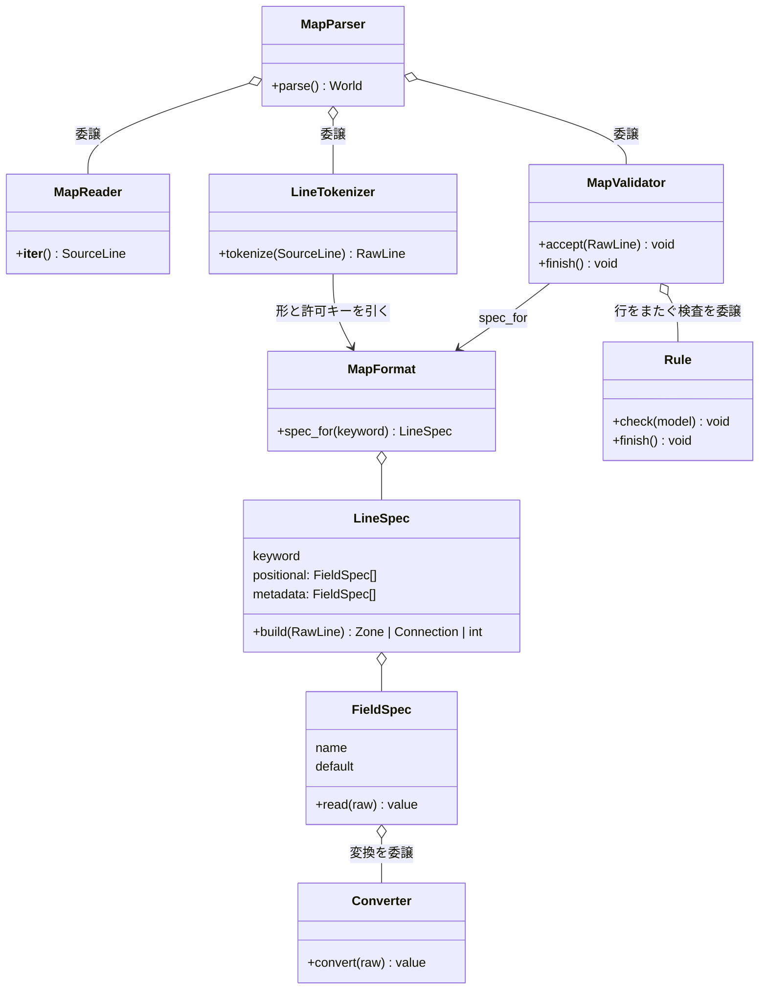
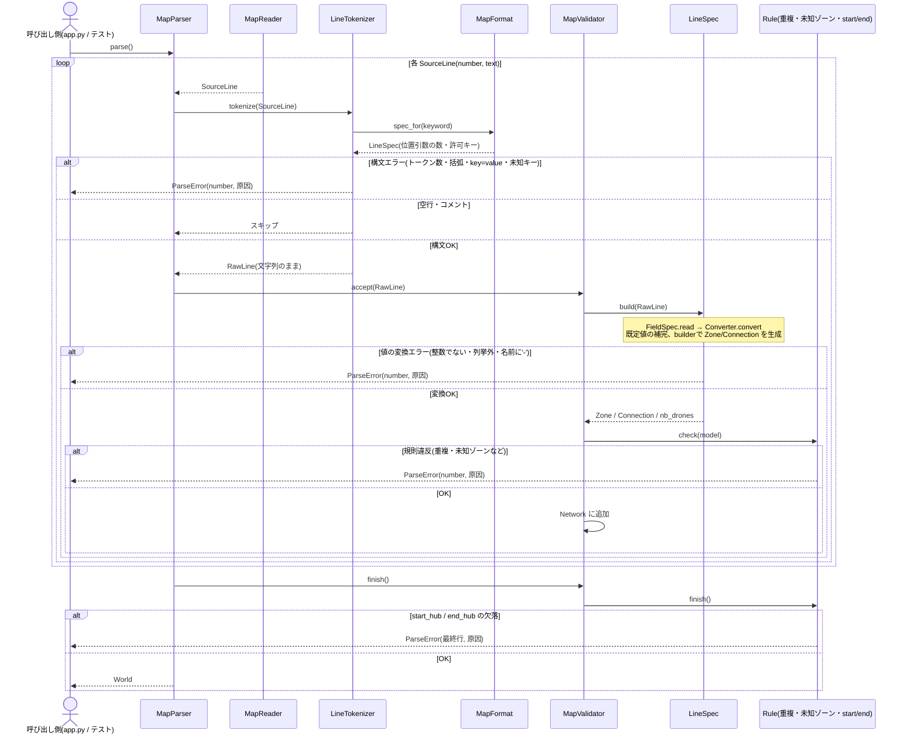

# 意思決定記録(Decision Log)

設計方針・技術選定・アルゴリズム選択などの意思決定をここに追記していく。
レビュー前後に必ず参照すること。

フォーマット:

```
## YYYY-MM-DD: <決定の見出し>
- 決定内容:
- 理由:
- 検討した代替案:
```

---

## 2026-09-05: リポジトリ初期化とブランチ構成

- 決定内容: `main`/`develop` の2ブランチ構成でリポジトリを初期化し、
  `https://github.com/saikawakiruya-droid/fly_in.git` にpush。
  `fly_in.pdf`(課題本文PDF)は `.gitignore` で除外し、`maps.tar.gz`(付属テストマップ)は追跡対象とした。
- 理由: cc_space共通ルール(`cc_space/CLAUDE.md`)のブランチ戦略(main/develop + feature/fix/test)に従うため。
  PDFは成果物ではなく配布された課題資料であり、サイズも大きいためリポジトリに含めない方針とした。
  マップは今後の実装・テストで直接使うため追跡対象とした。
- 検討した代替案: PDFも含めて全ファイルをコミットする案もあったが、
  「配布資料」と「成果物」を分ける方が管理上明確なため見送った。

## 2026-09-17: Stage 1(Domain Model)の設計方針3点

- 決定内容:
  1. `Network` は無防備な入れ物にする。`add_zone`/`add_connection` は重複名・重複接続(a-b==b-a)・
     start/endの一意性を一切検証しない。これらのバリデーションは全てStage 2(パーサ)側の責務とする。
  2. `ZoneType.turn_cost` を `BLOCKED` に対して呼び出した場合は `ValueError` を送出する契約とする。
     呼び出し側(Pathfinding等)は必ず `is_traversable` を先にチェックしてから `turn_cost` を呼ぶ利用契約になる。
  3. `Network.get_zone` / `start_zone` / `end_zone` が対象を発見できない場合のために、
     `errors.py` に専用例外(例: `ZoneNotFoundError(FlyInError)`)を追加し、組み込みの `KeyError` は使わない。
- 理由:
  1. パーサが検証を完了した上でNetworkに渡す前提にすることで、Network自身のクラスを単純に保てる。
     パーサ側のStage 2実装で、パース制約(章VII.4: 重複名・重複接続・start/end一意性)違反を
     行番号付きの`ParseError`に変換する処理を一箇所に集約できる。
  2. `int`型の`turn_cost`に「blockedのコスト」という概念自体が存在しないため、
     戻り値で誤魔化す(例: 0やInt.MAXを返す)よりも、実行時契約として呼び出しを禁止する方が
     呼び出し側の実装ミスを早期に検知できる。
  3. パーサ・シミュレーション両方から一貫して`FlyInError`系の例外体系で捕捉できるようにするため。
     `KeyError`のまま伝播させると、呼び出し側でのcatch節がバラバラになりうる。
- 検討した代替案:
  1. Network自身が重複チェックやstart/end一意性をガードする案。Stage2の実装が単純になる利点はあるが、
     Networkがバリデーション責務まで持つとクラスが厚くなるため見送った。
  2. `turn_cost`がblockedに対して便宜的な数値(0など)を返す案。「コスト0=タダで移動できる」という
     誤解を招きやすく、呼び出し側の実装ミスに気づきにくくなるため見送った。
  3. 専用例外を追加せず組み込みの`KeyError`をそのまま使う案。実装コストは最小だが、
     `FlyInError`系の例外体系から外れてしまうため見送った。

## 2026-09-17: start_hub / end_hub の max_drones を None に正規化する責務

- 決定内容: マップファイルで `start_hub` / `end_hub` に `max_drones=N` が指定されていても、
  パーサ(Stage 2)がその値を捨てて `Zone.max_drones` を必ず `None` に正規化する。
  `Zone`(Stage 1のdataclass自体)は `role` と `max_drones` の整合性を一切検証・強制しない。
- 理由: `Zone.has_unlimited_capacity`(role が START/END なら True)を利用側が先にチェックする
  契約だけでも動作上は成立するが、`zone.py`のdocstring(`max_drones: ... always the case for
  the start and end zones` = 常にNoneであるべき)という不変条件を実際に保証する主体を
  明確にしておく必要があった。「Networkは無防備な入れ物、検証はパーサの責務」という
  既存の設計方針(本ファイル内 2026-09-17 決定1)と一貫させ、ここでもパーサ側の責務とした。
- 検討した代替案:
  1. `Zone`自身が`__post_init__`等で`role`がSTART/ENDなら`max_drones`を強制的に`None`に
     上書きする案。データの不変条件をクラス自身が保証できる利点はあるが、
     「Zoneは無防備なデータ入れ物、バリデーション/正規化はパーサの責務」という
     既存方針から逸脱するため見送った。
  2. 正規化を行わず、`has_unlimited_capacity`の契約だけに頼る案(パースした値をそのまま保持)。
     `max_drones`の値がrole次第で意味を持ったり持たなかったりする状態になり、
     デバッグ時に「なぜstart_hubなのにmax_drones=5が入っているのか」と混乱を招くため見送った。

### 補足: get_zone / start_zone / end_zone の使い分け

- 決定内容:
  - `Network.get_zone(name)` は名前検索の失敗として `ZoneNotFoundError(FlyInError)`(要`errors.py`に追加、
    `zone_name: str` 属性を持つ)を送出する。
  - `Network.start_zone` / `end_zone` は「roleで一意なはずのゾーンが0件または複数件」という、
    本来パーサ制約(章VII.4: start_hub/end_hubはそれぞれちょうど1つ)で防がれているべき不変条件違反であり、
    実運用のパーサが正しく動いていれば発生しないケースのため、既存の `SimulationError` を送出する
    防御的チェックとして扱う。新規の専用例外は追加しない。
- 理由: `get_zone`は「与えられた名前」という具体的な検索キーを持つため`zone_name`属性を持つ専用例外が自然に噛み合うが、
  `start_zone`/`end_zone`の異常は「探すべき名前」ではなく「あるべき不変条件の破れ」なので、性質が異なる。
  後者に無理に`zone_name`を割り当てる(例: 疑似的に`"start_hub"`という文字列を渡す)よりも、
  既存の`SimulationError`(あり得ない状態を表す汎用例外)を使う方が意味的に正しい。
- 検討した代替案: `ZoneNotFoundError`の`zone_name`属性を`identifier`のような汎用名にリネームし、
  `start_zone`/`end_zone`でも使い回す案。クラス数は減るが、属性の意味が「名前」なのか「役割」なのか
  曖昧になり可読性が下がるため見送った。

## 2026-09-17: Stage 2(Parser)着手前の設計質問4点

- 決定内容:
  1. 重複検出(ゾーン名の重複、接続の重複 a-b/b-a)は、全行読了後の`_validate()`にまとめず、
     行単位で検出した時点で即座に`ParseError`を送出する。
  2. メタデータブロック(`[...]`)に未知のキー(例: `colr=`)が来た場合は`ParseError`にする。
  3. 座標の重複(同一(x, y)に複数ゾーンが存在すること)は許可し、パーサはこれを検証しない。
  4. 接続の自己ループ(`connection: a-a`、同一ゾーンを指す接続)は許可し、パーサはこれを検証しない。
- 理由:
  1. 行単位で即座にエラーにする方が実装がシンプルで、エラーメッセージの行番号も
     「実際に重複が判明した行」と一致し直感的。`_validate()`は「start/end の個数」のように
     行単位では判定できない、本当に全体を見ないと分からない制約だけに絞る。
  2. 章VII.4の「メタデータブロックは構文的に正しいこと」という要件を厳格に解釈し、
     タイポ(`colr=`等)や仕様外キーの早期検知を優先した。
  3. 章VII.4に座標重複を禁止する言及がなく、座標は主に可視化用の位置情報のため、
     要件にない制約を独自に追加しない方針とした。
  4. 自己ループは章VII.4に言及がなく許可/禁止どちらの立場もあり得たが、
     ユーザー判断として「要件にない制約を追加しない」方を優先し、パーサ側では検証しないことにした。
     ただしStage 3/4(経路探索・シミュレーション)が自己ループを実際にどう扱うかは別途検討が必要
     (経路探索アルゴリズムが自己ループを無限ループの原因にしない設計にする、等)。
- 検討した代替案:
  1. 全行読了後に`_validate()`でまとめて判定する案。ロジックを集約できる利点はあったが、
     「何行目をエラーとして報告するか(初出/再出現/検出順)」を別途決める必要があり、
     行単位方式より複雑になるため見送った。
  2. 未知キーを無視する案。将来のメタデータ拡張に寛容になるが、タイポを検知できず
     見送った。
  3. 座標重複を禁止する案。要件にない制約を独自に追加することになり、
     「後でなぜ弾いているのか」の説明が必要になるため見送った。
  4. 自己ループを禁止する案(Stage 2レビュー時の推奨案)。経路探索・シミュレーション上意味を持たない
     ため早期に弾く方が安全という判断もあったが、要件に明記がないためユーザーの意向で不採用とした。
     Stage 3/4実装時に自己ループが実害を持つと分かった場合は、本決定を見直す。
- 追記(2026-10-16): パーサが自己ループを許可する方針(決定4)は維持する。ただしシミュレーションでは、
  自己ループを通って今いるゾーンへ「移動」する指示を `SimulationError` で拒否することにした
  (「2026-10-16: 今いるゾーンへの移動指示(自己ループ経由を含む)は拒否する」を参照)。

## 2026-10-03: 目的地までの距離はダイクストラ法で事前計算する

- 決定内容: `end_hub`までの距離は、パース完了後に`end_zone`を始点とする**ダイクストラ法**で
  全ゾーンに対して一度だけ計算し、辞書に記録して以降はO(1)参照する。`ZoneType.BLOCKED`
  (`is_traversable == False`)のゾーンは緩和(relaxation)の対象から除外し、そこを経由する経路は
  最短路計算に現れないようにする。重みは「入るゾーンの`turn_cost`」(normal/priority=1、
  restricted=2)であり、辺そのものには重みが付かない点に注意する。実装(`droneflow/pathfinding/`)
  が着手され次第、アルゴリズム選定とAPIについてプロジェクト直下の`README.md`にも記載する予定
  (現時点では`README.md`自体が未作成)。
- 理由: 欲しいのは任意の2点間距離ではなく、常に固定された`end_hub`までの距離(1対多)なので、
  都度ペア指定で距離を計算する関数を毎回呼ぶより、1回のダイクストラで全ゾーン分を確定させておく方が
  計算量・設計の両面で無駄がない。`turn_cost`が非負である(BLOCKEDは対象外、他は1か2)ため
  ダイクストラの前提(非負重み)を満たす。
- 検討した代替案:
  1. 2点間の距離を都度計算する汎用関数として実装する案。`find_path`/`find_k_paths`
     (`droneflow/pathfinding/pathfinder.py`)の個別経路探索としては必要だが、「ゴールまでの距離」を
     知りたいだけの用途に対しては、同じ始点(`end_zone`)からの再計算を繰り返すことになり非効率なため、
     本決定の主目的としては見送った。
  2. 全探索(バックトラック法)で最短距離を求める案。経路を全列挙できる利点はあるが、
     最短"距離"だけを知りたい場合は指数時間になり得るため見送った。バックトラック法自体は
     `find_k_paths`(複数候補パスの列挙)側での利用候補として引き続き検討する。

### 補足: 「侵入の可否」は容量起因のものと地形起因のものを分けて扱う

- 決定内容: ダイクストラによる距離の事前計算が除外するのは`ZoneType.BLOCKED`(恒久的に通行不可、
  地形起因)のみ。ゾーンの`max_drones`・接続の`max_link_capacity`に起因する「今この瞬間に入れるか」
  という容量起因の侵入可否は事前計算に含めず、毎ターンの移動時に`SimulationState.zone_occupancy`/
  `connection_usage`(`droneflow/simulation/state.py`)を見て`Scheduler.decide_moves`
  (`droneflow/simulation/scheduler.py`)が判定する。
- 理由: 容量は他のドローンの移動次第で毎ターン変動する動的な状態であり、静的なグラフ距離の
  事前計算に混ぜ込むと「距離は確定しているのに実際には入れない」という矛盾が生じる。
  「距離(ダイクストラの事前計算)はヒューリスティックな参考値、実際に入れるかはその場(移動時)で判定」
  と役割を分離する方が設計として一貫する。
- 検討した代替案: 容量も含めて事前計算する案(例: 各ゾーンに「平均的な混雑度」を見込んだ距離を
  計算する)。シミュレーション開始前には他ドローンの動きが未確定で容量状況を予測できず、
  事前計算した値がすぐに陳腐化するため見送った。

## 2026-10-03: connectionに独自の`blocked`属性は追加しない

- 決定内容: `Connection`(接続/辺)自体には`blocked`相当の属性を新設しない。接続が通行不可になる
  ケースは、両端いずれかのゾーンが`ZoneType.BLOCKED`であることで**間接的に**表現する
  (`BLOCKED`ゾーンには入れない＝そのゾーンに繋がる接続も実質使えない)。ダイクストラの緩和処理も、
  隣接ゾーンの`is_traversable`を見るだけで対応でき、`Connection`側の変更は不要。
  なお、経路(`Route`、`droneflow/pathfinding/pathfinder.py`)自体にも`blocked`属性は不要
  (経路は探索結果として常に通行可能なゾーンのみを辿るため、経路そのものが「blockedかどうか」を
  持つ概念はそもそも存在しない)。
- 理由: 課題要件(`docs/research/2026-09-05_foreword-ja-and-requirements.md:53`、
  `2026-09-05_parser-requirements.md:20`)はconnectionのメタデータを`max_link_capacity`のみと
  定めており、接続自体が通行不可になるという記述は存在しない。自己ループ・座標重複の決定時と同じ
  「要件にない制約・属性を独自に追加しない」方針を踏襲した。
- 検討した代替案: `Connection`に`blocked: bool`のような独自フィールドを追加する案。ゾーンのBLOCKEDと
  意味が重複し、どちらを見ればよいか曖昧になる・要件にない拡張になる、という理由で見送った。

## 2026-10-03: Stage 6(Output Formatter)をStage 3〜5より先に実装する

- 決定内容: 実装順を変更し、Stage 6(`droneflow/output/formatter.py`)を経路探索(Stage 3)・
  シミュレーション(Stage 4)・スケジューラ(Stage 5)より先に実装する。
  あわせて以下を決めた。
  1. `TurnLogFormatter` は状態を持たず、`Move`(`droneflow/simulation/state.py`)だけに依存する。
  2. `Move.destination` はゾーン名か接続名かを解釈せず、そのまま `D<ID>-<destination>` に連結する。
  3. 行内のドローン順は呼び出し側が渡した順を保ち、フォーマッタ内ではソートしない。
  4. 動いたドローンがいないターンは行を出力しない(スケルトンのdocstringどおり)。
  Stage 7(可視化)は、ターンごとの実データ描画がStage 4の `SimulationState` 確定後になるため
  今回は設計対象外とし、先行するのはStage 6のみ。
- 理由: Stage 6の入力は `list[list[Move]]` だけで、`Move` はすでに定義済み。Stage 3〜5が未実装でも
  手作りの `Move` で単体テストでき、出力フォーマットという「課題の合否に直結する仕様」を先に固められる。
  後続ステージの出力契約(何を `Move` に入れるか)も早期に確定する。
- 検討した代替案:
  1. 元の計画どおり Stage 3→4→5→6 の順で進める案。依存関係には忠実だが、出力仕様の確認が最後に
     なり、`Move` の契約不備に気づくのが遅れるため見送った。
  2. Stage 6とStage 7を同時に先行する案。Stage 7のターンごとの描画は `SimulationState` に依存し、
     先行できるのは静的な土台(`Network`の描画)に限られるため、今回は見送った。
  3. フォーマッタ内でドローンIDをソートする案。出力が決定的になる利点はあるが、整形と順序決定の
     責務が混ざるため見送った。順序の固定が必要になれば上流(Stage 5)で担保する。

## 2026-10-04: MapParserを「読み取り・分解・検証」に委譲で分割し、行の仕様を宣言的な仕様表にまとめる

- 決定内容: `droneflow/parsing/map_parser.py`(286行)を、継承ではなく**委譲**で次のファイルに分ける。
  公開API(`MapParser(path).parse()` → `World`)は変えない。
  1. `map_reader.py`(**読み取り**): ファイルを開き、`SourceLine(number, text)` を1行ずつ返す。
  2. `map_format.py`(**仕様表**): 各行が何を持つかを宣言するオブジェクト群と、実際の定義表。
     - `FieldSpec`: フィールド名、変換を担う部品(`Converter`)、既定値を持つ。
       `read(raw)` で文字列を型付きの値に変える。失敗時は行番号つきで `ParseError` にする。
     - `Converter`(整数、正の整数、列挙値(`ZoneType`)、文字列など): 1つの値を変換するだけの小さな部品。
       `FieldSpec` が保持して呼び出す(継承ではなく委譲)。
     - `LineSpec`: キーワード、位置引数の `FieldSpec` の並び、メタデータの `FieldSpec` の並び、
       取り出した値から `Zone` / `Connection` / `nb_drones` を作る組み立て役(builder)を持つ。
     - `MapFormat`: `LineSpec` を束ね、`spec_for(keyword)` で引ける定義表。定義表は次のとおり。

       | 行の種類 | 位置引数 | メタデータ(型、既定値) |
       |---|---|---|
       | `nb_drones` | n(正の整数) | なし |
       | `hub` | name, x, y | `zone`(ZoneType、normal)、`color`(文字列、なし)、`max_drones`(正の整数、**1**) |
       | `start_hub` / `end_hub` | name, x, y | 同上。ただし `max_drones` は**なし(None)** |
       | `connection` | name1-name2 | `max_link_capacity`(正の整数、1) |
  3. `line_tokenizer.py`(**分解**): `MapFormat` から「位置引数の数」「許可するメタデータキー」を引き、
     構文だけを見て `SourceLine` を `RawLine`(文字列のまま)に割る。`[ ]` の対応、`key=value` の形、
     `a-b` の形、未知キーの拒否(許可キーは仕様表から得る)を扱う。
  4. `map_rules.py`(**行をまたぐ規則**): 名前の重複、接続の重複、未知ゾーンへの接続、start/end の
     重複を、それぞれ小さな**規則オブジェクト**にする。validator が保持するのは `check(entry, network)` を
     持つ `Rule`(`Protocol`)。規則は組み立て済みの `Network` を見るだけで自前の状態を持たず、
     違反時は `ValueError`。「規則は Zone 用か Connection 用のどちらか」という is-a 関係には**継承**を
     使い、基底クラス `ZoneRule` / `ConnectionRule`(ABC)が `check` で型の振り分けを行い、
     サブクラスは `check_zone` / `check_connection` だけを実装する(Template Method)。
  5. `map_validator.py`(**検証**): フィールド単位の変換と既定値の補完は `LineSpec` に、行をまたぐ検査は
     規則オブジェクトに委譲し、自身は「仕様に変換させ、規則に確認させ、`Network` に追加する」だけの
     調整役になる。`ValueError` を行番号つきの `ParseError` に包み直すのはここ1箇所。
     start/end の欠落(全行を読み終えないと分からない検査)は `finish()` で行い、`World` を返す。
  6. `map_parser.py`(**司令塔**): 上の部品を呼び出して `World` を組み立てるだけにする。
  あわせて以下を決めた。
  - 行番号は `SourceLine` / `RawLine` に持たせ、各段階が `ParseError(number, ...)` を送出する。
    `line_number` 引数の引き回しと、`_last_line_number` のような共有状態をなくす。
  - 「ゾーン名に `-` を含まない」は、ゾーンの名前フィールドの検査(`Converter`)として仕様表側に置く。
  - `nb_drones` の「1行目でなければならない」という位置の制約は、仕様表に持たせず司令塔が
    `SourceLine.number == 1` を見て扱う。
  - hub と start/end の `max_drones` 既定値の違い(2026-09-17のバグ箇所)は、仕様表の上で
    `LineSpec` ごとに宣言し、テストで明示的に確認する。
  - 2026-09-17の決定(重複を行単位で即時検出、未知キーは `ParseError`、座標重複・自己ループは許可)は
    そのまま維持する。
  - 値の型の扱い(仕様表から取り出した値を `dict[str, object]` にせず、課題の type safe 要件=mypy を
    満たす形にすること)は未決。**実装前に別途検証する。**
- 理由: 現状は `line_number` を全メソッドに引き回してシグネチャが折れ、`_parse_zone_line` が約55行と
  多くの責務を抱えている。`_ZONE_KEYWORDS` などの定数と、行ごとに似た構造のメソッドが散らばり、
  「どの行がどんな値を持つか」が一覧できない。仕様を宣言的に1か所へまとめれば、仕様の追加・変更が
  表の編集で済み、既定値の違いも一目で分かる。各部品は小さな責務に絞られ、tokenizer・仕様・規則を
  それぞれ単体テストできる。継承よりも委譲を優先するというユーザーの方針(2026-10-04に表明)にも沿う。
- 検討した代替案:
  1. 分割せず、`line_number` の共有状態化とヘルパー統合だけで行数を削る案。変更は最小で済むが、
     責務過多と「仕様が散らばる」問題は残るため見送った。
  2. 基底クラス(`LineParser`)を作り、zone用・connection用のサブクラスで分ける案。メタデータ処理の
     再利用が継承頼みになり、方針に反するため見送った。
  3. フィールド検査に pydantic を使う案。禁止はされていないが、担えるのは値の検査だけで、行の形
     (位置引数)、キーワードとロールの対応、行をまたぐ検査、行番号つきエラーへの変換は担えない。
     依存追加、`ValidationError` の変換、緩い型変換(`"1_000"` が通るなど)のコストに見合わないため
     見送った。仕様表方式なら、依存を増やさずに仕様全体を1か所に宣言できる。
  4. 仕様表を作らず、検証を標準ライブラリで行ごとに手書きし続ける案。仕様が散らばる問題が残るため見送った。
  5. 規則クラスを継承なしの独立したクラス(`isinstance` の振り分けを各規則に書く)にする案。
     同じ振り分けが4回繰り返され、引数の型の絞り込みも各規則が負うため、is-a 関係が明確な
     この部分は継承を採用した(上記)。一方、`ZoneBuilder` の hub / start・end の分岐は分岐が1行で、
     サブクラス化に見合わないため、継承せず現状の委譲のままとした。

### 構造図(静的な形)



### 挙動図(実行時の呼び出し順)



## 2026-10-16: `nb_drones` は「ファイルの物理的な1行目」に限る

- 決定内容: `nb_drones: <n>` は、空行やコメントも含めた**ファイルの物理的な1行目**に書かれていなければならない。
  1行目が `nb_drones:` でなければ(コメントや空行でも)`line 1` の `ParseError` にする。
  2026-10-04 の決定(`MapParser` が `SourceLine.number == 1` を見て扱う)のとおりで、現行実装はすでにこの動作。
  テストパターン `revie_case/maps/parse_error/E35_comment_first_line.txt` で確認する。
- 理由: 課題PDF VII.4 の「The first line must define the number of drones」を文字どおり読む。
- 影響: 配布マップ(`maps.tar.gz`)は10枚とも1行目がコメントなので、そのままでは `line 1` エラーになる。
- 検討した代替案: 「空行・コメントを除いた最初の行」と読む案。配布マップはそのまま読めるが、採用しなかった。

## 2026-10-16: goal に到達できないことは、ゴールからの距離計算で検出する

- 決定内容: start から goal に到達できない(非連結、唯一の経路が blocked、接続がない)ことはパーサーでは検出しない。
  2026-10-03 の決定どおり `end_zone` を始点にダイクストラで距離を求めるとき、`start_zone` に距離が付かなければ
  明確なエラー(行番号ではなく「到達不能」と分かるメッセージ)で終了する。
  テストパターン: `revie_case/maps/edge/X02_disconnected_goal.txt`、`X03_only_path_blocked.txt`、`X05_no_connections.txt`
  (いずれもパースは成功し、距離計算でエラーになるのが期待結果)。孤立したゾーンがあっても start→goal が繋がっていれば
  普通に動く(`X04_isolated_zone_but_solvable.txt`)。
- 理由: 到達可能かどうかは、ゴールからの距離を全ゾーンについて求めればそのまま分かる。別にグラフ探索を書く必要がなく、
  パーサーは書式と行単位の規則だけを見る、という役割分担も保てる。
- 検討した代替案: パーサーの最終検査(`MapValidator.finish`)で連結性を調べる案。パーサーにグラフ探索を持ち込むことになり、
  距離計算と同じ探索を2回書くことになるため採用しなかった。
- 状態: 2026-10-16 に `feature/stage3_pathfinding` で実装(`Pathfinder` の構築時に `UnreachableGoalError` を送出。
  下の「Stage 3 の API をスケルトンから変更する」を参照)。

## 2026-10-16: 出力の検証スクリプトは今は作らない

- 決定内容: シミュレーション出力が容量などの制約を守っているかを自動で調べるスクリプトは、今は作らない。
  確認項目は `revie_case/README.ja.md` の「どの出力にも使えるチェックリスト」に残す。
- 理由: ユーザー判断(2026-10-16)。シミュレーション部が未実装のため。

## 2026-10-16: 残りステージの実装方針(Stage 3〜5, 7)

- 決定内容:
  1. **実装体制**: 残りのステージは、ユーザーの明示的な指示により Claude のサブエージェントが
     ステージ(フェーズ)単位で実装する。各ステージは `develop` から `feature/stageN_xxx` を切り、
     ワークフロードキュメント(構造図+挙動図)→実装→テスト(設計フェーズと作成フェーズを分ける)の順に進める。
  2. **スケジューラ(Stage 5)**: ユーザー指定の方式。毎ターン次の順に手を決める。
     a. restricted 接続上を飛行中のドローン(次ターン必着、課題 VII.3 の必須要件)。
     b. `zone=priority` のゾーンを通る経路上のドローン(優先ルート)を先に動かす。
     c. 残りは、ゴールまでの距離が近いゾーンにいるドローンから順に確認し、移動できれば動かす
        (下流から空けることで、同じターンの退出で生まれた空きを上流が使える)。
  3. **priority と遠回り**: 移動先は「ゴールまでの距離(ダイクストラの事前計算)が最小の隣接ゾーン」から選び、
     **距離が同じ候補の中でだけ priority を優先**する。priority 側が遠回りになる場合は選ばない。
     最小距離の候補がすべて満員なら、そのドローンは待機する。
  4. **可視化(Stage 7)**: ターミナル(ANSI カラー、ゾーンの `color` を使用)とグラフィカル(pygame)の両方を作る。
     pygame はプロジェクト直下の仮想環境(`.venv`)に入れ、`make install` で導入する。
- 理由:
  2/3. 課題の priority の記述は「1ターン(normal と同じ)、ただし経路探索で優先すべき」のみで程度の指定がなく、
     採点の主指標は総ターン数(VII.6)。遠回りしてまで priority を選ぶと主指標を悪化させるため、同距離時の
     タイブレークに留めた(課題文の確認結果を受けてユーザーが判断)。ゾーン順の処理はユーザーの設計。
  4. 課題 VII.1 は「ターミナル/グラフィカル/両方」のいずれかを求め、両方は加点要素(VII.6 の可視化の質)。ユーザー判断。
- 検討した代替案:
  - スケジューラを時間展開の予約方式(ドローンごとに (ゾーン, ターン) 空間でダイクストラ)にする案。容量違反・
    デッドロックが構造的に起きない利点があったが、ユーザーの設計を採用した。
  - 最短側が満員のとき、待つより早く着くなら遠回り側へ迂回する案。分散でターン数が減る可能性はあるが、
    判定が複雑になるため不採用。
  - グラフィカル表示に tkinter / matplotlib を使う案。ユーザーが pygame を選んだ。

## 2026-10-16: Stage 3 の API をスケルトンから変更する

- 決定内容: `droneflow/pathfinding/` を次の形にした(スケルトンの `find_path` / `find_k_paths` は削除)。
  1. `DistanceMap(network)`(`distance_map.py`): `end_zone` を始点とするダイクストラ(`heapq`、グラフライブラリなし)を
     構築時に1回だけ実行し、`distance(zone_name) -> int | None` で参照させる。goal に届かないゾーン(BLOCKED を含む)は
     `None`、存在しない名前は `ZoneNotFoundError`。
  2. `Pathfinder(network)`(`pathfinder.py`): `DistanceMap` を持ち(委譲)、次を提供する。
     - `distance(zone_name) -> int | None`: `DistanceMap` への委譲。
     - `next_hops(zone_name) -> list[Hop]`: 最短のまま goal に進める一手の候補。`Hop(connection, zone)` は
       通る接続と入るゾーンの組(frozen dataclass)。goal 自身・goal に届かないゾーンでは空。
     - `best_route(from_zone=None) -> Route`: `next_hops` の先頭を goal まで辿った1本(省略時は start から)。表示・テスト用。
  3. 構築時に start の距離が無ければ `UnreachableGoalError` を送出する(下の別項目)。
  4. 候補の並びは「priority のゾーンが先、同じ優先度の中は接続の宣言順(マップの記述順)」。安定ソートで決める。
- 理由:
  - 2026-10-16 のスケジューラ方針(毎ターン、最小距離の隣接ゾーンから選び、満員なら待つ)では、ドローンごとに経路を
    事前に割り当てない。必要なのは「今いるゾーンからの最短の一手の候補」であり、複数経路の列挙(`find_k_paths`)は使い道がない。
    最短の候補が複数あれば Stage 5 が空いている方を選ぶことで、負荷分散は自然に行われる。
  - `Hop` に接続を含めたのは、Stage 5 が接続の `max_link_capacity` と移動先ゾーンの `max_drones`・`turn_cost`(restricted の
    2ターン移動)を同時に必要とするため。`Network` には2ゾーン間の接続を引くメソッドがなく、Stage 5 で探し直さずに済む。
  - 宣言順を保つと結果が決定的になり、マップを見れば順序を予想できる。
- 検討した代替案:
  - スケルトンどおり `find_path(start, end)` / `find_k_paths(start, end, k)` を実装する案。2点間を都度探索するのは
    2026-10-03 の決定(goal からの1回の事前計算)と重複し、k 本の経路は上記のとおり使わないため見送った。
  - `next_hops` がゾーン名(`list[str]`)だけを返す案。単純だが、Stage 5 で接続を探し直す処理が必要になるため見送った。
  - 同じ優先度の中を名前順に並べる案。決定的にはなるが、マップ作者の記述順を無視する理由がないため見送った。

## 2026-10-16: 「距離が最小の隣接ゾーン」は「そのゾーンに入るコスト+そこからの距離」で比べる

- 決定内容: 2026-10-16「残りステージの実装方針」3 の「ゴールまでの距離が最小の隣接ゾーン」は、隣接ゾーン v の距離 `dist(v)`
  単体ではなく、`v.zone_type.turn_cost + dist(v)`(v に進んだ場合に goal まで実際にかかるターン数)で比べる。
  `next_hops(u)` はこれが `dist(u)` と等しい v(=最短経路上の一手)をすべて返す。priority は、この中でだけ先頭に並べる。
- 理由: restricted のゾーンは入るのに2ターンかかるため、`dist(v)` だけを比べると遠回りを選びうる。
  例: `s-r-g`(r は restricted)と `s-a-g`(a は normal)では `dist(r) = dist(a) = 1` で同点になるが、実際には r 経由が3ターン、
  a 経由が2ターンかかる。入るコストを足せば a だけが候補になる。方針の意図(総ターン数を悪化させない)どおりの解釈。
- 検討した代替案: `dist(v)` が最小のものを選ぶ(文字どおりの)案。上の例で余計に1ターンかかる移動を選びうるため見送った。

## 2026-10-16: 到達不能は新しい例外 `UnreachableGoalError` で知らせ、`Pathfinder` の構築時に検出する

- 決定内容: `errors.py` に `UnreachableGoalError(FlyInError)` を追加した。属性は `zone_name`(どこから)と `goal_name`、
  メッセージは `goal 'g' is unreachable from 's'`(行番号なし)。`Pathfinder(network)` の構築時に start の距離が無ければ送出する。
  `best_route(from_zone)` も、`from_zone` から届かない場合に同じ例外を送出する。
- 理由: 到達不能は特定の行ではなくマップ全体の性質なので、`ParseError`(行番号つき)は合わない。`SimulationError` は
  「起きるはずのない状態」(パーサが防ぐはずの不変条件違反)に使っており、入力マップが原因の正当なエラーとは性質が違う。
  専用の例外にすれば、`app.py` 側で他のエラーと同様に `FlyInError` として捕まえつつ、テストで種類を区別できる。
  構築時に検出すれば「`Pathfinder` が存在する=start から goal に届く」が保証され、Stage 5 が毎回確認せずに済む。
- 検討した代替案:
  - `SimulationError` を流用する案。上記の理由で意味が混ざるため見送った。
  - `Pathfinder` は例外を出さず、`is_goal_reachable()` のような問い合わせを用意して `app.py` に判定させる案。確認を忘れると
    Stage 5 が距離 `None` のまま動いてしまうため見送った。

## 2026-10-16: start_hub / end_hub が `zone=blocked` のマップは到達不能として扱う

> **更新(2026-10-16)**: パーサで拒否する方針に変更した。下記「start_hub / end_hub に付けてはいけないオプション群を仕様表で宣言し、`ParseError` にする」を参照。
> 本項の `UnreachableGoalError` の経路は、コード内で直接組んだネットワーク向けの防御的な挙動として残す。

- 決定内容: BLOCKED のゾーンは start / end を含めて距離を持たない。そのため `end_hub` が blocked なら goal に入れず、
  `start_hub` が blocked でも start に距離が付かないので、どちらも `UnreachableGoalError` になる。パーサはこの組み合わせを拒否しない(現状どおり)。
- 理由: 課題 VII.3 は blocked を「入ることも通過することもできない」と定めている。end には入らなければ配達できない。
  start については「最初からそこにいるので入るわけではない」という読み方もありうるが、要件に明記がなく、
  一律に「blocked のゾーンは経路に現れない」とする方が単純で、`turn_cost` の利用契約(blocked で `ValueError`)とも矛盾しない。
- 検討した代替案:
  - start が blocked でも出発だけは許す案。課題文の読み方としてはありうるため、ユーザーの判断で変更しうる(未決事項として報告)。
  - パーサで start/end の `zone=blocked` を `ParseError` にする案。要件にない制約を加えることになるため見送った。

## 2026-10-16: priority は「次の1手」の同点の中だけで優先する

- 決定内容: `Pathfinder.next_hops` での priority の優先は、直接進める隣接ゾーン(次の1手)が priority かどうかだけで決める。
  2手先以降に priority のゾーンがある経路と、priority を通らない同距離の経路は、接続の宣言順で並べる(現状の実装どおり)。
  テスト `tests/pathfinding/test_pathfinder.py` の N12 で確認する。
- 理由: ユーザー判断。テスト設計(`docs/research/2026-10-16_test-design-stage3-pathfinding.md` の「気づいた点」2)で
  未決事項として挙げたものを、現状の動作で確定した。
- 検討した代替案: 経路全体で通る priority ゾーンの数を数え、多い経路の一手を先に並べる案。ユーザー判断により採らなかった

## 2026-10-16: start_hub / end_hub に付けてはいけないオプション群を仕様表で宣言し、`ParseError` にする

- 決定内容: start_hub / end_hub に付けてはいけないメタデータの値を「禁止オプション群」として宣言し、該当する行を
  行番号つきの `ParseError` にする(メッセージ例: `line 2: start_hub cannot have zone=blocked`)。
  - 置き場所は仕様表(`droneflow/parsing/map_format.py`)。`ForbiddenOption(key, value)` を追加し、`LineSpec` に
    `forbidden`(既定は空)を持たせた。`LineSpec.build` が変換後の値と比べ、一致すれば `ValueError` を送出し、
    `MapValidator` が既存の1箇所で `ParseError` に包む。
  - 中身は定数 `START_END_FORBIDDEN` に宣言し、start_hub と end_hub の `LineSpec` に渡す。初期値は `zone=blocked` のみ。
    増やすときはこのタプルに `ForbiddenOption(...)` を1行足す(比較は変換後の値で行うため、値は `ZoneType.BLOCKED` のように型付きで書く)。
  - `max_drones` は含めない。課題 VII.4 のとおり start/end では無視するだけでエラーにしない(2026-09-17 の None への正規化を維持)。
  - 2026-10-16「start_hub / end_hub が `zone=blocked` のマップは到達不能として扱う」を置き換える。ただし `Pathfinder` の
    `UnreachableGoalError` の経路は、コード内で直接組んだネットワーク向けの防御として残す(削除しない)。
- 理由: ユーザー判断。blocked の start/end は経路に現れえず、goal に必ず届かないため、マップの誤りとして入力の行で知らせる方が分かりやすい。
  禁止は「1行だけを見れば判定できる」制約なので、行をまたぐ検査を担う `map_rules` ではなく、行ごとの仕様を宣言する仕様表に置いた。
  これで「どの行に何を書けないか」が既定値の違い(`max_drones`)と同じく仕様表で一覧でき、追加も表の編集で済む。
- 検討した代替案:
  - `map_rules.py` に `ZoneRule` のサブクラス(例: `NoBlockedStartOrEnd`)を足す案。動作は同じだが、規則は「行をまたぐ検査」という
    2026-10-04 の役割分担から外れ、禁止の中身が規則クラスのコードに埋もれて宣言的でなくなるため見送った。
  - `LineTokenizer` で生の文字列(`zone=blocked`)を比べる案。tokenizer は構文だけを扱う方針(2026-10-04)に反し、
    変換前の文字列比較になるため見送った。
  - パーサでは拒否せず到達不能(`UnreachableGoalError`)のままにする案(従来の決定)。ユーザー判断で変更した。

## 2026-10-16: メタデータの重複キーは `ParseError` にし、start/end の `max_drones` は無視しつつ値は検査する

- 決定内容:
  1. 同じ行で同じメタデータキーを2回書いた場合(例: `[zone=blocked zone=normal]`)は `ParseError` にする。
     現状は tokenizer で後勝ちになり、start_hub の `zone=blocked` が後ろの `zone=normal` で隠れてしまう。
     実装は別の fix ブランチで行う(`test/start_end_forbidden_options` ではテストも書かず、`droneflow/` も変更しない)。
  2. start_hub / end_hub の `max_drones` は値を無視する(None に正規化、2026-09-17 を維持)が、構文上は正の整数でなければ
     `ParseError` のままとする(例: `[max_drones=0]`、`[max_drones=two]`)。`tests/parsing/test_map_parser.py` の M08 で確認する。
- 理由: ユーザー判断。テスト設計(`docs/research/2026-10-16_test-design-start-end-forbidden-options.md` の「気づいた点」1・2)で
  未決事項として挙げたものを確定した。
  1. 重複キーはマップの書き誤りであり、後勝ちにすると禁止オプションの検査をすり抜けられる。全キー共通の構文の問題なので、
     禁止オプションとは別の変更として扱う。
  2. 課題 VII.4 は「容量の値は正の整数」と定めており、start/end の「無視」は値を使わないという意味で、不正な値を書いてよいという意味ではない。
- 検討した代替案:
  1. 重複キーを後勝ち(現状)のまま許す案。上記のすり抜けがあるため採らなかった。本ブランチで一緒に直す案は、変更の単位を分けるため見送った。
  2. start/end では `max_drones` の値を一切見ない(どんな値でも通す)案。VII.4 の値の制約に反するため採らなかった。

## 2026-10-16: Stage 4 の API(スケジューラは `MoveOrder` を返し、`TurnResolver` が検査して `Move` を作る)

- 決定内容: `droneflow/simulation/` を次の形にした(詳細は `docs/research/2026-10-16_workflow-stage4-simulation.md`)。
  1. `MoveOrder(drone_id, zone)`(frozen dataclass)を追加し、`Scheduler.decide_moves(state)` の戻り値を `list[MoveOrder]` に変えた。
     スケジューラは restricted でも「入りたいゾーン名」を指示するだけで、出力の書式は知らない。
     `Move` は出力の記録専用で、エンジンだけが作る。
  2. `TurnResolver(network).resolve(state, orders) -> list[Move]`(新規 `turn_resolver.py`)が、1ターン分の指示を
     すべて検査してから状態に適用する。違反があれば状態を一切変えずに `SimulationError`。
  3. `SimulationState(network, nb_drones)`: 構築時にドローン `1..nb_drones` を全機 start に `AT_ZONE` で置く。
     スケルトンの公開 dict(`zone_occupancy` / `connection_usage`)と `apply_moves` はやめ、問い合わせ
     (`occupancy` / `reserved` / `load` / `free_capacity` / `link_load` / `active_drones` / `drones_in_transit` /
     `drones_at` / `delivered_count` / `is_complete`)と、検査をしない変更の基本操作(`enter_zone` / `enter_transit` /
     `complete_transit`、`TurnResolver` だけが呼ぶ)にした。
  4. `SimulationEngine(world, scheduler, max_turns=None)`: 状態・`TurnResolver`・`Scheduler` を持ち(委譲)、
     `run(visualizer=None) -> list[list[Move]]` で毎ターン「指示→検査・適用→記録→`render(state)`」を繰り返す。
  5. モデルに `Connection.name`、`Network.connection_between(a, b)`、`Drone.transit_target` を追加した。
- 理由:
  - 出力の書式(restricted では接続名、次ターンに到着を足す)をエンジンの1箇所に閉じ込めると、Stage 5 は
    `Pathfinder.next_hops` の `Hop.zone.name` をそのまま指示に使え、書式の誤りが起きない。
  - 指示と記録を同じ `Move` にすると、`destination` が「入りたいゾーン」と「出力する文字列」の二重の意味になり読み違えやすい。
  - ルールの検査を `SimulationState` から分けると、状態はデータと問い合わせだけの単純なクラスに保てる。
  - 「全部検査してから適用」にすると、違反時に状態が中途半端に変わらず、原因を追いやすい。
- 検討した代替案:
  - スケルトンどおり `decide_moves` が `list[Move]` を返し、restricted では接続名を入れる案。スケジューラが出力書式を知る必要があり、
    到着ターンの `Move` もスケジューラが出し忘れうるため見送った。
  - `MoveOrder` に `Hop`(接続+ゾーン)を持たせる案。曖昧さはないが、最短以外の移動(戦略的な迂回)をするときに
    スケジューラが接続を探す必要が出るため、ゾーン名だけにした(2ゾーン間の接続は重複禁止なので一意に決まる)。
  - 検査を `SimulationState.apply_moves` に入れる案。クラスが厚くなるため見送った。

## 2026-10-16: restricted への移動は、出発時に到着先の容量を予約し、到着はエンジンが自動で行う

- 決定内容:
  1. restricted のゾーン z へ出発するとき(1ターン目)に z の容量を1つ予約する。ゾーンの負荷は「いる数+予約数」で数え、
     `max_drones` 以下でなければならない。2ターン目の到着では予約が占有に置き換わるだけで、負荷は変わらず再検査しない。
  2. 飛行中のドローンは次のターンに必ず到着させる。到着の `Move(d, z)` はエンジン(`TurnResolver`)が自動で足し、
     スケジューラは飛行中のドローンに指示を出してはいけない(出せば `SimulationError`)。
  3. 飛行中のドローンは2ターンとも接続を使う。到着するターンも、その接続の `max_link_capacity` に数える
     (スケジューラには `SimulationState.link_load(connection)` で見える)。
- 理由: 課題 VII.3 は「接続上で待てない、必ず到着する」と定める。到着時に初めて容量を見ると、1ターン目の間に他のドローンが
  z を埋めた場合に到着できなくなる。出発時に予約すれば、到着は常に合法になる。「占有する」(VII.3)の記述から、接続は2ターンとも使用中とした。
- 検討した代替案:
  - 到着時(2ターン目)に容量を確認する案。上記のとおり到着できない状況が生じうるため見送った。
  - 到着の指示もスケジューラに出させ、無ければ違反にする案。必ず起きる動きを毎回書かせる意味が薄く、出し忘れが違反になるだけなので見送った。
- 追記(2026-10-18): 3(到着するターンも接続容量に数える)は改めた。飛行中のドローンは到着するターンに接続から出ていくので、
  そのターンの接続容量には数えない。1・2(出発時の予約、到着の自動化)は変えない。
  2026-10-18「restricted の到着ターンは接続容量に数えない」を参照。

## 2026-10-16: 容量の数え方(退出を先に空ける、接続は向きを区別しない)

- 決定内容:
  1. ゾーン容量は、そのターンのすべての移動を反映した**最終的な負荷**で判定する(`現在の負荷 − 出ていく数 + 入る数 ≤ max_drones`)。
     そのため、出ていくドローンの分は同じターンに入ってくるドローンが使える。3機以上の玉突き・循環の移動も、最終的な負荷が収まれば合法。
  2. 接続容量は、そのターンにその接続を使うドローン(1ターンで通過・restricted へ出発・restricted へ到着)の合計で判定する。
     (2026-10-18 に改め、restricted への到着は数えない。2026-10-18「restricted の到着ターンは接続容量に数えない」を参照)
     向きは区別しない(a→b と b→a は同じ接続を使う)。そのため容量1の接続の両端で入れ替わることはできない。
  3. start / end は数えない(`Zone.has_unlimited_capacity`)。goal に着いたドローンは配達済み(`DELIVERED`)になり、
     占有数に残らず、以後は指示も出力もされない。
- 理由: 課題 VII.3「出ていくドローンは同じターンに容量を空ける」「容量は出ていく分を空けた後で判定する」をそのまま数式にした。
  接続は双方向で1本として宣言されるので(VII.4、a-b と b-a は重複)、容量も1本分として数えるのが自然。
- 検討した代替案:
  - 接続容量を向きごとに数える案。課題に向きの区別がなく、容量の意味が倍になるため見送った。
  - 退出と入場を順に1機ずつ処理して途中経過でも容量を守らせる案。処理順で結果が変わり、VII.3 の「同じターンに空く」と合わないため見送った。

## 2026-10-16: 出力用の接続名は宣言どおりの `zone_a-zone_b`、1ターン内の並びはドローンID順

- 決定内容:
  1. `D<ID>-<connection>` の `<connection>` は、マップで宣言したとおりの `zone_a-zone_b`(`Connection.name`)にする。
     向き(どちらから飛んでいるか)では入れ替えない。
  2. `TurnResolver.resolve` は、そのターンの `Move` をドローンID順に並べて返す(到着とスケジューラの指示が混ざっても同じ規則)。
- 理由:
  1. 課題は「接続の名前」とだけ言い、接続の名前はマップに書かれた `a-b` しかない。宣言どおりにすればマップと照合しやすい。
  2. 2026-10-03 の決定どおりフォーマッタは並びを変えないので、並びは上流で決める必要がある。到着をエンジンが足すため、
     スケジューラの順序だけでは決まらない。ID順は課題の出力例(VII.5)と同じで、決定的で読みやすい。
- 検討した代替案:
  - 進行方向の順(`from-to`)で出力する案。どちら向きかは分かりやすいが、宣言にない名前を作ることになるため見送った。
  - スケジューラが返した順を保ち、到着を先頭に置く案。行内の順序に意味がなく読みにくいため見送った。

## 2026-10-16: 無限ループは「誰も動かないターン」と「ターン数の上限」で検出する

- 決定内容: `SimulationEngine.run` は次の場合に `SimulationError` を送出する。
  1. あるターンに誰も動かなかった(到着もなく、指示も空)。
  2. 終わる前にターン数が `max_turns` に達した。既定値は `default_turn_limit(world) = 2 × ゾーン数 × nb_drones`。
- 理由:
  1. 誰も動かないターンは状態が一切変わらないので、同じスケジューラなら次も同じ判断になり、永久に進まない。
     出力でも空のターンは行にならない(2026-10-03)ため、もし許すと出力の行数と実際のターン数がずれる。
  2. 動いてはいるが同じ場所を行き来する(振動)ケースは 1 では捕まらない。ドローンを1機ずつ送るだけでも、1機は単純な経路で
     最大「2 × ゾーン数」ターンで着くので、この上限を超えるスケジューラは明らかに異常。
- 検討した代替案:
  - 状態のスナップショットを覚えて同じ状態の繰り返しを検出する案。正確だが、記憶量と実装が重く、ターン上限で十分なので見送った。
  - 固定のターン上限(例: 10000)だけにする案。マップの大きさに比例しないため見送った。

## 2026-10-16: `DroneStatus.WAITING` は使わない

- 決定内容: シミュレーションでは全機を `AT_ZONE` で start に置き、`WAITING` は使わない。列挙値自体は Stage 1 のテスト
  (`tests/models/test_drone.py`)が参照しているため残す。
- 理由: 待機はターンごとの行動(指示が出なかった)であり、状態として持つと「待っている」と「ゾーンにいる」の区別の規則が別に必要になる。
  start にいるかどうかは `current_zone` で分かる。
- 検討した代替案: start にいてまだ出発していないドローンを `WAITING` にする案。可視化で使える可能性はあるが、Stage 7 で必要になれば見直す。

## 2026-10-16: 今いるゾーンへの移動指示(自己ループ経由を含む)は拒否する

- 決定内容: `TurnResolver` は、ドローンが今いるゾーンへの `MoveOrder` を `SimulationError` で拒否し、状態を一切変えない
  (他の不正な指示と同じ扱い)。自己ループ接続(`a-a`)があっても、それが restricted ゾーンの自己ループ(`r-r`)でも同じ。
  待機は「指示を出さない」ことでのみ表す。パーサが自己ループを許可する方針(2026-09-17 の決定4)は変えない。
- 理由:
  1. 自己ループでの「移動」を許すと、状態が実質変わらないのに `D1-a` が出力され、そのターンが「誰も動かないターン」に
     当たらなくなる。無限ループ検出(2026-10-16「無限ループは『誰も動かないターン』と『ターン数の上限』で検出する」)の
     抜け穴になり、ターン上限まで走ってしまう。restricted の自己ループでは2ターンかけてその場に戻る、という意味のない動きにもなる。
  2. 課題上、自己ループを通る意味はなく、経路探索(Stage 3)もすでに自己ループを使わない。待機の表し方を「指示なし」の1通りに
     限ることで、出力と状態の対応が単純になる。
- 検討した代替案:
  1. 今のまま合法な移動として扱う案。スケジューラ(Stage 5)が使わなければ実害は出ないが、エンジン側で規則として保証できず、
     無限ループ検出の抜け穴が残るため見送った。
  2. パーサで自己ループ自体を禁止する案。要件にない制約を入力に課すことになり、2026-09-17 の決定(要件にない制約を追加しない)
     と食い違うため見送った。問題はシミュレーションでの扱いだけなので、そこで閉じる。

## 2026-10-17: Stage 5 の API(`Scheduler` は `TurnLedger` で空きを数え、最短の一手の中で空いている最初の候補へ進める)

> **更新(2026-10-17)**: 判断の順序は「距離が近い順 → 同じ距離なら優先ルート上を先 → ID順」に変更した。下記「判断の順序を『距離が近い順』を先にし、優先ルートは同じ距離の中のタイブレークにする」を参照。

- 決定内容: `droneflow/simulation/` を次の形にした(詳細は `docs/research/2026-10-17_workflow-stage5-scheduler.md`)。
  1. `Scheduler(network, pathfinder)`: 構築時に全ゾーンの `Pathfinder.next_hops` をキャッシュする。
     `decide_moves(state) -> list[MoveOrder]` は、ゾーンにいる(`AT_ZONE`)ドローンを「優先ルート上か → ゴールまでの距離が
     近い順 → ドローンID順」に並べ、各機について `next_hops` の候補を先頭から見て、空きのある最初の候補へ指示を出す。
     空きがなければ指示を出さない(待機)。飛行中・配達済みのドローンは判断に含めない。
     `is_on_priority_route(zone_name) -> bool` を公開する(下の別項目)。
  2. `TurnLedger(state)`(新規 `turn_ledger.py`): 1ターン限りの台帳。`has_room(hop)` と `record(from_zone, hop)` を持つ。
     ゾーンは `free_capacity − (このターンの入る数 − 出る数) ≥ 1`(start / end は無制限)、接続は
     `link_load + このターンの使用数 < max_link_capacity`(向きを区別しない)で判定する。`TurnResolver` と同じ規則。
  3. 判定は「それまでに出した指示」だけで行う(1周のみ)。後から退出が増えても空きが増えるだけなので、
     台帳が許した指示は `TurnResolver` で必ず合法になる(保守的)。
- 理由:
  - ユーザーの設計(2026-10-16「残りステージの実装方針」2・3)をそのまま実装するため。候補を `next_hops` に限ることで、
    遠回りしない方針が構造的に守られる。
  - 空きの数え方を `TurnLedger` に分けると(委譲)、`Scheduler` は「誰を先に・どこへ」だけを扱え、規則が `TurnResolver` と
    1対1で対応しているかをレビューしやすい。
  - 移動は必ずゴールまでの距離が真に小さいゾーンへ向かうため、相互待ちは起きず、毎ターン少なくとも1機が動く
    (理由の詳細はワークフロードキュメントの「デッドロックが起きない理由」)。配布マップ10枚と課題の例で確認した。
- 検討した代替案:
  - 台帳を作らず `SimulationState` の値だけで判定する案。同じターンの指示同士の衝突(2機が同じゾーンに入るなど)を防げないため見送った。
  - 待機したドローンを再判定する(複数周する)案。下の「優先ルートの定義」の副作用を消せるが、元の設計にない変更なので
    ユーザーの判断を待つ(`docs/research/2026-10-17_stage5-benchmark.md` の選択肢)。

## 2026-10-17: 「優先ルート上のドローン」の定義

> **更新(2026-10-17)**: 判断の順序は「距離が近い順 → 同じ距離なら優先ルート上を先 → ID順」に変更した。下記「判断の順序を『距離が近い順』を先にし、優先ルートは同じ距離の中のタイブレークにする」を参照。

- 決定内容: ゾーンにいるドローンのうち、(1) 今いるゾーンが `zone=priority`、または (2) `next_hops(今いるゾーン)` の先頭が
  `zone=priority`(=最短の一手の中に priority がある)のものを「優先ルート上」とし、残りより先に判断する。
  2手先以降の priority は見ない。優先ルートのドローン同士も「距離が近い順 → ID順」で並べる。
- 理由: 2026-10-16「priority は次の1手の同点の中だけで優先する」と同じ範囲に揃えた。`next_hops` が priority を先頭に並べるので、
  判定は先頭を見るだけで済む。今いるゾーンが priority のドローンも含めたのは、priority のゾーンを早く空けて後続が入れるようにするため。
- 副作用(未決事項): 優先ルートのドローンの移動先に、後で判断される(このターンに出ていく)ドローンがいると、空きが見えずに待機する。
  課題の例(VII.5 前のマップ)では、corridorA(priority)の機が tunnelB の先客の退出を使えず、下限7ターンに対して11ターンになる。
  配布マップ10枚では影響なし(全マップで VII.7 の目標を達成)。対応案(現状維持 / 待機した機の再判定 / 距離順を先にする)を
  `docs/research/2026-10-17_stage5-benchmark.md` に記録し、ユーザーの判断を待つ → 2026-10-17 に案B(距離順を先)で解決。
- 検討した代替案:
  - (2) だけ(次の一手が priority のものだけ)にする案。priority のゾーンにいるドローンが後回しになり、priority のゾーンが
    空きにくくなる。上の副作用も残る(priority の手前で待つ機が、priority にいる機の退出を使えない)ため見送った。
  - 残りの経路全体(`best_route`)に priority を含むものとする案。2026-10-16 の「次の1手だけで優先する」と範囲がずれるため見送った。

## 2026-10-17: 判断の順序を「距離が近い順」を先にし、優先ルートは同じ距離の中のタイブレークにする

- 決定内容: `Scheduler` の判断の順序を「ゴールまでの距離が近い順 → 同じ距離なら優先ルート上のドローンを先 → ドローンID順」にする
  (案B)。飛行中のドローンに指示を出さない点、優先ルートの定義(`is_on_priority_route`)、候補を `next_hops` に限る点は変えない。
  これは 2026-10-16「残りステージの実装方針」2b(優先ルート上のドローンを先に動かす)を改めるもの。
- 理由: ユーザー判断。優先ルートを距離に関係なく先に判断すると、その移動先にいる(このターンに出ていく)ドローンがまだ判断されておらず、
  退出が台帳に載っていないため満員に見えて待機してしまう。課題の例(VII.5 前のマップ)では corridorA(priority)の機が
  tunnelB の先客の退出を使えず、下限7ターンに対して11ターンかかった。距離順を先にすると、移動先(距離が真に小さいゾーン)の
  ドローンは必ず先に判断済みになり、1周の判断で退出分の空きを使える。変更後は課題の例が7ターン、配布マップ10枚は変化なし
  (`docs/research/2026-10-17_stage5-benchmark.md`)。
- 検討した代替案:
  - 案C: 当初の順序(優先ルートを先)で判断した後、待機したドローンを新しい指示が出なくなるまで同じ順で再判定する。
    優先ルートが先に空きを取る性質を保てるが、判断が複数周になる。計測結果は案Bと同じ。
  - 現状維持(優先ルートを先、1周のみ)。配布マップの目標は達成していたが、課題の例で4ターン余計にかかるため採らなかった。

## 2026-10-17: Stage 7 の API(`Visualizer` を `begin` / `render(state, moves)` / `close` の3つにする)

- 決定内容: `droneflow/visualization/base.py` の `Visualizer` プロトコルを次の形にし、`SimulationEngine.run` が呼ぶ
  (詳細は `docs/research/2026-10-17_workflow-stage7-visualization.md`)。
  1. `begin(state)`: 1ターン目の前に1回(ターン0、全機が start)。
  2. `render(state, moves)`: ターンを適用・記録した直後に1回。`moves` はそのターンの `Move`(ドローンID順、空でない)。
  3. `close()`: `run` の終わりに1回。`try/finally` で、`SimulationError` で止まった場合も呼ぶ。
  エンジンの戻り値・例外・`render` の回数とタイミング(誰も動かないターンでは呼ばない)は変えていない。既存テストの
  `RecordingVisualizer`(`tests/simulation/conftest.py`)は、シグネチャに合わせて `render(state, moves)` にし、
  何もしない `begin` / `close` を足しただけで、アサーションは変えていない。
  あわせて、複数のビューに同じ呼び出しを配る `CompositeVisualizer`(`composite.py`、`--visual=both` 用)を追加した。
  `close` は1つのビューが失敗しても残りをすべて閉じる。
- 理由:
  - Stage 4 のテスト設計で挙がった「`render(state)` では、そのターンに誰が動いたか分からない」を解消するため。
    状態の差分から推測するより、エンジンがすでに持っている `moves` を渡すほうが確実で簡単。
  - 初期状態(ターン0)を見せる場所と、窓を確実に閉じる場所が必要だった。エンジンが `finally` で `close` を呼べば、
    エラーで止まっても窓が残らない。
  - `CompositeVisualizer` はビューを持って配るだけ(委譲)にし、継承は使わない。
- 検討した代替案:
  - `render(state)` のまま、ビューが前回の状態を覚えて差分を取る案。restricted の出発と着地など、`Move` の意味を
    ビュー側で作り直すことになるため見送った。
  - `begin` / `close` をアプリ(`app.py`)が呼ぶ案。エラー時の後始末をアプリ側に書き忘れうるため、エンジンにまとめた。

## 2026-10-17: ターミナル表示は stderr に出し、stdout はターンログだけにする

- 決定内容:
  1. `TerminalVisualizer` は既定で `sys.stderr` に書く(コンストラクタの `stream` で変更可)。stdout には、可視化の有無に
     かかわらず課題の出力形式(VII.5)のターンログだけが出る。
  2. 色(24bit の ANSI)は、`NO_COLOR` が空でない値のとき、または出力先が端末でない(`isatty()` が偽)ときは出さない。
     `color=True/False` で強制できる。文字はすべて ASCII にする。
  3. 1ターン分は「見出し(ターン数・動いた数・配達済み)→ `moves:` → ゾーンの表(端末の幅に合わせて1行に複数)→
     `drones:`(ゾーンごとのドローン)→ `in flight:`(restricted へ飛行中)」。ゾーン名を `color=` の色で塗る。
- 理由:
  1. 出力をリダイレクト・パイプして検査する場合(採点や自作の検証)に、stdout が課題の形式どおりのままになる。
     ターミナルで見る分には stderr も同じ画面に出るので、見やすさは変わらない。
  2. 色の制御文字がファイルに混ざるのを防ぐ。`NO_COLOR` は広く使われている慣習(https://no-color.org)。
     Windows でリダイレクトしたときの文字コード(cp932 など)で記号が書けずに落ちるのを避けるため ASCII にした。
  3. 54ゾーンのマップでも1ターンが20行ほどに収まるよう、ゾーンを横に並べる。
- 検討した代替案:
  - 可視化を stdout に、ターンログの行の前後に混ぜる案。見た目はまとまるが、stdout が課題の形式でなくなるため見送った。
  - 色の名前を ANSI の16色に丸める案。`crimson` / `darkred` / `maroon` などが同じ赤になり区別できないため、24bit にした。

## 2026-10-17: 色の名前は自前の表 → pygame の色名 → 既定色の順に引き、知らない名前でも落とさない

- 決定内容: `palette.py` に、配布マップに出るすべての色名と、よく使う色名の RGB 表を置く(大文字小文字は区別しない)。
  ターミナルはこの表だけを使い、ない名前(例: `rainbow`)と `color` なしは端末の既定色のまま表示する。
  グラフィカルは、表になければ `pygame.Color` の色名も試し、それもなければ灰色にする。
- 理由: 課題 VI は「任意の1語の文字列で、決まった一覧はない」とするため、知らない名前はエラーにできない。
  ターミナル側を pygame に依存させないため、表は pygame と別のモジュールにした。
- 検討した代替案: 色名の表を持たず、ターミナルでは色を使わない案。課題 VI の「色付きの出力で視覚的に示す」に合わないため見送った。

## 2026-10-17: グラフィカル表示(pygame)の窓の扱い: 最初の描画で開き、途中で閉じても計算は続ける

- 決定内容:
  1. `GraphicalVisualizer` は構築しても何も開かず、最初の `begin` / `render` で窓を開く。pygame の import は
     `graphical_view.py` の中だけにする(ほかのモジュールは pygame なしで動く)。
  2. 毎ターン描いた後に `delay` 秒(既定 0.5)待つ。待つ間の操作: Space で一時停止 / 再開、右矢印で次のターンへ
     (一時停止中は1ターン送り)、上下の矢印(または `+` / `-`)で待ち時間を半分 / 2倍、Esc・q・窓の×で終了。
     マウスをゾーンに重ねると詳細を表示する。
  3. 途中で窓を閉じた場合、**シミュレーションは止めない**。以後の `render` は何もせず、エンジンは最後まで計算し、
     ターンログは最後まで出る(both ならターミナル表示も続く)。
  4. 最後のターンまで描いた場合、`hold_final=True`(既定)なら `close()` で「finished」と表示して Esc・q・× を待つ。
     エラーで止まった場合は待たずに閉じる。ヘッドレスでの確認やテストでは `hold_final=False`・`delay=0` を使う。
  5. pygame は import 時に stdout へ案内文を出すため、import の前に `PYGAME_HIDE_SUPPORT_PROMPT=1` を設定する
     (既に設定されていれば上書きしない)。
- 理由:
  1. テストや CLI で、構築しただけで窓が開くのを避ける。pygame を任意の依存のままにできる。
  3. 窓を閉じるのは「見るのをやめる」操作であり、必須の出力(ターンログ)まで欠けるのは不自然。計算は一瞬で終わるので、
     止める利点が小さい。エンジンにも中断の仕組みを足さずに済む。
  5. 案内文が stdout に混ざると、課題の出力形式が崩れる。
- 検討した代替案:
  - 窓を閉じたら例外を投げて実行を中断する案。ターンログが途中までになり、アプリ側で例外の扱いも要るため見送った。
  - 最後の画面で待たずにすぐ閉じる案。自動再生だと最終状態を見る前に窓が消えるため、既定では待つことにした。

## 2026-10-18: グラフィカル表示の y 軸は上向きにする

- 決定内容: `GraphicalVisualizer` は、マップの y を上向き(数学の向き。y が大きいほど窓の上)に描く。x は右向きのまま。
- 理由: ユーザー判断。マップの座標をグラフ用紙の座標として読むほうが自然なため。
- 検討した代替案: 画面の向き(y が大きいほど下)のまま描く案(Stage 7 の初版)。座標の変換は不要だが、マップの見た目が上下逆になる。

## 2026-10-18: ステップ実行(1ターンずつ進める)を可視化の層に持たせ、both ではグラフィカル側だけが進行を握る

- 決定内容:
  1. `TerminalVisualizer(step=True, input_stream=None)`: 各フレーム(初期状態を含む、最後のターンを除く)の後に
     `-- press Enter for the next turn --` を出力先(stderr)に出し、入力(既定 `sys.stdin`)から1行読むまで待つ。
     入力が端末でないときは待たない(構築時に判定)。入力が終わった(EOF)ら、以後は待たない。
  2. `GraphicalVisualizer(step=True)`: 一時停止で始まり、右矢印1回で1ターン進む(旧名 `start_paused` を `step` に改めた)。
  3. `--visual=both` でのステップは、グラフィカルの窓だけが進行を握る(ターミナルは `step=False` で組み立て、待たずに毎ターン出す)。
     CLI のフェーズで `--step` をこの組み合わせにつなぐ。
- 理由:
  - ユーザー判断(1ターンずつ確認できるようにしたい)。待ちはビューの中で完結するので、エンジンに手を入れずに済む。
  - パイプやリダイレクトの実行(採点・自作の検査)で、入力待ちのまま止まらないようにするため、端末のときだけ待つ。
  - both で両方が待つと、1ターンごとに Enter と右矢印の2回の操作が要り、しかも窓とターミナルを行き来する必要がある。
    フォーカスのある窓1つで進めるほうが自然。
- 検討した代替案:
  - both ではターミナルの Enter で進める案。窓にフォーカスがあると Enter が届かず、窓側の待ちとも二重になるため見送った。
  - エンジンに「1ターン進める」API を足して、アプリが待つ案。待ち方がビューごとに違うため、ビューに持たせた。
  - 入力が端末でなくても読む案。パイプで EOF までの行を消費するだけで意味がなく、止まる危険もあるため見送った。

## 2026-10-18: CLI のフェーズで実装する可視化まわりの方針(ユーザー判断)

- 決定内容:
  1. ターンログ(stdout)は、実行の最後にまとめてではなく**ターンごとに**フレームと並べて出す(Stage 7 の未決事項の案 b)。
     ビューの出力は stderr のまま。
  2. `--visual` の既定値は `terminal`。
  3. グラフィカルには `--delay`(既定 0.5 秒)を設け、`hold_final=True`(最後の画面で閉じる操作を待つ)にする。
- 理由: ユーザー判断。1 はフレームとログが同じ順で読め、stdout の内容は変わらない。2 は追加の依存(pygame)なしで可視化が見える。
- 検討した代替案:
  1. 実行の最後にまとめて出す案(Stage 7 時点の動き)。グラフィカルでは窓を閉じるまでログが出ないため見送った。
  2. 既定を `none` にする案。課題 VII.1 の可視化を既定で見せるほうがよいとして見送った。

## 2026-10-18: Stage 7 のテスト設計で挙がった点の扱い(最後のフレーム、begin の失敗、close の後)

- 決定内容(`docs/research/2026-10-18_test-design-stage7-visualization.md` の「確認したい点」3・4・6・7 と `docs/bugs.md` 2026-10-18 の2件):
  1. **ステップ実行の最後のフレーム**: グラフィカル表示は、全機が配達済みになった最後のフレームでは、一時停止中(ステップ実行)
     または `hold_final=True` のとき待たない(右矢印を求めない)。`hold_final=True` なら、続く `close()` が finished の表示で
     Esc・q・× を待つ。自動再生かつ `hold_final=False` のときは、従来どおり待ち時間だけ最後のフレームを見せる。
  2. **begin の失敗**: `SimulationEngine.run` は `begin` も `try` の中で呼び、`begin` が例外を出しても `close()` を呼ぶ。
  3. **close の後**: `GraphicalVisualizer.close()` は、窓を一度も開いていなくても「閉じた」状態にし、以後の `begin` / `render` は
     何もしない(窓を開かない)。
  4. `CompositeVisualizer.close` は docstring どおり、すべてのビューを順に閉じ、複数が失敗したら最後の失敗を送出して、
     前の失敗を `__context__` でつなぐ(`docs/bugs.md` 参照)。`palette.py` の docstring は「`rainbow` 以外の配布マップの色」に直した。
- 理由: ユーザー判断。1 はターミナルのステップ実行(最後のターンの後は待たない)とそろえ、「右矢印 → finished → Esc」の
  二度手間をなくすため。2 は「エラーでも close」(2026-10-17 の API 決定)を `begin` の失敗にも広げ、both でグラフィカルの窓が
  開けない場合にもターミナル側の後始末が走るようにするため。3 は「閉じたら以後は何もしない」(2026-10-17 の窓の決定)を、
  窓を開く前に閉じた場合にもそろえるため。
- 検討した代替案:
  1. 最後のフレームも右矢印で確認させる(初版の動き)。ターミナルと食い違い、finished の表示が遅れるため見送った。
  2. `begin` は `try` の外のまま(`SimulationError` だけを想定)。ビューが部分的に開いたまま残りうるため見送った。
  3. 窓を開く前の `close()` は何もしない(初版の動き)。エンジンの呼び方では起きないが、約束として曖昧なため見送った。

## 2026-10-18: CLI の形(`--visual` / `--delay` / `--step`、`--debug` はなくす)

- 決定内容(`docs/research/2026-10-18_workflow-cli-app.md`):
  1. `python fly_in.py MAP [--visual {terminal,graphical,both,none}] [--delay SECONDS] [--step]`。argparse で解釈する。
     既定は `--visual terminal`、`--delay 0.5`。
  2. スケルトンにあった `Args.debug`(pdb の下で動かすフラグ)はなくす。`make debug` が `python -m pdb fly_in.py ...` で
     起動するので、アプリ側に同じ機能は要らない。
  3. 引数の誤り(未知のオプション、`MAP` なし、`--visual` の値の誤り、`--delay` が負・非数・無限大)は argparse の
     慣例どおり、usage とエラーを stderr に出して**終了コード2**(マップや実行のエラーの1とは分ける)。
  4. `--delay` はグラフィカル表示だけが使い、`--step` は `none` では使わない。どちらも関係のないモードではエラーにせず無視する。
  5. `--step` の組み立ては 2026-10-18「ステップ実行…」のとおり: `terminal` → `TerminalVisualizer(step=True)`、
     `graphical` → `GraphicalVisualizer(step=True)`、`both` → グラフィカルだけ `step=True`(ターミナルは `step=False`)。
     グラフィカルは常に `hold_final=True`。
- 理由: 2 は同じことを2か所でできるようにしない。3 は argparse の標準の動きで、使い方の誤りと実行の失敗を区別できる。
  4 は、terminal で `--delay` を付けた程度でエラーにする利点が小さいため。
- 検討した代替案:
  - `--debug` を残し、例外時にトレースバックを出すフラグにする案。課題の `debug` は pdb を求めており、`make debug` で足りるため見送った。
  - 引数の誤りも終了コード1にそろえる案。argparse の既定を曲げる必要があり、利点が小さいため見送った。

## 2026-10-18: ターンログはエンジンの観測者 `TurnLogPrinter` がターンごとに stdout へ書く

- 決定内容:
  1. `droneflow/output/turn_log_view.py` に `TurnLogPrinter` を置く。`Visualizer` と同じ `begin` / `render` / `close` の形で、
     `render` のたびに `TurnLogFormatter.format_turn(moves)` の1行を stdout に書き、**1行ごとに flush** する
     (空のターンは書かない。フォーマッタは状態を持たないまま)。
  2. `Application` は `CompositeVisualizer([TurnLogPrinter, ターミナル/グラフィカルのビュー...])` をエンジンに渡す。
     プリンタを**先頭**に置くので、各ターンで stdout の行が stderr のフレームより先に出る。
  3. stdout に書くのはこのプリンタだけ。まとめ・警告・エラー・ターミナル表示は stderr。課題の例と配布マップ10枚
     (コメント行を除いたもの)で、`--visual` の4つのモードの stdout がバイト単位で同じことを確かめた。
- 理由: 2026-10-18「CLI のフェーズで実装する可視化まわりの方針」1(ターンごとに出す)。ビューと同じ形にすれば、エンジンにも
  フォーマッタにも手を入れずに、ビューと同じタイミングで出せる(合成で並べるだけ、継承なし)。flush は、stdout と stderr を
  同じファイルにリダイレクトしたときやパイプのときにも、行とフレームの順が崩れないようにするため。
- 検討した代替案:
  - `engine.run` の戻り値を最後に `TurnLogFormatter.emit` で出す案(Stage 7 時点の動き)。グラフィカルでは窓を閉じるまでログが
    出ないため見送った(上記の方針)。
  - `TurnLogFormatter` に出力先と印字を持たせる案。Stage 6 の「フォーマッタは状態を持たない」を崩すため見送った。

## 2026-10-18: 実行の最後に、総ターン数と副次指標2つを stderr に1行出す

- 決定内容: 正常に完走したとき、stderr に
  `summary: 7 turns, 5 drones, 5.00 turns per drone on average, 2.14 moves per turn` の1行を出す
  (`droneflow/output/summary.py` の `RunSummary`)。`--visual` によらず毎回出す。エラーで止まったときは出さない。
  - 1機あたりの平均ターン数 = 各ドローンが配達された(最後に動いた)ターンの平均。
  - 1ターンあたりの移動数 = ターンログの項目数の合計 / ターン数。
  - 課題 VII.6 の3つ目(経路コストの合計)は出さない。
- 理由: 課題 VII.6 は副次指標を「出力やドキュメントに出すことを勧める」としている。stdout は課題の形式だけにするため stderr。
  2つに絞ったのは、ターンログから計算でき、新しい状態を持たずに済むため(控えめにする、というユーザーの指示)。
- 検討した代替案: `--visual none` のときは出さない案。stderr なので stdout の検査を妨げず、出し分ける利点が小さいため見送った。

## 2026-10-18: エラーの扱い(マップが読めない、pygame がない・窓が開けない、Ctrl+C、パイプが閉じた)

- 決定内容: どのエラーも stderr に1行、トレースバックなし。
  1. `FlyInError`(パース・到達不能・シミュレーション)→ `error: <説明>`、終了コード1(従来どおり)。
  2. マップファイルが開けない・読めない(ない、ディレクトリ、権限、UTF-8 でない)→ 新しい `MapFileError` にして
     `error: cannot read map file 'x.txt': No such file or directory`、終了コード1。`OSError` / `UnicodeDecodeError` の変換は
     `Application._load_world` で行い、パーサー(Stage 2)には手を入れない。
  3. `--visual graphical/both` で pygame(pygame-ce)が入っていない → 新しい `VisualizationError` で
     `error: the graphical view needs pygame (pygame-ce): run 'make install' or 'pip install pygame-ce', or use --visual terminal`、
     終了コード1。pygame は `graphical` / `both` のときだけ import する(`terminal` / `none` は pygame なしで動く)。
  4. 窓が開けない(画面がない、SDL のドライバがない)→ `GraphicalVisualizer` が窓を開くときの `pygame.error` を
     `VisualizationError("cannot open the graphical window: ...")` にし、ビューは閉じた状態にする(`graphical_view.py` の小変更)。
  5. 確認の順番は「マップを読む → 到達可能か → ビューを組み立てる → 実行」。マップの誤りを先に知らせる。
  6. Ctrl+C → `error: interrupted`、終了コード130(シェルの慣例 128+SIGINT)。ビューはエンジンの `finally` で閉じる。
  7. stdout の読み手がいなくなった(`| head` など)→ 何も出さずに終了コード1(stdout を devnull に向け直し、終了時の flush の
     エラーも出さない)。POSIX の `BrokenPipeError` と、Windows でこの場合に出る `OSError(EINVAL)` を対象にする。
- 理由: 課題 III.1(例外で落ちない)。1行のメッセージで原因と対処が分かるようにする。3 は依存が任意であることを保つため。
- 検討した代替案:
  - パーサーの `MapReader` で `OSError` を変換する案。設計としては自然だが、Stage 2 はユーザーが実装した部分で、パーサーの約束
    (送出する例外)を変えずに済むアプリ側で変換した。
  - pygame がないとき、ターミナル表示に切り替えて続ける案。指定と違う動きを黙ってするより、明確に止めるほうがよいとして見送った。
  - 予期しない例外(バグ)の扱いは、下の「予期しない例外は最後の砦で1行にする」で決定(当初は未決として見送っていた)。

## 2026-10-18: ビューの `close()` の失敗は、実行の結果を変えずに警告1行にする

- 決定内容(Stage 7 のテスト設計の確認したい点5への回答):
  1. `Application` はターミナル・グラフィカルのビューを `_GuardedView` で包んでからエンジンに渡す。`_GuardedView.close()` は
     ビューの `close()` の例外を送出せずに覚え、`run` の後に `warning: could not close the graphical view: <説明>` を stderr に出す。
  2. 正常に完走していれば、終了コード0・ターンログ(すでにターンごとに出ている)・まとめはそのまま。
     エラーで止まった場合は、警告の後に元のエラーを `error: ...` で出し、終了コード1。
  3. `TurnLogPrinter` は包まない(stdout に書けないことは隠さない)。
- 理由: ターンログはターンごとに出し終えているので、窓の後始末の失敗で実行全体を失敗にする理由がない。また、エンジンの
  `finally` で `close()` が例外を出すと、元のエラー(例: `SimulationError`)がその例外に置き換わって表に出なくなる。
- 検討した代替案:
  - 何もしない(close の例外がそのまま出る)。pygame の例外ならトレースバックで落ち、元のエラーも隠れるため見送った。
  - `CompositeVisualizer` に握りつぶしを持たせる案。Stage 7 で「最後の失敗を送出し、前の失敗を context でつなぐ」と決めて
    テストもあるため、変えずにアプリ側で包んだ。
  - 警告を出し、終了コードを1にする案。出力は完全なので、成功を失敗と報告することになるため見送った。

## 2026-10-18: Makefile / requirements.txt / setup.cfg

- 決定内容:
  1. `Makefile`(リポジトリ直下): `install`(`.venv` がなければ作り、`requirements.txt` を入れる)、`run`(`MAP=` と `ARGS=` で
     上書き可)、`debug`(`python -m pdb`)、`clean`(`.venv` 以外の `__pycache__` / `.mypy_cache` / `.pytest_cache` / `*.pyc`)、
     `lint`(`flake8 .` と、課題 III.2 のフラグそのままの `mypy .`)、`lint-strict`(`flake8 .` と `mypy . --strict`)。
     追加で `test`(`pytest tests -q`)と `fclean`(`clean` + `.venv` の削除)。
  2. どの規則も `.venv` の python(`-m flake8` などモジュールとして)を使う。Linux/macOS は `.venv/bin`、Windows
     (`OS=Windows_NT`)は `.venv/Scripts`。venv を作る python は `PYTHON_SYS`(既定 `python3`、Windows は `python`)で変えられる。
  3. `run` / `debug` / `lint` / `lint-strict` / `test` は、`.venv/.installed`(`install` が作る印)が `requirements.txt` より古いか
     ないときに、先に `install` を走らせる。
  4. `requirements.txt` は `pygame-ce>=2.5`(pygame は Python 3.14 用のビルドがない。2026-10-16 の決定)、`flake8>=7.0`、
     `mypy>=1.10`、`pytest>=8.0`。pytest は実行には要らないが、`tests/` がリポジトリにある間は `mypy . --strict` が
     pytest の型情報なしでは通らない(デコレータが型なしと判定される)ため、同じファイルに入れた。
  5. `setup.cfg` に flake8 と mypy の設定を置く: flake8 は `.venv` などを除外(`flake8 .` が `.venv` の中まで見て数千件の
     エラーになるため)。mypy は `explicit_package_bases = True`(`tests/` の各フォルダの `conftest.py` が同じモジュール名になって
     止まるため)と、`tests.*` だけ `strict_equality = False`(`docs/bugs.md` 2026-10-18 参照)。
  6. `.gitattributes` で `Makefile` の改行を LF に固定する(Windows の `core.autocrlf=true` で CRLF になるのを避ける)。
- 理由: 課題 III.2。採点は Linux/macOS なので、そちらで素直に動く書き方(`find`、`test -d`、`touch`)にした。
- 確認できたこと・できなかったこと: 開発機(Windows + Git Bash)には `make` がなく、WSL の Ubuntu も起動できなかった
  (vhdx のある外付けドライブが未接続)ため、**`make` 自体での実行は未確認**。各規則のコマンドを Git Bash で手で展開して実行し、
  リポジトリの写し(scratchpad、`.venv` なし)で `python -m venv` → `pip install -r requirements.txt` → 実行・lint・lint-strict・
  pytest(410件)が通ることを確かめた。
- 検討した代替案:
  - pytest を `requirements-dev.txt` と `make install-dev` に分ける案。`tests/` を提出物に含めた場合に `make lint-strict` が
    `make install` だけでは通らないため見送った。
  - `pyproject.toml` に設定を書く案。パッケージとして配布しないので設定だけの `setup.cfg` にした(flake8 は `pyproject.toml`
    を読まないことも理由)。

## 2026-10-18: `make run` の既定マップは課題の例(`maps/subject_example.txt`)

- 決定内容: 課題 VII.5 の例のマップを `maps/subject_example.txt` として提出物に含め、`make run` の既定にする
  (`make run MAP=path/to/map.txt` で変更)。
- 理由: 2026-10-16 の決定(`nb_drones` は物理的な1行目に限る)により、**配布マップ(`maps.tar.gz`)10枚はどれも1行目が
  コメントなので、そのままでは `line 1: the first line must be 'nb_drones: <n>'` の `ParseError` で終了する**。
  既定の実行が必ず成功するよう、1行目が `nb_drones:` のマップを同梱した。
- 評価への影響(要確認): 評価者が配布マップをそのまま渡すと、どれもパースエラーになる。仕様の読み方としては一貫しているが、
  評価の場で説明が要る(README に書く、またはコメント行を除いた配布マップを同梱する、などは Stage 9 / ユーザー判断)。
- 検討した代替案: コメント行を除いた配布マップを `maps/` に同梱し、そのうち1枚を既定にする案。配布物の改変版を含めることになり、
  ユーザーの判断が要るため、今回は課題の例だけにした。

## 2026-10-18: CLI のフェーズで残った未決事項(→ 下の2件で解決済み)

- 予期しない例外(バグ)の扱い → 「予期しない例外は最後の砦で1行にする」で解決。
- 配布マップをそのまま読めないことの扱い → 「入力ファイルの制約は README に書き、配布マップには触れない」で解決。

## 2026-10-18: 予期しない例外は最後の砦で1行にする(`make debug` では pdb に渡す)

- 決定内容(ユーザー判断):
  1. `fly_in.py` の `main` は、`FlyInError` などの既知の扱い(`_run`)の外側で `except Exception` を受け、
     `error: internal error: <例外の型>: <説明>` を stderr に1行出して終了コード1にする。トレースバックは出さない。
     既知の扱いで再送出された `OSError`(パイプが閉じた以外)もここに来る。
  2. `KeyboardInterrupt` / `SystemExit` は `Exception` ではないので受けない。Ctrl+C は従来どおり `_run` で `error: interrupted`・終了コード130。
  3. 環境変数 `FLYIN_DEBUG=1` のときは、この最後の砦で受けずにそのまま送出する。`make debug` は Makefile の
     ターゲット固有変数 `debug: export FLYIN_DEBUG := 1` で設定するので、`python -m pdb` が例外の時点の事後デバッグ
     (post mortem)に入り、元の例外を調べられる。
- 理由: 課題 III.1(未処理の例外で落ちると動かないものとみなす)。一方でバグの調べやすさは残したい。
  環境変数は、pdb の下かどうかを `sys.gettrace()` などで推測するより確実で、`make debug` 以外(`FLYIN_DEBUG=1 python fly_in.py ...`)
  でも使える。Makefile の `export` はシェルの種類(`VAR=1 cmd` の書き方が使えるか)に依存しない。
- 検討した代替案:
  - pdb の下で動いているかを自動で判定する案。判定が環境に依存し、確実でないため見送った。
  - `--debug` のような CLI オプションを足す案。2026-10-18「CLI の形」で `--debug` をなくした決定と食い違い、利用者向けの
    オプションを増やすことになるため見送った。
- 確認: 例外を差し込んだ実行で、通常は `error: internal error: ValueError: injected bug`・終了コード1、`FLYIN_DEBUG=1` では
  トレースバック、`FLYIN_DEBUG=1 python -m pdb` では post mortem に入ることを確かめた。

## 2026-10-18: 入力ファイルの制約は README に書き、配布マップには触れない

- 決定内容(ユーザー判断): README(Stage 9)に「`nb_drones: <n>` はファイルの物理的な1行目に書く(コメント・空行より前)」という
  入力ファイルの制約を書く。配布マップ(`maps.tar.gz`)がそのままでは読めないことには触れない。コードは変えない
  (2026-10-16「`nb_drones` は物理的な1行目に限る」を維持し、コメントを除いた配布マップも同梱しない)。
- 理由: 仕様の読み方(課題 VII.4)として一貫しており、制約を README に明記すれば利用者に必要な情報は伝わる。
- 検討した代替案: コメントを除いた配布マップを同梱する案、README で配布マップに触れる案。どちらもユーザー判断で採らなかった。

## 2026-10-18: CLI のテスト設計で見つかった点の対応(`--delay` の上限、パスの表示、`main(argv)`)

- 決定内容(ユーザー判断。`docs/research/2026-10-18_test-design-cli-app.md`、`docs/bugs.md` 2026-10-18 の2件):
  1. `--delay` は 0〜60 秒。60 を超える値は argparse の usage エラー(`must be between 0 and 60 seconds: '...'`、終了コード2)。
     `GraphicalVisualizer` も念のため、構築時に delay を 0〜60 秒に頭打ちにする(NaN は 0。`OverflowError` を起こさない)。
     矢印キーで変えられる範囲(0.05〜5秒)は変えない。
  2. マップのパスは、メッセージでは入力どおりの文字列を出す。`Args` に `map_arg`(入力どおりの文字列、`compare=False`)と
     `map_name`(`map_arg`、なければ `str(map_path)`)を足し、I/O は `Path` の `map_path` のまま。
  3. `fly_in.main(argv: list[str] | None = None)` にして `parse_args(argv)` に渡す(動きは変わらない。テストのため)。
- 理由: 1 は大きな値で内部エラーになるのを入口で止め、ビュー単体で使われた場合にも落ちないようにするため。60 秒は1ターンを
  見るには十分長い。2 は `MapFileError.path` の docstring(「コマンドラインで与えたとおり」)に合わせるため。`compare=False` に
  したのは、手で作った `Args` と解釈した `Args` が等しいままになるようにするため。
- 検討した代替案: 1 で頭打ちだけにする案(上限を超えた値が黙って変わる)、`delay * 1000` の有限性だけを検査する案。
  2 で `Args.map_path` を `str` にする案(I/O 側の型が変わる)、docstring を「正規化したパス」に直す案。

## 2026-10-18: restricted の到着ターンは接続容量に数えない

- 決定内容(ユーザー判断):
  1. restricted へ飛行中のドローンは、到着するターンには接続の `max_link_capacity` を使わない。到着でその接続から出ていくので、
     同じターンにほかのドローンがその接続へ出発・通過できる(ゾーンから出ていくドローンが同じターンに空きを作るのと同じ考え方)。
  2. 出発するターンは、これまでどおり接続容量に数える。到着先の容量も、これまでどおり出発時に予約する(到着は必ずできる)。
  3. `TurnResolver`(接続の検査で到着を数えない)と `TurnLedger`(`SimulationState.link_load` を足さない)を同じ規則に揃えた。
     `SimulationState.link_load` は「接続上を飛行中のドローン数」のまま残す(グラフィカル表示が使う)。次のターンには数えないことを
     docstring に書いた。
  - 2026-10-16「restricted への移動は、出発時に到着先の容量を予約し…」の 3 と、「容量の数え方」の 2 のうち到着の部分を改める。
- 理由: ユーザー判断。到着したドローンは接続上にいないので、ゾーンの退出と同じく同じターンに空くとみなすのが自然、という判断。
- 結果(`fix/restricted_link_release`。詳細は `docs/research/2026-10-18_stage8-validation.md` の追記):
  - 接続容量だけで詰まっていた場面は速くなった。例: restricted `r`(容量2)へ容量1の接続で2機を送ると 5 → 4 ターン
    (`D1-s-r` / `D1-r D2-s-r` / `D1-g D2-r` / `D2-g`)。revie_case の P04 は 6 → 5、X11 は 74 → 73。
  - **S07(`revie_case/maps/sim/S07_restricted_no_wait_on_link.txt`)は5ターンのまま変わらない**。`r` が容量1なので、
    2ターン目に D2 が出発するには `r` の予約が要るが、`r` には到着した D1 がいて負荷が1で埋まっている(予約の規則、上記2)。
    S07 を4ターンにするには、接続だけでなく「到着ターンに出ていくドローンの分を予約に使える」ようにゾーンの予約の規則も変える必要がある(未決)。
  - 配布マップの challenger(the_impossible_dream)は 43 → 45 ターンに増えた(参考記録 45 を下回らなくなった)。ほかの配布マップ9枚と課題の例は変わらない。
- 検討した代替案:
  - これまでどおり到着ターンも接続を使う(2026-10-16 の規則)。課題 VII.3 の「占有する」を2ターンとも、と読む案。ユーザー判断で改めた。
  - 予約も「到着ターンに出ていく分を使える」ように緩める案。S07 は4ターンになるが、到着先の空きが次のターンの退出に依存し、
    「到着は必ずできる」を出発時に保証できなくなる。今回はユーザーの指示の範囲(接続のみ)にとどめ、未決とした。
    → 2026-10-18「予定表と約束の設計: Q1・Q3・Q4・Q5 の決定」で、約束(必ず起きる退出)だけを使う形で設計中。

## 2026-10-18: 予定表と約束の設計: Q1・Q3・Q4・Q5 の決定

> **取り下げ(2026-10-18)**: 約束による設計はユーザー判断で取り下げた。下の「restricted の予約は、着陸ターンごとの予約表で数える」を参照。
> Q1・Q2・Q5・Q6 は不要になり、Q3 は取り消し(`decide_moves` は `list[MoveOrder]` のまま)、Q4 は新モデルで45未満にならなかった場合だけ調べる。

- 前提: S07 を4ターンにするための設計案 `docs/research/2026-10-18_design-timed-reservation.md`(restricted へ出発するとき、
  t+1 の席がなければ、そのゾーンにいる機に「次のターンに必ず出る」約束をさせて席を確保する)。この決定は設計の方針で、実装はまだ。
- 決定内容(ユーザー判断。推奨案を採用):
  1. Q1: 約束を作るきっかけは、restricted への出発で t+1 の席が足りないときだけ。約束の連鎖は normal / priority / end を通ってよい。
  2. Q3: `Scheduler.plan_turn(state) -> TurnPlan(orders, commitments)` を新しく作り、エンジンはこれを呼ぶ。`decide_moves` は削除し、
     テスト(`decide_moves(...) == [...]` の形のもの、テスト用スケジューラ)は `plan_turn` を使う形に直す。
     `TurnResolver.resolve(state, orders, commitments=())` は約束を省略可能な第3引数で受け取る。
  3. Q4: challenger(the_impossible_dream)が 43 → 45 に増えた原因(2026-10-18「restricted の到着ターンは接続容量に数えない」)は、
     この変更と切り離して別に調べる。それまで `test_challenger_beats_reference` は失敗のまま記録しておく。
  4. Q5: 約束はターミナル・グラフィカル表示に出さない(必要になれば Stage 7 側で `state.schedule` を読んで足す)。
  - Q2(予定表を何ターン先まで持つか)は未決。判断材料を設計案の 11 章にまとめた。11 章で新しく挙げた Q6(約束は最後の手段にするか)も未決。
- 理由: ユーザー判断(推奨案を採用)。推奨の理由は設計案の 8 章のとおり:
  1. normal への移動はそのターンに完結し、同じターンの退出は最終負荷の規則ですでに使えている。約束が保証するのは次のターンの退出なので、
     出発と到着のターンがずれる restricted への出発にだけ意味がある。
  2. 戻り値の意味(指示+約束)が名前に出るほうが読み違えにくい。テストの直しは機械的。
  3. 試作では約束を入れても45のままで、原因は別の変更にある。
  4. 出力(VII.5)には出せず、今回の目的(S07)にも表示は要らない。
- 検討した代替案:
  1. Q1: normal / priority への移動でも約束を探す案(同じターンに完結する移動には役に立たない)。
  2. Q3: `decide_moves` を `plan_turn(state).orders` の窓口として残す案(約束を落とす窓口が残り、誤用しやすい)。
     `decide_moves` の戻り値だけを `TurnPlan` に変える案(呼び出し側の変更は同じで、名前と中身がずれる)。
  3. Q4: テストの閾値を「45以下」にする案。到着ターンの規則変更を戻す案(S07 の4ターンと両立しない)。
  4. Q5: 表示で「次のターンに動く約束」を見せる案。

## 2026-10-18: restricted の予約は、着陸ターンごとの予約表で数える(ユーザーのモデル)

- 決定内容(ユーザー判断。設計は `docs/research/2026-10-18_design-timed-reservation.md`、実装はまだ):
  1. restricted への移動は強制(出発した機は次のターンに必ず着陸する。今と同じ)。
  2. 予約表 `{(ゾーン, ターン): [そのターンに入ることを許された機]}` を持つ(`SimulationState` が `ReservationTable` を持つ)。
     ターン t に restricted の r へ出発してよいのは、予約表の (r, t+1) の数が r の容量未満のとき。出発した機を (r, t+1) に載せる。
     **r に今いる機は数えない**(着陸のターンまでに、ふつうの判断で出ていく前提)。
  3. 着陸のターンの r の容量は、これまでどおりの最終負荷(出ていく機が同じターンに空きを作る)で判定する。着陸する機も負荷に数え、
     restricted への出発は出発のターンの負荷に数えない。接続容量は出発のターンだけ数える(2026-10-18 の決定のまま)。
  4. 「約束が守られたか」「席が空いているか」の専用の検査は作らない。新しい検出は、着陸のターンに満員で着陸できないとき(接続上で詰まる)の
     `SimulationError` だけ。
  5. 判断の順序、遠回りしない、着陸を先に適用する、start / end 無制限などは変えない。`Scheduler.decide_moves(state) -> list[MoveOrder]` もそのまま。
  - 2026-10-16「restricted への移動は、出発時に到着先の容量を予約し…」の 1(出発時に「いる数+予約数」で判定)を改める。
- 理由: ユーザー判断。必要な情報は「どのゾーンに、どのターンに、誰が入るか」だけで、約束・連鎖・凍結・取り消しは要らない、という判断。
  試作では S07 4、circular_loop 10、the_impossible_dream 43(45未満)、restricted が続くマップでも続く数に関係なく流れる。
  配布マップ10枚・課題の例・revie_case で「接続上で詰まる」は0件。
- 未決: restricted に入る速さが出る速さを上回るマップ(例: 出口の接続が細い)では「接続上で詰まる」が起きる(偏ったランダムなマップで 4.5%)。
  扱い(そのまま / 出口が goal の分だけ在室機を差し引く安全策 / 試し実行してから安全策でやり直す)は設計案の Q-A でユーザーの判断を待つ。
- 検討した代替案: 約束による設計(上の項目。r にいる機に次のターンに必ず出ていく約束をさせて席を保証する)。詰まりは原理的に起きないが、
  約束の連鎖、2ターン先以降の先読み、凍結、取り消し、`TurnPlan` などの API 変更が要り、仕組みが大きすぎるとして取り下げた。
- 追記(2026-10-18): 上の「未決」は、下の「席がなければ在室機を立ち退かせ、その移動も同じ予約表に入れる」で解決した。
  2(r に今いる機は数えない)は、そちらの規則(残る機を数え、足りなければ立ち退かせる)に改める。

## 2026-10-18: restricted へ出発する席がなければ、在室機を立ち退かせ、その移動も同じ予約表に入れる

- 決定内容(ユーザー判断。設計は `docs/research/2026-10-18_design-timed-reservation.md` の本版、実装はまだ):
  1. 予約表は1つだけ: `{(ゾーン, 入るターン): [予約(機・どこから)]}`。restricted への着陸も、立ち退きの移動も、ここに載せる。
     約束・凍結のような別の仕組みは作らない。
  2. ターン t に restricted の r へ出発してよいのは、t+1 以降、予約表に載っているどのターンでも r に席があるとき
     (残る機 = 出ていく予約のない在室機 + 入る予約 − 出る予約 で数える)。
  3. 席がなければ、r に確実にいて予約のない機を、そのターンに `next_hops` の一手 W へ**立ち退かせる**予約を作る。W の席は (W, T)、
     W が restricted なら (W, T+1) 以降で確保し、接続はターン T の使用数を取る。W に席がなければ W の機を同じやり方で立ち退かせる(再帰)。
     W が end なら常に成功。どこかで失敗したら仮の予約をすべて取り消し、その機はその候補をあきらめる(次の候補か待機)。
  4. 予約した移動は、そのターンの最初に、ふつうの判断より先に行う(着陸と同じ扱い)。ふつうの移動も、予約された将来の席を使わない。
  5. 凍結はしない: 立ち退きの予約がある機も、それより前にふつうの判断で動ければ動いてよく、そのときは予約を消す。
  6. 新しい実行時の検出は「接続上で詰まった」(着陸できない)の `SimulationError` だけ。予約の専用の検査は作らない。
  7. 再帰は、立ち退き先のゴールまでの距離が真に小さくなるので必ず終わる(深さ ≤ dist(r))。
- 理由: ユーザー判断。2026-10-18 の前の項目(在室機を数えない)では、出口の細い restricted で「接続上で詰まる」ことが分かったため、
  その穴をふさぐ。立ち退きも移動なので、予約表を増やさずに同じ表で扱える。
  試作: 配布マップ10枚・課題の例・revie_case・ランダムなマップ 7,832 枚のすべてで詰まり0件。S07 4、circular_loop 10、
  the_impossible_dream 44(45未満)、R02 のマップ 8、X11 71。配布マップ・revie_case で今より悪くなったマップはない
  (ランダムなマップでは 6 枚。立ち退きを「最後の手段」にすると 1 枚。設計案 Q-C)。
- 検討した代替案(前の項目の安全策の候補):
  - M2L: 出発のとき、r の在室機のうち出口が goal の接続容量の分だけを「出ていく」とみなし、残りは数える。必ず詰まらないが、
    restricted が続く場所での改善を失う(R02 のマップ 12、the_impossible_dream 45)。
  - M3: 出口から今出られる数を見積もって出発を控える。詰まりは減るが0にならず(ランダムなマップで 78 枚)、circular_loop が 10 → 12 に悪化。
  - M5: 在室機を数えないモデルで試し実行し、詰まったら M2L でやり直す。詰まらないが、やり直しの仕組みと、ターンログを後から出す変更が要る。

## 2026-10-18: 予約表と立ち退きの設計: Q-A・Q-B・Q-C の決定(予約表は Scheduler が持つ、予約は検査しない、立ち退きは最後の手段)

- 決定内容(ユーザー判断。推奨案を採用。設計は `docs/research/2026-10-18_design-timed-reservation.md` の 8 章、実装はまだ):
  1. Q-A: 予約表(`ReservationTable`)は `Scheduler` が持つ。予約した移動はふつうの `MoveOrder` として出すので、
     `decide_moves(state) -> list[MoveOrder]`・`TurnResolver.resolve(state, orders)`・エンジンの形は変えない。着陸は毎ターン状態から作り直す。
  2. Q-B: `TurnResolver` は予約を検査しない。新しい実行時の検出は「接続上で詰まった」の `SimulationError` だけ。
  3. Q-C: 立ち退きは最後の手段。各機はまず立ち退きなしで `next_hops` の候補をすべて見て、どれも使えないときだけ、先頭から立ち退きを試す。
- 理由: ユーザー判断(推奨案を採用)。
  1. 予約表は計画のための道具で、検査をしない `TurnResolver` には要らない。API を変えずに済む。
  2. ユーザーのモデルどおり。規則を守っていれば詰まりは起きない(設計案 2.2)。
  3. 最後の手段にしないと、先頭の候補に立ち退きで機が集まり、空いている同じ長さの経路が使われないことがある。
     ランダムなマップ 7,832 枚で、今より悪くなる例が 6 → 1 枚。配布マップ・revie_case は変わらない。
     詳細と README 用の英文は `docs/research/2026-10-18_last-resort-eviction.md`。
- 検討した代替案:
  1. Q-A: `SimulationState` が持つ案(新しい予約を渡すため戻り値の型を変える必要がある)。
  2. Q-B: 出発・立ち退きの予約を `TurnResolver` でも検査する案。
  3. Q-C: 候補を先頭から見て、その場で立ち退きを試す案。`next_hops` を空いている順に並べ替える案。経路全体の混み方を見積もる案。

## 2026-10-18: ふつうの移動は、将来の予約された席を使うなら自分の立ち退きを予約して入る(規則6')

- 決定内容(ユーザーの案。設計は `docs/research/2026-10-18_design-timed-reservation.md` 8.1、実装はまだ。**実装前にユーザーへ報告する**):
  normal / priority のゾーン W へのふつうの移動で、W の将来の予約された席が足りなくなるとき、入る機自身(または W にいる別の機)を
  その予約されたターンまでに W から立ち退かせる予約が作れるなら入ってよい。立ち退きは restricted への出発と同じ仕組み(`next_hops` の一手、
  行き先の席・接続、再帰、失敗したら取り消し、最後の手段)。作れなければ入らない。
- 理由: ユーザーの案。試作で、規則6(入らない)と比べて同じかそれ以上の結果で、詰まりは0件だった
  (配布マップ・課題の例・revie_case はすべて同じ。ランダムなマップ 7,832 枚で規則6' が良い1枚・悪い0枚)。
  時間をまたぐ連鎖も、立ち退きの席の確認がもともと将来のすべてのターンを見ているので同じ仕組みで扱え、再帰は距離が減るので必ず終わる。
- 注意: 効果は非常にまれな場面に限られる(配布マップでは一度も起きない)一方、立ち退きの分岐とテストが増える。
- 検討した代替案: 規則6(将来の予約された席を使うなら入らない)。結果はほぼ同じで、仕組みは少し小さい。

## 2026-10-19: 予約表と立ち退きの実装で決めた細部(設計からの補足)

- 前提: 2026-10-18 の4項目(予約表と立ち退き、Q-A・Q-B・Q-C、規則6')を `feature/timed_reservation` に実装した。
  新しいファイルは `droneflow/simulation/reservation_table.py`(`Reservation` / `ReservationTable` / `landings`)と
  `droneflow/simulation/evictor.py`(`Evictor`)。挙動は設計どおりで、試作とターンログが完全に一致した
  (`docs/research/2026-10-17_stage5-benchmark.md` の 2026-10-19 追記)。設計に書かれていなかった細部を次のように決めた。
- 決定内容:
  1. **このターンのふつうの指示は予約表に載せず、`TurnLedger` が数える**。restricted へ出発する指示も、着陸のターン(t+1)の
     +1 として台帳が数える。予約表に載るのは、着陸(毎ターン状態から作り直す)と立ち退きの予約だけ。次のターンには、出発した機は
     着陸として状態から作り直されるので、結果は「出発を予約表に載せる」設計の図(4.2)と同じ。
  2. `TurnLedger(state, table=None)`、`has_room(hop)`、`record(from_zone, hop)` の形はそのまま残し、次を足した:
     `link_free(connection, turn)`、`has_seats(zone, first_turn)`、`has_seat(zone, turn, extra)`、`projected(zone, turn)`、
     `horizon()`、`arrival_turn(zone)`、`cancel(from_zone, hop)`(規則6' で入ってから立ち退きに失敗したときの取り消し)。
     表を渡さないときは、着陸だけを載せた表を自分で作る(テストや単独での利用のため)。
  3. 1機が予約表に同時に2行持つことがある(このターンの着陸と、着陸した後の立ち退き)。そのため `remove(drone_id)` は
     その機の予約をすべて外して返し、`planned(drone_id)` で一覧を返す。設計の `remove` / `entering` / `leaving` / `due` /
     `mark` / `rollback` のほか、`start_turn(state)`、`last_turn()`、`clear()` を持つ。
  4. `start_turn(state)` は、済んだ予約を捨て、着陸を状態から作り直すほか、**その機がもう出発元にいない(着陸もしない)予約を捨てる**
     (外から状態を変えられたときの防御。規則どおりに進めていれば起きない)。
  5. 立ち退きの候補は、「T−1 の終わりに確実にそのゾーンにいて、このターンより後に出ていく予約を持たない機」のうち ID が最小の1機。
     このターンの判断で先に動いた機・予約どおり動いた機・着陸する機も、行き先のゾーンで候補になる(試作と同じ)。
  6. `decide_moves` を同じターンにもう一度呼ぶと、そのターンに作った予約を取り消して計画し直す。前のターン(新しい実行)を渡されたら
     予約表を空にして始め直す。
     (2026-10-19 追記: 再呼び出しでは `start_turn(state)` もやり直し、着陸を渡された状態から作り直す。同じターン番号の別の状態でも
     正しく計画する。`docs/bugs.md` 2026-10-19、acc1f71)
  7. 取り消し(`rollback`)は、その試みで作った予約を必ずすべて元に戻す。
- 理由: 1・2 は既存の API(`TurnLedger.record(from_zone, hop)` は機の ID を受け取らない)と既存テストを変えずに済むため。
  3〜7 は設計の規則を漏れなく実装するため。
- 試作との違い(どれも、比べたすべてのマップで出力に差は出なかった):
  - 試作の取り消しは、数(在室・接続)だけを戻し、「立ち退く機の一覧」と「位置」を戻していなかった。本実装は設計どおりすべて戻す。
  - 試作は、失敗した立ち退きの結果を「(ゾーン, ターン, 記録の長さ)」で覚えて再試行を省いていた。本実装は覚えない(毎回試す)。
    配布マップ・revie_case の実行時間は合わせて約2秒で、問題はない。
  - 試作では、前のターンからの立ち退きの予約を持つ機が規則7で動こうとするとき、規則6' の立ち退き候補から外れていた。
    本実装では、予約を仮に外した時点で候補になりうる(規則6' の「入る機自身を立ち退かせる」のとおり)。
  - 試作は end が restricted のマップで end への移動を1ターンとして扱っていた。本実装はエンジンと同じく2ターン(席は常にある)。
- 検討した代替案:
  - このターンの指示もすべて予約表に載せる案。数え方が1か所にまとまるが、`record` に機の ID が要り、`TurnLedger` の API と
    既存テスト(L01〜L12)を変えることになる。
  - 失敗の結果を覚える(試作と同じ)案。今のマップでは速さに困っていないので、正しさが分かりやすい「覚えない」を選んだ。
