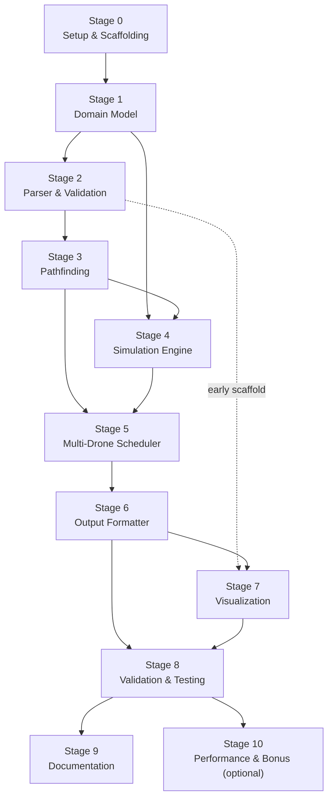
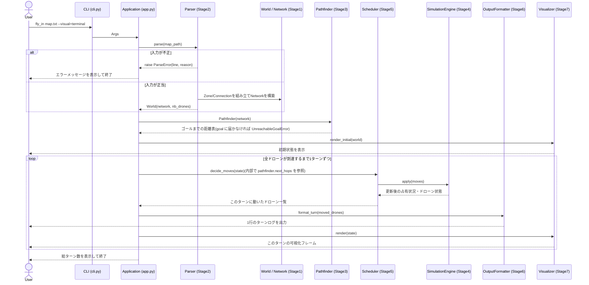

# ワークフロー: 全体実装(全ステージ)

- 日付: 2026-09-17
- 依頼内容: 「全体の実装に対し各ステージが何を行うか」のワークフローを作成する
- 位置づけ: `2026-09-05_implementation-plan.md`(ステージ分解・依存関係・マイルストーン)を土台に、
  各ステージを「入力 → 作業 → 完了条件」の形式に再構成したもの。ステージ分解自体を変更するものではない。
  Stage 1 単体の詳細ワークフローは `2026-09-17_workflow-stage1-domain-model.md` を参照。

## 全体依存関係図

## 実行時の挙動シーケンス図(ビルド順ではなく実際の呼び出し順)

上の依存関係図は「どのステージを先に作るべきか」という開発順序を表す。
以下は逆に、完成後のプログラムを実際に1回実行したときに各ステージのコンポーネントが
どう呼び合うか(ランタイムの挙動)を示す。

## 読み方

各ステージについて以下を記す。

- **入力**: そのステージが着手する前提として存在しているべきもの
- **作業**: そのステージで行う具体的な作業
- **完了条件(Done)**: 次のステージに進んでよいと判断できる状態
- **依存**: 先行して完了している必要があるステージ

---

## Stage 0 — Setup & Scaffolding

- 入力: 課題PDF(`fly_in.pdf`)、cc_space共通ルール
- 作業:
  - リポジトリルート直下に提出物一式を配置できる構成を作る
  - `Makefile`(install / run / debug / clean / lint / lint-strict任意)を用意
  - `.gitignore`、仮想環境設定を用意
- 完了条件: ドメインコードが一切なくても、共通ルール(章III)の非機能要件(Makefile等)を満たしている
- 依存: —

## Stage 1 — Domain Model (OOP)

- 入力: Stage 0 の環境、章VI(入力フォーマット)・章VII.2/3(占有・移動ルール)の要件
- 作業:
  - `Zone` / `ZoneType` / `ZoneRole`、`Connection`、`Drone` / `DroneStatus`、`Network`、`World` を実装
  - グラフ系ライブラリを使わず、`Network` の隣接構造を手組みする
  - 型ヒント・docstringを全メソッドに付与し、mypy --strict / flake8 に通す
- 完了条件: 全モデルクラスが `NotImplementedError` なしで動作し、単体でインスタンス化・属性アクセスができる
  (パーサやシミュレーションからの利用はまだ発生しない)
- 依存: Stage 0

## Stage 2 — Parser & Validation

- 入力: Stage 1 のドメインモデル一式、章VI(入力フォーマット)・章VII.4(パーサ制約)
- 作業:
  - マップファイルを読み込み、`World`(`Network` + `nb_drones`)を構築するクラスを実装
  - 章VII.4の全制約(start/end一意性、名前重複、接続重複、ゾーンタイプ妥当性、容量の正整数性 等)を検証
  - 不正入力は行番号付きの `ParseError` で停止させる(未処理例外でクラッシュさせない)
- 完了条件: 提供マップ(easy/medium/hard/challenger)全てが例外なくパースでき、
  意図的に壊したマップ(重複名・重複接続・start/end欠落等)で期待通り `ParseError` が出る
- 依存: Stage 1

## Stage 3 — Pathfinding

- 入力: Stage 2 で構築された `Network`
- 作業:
  - グラフライブラリを使わない手組みの重み付き探索(Dijkstra/BFS系)を実装
  - エッジ重み = 移動先ゾーンのコスト(normal/priority=1, restricted=2, blocked除外)
  - 同コスト時はpriorityゾーンを優先。後段の負荷分散のため複数候補経路を返す
- 完了条件: start→endの経路が、blockedを避けコストを正しく反映した形で計算できる
  (この時点ではまだ複数ドローンの競合・容量は考慮しない)
- 依存: Stage 2
- 2026-10-16更新: 複数候補経路の列挙(`find_k_paths`)はやめ、goal からのダイクストラで全ゾーンの距離を
  1回求め、ゾーンごとの「最短の次の一手」の候補(priority は同距離時のみ先頭)を返す形にした。
  負荷分散は、Stage 5 が毎ターン候補の中から空いている先を選ぶことで行う。到達不能はここで検出する。
  詳細は `2026-10-16_workflow-stage3-pathfinding.md` と `docs/decisions.md` を参照

## Stage 4 — Simulation Engine

- 入力: Stage 1 のドローン/ゾーン/接続モデル、Stage 3 の経路
- 作業:
  - ターン単位で世界を1手ずつ進めるエンジンを実装
  - ゾーン占有数・接続通過数のターンごとのカウンタ管理(退出が入場より先に空きを作る)
  - restricted接続の「入ったら次ターン必ず到着、経路上待機不可」を実装
  - start/endはmax_drones制限の対象外にする
- 完了条件: 単一ドローンをstartからendまで、容量・restrictedのルールを守って1体だけ動かせる
- 依存: Stage 1, Stage 3
- 2026-10-16更新: スケジューラは「ドローン d をゾーン z へ」という指示(`MoveOrder`)だけを返し、エンジン
  (`TurnResolver`)がルールを検査して出力用の `Move` を作る(restricted は接続名で出力し、次ターンの到着を自動で足す)。
  restricted の到着先は出発時に予約する。誰も動かないターンとターン数の上限超えは `SimulationError`。
  詳細は `2026-10-16_workflow-stage4-simulation.md` と `docs/decisions.md` を参照

## Stage 5 — Multi-Drone Scheduler

- 入力: Stage 4 のシミュレーションエンジン、Stage 3 の距離表と次の一手の候補(2026-10-16更新)
- 作業:
  - 複数ドローンを(重複/非重複の)複数経路に配分し、同時スループットを最大化する
  - ゾーン/リンク容量の競合・デッドロック(相互待ち)を解消する
  - どの合法手を取ってもターン数が減らない場合の戦略的待機を選択する
- 完了条件: 提供マップの `nb_drones` 全数が、ルール違反なく全員endに到達するまでシミュレーションできる
- 依存: Stage 3, Stage 4
- 2026-10-17更新: 経路の事前配分や戦略的な迂回はせず、ユーザーの設計どおり毎ターン「飛行中は指示なし →
  ゴールに近い順(同じ距離なら優先ルート上のドローンを先、次にID順)」に判断し、`next_hops`(最短の一手)の中で空きのある最初の候補へ進める。
  空きは `TurnResolver` と同じ規則の台帳(`TurnLedger`)で数える。距離が単調に減る移動だけなのでデッドロックは起きない。
  詳細は `2026-10-17_workflow-stage5-scheduler.md` と `docs/decisions.md` を参照

## Stage 6 — Output Formatter

- 入力: Stage 5 が生成するターンごとの移動記録
- 作業:
  - 1ターン1行、そのターンに動いたドローンのみ `D<ID>-<zone>`(または飛行中は `D<ID>-<connection>`)で列挙
  - 配達済みドローンは以降の行から除外
- 完了条件: 課題指定の出力フォーマットに完全一致するログが得られる
- 依存: Stage 5(ただし入力は `Move` のみのため、2026-10-03に実装順をStage 3〜5より先行へ変更。
  詳細は `2026-10-03_workflow-stage6-output-formatter.md` と `docs/decisions.md` を参照)

## Stage 7 — Visualization

- 入力: 早期スキャフォールドはStage 2(色・座標メタデータ)、本稼働はStage 6(ターンごとの実データ)
- 作業:
  - ターミナルカラー表示 and/or グラフィカル表示の土台を先に作る(Stage 2後すぐ着手可能)
  - Stage 6完成後、ターンごとのドローン位置・ゾーン充填率を実データで描画する
- 完了条件: シミュレーションの進行が目視で確認できる(静止画/アニメーションいずれでも可)
- 依存: Stage 2(早期スキャフォールド), Stage 6(実データ連携)
- 2026-10-17更新: ターミナル(ANSI カラー、stderr に出力)とグラフィカル(pygame-ce)の両方を作り、`CompositeVisualizer` で
  両方を同時に使えるようにする。`Visualizer` は `begin(state)` / `render(state, moves)` / `close()` の3つにし、
  エンジンが開始時・毎ターン・終了時(エラーでも)に呼ぶ。上の実行時シーケンス図の `render_initial(world)` は
  `begin(state)` にあたる。stdout はターンログだけのまま。
  詳細は `2026-10-17_workflow-stage7-visualization.md` と `docs/decisions.md` を参照

## Stage 8 — Validation & Testing

- 入力: Stage 6/7 まで完成した一連のパイプライン
- 作業:
  - 提供マップ全種(easy/medium/hard/challenger)を実行
  - エッジケース用の自作マップ(不正メタデータ、重複接続、start/end欠落、容量0等)を作成し検証
  - 最終状態だけでなく、ターンごとにルール違反ゼロであることを確認
- 完了条件: 提供マップ+自作エッジケースマップの双方で、ルール違反なしに完走することを確認済み
- 依存: Stage 6, Stage 7

## Stage 9 — Documentation

- 入力: Stage 8までの完成物、`docs/decisions.md` / `docs/bugs.md` の蓄積
- 作業:
  - README.md(イタリック42表記、Description/Instructions/Resources+AI利用開示、
    アルゴリズム根拠、可視化説明、入出力例)を英語で作成
  - `docs/decisions.md` / `docs/bugs.md` を実装の実態と突き合わせて整合させる
- 完了条件: 章VIII(README要件)を満たすREADME.mdが `main` に存在する
- 依存: Stage 8

## Stage 10 — Performance & Bonus(任意)

- 入力: Stage 8で全マップが完走している状態
- 作業:
  - Easy<10 / Medium 10-30 / Hard<60ターンのベンチマークを目指しチューニング
  - 余力があればChallenger map(Impossible Dream, 45ターン参考記録)の更新を狙う
- 完了条件: 必須要件を満たした上で、各難易度のベンチマークを満たす(または上回る)
- 依存: Stage 8

---

## 継続的に守る事項(ステージを問わず)

- `flake8` + `mypy --strict` をStage 1以降常に通す
- `docs/decisions.md` / `docs/bugs.md` を都度更新し、レビュー前後に必ず参照する
