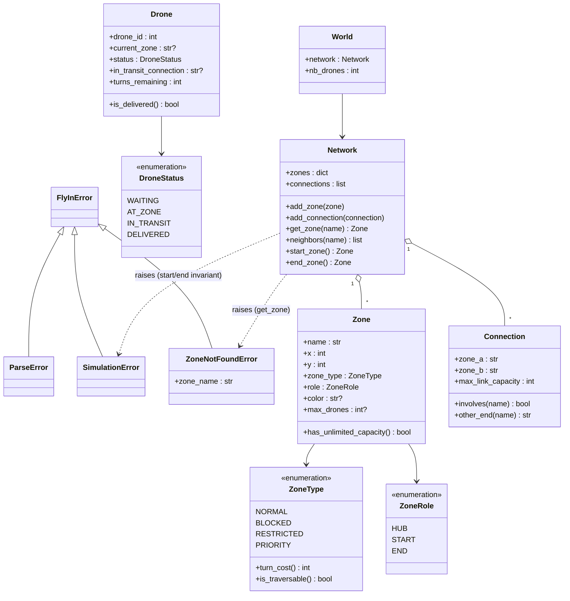
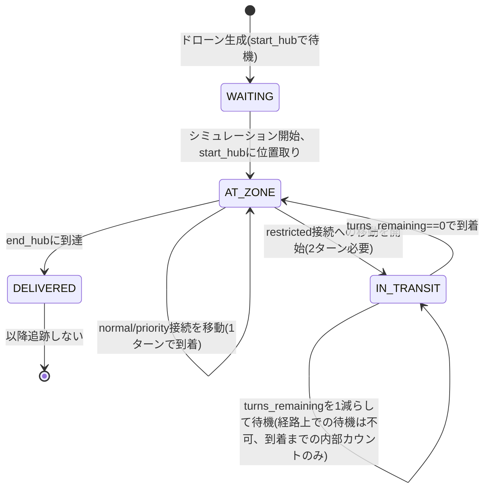
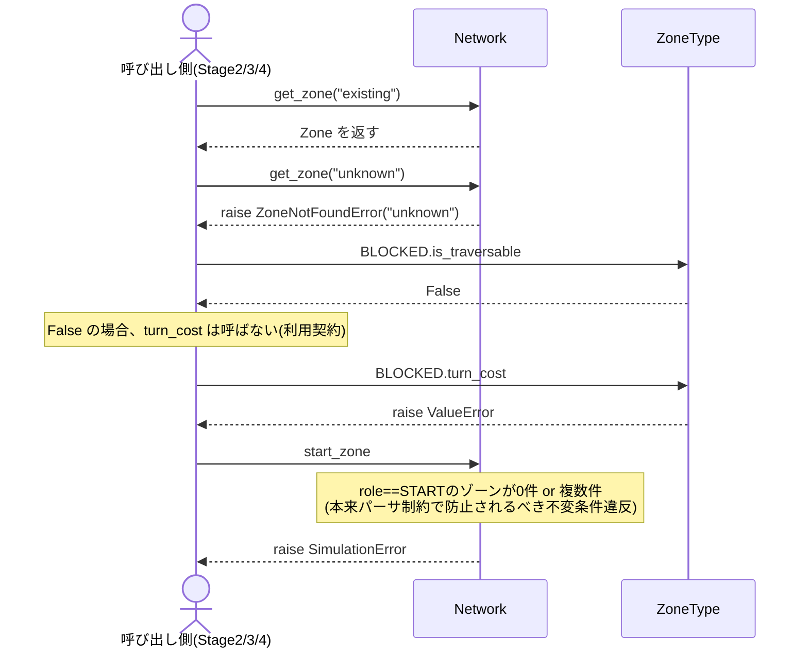

# ワークフロー: Stage 1(Domain Model)詳細

- 日付: 2026-09-17
- 依頼内容: 「ステージ1は何を行うか」のワークフローを作成する
- 前提: `docs/research/2026-09-17_workflow-all-stages.md` のStage 1を詳細化したもの。
  設計判断の根拠は `docs/decisions.md` の「2026-09-17: Stage 1(Domain Model)の設計方針3点」
  および「補足: get_zone / start_zone / end_zone の使い分け」を参照。

## ゴール

以降の全ステージ(パーサ・経路探索・シミュレーション)が共通して使う、型安全な語彙(ドメインモデル)を定義する。
このステージ単体では「マップを読む」「経路を探す」処理は行わない —
純粋にクラスの形と不変条件だけを完成させる。

## 対象ファイル(既存スケルトン、`droneflow/models/`)

現状は全メソッドが `raise NotImplementedError` のスケルトンのみ存在する状態。

| ファイル | 内容 |
|---|---|
| `zone.py` | `ZoneType`(enum)、`ZoneRole`(enum)、`Zone`(dataclass) |
| `connection.py` | `Connection`(dataclass) |
| `drone.py` | `DroneStatus`(enum)、`Drone`(dataclass) |
| `network.py` | `Network`(手組みグラフ構造) |
| `world.py` | `World`(dataclass、実装済み・変更不要見込み) |
| `errors.py`(`models/`外、`droneflow/`直下) | 本ステージの決定に伴い `ZoneNotFoundError` を追加 |

## クラス構成図

## 実際の挙動(ランタイムでの振る舞い)

上のクラス図は「型として何を持つか」という静的構造。以下はStage 1のオブジェクトが
実行時にどう振る舞うかを示す。Stage 1自体はマップ読み込みやターン進行を行わないため、
ここでの「挙動」は (a) `Drone` のライフサイクル(状態遷移)、(b) 各クラスが持つ
例外契約(呼び出し方によって何が起きるか)の2つに限られる。

### (a) Drone のライフサイクル(状態遷移)

`current_zone` / `in_transit_connection` / `turns_remaining` は状態ごとに意味が変わるため、
実際に「今何が起きているか」は状態遷移として理解する必要がある
(遷移の駆動元はStage 4のシミュレーションエンジンだが、状態自体はStage 1で定義する)。

### (b) 例外契約(呼び出し方に対する実際の応答)

`Network` / `ZoneType` は「正しく使えば動くが、契約を破ると即座に例外で落ちる」設計
(`docs/decisions.md` の2026-09-17決定に対応)。実装完了の確認は、このシーケンス通りに
動くかどうかで行う。

## 作業項目

### 1. `errors.py` への例外追加

- `ZoneNotFoundError(FlyInError)` を新設(`zone_name: str` 属性)。`ParseError` と `SimulationError` の間に配置。
- `start_zone` / `end_zone` の異常時は新規例外を作らず、既存の `SimulationError` を使う。

### 2. `zone.py`

- `ZoneType.turn_cost`
  - `NORMAL` / `PRIORITY` → `1`
  - `RESTRICTED` → `2`
  - `BLOCKED` → **呼び出し禁止**。`ValueError` を送出する(コストという概念が存在しないため)。
- `ZoneType.is_traversable`
  - `BLOCKED` のみ `False`、他は `True`。
  - 利用契約: 呼び出し側は `turn_cost` を呼ぶ前に必ずこれを確認する。
- `Zone.has_unlimited_capacity`
  - `role` が `ZoneRole.START` または `ZoneRole.END` なら `True`。

### 3. `connection.py`

- `Connection.involves(zone_name)`: `zone_a` または `zone_b` と一致するかを返す。
- `Connection.other_end(zone_name)`: 一致した側と反対の端を返す。
  - 両端どちらとも一致しない場合の挙動は未決定 — 実装時に発生し得るなら `ValueError` を検討
    (`Network`側の呼び出し契約次第で不要になる可能性もあるため、Stage 2実装時に再検討)。

### 4. `drone.py`

- `Drone.is_delivered`: `status == DroneStatus.DELIVERED` を返すだけの単純な判定。

### 5. `network.py`

- `Network` は無防備な入れ物(決定済み)。以下は一切ガードしない:
  - ゾーン名の重複
  - 接続の重複(a-b と b-a)
  - start_hub / end_hub の一意性
  - これらは全てStage 2(パーサ)側の責務として先送りする。
- `add_zone(zone)`: `self.zones[zone.name] = zone` するだけ。
- `add_connection(connection)`: `self.connections` への追加、および `_adjacency` の両端エントリへの追加。
- `get_zone(name)`: 見つからなければ `ZoneNotFoundError(name)` を送出。
- `neighbors(name)`: `_adjacency.get(name, [])` 相当。
- `start_zone` / `end_zone`: `zones.values()` を `role` で走査。
  0件・複数件は本来パーサ制約で防がれるべき不変条件違反 → `SimulationError` を送出する防御的チェック。

### 6. `world.py`

- 現状 `dataclass` として完成しているため、Stage 1では変更不要見込み。
  Stage 2でパーサが `World` を組み立てる際に、フィールド追加の要否のみ再確認する。

## 明示的にやらないこと(スコープ外)

- マップファイルの読み込み・パース(Stage 2)
- 経路探索アルゴリズム(Stage 3)
- ターン進行・占有カウンタ管理(Stage 4)
- 「重複名はエラーにする」等の入力バリデーション(Stage 2の責務。Stage 1では検証ロジック自体を書かない)

## 完了条件(Done)

- `droneflow/models/` 配下の全メソッドから `NotImplementedError` が消えている。
- `flake8` と `mypy --strict` がエラーなしで通る。
- 各クラスを手動でインスタンス化し、以下が期待通り動作することを確認できる:
  - `ZoneType.BLOCKED.turn_cost` が `ValueError` を送出する
  - `Zone(role=ZoneRole.START, ...).has_unlimited_capacity` が `True`
  - `Network` に未登録のゾーン名で `get_zone` を呼ぶと `ZoneNotFoundError` が送出される
  - `start_zone` / `end_zone` を、start/endを登録していない状態の `Network` で呼ぶと `SimulationError` が送出される
- パーサ(Stage 2)からの利用を一切想定した実装(先回りしたバリデーション等)を混入させていない。

## レビュー時の確認事項

- `docs/decisions.md` の当該日付エントリと実装が食い違っていないか。
- `Network` にバリデーションロジックが紛れ込んでいないか(Stage 2との責務境界の逸脱チェック)。
