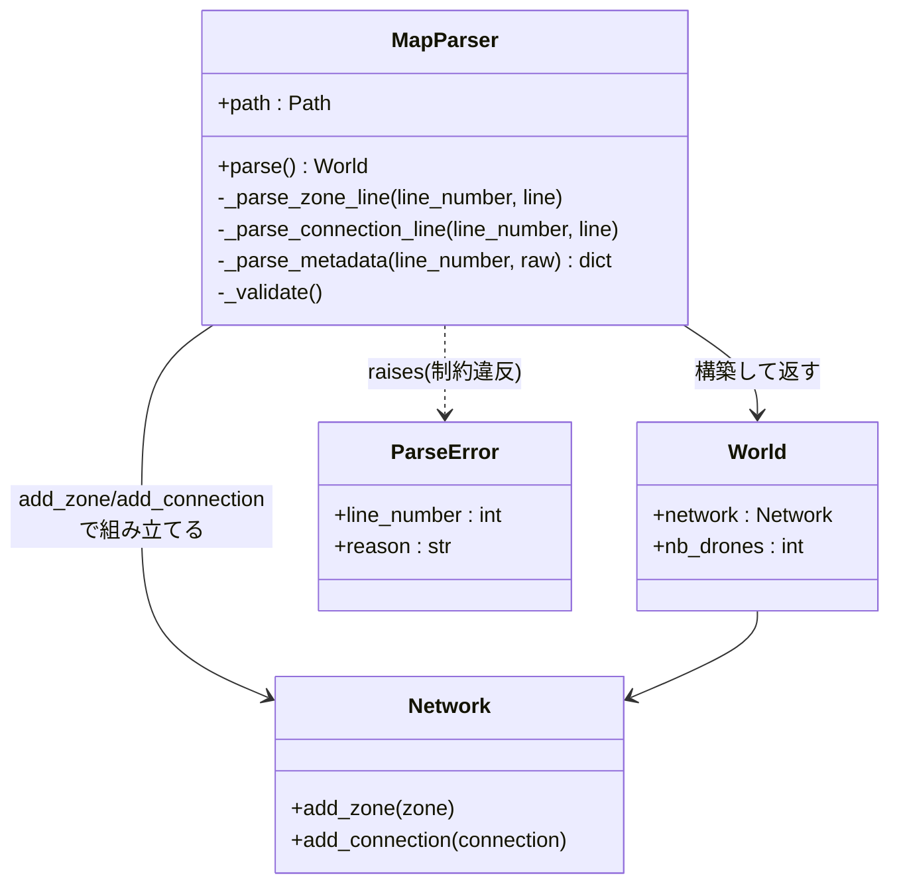
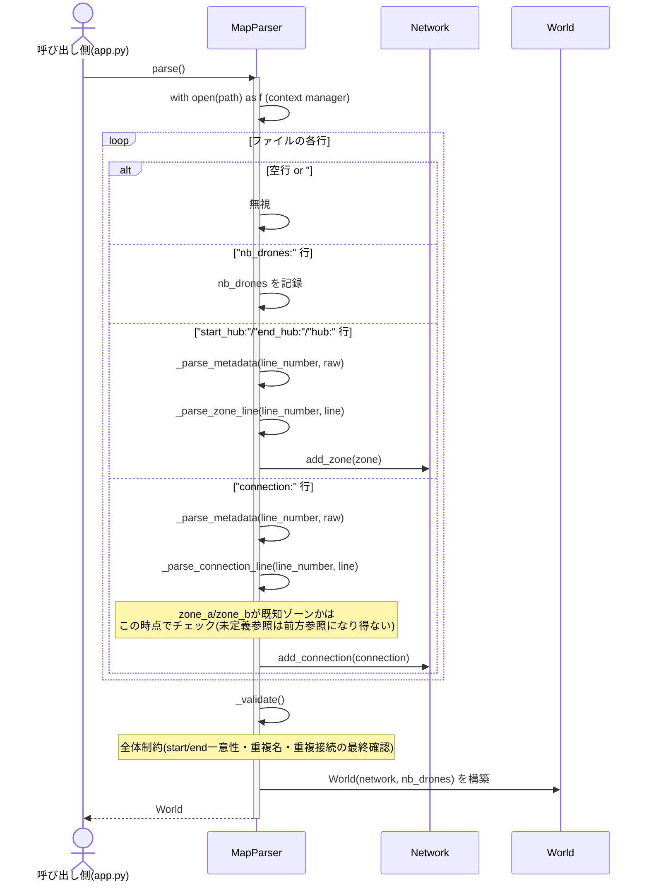
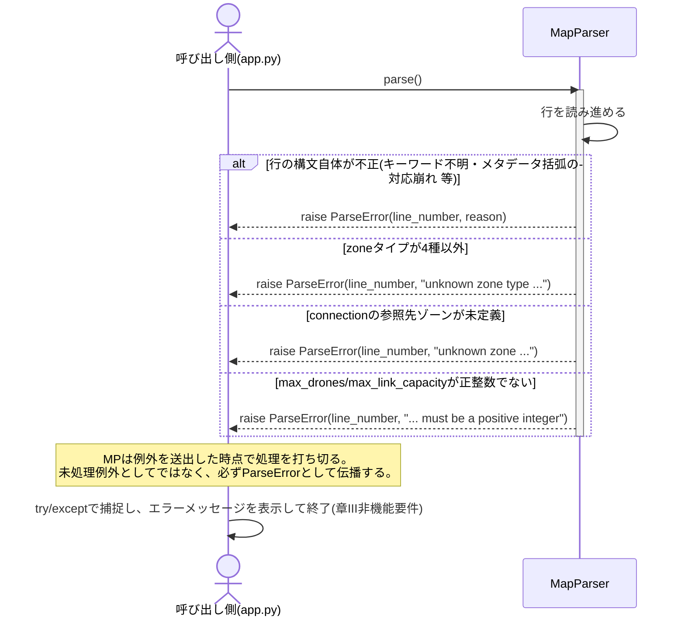

# ワークフロー: Stage 2(Parser & Validation)詳細

- 日付: 2026-09-17
- 依頼内容: 「ステージ2の実装をはじめる」にあたり、着手前の設計整理を行う
- 前提:
  - `docs/research/2026-09-17_workflow-all-stages.md` のStage 2を詳細化したもの。
  - 要件の一次情報は `docs/research/2026-09-05_parser-requirements.md`(章VI・章VII.4の抜き出し)。
  - Stage 1の設計判断(`docs/decisions.md`)を前提とする。特に「Networkは無防備な入れ物、
    重複名・重複接続・start/end一意性の検証は全てStage 2の責務」という分担が本ステージの出発点になる。

## ゴール

マップテキストファイルを読み込み、章VII.4の全パーサ制約を検証したうえで、
Stage 1のドメインモデル(`Zone` / `Connection` / `Network` / `World`)を組み立てる。
不正入力は必ず行番号付きの `ParseError` にして、未処理例外でクラッシュさせない。

## 対象ファイル(既存スケルトン)

| ファイル | 内容 | 状態 |
|---|---|---|
| `droneflow/parsing/map_parser.py` | `MapParser` クラス本体 | 全メソッド `NotImplementedError` |
| `droneflow/errors.py` | `ParseError(line_number, reason)` | Stage 1で実装済み、変更不要見込み |
| `droneflow/models/*` | `Zone` / `Connection` / `Network` / `World` | Stage 1で実装済み |

## 責務の構造(クラス図)

`MapParser` は自分の中に「まだ検証しきれていない一時状態」を持つ必要がある
(例: 全ゾーンを読み終わるまでは重複名も接続の参照先妥当性も確定できない)。
スケルトンのメソッド分割から見て、少なくとも以下の一時状態を `__init__` 以降に持つことになる。

- 読み込み済みゾーン名の集合(重複検出・接続の参照先チェック用)
- 読み込み済み接続の `frozenset({zone_a, zone_b})` の集合(`a-b`/`b-a` の重複検出用)
- `start_hub` / `end_hub` の出現回数
- 構築中の `Network`、`nb_drones` の値

## 実際の挙動(ランタイムでの振る舞い)

### (a) 正常系: 1行ずつ読みながら `Network` を組み立てる

### (b) 異常系: 制約違反はその場で `ParseError` にして止める

行単位でチェックできるもの(構文・型・値域)はその行の処理中に即座に `ParseError` を出す一方、
「ファイル全体を読み終えないと判定できない制約」(ゾーン名の重複、`start_hub`/`end_hub` の出現数、
接続の重複)は `_validate()` に集約する、という2段構えになる。

## 作業項目

### 1. 行のトークン化と種別判定

- `nb_drones:` / `start_hub:` / `end_hub:` / `hub:` / `connection:` / 空行 / `#`コメント の判定。
- 上記いずれにも一致しない行は構文エラーとして `ParseError`。

### 2. `_parse_metadata`

- `[key=value key=value ...]` を `dict[str, str]` にする。
- 対象キーは `zone` / `color` / `max_drones`(ゾーン側)、`max_link_capacity`(接続側)。
- 不正な形式(閉じ括弧なし、`=`なしのトークン等)は `ParseError`。
- 未知のキーが来た場合の扱いは要件に明記がないため、要検討(下記オープン質問を参照)。

### 3. `_parse_zone_line`

- `<keyword>: <name> <x> <y> [metadata]` の分解。
- `name` にダッシュ・スペースが含まれていないかチェック。
- `x`/`y` が整数に変換できるかチェック。
- メタデータの `zone=` を `ZoneType` に変換(4種以外は `ParseError`)。
- `start_hub`/`end_hub` の場合、`max_drones` 指定を無視して `None` に正規化(`docs/decisions.md` 2026-09-17決定済み)。
- `Zone` を組み立てて `Network.add_zone` に渡す。
- 重複名チェックは行単位でも可能(既知ゾーン名集合との照合)だが、
  「行単位でエラーにするか `_validate()` に回すか」は設計判断が必要(下記オープン質問)。

### 4. `_parse_connection_line`

- `<name1>-<name2> [metadata]` の分解。
- `name1`/`name2` が既に登録済みのゾーンか確認(未定義なら `ParseError`)。
- `max_link_capacity` の正整数チェック。
- 重複接続(`a-b` と `b-a`)の検出は `frozenset({a, b})` の集合で判定。

### 5. `_validate`

- `nb_drones` が正の整数として設定されているか。
- `start_hub` / `end_hub` がそれぞれちょうど1つか。
- (行単位で先送りした場合)ゾーン名の重複、接続の重複の最終確認。

### 6. `parse` 本体

- `with open(self.path) as f:` でファイルを開く(章III: リソース管理)。
- 各行を読みつつ上記メソッド群を呼び出し、最後に `_validate()` → `World` を返す。

## 設計質問(決着済み。決定内容・理由は `docs/decisions.md` の
「2026-09-17: Stage 2(Parser)着手前の設計質問4点」を参照)

1. **重複検出のタイミング** → 行単位で即座に `ParseError`。`_validate()` は
   「start/end の個数」のように全体を見ないと判定できない制約だけに絞る。
2. **メタデータの未知キー** → `ParseError` にする(タイポ・仕様外キーの早期検知を優先)。
3. **`Connection.other_end` の`ValueError`との関係** → パーサは `connection: a-b` を
   `Connection(zone_a="a", zone_b="b")` として組み立てるだけで `other_end` を呼ぶ必要がない。
   Stage 3/4(経路探索・シミュレーション)側の関心事として持ち越し。
4. **座標の重複・同一座標** → 許可する(検証しない)。要件にない制約を独自に追加しない。
5. **`connection:` の自己ループ(`a-a`)** → 許可する(検証しない)。ただしStage 3/4が
   自己ループを実際にどう扱うか(無限ループの原因にしない設計か)は別途要検討。

## 明示的にやらないこと(スコープ外)

- 経路探索(Stage 3)。パーサは `Network` を組み立てるだけで、到達可能性は検証しない
  (start-end間に経路が存在しない壊れたマップも、パーサ制約さえ満たせば `ParseError` にはしない)。
- ターン進行・占有カウンタ管理(Stage 4)。
- 提供マップ(easy/medium/hard/challenger)の展開・実行(`maps.tar.gz` は未展開)。

## 完了条件(Done)

- `droneflow/parsing/map_parser.py` の全メソッドから `NotImplementedError` が消えている。
- `flake8` と `mypy --strict` がエラーなしで通る。
- 提供マップ(easy/medium/hard/challenger、`maps.tar.gz` を展開したもの)全てが例外なくパースできる。
- 意図的に壊した自作マップ(重複名・重複接続・start/end欠落・start/end重複・不正ゾーンタイプ・
  不正メタデータ・非正整数の容量・未定義ゾーンへの接続参照)で、それぞれ期待通り
  `ParseError` が行番号付きで送出される。

## レビュー時の確認事項

- `docs/decisions.md` の該当エントリ(Stage 1の3決定、start/end hubのmax_drones正規化)と実装が
  食い違っていないか。
- 上記「オープンな設計質問」がどう解決されたか(`docs/decisions.md` に追記されているか)。
- `Network`側にバリデーションロジックが漏れ出していないか(Stage 1との責務境界)。
- `docs/bugs.md` に記録すべき不整合が残っていないか。
