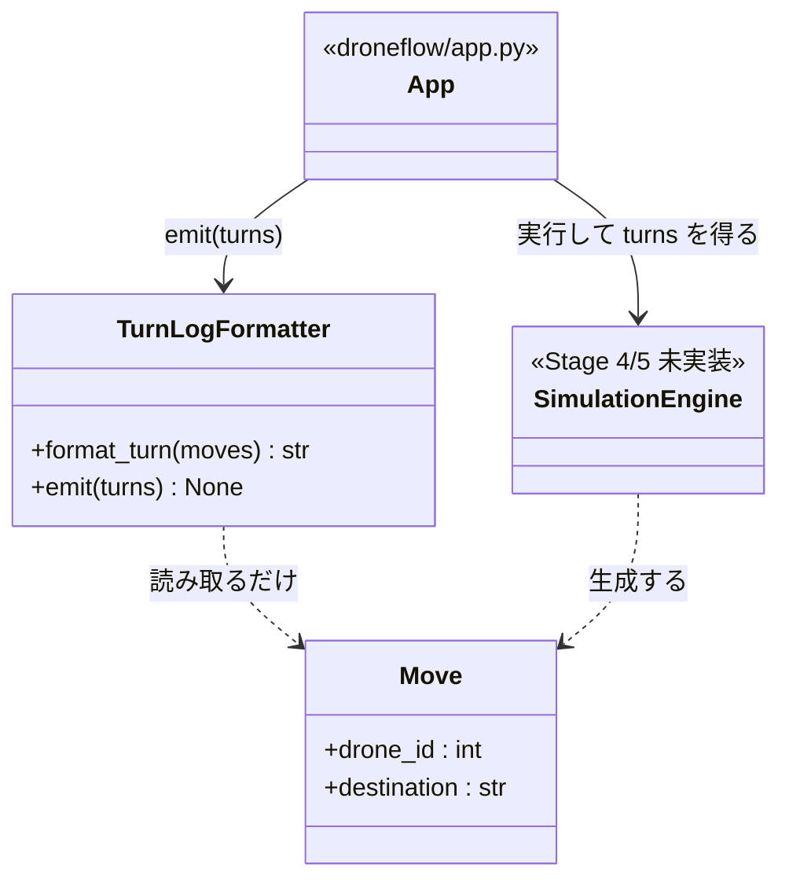
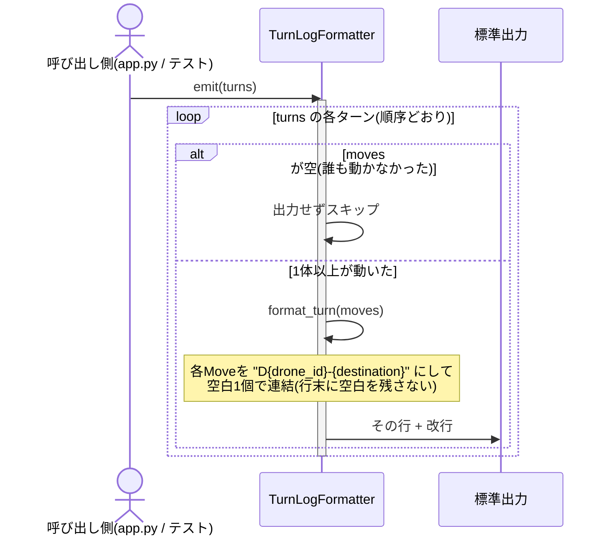

# ワークフロー: Stage 6(Output Formatter)詳細

- 日付: 2026-10-03
- 依頼内容: 「出力・表示のフェーズを先に行う」にあたり、Stage 6 の着手前の設計整理を行う
- 前提:
  - `docs/research/2026-09-17_workflow-all-stages.md` のStage 6を詳細化したもの。
  - 実装順を「Stage 3〜5より先にStage 6」に変更する(`docs/decisions.md` 2026-10-03「Stage 6を先行」参照)。
  - 出力フォーマットの一次情報は課題要件(`docs/research/2026-09-05_foreword-ja-and-requirements.md` 章VII)。

## ゴール

シミュレーションが生成するターンごとの移動記録(`list[list[Move]]`)を、課題指定の
1ターン1行フォーマット(`D<ID>-<行き先>` を空白区切りで列挙)の文字列にして標準出力へ出す。
入力は `Move` のリストだけなので、経路探索・スケジューラが未実装でも、手作りの `Move` で
完結してテストできる。

## 対象ファイル(既存スケルトン)

| ファイル | 内容 | 状態 |
|---|---|---|
| `droneflow/output/formatter.py` | `TurnLogFormatter`(`format_turn` / `emit`) | 全メソッド `NotImplementedError` |
| `droneflow/simulation/state.py` | `Move(drone_id, destination)` | 実装済み(dataclass) |

`Move.destination` は「行き先ゾーン名」、または「restricted接続に入った直後は接続名」を保持する
(docstringの契約)。フォーマッタはこの文字列を**解釈せずそのまま連結する**だけで、
ゾーンか接続かの区別は上流(Stage 4/5)の責務とする。

## 責務の構造(クラス図)

`TurnLogFormatter` は状態を持たない(インスタンス変数なし)。`Network` やゾーン情報にも依存しない。
依存は `Move` のみで、これが「先行実装できる」根拠になる。

## 実際の挙動(ランタイムでの振る舞い)

### (a) 正常系: 1ターン=1行で出力する

### (b) 出力の例(restricted接続の遷移を含む)

| ターン | `moves`(drone_id, destination) | 出力行 |
|---|---|---|
| 1 | (1, `roof1`), (2, `corridorA`) | `D1-roof1 D2-corridorA` |
| 2 | (2, `goal`) | `D2-goal` |
| 3 | (なし) | (出力されない) |

`D2-corridorA` は、D2がrestricted接続に入った直後の「飛行中」を表す(`destination` が接続名)。
翌ターンに到着先ゾーン名で現れる。配達済みドローンは以降 `Move` を生成しないため、
フォーマッタ側で除外処理を持つ必要はない(上流が動いたドローンの `Move` だけを渡す契約)。

### (c) 異常系

フォーマッタは入力を検証しない。不正な `Move`(drone_idが負、destinationが空文字 等)を
渡された場合の扱いは契約外(そのまま文字列化する)。上流が責任を持つ。
`FlyInError` 系の例外は送出しない。

## 作業項目

### 1. `format_turn`

- `list[Move]` → `"D1-roof1 D2-corridorA"` のような1行文字列。
- 空リストが渡された場合は空文字を返す(`emit` が事前にスキップするので通常は呼ばれない)。

### 2. `emit`

- 各ターンについて、空ならスキップ、そうでなければ `format_turn` の結果を `print`。
- 順序はターンの並び順を保つ。

## 設計上の確認事項(決着済み。内容は `docs/decisions.md` 「Stage 6を先行」を参照)

1. **実装順** → Stage 6 を Stage 3〜5 より先にやる(依存は `Move` のみのため)。
2. **行内のドローン順** → 呼び出し側が渡した順を保つ(フォーマッタ内でソートしない)。
   ソートが必要なら上流の責務。理由は「フォーマッタを純粋な整形にとどめる」ため。
   (要件が行内順序を固定していない場合のみ。要件に順序指定があればそれに従う)
3. **空ターンの扱い** → スキップ(スケルトンの docstring どおり)。

## 明示的にやらないこと(スコープ外)

- `Move` の生成(Stage 4/5)。
- 総ターン数の表示(App 側の責務)。
- 到着済みドローンの管理(上流の責務)。
- 色付き表示・アニメーション(Stage 7)。

## 完了条件(Done)

- `formatter.py` の両メソッドから `NotImplementedError` が消えている。
- 上の出力例(正常系・restricted遷移・空ターンスキップ)が単体テストで完全一致する。
- `flake8` と `mypy --strict` がエラーなしで通る。
- テストはプロジェクトから分離した `tests/output/` に置く(`stdout` は `capsys` で検査)。

## レビュー時の確認事項

- `docs/decisions.md` の「Stage 6を先行」と実装が食い違っていないか。
- フォーマッタが `Network` / ゾーン情報に依存していないか(`Move` のみに依存する設計の維持)。
- 行末・文頭に余計な空白がないか。
- `docs/bugs.md` に記録すべき不整合が残っていないか。
