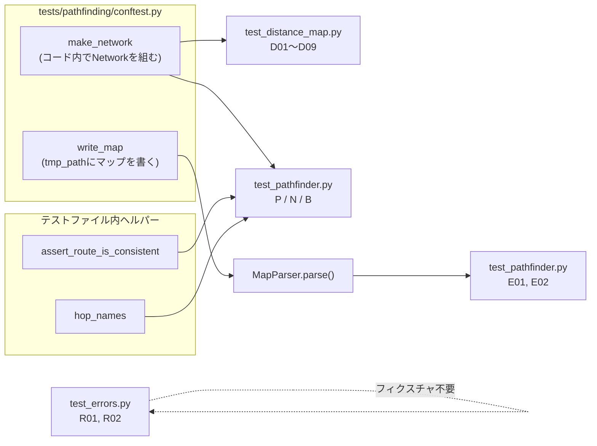

# テスト設計: Stage 3(Pathfinding)

- 日付: 2026-10-16
- フェーズ: **テスト設計**(テストコードはまだ書かない。作成は別フェーズで行う)
- 対象ブランチ: `test/stage3_pathfinding`(`feature/stage3_pathfinding` から分岐)
- 対象コード: `droneflow/pathfinding/distance_map.py`、`droneflow/pathfinding/pathfinder.py`、`droneflow/errors.py`(`UnreachableGoalError`)
- 参照した決定: `docs/decisions.md` の 2026-10-16 の各項目
  - 「goal に到達できないことは、ゴールからの距離計算で検出する」
  - 「残りステージの実装方針」3(priority は同距離のときだけ優先、遠回りなら選ばない)
  - 「Stage 3 の API をスケルトンから変更する」(`DistanceMap` / `Pathfinder` / `Hop` / `Route`、宣言順)
  - 「距離が最小の隣接ゾーン」は `turn_cost(v) + dist(v)` で比べる
  - 「到達不能は `UnreachableGoalError`、`Pathfinder` の構築時に検出」
  - 「start_hub / end_hub が `zone=blocked` のマップは到達不能」
- 参照した課題の条項: VII.3(ゾーンタイプ: normal=1ターン、restricted=2ターン、priority=1ターンで優先、blocked は進入・通過不可)、
  VII.4(マップ書式。`nb_drones` はファイルの物理的な1行目)、VII.6(総ターン数が主指標)

## 方針

- `tests/` は `droneflow/` の構成に対応させる(`tests/README.md` のとおり)。`tests/pathfinding/` を新設する。
- ネットワークは**テストコード内で組み立てる**(`Network` / `Zone` / `Connection` を直接使う)。
  パーサーを通す確認は E2E の2件だけで、`tmp_path` にマップを書き出して読む。
- `revie_case/` のファイルには**依存しない**(未追跡・読み取り専用のため)。同じ形のマップが必要な場合はテスト内に再現する。
- start/end の `zone=blocked` をパーサーで `ParseError` にする変更は別途予定されているため、ここではパーサー側のケースを設計しない。
  `Pathfinder` 単体(コード内で組んだネットワーク)の防御的な挙動だけを1件(P02-d)確認する。
- 期待値は手計算で決められる小さなネットワーク(ゾーン数 2〜7)に限る。ただし規模の確認として格子を1件(D09)入れる。

## ファイル構成

```
tests/
├── README.md                     # 作成フェーズでカバレッジ欄に Stage 3 を追記する
├── test_errors.py                # 追記: UnreachableGoalError(R01, R02)
└── pathfinding/
    ├── conftest.py               # 共有フィクスチャ: make_network, write_map
    ├── test_distance_map.py      # D01〜D09
    └── test_pathfinder.py        # P01〜P03, N01〜N11, B01〜B06, E01〜E02
```

- 既存の `tests/models/` などと同じく `__init__.py` は置かない(テストファイル名が他と重複しないので問題ない)。
- E2E(E01, E02)は `Pathfinder` の結果を見るテストなので `test_pathfinder.py` に置く。

## 共有フィクスチャ・ヘルパー(`tests/pathfinding/conftest.py`)

### `make_network`(ファクトリ・フィクスチャ)

小さなネットワークを1行で組み立てるための関数を返す。想定シグネチャ:

```
make_network(
    edges: str,                                   # 例: "s-a a-g s-b b-g"(空白区切り、書いた順が接続の宣言順)
    types: dict[str, ZoneType] | None = None,     # 省略したゾーンは NORMAL
    start: str = "s",
    end: str = "g",
    isolated: tuple[str, ...] = (),               # 接続を持たないゾーン
) -> Network
```

- `edges` に現れた名前と `isolated` の名前からゾーンを作る。`start` は `ZoneRole.START`、`end` は `ZoneRole.END`、他は `HUB`。
- ゾーン登録順は「初出順」、接続登録順は `edges` の記述順(= `next_hops` の宣言順の検証に使う)。
- 自己ループ `a-a` も書けるようにする(パーサーも自己ループを許容している: decisions 2026-09-17)。
- `edges=""` で接続ゼロのネットワークも作れる(このとき start/end は `isolated` で渡すか、自動で作る)。
- 座標・色・容量は経路探索に関係しないので固定値(`x=0, y=0`、容量既定値)でよい。

### `write_map`(フィクスチャ)

`tmp_path` にマップ文字列を書き出してパスを返す(`tests/parsing/test_map_parser.py` の `write_map` と同じ役割)。
**マップ文字列の1行目は必ず `nb_drones: <n>`** にする(decisions 2026-10-16「物理的な1行目」)。

### 検証用ヘルパー(テストファイル内の関数)

- `assert_route_is_consistent(network, route)`: B06 と N11 で使う。
  1. `route.zones[-1]` が end、2. 隣り合うゾーンの間に接続がある、3. 同じゾーンが2回現れない、
  4. `route.total_cost == sum(turn_cost(z) for z in zones[1:])`、5. `route.total_cost == distance(zones[0])`。
- `hop_names(hops)`: `[hop.zone.name for hop in hops]`。順序の比較に使う。



## ケース一覧

表記: `s-a a-g` は接続(記述順)。`r` = RESTRICTED、`p`/`q` = PRIORITY、`x` = BLOCKED、それ以外は NORMAL(明記がない限り)。
`dist(z)` は `distance(z)`。

### DistanceMap(`tests/pathfinding/test_distance_map.py`)

| ID | 対象 | セットアップ(マップの形) | 期待結果 | 意義・守る決定/条項 |
|---|---|---|---|---|
| D01 | `distance` 基本 | `s-a a-g` | `dist(g)=0`, `dist(a)=1`, `dist(s)=2` | 正常系の基準。end 自身は 0(docstring の契約) |
| D02 | ゾーンタイプ別の進入コスト | `s-r r-g`(r=restricted)と、別ネットワーク `s-p p-g`(p=priority) | 前者 `dist(r)=1`, `dist(s)=3`。後者 `dist(p)=1`, `dist(s)=2` | 「進入するゾーンのコストを足す」向きが正しいこと(VII.3: restricted=2, priority=1)。逆向きに足すと `dist(r)=2, dist(s)=3` で r の値がずれる |
| D03 | restricted な end | `s-a a-g`、g=restricted | `dist(g)=0`, `dist(a)=2`, `dist(s)=3` | end に入る分の2ターンが数えられること(Dijkstra の初手で end の `turn_cost` を使う箇所) |
| D04 | blocked は距離なし・通過不可 | `s-x x-g s-a a-b b-g`(x=blocked) | `dist(x) is None`、`dist(s)=3`(x 経由の 2 にならない) | VII.3「blocked は進入も通過もできない」、decisions「blocked zones get no distance」 |
| D05 | 行き止まりと孤立ゾーン | `s-a a-g s-d`、孤立ゾーン `z` | `dist(d)=dist(s)+1=3`、`dist(z) is None`、`dist(s)=2` | 最短経路に乗らないゾーンにも(届くなら)距離が付く/届かなければ None(decisions「到達不能は距離計算で検出」、X04 相当) |
| D06 | 自己ループ・閉路 | `s-a a-a a-b b-s a-g`(a に自己ループ、s-a-b の三角形) | 正常に終了し `dist(a)=1`, `dist(b)=2`, `dist(s)=2` | 自己ループ・閉路で無限ループや値の更新ミスが起きないこと(ユーザー確認済みの要件、パーサーも自己ループを許容) |
| D07 | 存在しない名前 | D01 のネットワーク | `distance("nope")` が `ZoneNotFoundError`、`zone_name == "nope"` | 「届かない(None)」と「存在しない(例外)」を区別する契約 |
| D08 | end が blocked(防御的) | `s-a a-g`、g=blocked(コード内で直接組む) | 例外は出さず、全ゾーン `None` | `_compute` の早期 return。`turn_cost` の `ValueError` に落ちないこと(decisions「start/end が blocked なら到達不能」) |
| D09 | 規模(格子) | 20×20 の格子、左上 s・右下 g、全 normal | 各ゾーンの距離 = g までのマンハッタン距離、`dist(s)=38`。実行が一瞬で終わる | ヒープ(`heapq`)と「古いエントリを捨てる」分岐が多くの更新でも正しいこと(評価シート: 大規模グラフ) |

### Pathfinder の構築(`tests/pathfinding/test_pathfinder.py`)

| ID | 対象 | セットアップ | 期待結果 | 意義・守る決定/条項 |
|---|---|---|---|---|
| P01 | 構築と `distance` の委譲 | `s-a a-g s-r r-g`(r=restricted) | 例外なく構築。全ゾーンで `Pathfinder.distance(z) == DistanceMap(net).distance(z)`。未知名は `ZoneNotFoundError` | decisions「API変更」2(`distance` は `DistanceMap` への委譲) |
| P02 | 到達不能の各パターン(parametrize) | a) 非連結 `s-a b-g` b) 唯一の経路が blocked `s-x x-g` c) 接続なし(s, g のみ) d) end が blocked `s-a a-g`(g=blocked、コード内のみ) | いずれも `Pathfinder(net)` が `UnreachableGoalError`、`zone_name == "s"`、`goal_name == "g"`、メッセージに `line` を含まない | decisions「到達不能は `UnreachableGoalError`、構築時に検出」「行番号なし」。X02/X03/X05 相当をコード内で再現 |
| P03 | 孤立ゾーンがあっても解ける | `s-a a-g`、孤立 `z` | 例外なく構築、`distance("z") is None` | 構築時の検査は start だけを見る(X04 相当)。他のゾーンの到達不能で落ちないこと |

### next_hops(`tests/pathfinding/test_pathfinder.py`)

| ID | 対象 | セットアップ | 期待結果 | 意義・守る決定/条項 |
|---|---|---|---|---|
| N01 | 基本と `Hop` の中身 | `s-a g-a`(2本目は end 側を zone_a として宣言) | `next_hops("s")` は1件で、`hop.connection is`(s-a の Connection)、`hop.zone is get_zone("a")`。`next_hops("a")` の `hop.zone.name == "g"`(逆向き宣言でも反対側を返す) | decisions「`Hop` に接続を含める」(Stage 5 が接続容量を引き直さないため)。`other_end` の使い方 |
| N02 | restricted と normal の見かけの同点 | `s-r r-g s-a a-g`(r=restricted、r 側を先に宣言) | `dist(r) == dist(a) == 1` だが `hop_names(next_hops("s")) == ["a"]` | **decisions「`turn_cost(v)+dist(v)` で比べる」の例そのもの**。`dist(v)` だけで比べる実装への退行を防ぐ |
| N03 | restricted が実コストで同点 | `s-r r-g s-a a-b b-g`(r=restricted) | `dist(s)=3`、`hop_names == ["r", "a"]`(両方、宣言順) | 実コストが同じなら restricted も候補に残る(除外しすぎない) |
| N04 | 宣言順 | `s-a a-g s-b b-g` と、宣言を入れ替えた `s-b b-g s-a a-g` | 前者 `["a", "b"]`、後者 `["b", "a"]` | decisions「同じ優先度の中は接続の宣言順」(名前順ではない) |
| N05 | priority のタイブレーク | `s-a a-g s-p p-g`(p=priority、normal を先に宣言) | `["p", "a"]` | decisions「同距離の候補の中でだけ priority を優先」、VII.3 |
| N06 | 遠回りの priority は選ばない | `s-p p-q q-g s-a a-g`(p, q=priority) | `["a"]` のみ(p 経由は3ターン、a 経由は2ターン) | decisions「priority 側が遠回りなら選ばない」(VII.6 総ターン数を悪化させない) |
| N07 | priority 同士・normal 同士の順序 | `s-a a-g s-p p-g s-b b-g s-q q-g`(p, q=priority) | `["p", "q", "a", "b"]` | 安定ソートであること(priority を先頭に寄せても、各グループ内の宣言順が崩れない) |
| N08 | 候補なしになる場所 | D05 のネットワーク(孤立 z)に blocked `x`(`s-x`)を追加 | `next_hops("g") == []`、`next_hops("z") == []`、`next_hops("x") == []` | docstring「goal 自身・届かないゾーンでは空」。blocked で `turn_cost` の `ValueError` が出ないこと |
| N09 | goal に隣接する blocked を候補にしない | `s-x x-g s-a a-g`(x=blocked、x を先に宣言) | `next_hops("s")` は `["a"]` | blocked 除外(VII.3)。距離 None の隣接ゾーンを飛ばす分岐 |
| N10 | 存在しない名前 | 任意 | `next_hops("nope")` が `ZoneNotFoundError` | 「空リスト」と「例外」の区別(docstring の Raises) |
| N11 | 自己ループ・閉路での不変条件 | D06 のネットワーク(自己ループ+三角形)と D09 の格子 | 全ゾーン u と全 hop について `hop.zone.name != u`、`turn_cost(hop.zone) + dist(hop.zone) == dist(u)`、同じゾーンが2回現れない | 自己ループで自分自身を返さない、閉路で「上り」の手を返さない(ユーザー確認済みの要件)。`seen` による重複除去 |
| N12 | priority は次の1手の中だけ(作成フェーズで追加) | `s-b b-c c-g s-a a-p p-g`(p=priority、b 側を先に宣言) | `["b", "a"]`、`best_route().zones == ["s","b","c","g"]` | decisions 2026-10-16「priority は次の1手の同点の中だけで優先する」。2手先の priority で並びが変わらないこと |

### best_route(`tests/pathfinding/test_pathfinder.py`)

| ID | 対象 | セットアップ | 期待結果 | 意義・守る決定/条項 |
|---|---|---|---|---|
| B01 | 基本と total_cost | a) `s-a a-g` b) `s-r r-g`(r=restricted) | a) `Route(["s","a","g"], 2)` b) `Route(["s","r","g"], 3)` | `total_cost` が「ゾーン数-1」ではなく進入コストの合計であること(VII.3) |
| B02 | priority が同点なら経路に入る | N05 のネットワーク | `zones == ["s", "p", "g"]`、`total_cost == 2` | docstring「`next_hops` の先頭を辿るので、同点なら priority を通る」 |
| B03 | `from_zone` 指定 | N03 のネットワーク | `best_route("a") == Route(["a","b","g"], 2)`、`best_route("g") == Route(["g"], 0)`、`best_route()` は start から(`zones[0] == "s"`) | 途中のゾーンから・end 自身からの境界値。省略時の既定値 |
| B04 | `from_zone` から届かない | P03 のネットワーク(孤立 z)に blocked `x`(`s-x`)を追加 | `best_route("z")` と `best_route("x")` が `UnreachableGoalError`、`zone_name` はそれぞれ `"z"` / `"x"` | decisions「`best_route(from_zone)` も届かなければ同じ例外」。構築は成功していること |
| B05 | 存在しない `from_zone` | 任意 | `ZoneNotFoundError`(`UnreachableGoalError` ではない) | 例外の種類の区別(docstring の Raises) |
| B06 | 経路の整合性 | D04, D06, N03, D09 の各ネットワーク | `assert_route_is_consistent` が全部通る(end で終わる・接続が実在・重複なし・`total_cost` = 進入コストの和 = `distance(start)`) | 個々の期待値に頼らない総合チェック。閉路・自己ループで止まらないこと |

### E2E(パーサー経由、`tests/pathfinding/test_pathfinder.py`)

| ID | 対象 | セットアップ | 期待結果 | 意義・守る決定/条項 |
|---|---|---|---|---|
| E01 | 課題の入力例 | 課題 VI 章のサンプルマップ(`nb_drones: 5` を1行目に置いたもの)を `write_map` で書き、`MapParser(path).parse().network` から `Pathfinder` を作る | 距離 `hub=3, roof1=2, corridorA=2, roof2=1, tunnelB=1, goal=0, obstacleX=None`。`next_hops("hub")` は `["corridorA"]`(roof1 経由は 2+2=4 なので外れる)。`best_route() == Route(["hub","corridorA","tunnelB","goal"], 3)` | パーサーと経路探索の結合。restricted・priority・blocked・`max_link_capacity` が混ざった実例で、上記の決定がまとめて効いていること(実装ブランチ上で値を確認済み) |
| E02 | 到達不能マップはパースは成功、経路探索で失敗 | `nb_drones: 1` / `start_hub: s 0 0` / `end_hub: g 1 1` / `hub: a 2 2` / `connection: s-a`(g に接続なし) | `parse()` は成功し、`Pathfinder(network)` が `UnreachableGoalError`(`ParseError` ではない) | decisions「到達不能はパーサーでは検出しない」(役割分担) |

### errors(`tests/test_errors.py` に追記)

| ID | 対象 | セットアップ | 期待結果 | 意義・守る決定/条項 |
|---|---|---|---|---|
| R01 | 例外階層 | `UnreachableGoalError("s", "g")` | `FlyInError` のサブクラス。`ParseError` / `SimulationError` のサブクラスではない | decisions「`SimulationError` を流用しない」。`app.py` は `FlyInError` でまとめて捕まえられる |
| R02 | 属性とメッセージ | 同上 | `zone_name == "s"`、`goal_name == "g"`、`str()` に `'s'` と `'g'` を含み、`line` を含まない | decisions「メッセージは行番号なし」 |

合計: D 9 + P 3 + N 12 + B 6 + E 2 + R 2 = **34 件**(P02 は parametrize で4パターン)。
N12 は設計後のユーザー決定(下記「気づいた点」2)を受けて作成フェーズで追加した。

## 作成フェーズへの申し送り

- 既存テストと同じく、関数ごとに型ヒントと docstring を付ける(`flake8` / `mypy --strict` を通す前提)。
  `make_network` はファクトリ・フィクスチャなので、戻り値の型は `Callable[..., Network]` か、`Protocol` で引数を明示する。
- 期待値の順序比較は `hop_names` で名前のリストにしてから `==` で比べる(`Hop` 同士の比較は `Zone`/`Connection` の等価比較になり、失敗時の差分が読みにくい)。
- 作成後、`tests/README.md` の「現在のカバレッジ範囲」に `tests/pathfinding/` と `test_errors.py` の追記分を加え、
  「対象は Stage 1・2・6」の文を Stage 3 を含む形に直す。

## 設計中に気づいた点(バグではない)

1. **`Hop` は `frozen=True` だがハッシュできない**。`Connection` と `Zone` が `frozen` でない dataclass(`__hash__ = None`)のため、
   `hash(hop)` や `set` / `dict` のキーに入れると `TypeError: unhashable type: 'Connection'` になる(実装ブランチ上で確認)。
   現状の使い方(リストで返す)では問題ないが、Stage 5 で `Hop` を集合に入れる設計にする場合は注意。テストでは扱わない
   (2026-10-16、ユーザー判断で当面このまま受け入れる)。
2. **priority の優先は「次の一手」の中だけ**。`next_hops` は直接の隣接ゾーンが priority かどうかしか見ないため、
   2手先に priority がある最短経路と、priority を通らない同距離の経路は宣言順で決まる。
   decisions「API変更」4 の文言(priority のゾーンが先)どおりの動作なので、テストは現状の動作を前提にする。
   → **決定済み(2026-10-16、ユーザー判断)**: priority は「次の1手」の同点の中だけで優先する。2手先以降に priority がある
   同距離の経路は、接続の宣言順で並べる(現状の実装どおり)。経路全体で priority を数える案は採らない。
   decisions.md の同日の項目に記録し、テスト N12 で確認する。
3. **start が blocked のケース**は、予定されているパーサー側の変更(`ParseError` 化)とあわせて扱うため、本設計には含めない。
   end が blocked のケース(D08, P02-d)は、コード内で組んだネットワークに対する防御的な挙動として残す。
