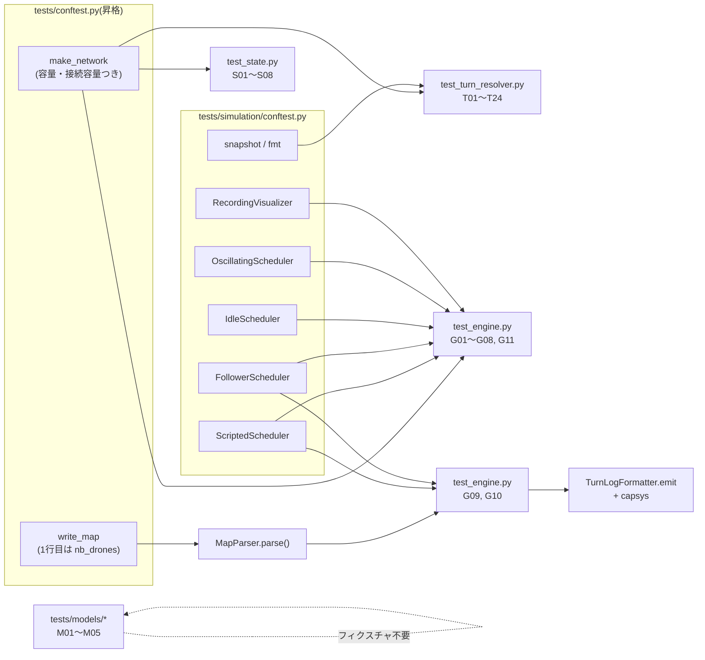
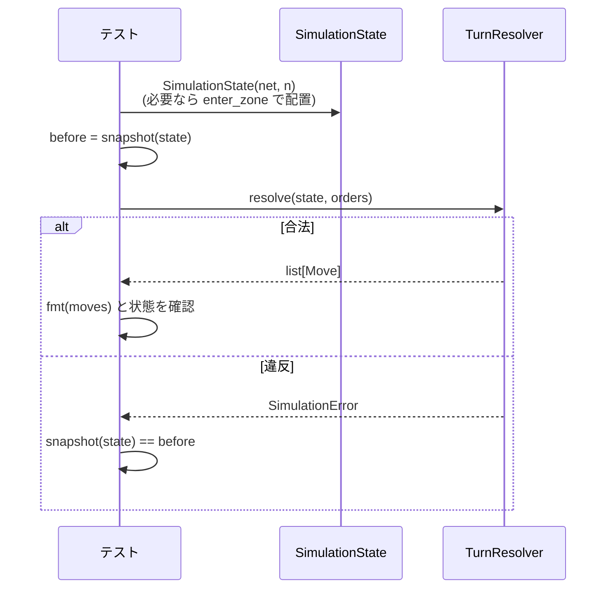

# テスト設計: Stage 4(Simulation Engine)

- 日付: 2026-10-16
- フェーズ: **テスト設計**(テストコードはまだ書かない。作成は別フェーズで行う)
  → 2026-10-17 に作成フェーズ完了(末尾「作成フェーズの結果」を参照)
- 対象ブランチ: `test/stage4_simulation`(`feature/stage4_simulation` から分岐)
- 対象コード: `droneflow/simulation/state.py`(`Move` / `MoveOrder` / `SimulationState`)、
  `droneflow/simulation/turn_resolver.py`(`TurnResolver`)、`droneflow/simulation/engine.py`
  (`SimulationEngine` / `default_turn_limit`)、モデルの追加分(`Connection.name`、`Network.connection_between`、
  `Drone.transit_target`)。`Scheduler.decide_moves` は Stage 5 のため対象外(テストではスタブに置き換える)。
- 参照した決定: `docs/decisions.md` の 2026-10-16 の Stage 4 の各項目
  - 「Stage 4 の API(スケジューラは `MoveOrder` を返し、`TurnResolver` が検査して `Move` を作る)」(以下 **API**)
  - 「restricted への移動は、出発時に到着先の容量を予約し、到着はエンジンが自動で行う」(以下 **予約**)
  - 「容量の数え方(退出を先に空ける、接続は向きを区別しない)」(以下 **容量**)
  - 「出力用の接続名は宣言どおりの `zone_a-zone_b`、1ターン内の並びはドローンID順」(以下 **出力**)
  - 「無限ループは『誰も動かないターン』と『ターン数の上限』で検出する」(以下 **無限ループ**)
  - 「`DroneStatus.WAITING` は使わない」(以下 **WAITING**)
  - 「`nb_drones` は『ファイルの物理的な1行目』に限る」(E2E のマップの書き方)
- 参照した課題の条項: VII.2(1ターンの動き)、VII.3(ゾーン容量・接続容量・restricted は2ターンで接続上で待てない・
  start/end は無制限・出ていく分は同じターンに空く)、VII.5(出力書式 `D<ID>-<zone>` / `D<ID>-<connection>`)
- 参照したバグ記録: `docs/bugs.md`(Stage 4 に関係する既知のバグはなし。1行目コメントのマップの件は E2E のマップを
  `nb_drones` 始まりにすることで避ける)
- ユーザー確認済みの仕様(依頼時に提示されたもの。各ケースの「守る仕様」欄で ★ を付けて参照する):
  ★1 接続容量は両方向で共有(容量1の接続で入れ替わりは違反)/ ★2 1ターン内の並びはドローンID順 /
  ★3 誰も動かないターンは `SimulationError` / ★4 restricted の到着先は出発時に予約・次ターンに自動到着・
  飛行は2ターンとも接続容量に数える / ★5 ゾーン容量は最終的な負荷で判定(出ていく分は同じターンに空く)/
  ★6 start/end は無制限 / ★7 配達済みは以後扱わない / ★8 違反は `SimulationError` で状態は変わらない /
  ★9 `max_turns` の上限

## 方針

- `tests/` は `droneflow/` の構成に対応させる(`tests/README.md` のとおり)。`tests/simulation/` を新設し、
  モデルの追加分は既存の `tests/models/` の各ファイルに追記する。
- ネットワークは原則**テストコード内で組み立てる**。パーサーを通すのは E2E(G09, G10)だけで、`tmp_path` にマップを書き出して読む。
- `revie_case/` と、実装時のスクラッチ(scratchpad の `sim_check.py` / `neg_check.py`)には**依存しない**。
  そこで使われていた場面は、テスト内で同じ形のネットワークを組み直して再現する。
- 本物の `Scheduler` は Stage 5 で未実装(`NotImplementedError`)なので、**スタブのスケジューラ**を使う。
  ルールの検査は `TurnResolver` を直接呼ぶテスト(T 系)で行い、エンジンのテスト(G 系)はループ・上限・可視化・出力の結合を見る。
- 状態の準備には、検査をしない基本操作(`SimulationState.enter_zone` / `enter_transit`)を直接使ってよい
  (「ドローンを a・b・c に1機ずつ置いた状態」などを1行で作るため)。ただし**検査対象のターンは必ず `TurnResolver.resolve` を通す**。
- 期待値は手計算で決められる小さなネットワーク(ゾーン数 2〜7)に限る。E2E の期待出力は、実装ブランチ上で実行して手計算と一致することを確認済み。

## ファイル構成

```
tests/
├── README.md                     # 作成フェーズでカバレッジ欄に Stage 4 を追記する
├── conftest.py                   # (新設・推奨)build_network / make_network / write_map を pathfinding から昇格
├── models/
│   ├── test_connection.py        # 追記: M01
│   ├── test_network.py           # 追記: M02〜M04
│   └── test_drone.py             # 追記: M05
├── pathfinding/
│   └── conftest.py               # 昇格後は grid_network だけを残す(make_network / write_map はルートから使う)
└── simulation/
    ├── conftest.py               # スタブのスケジューラ・記録用の可視化・snapshot ヘルパー
    ├── test_state.py             # S01〜S08
    ├── test_turn_resolver.py     # T01〜T24
    └── test_engine.py            # G01〜G11(E2E の G09, G10 を含む)
```

- 既存と同じく `__init__.py` は置かない(テストファイル名は既存と重複しない)。
- エンジンのテストの ID は、Stage 3 の E2E(`E01`)と紛らわしくならないよう `G`(enGine)にする。

## 共有フィクスチャ・ヘルパー

### `make_network` の昇格と容量の指定(`tests/conftest.py`)

`tests/pathfinding/conftest.py` の `build_network` は容量を指定できず、hub の `max_drones` が `None` になる。
`SimulationState.free_capacity` は `max_drones is None` を**無制限**として扱うため、そのままではシミュレーションのテストで
「容量1の hub」が作れない。そこで次のように拡張して `tests/conftest.py` に昇格する(推奨):

```
build_network(
    edges: str,                                  # 例: "s-a a-g"。記述順 = 接続の宣言順(Connection.name も記述どおり)
    types: dict[str, ZoneType] | None = None,    # 省略は NORMAL
    start: str = "s",
    end: str = "g",
    isolated: tuple[str, ...] = (),
    capacity: dict[str, int] | None = None,      # 追加: hub の max_drones。省略した hub は 1(パーサーの既定値と同じ)
    links: dict[str, int] | None = None,         # 追加: 接続名 → max_link_capacity。省略は 1
) -> Network
```

- start / end の `max_drones` は常に `None`(パーサーの正規化と同じ。decisions 2026-09-17)。
- hub の既定を `None` から `1` に変えても、Stage 3 のテストは容量を見ないので影響しない(作成フェーズで全テストを流して確認する)。
- 昇格せず `tests/simulation/conftest.py` に容量つきの別の組み立て関数を作る案もある。重複を避けるため昇格を推奨するが、
  どちらにするかは作成フェーズで決めてよい(下記「確認したい点」4)。
- `write_map`(`tmp_path` にマップを書く)も同時に昇格する。**マップ文字列の1行目は必ず `nb_drones: <n>`**。

### スタブのスケジューラ(`tests/simulation/conftest.py`)

`SimulationEngine` の引数は `Scheduler`(Protocol ではなく具象クラス)なので、スタブは `Scheduler` を継承して
`decide_moves` を上書きする。`mypy --strict` を通すため、`super().__init__(network, Pathfinder(network))` で本物の
`Pathfinder` を渡す(テストのネットワークは常に到達可能なので構築は成功する)。

| スタブ | 振る舞い | 使うケース |
|---|---|---|
| `ScriptedScheduler(network, script)` | `script: list[list[MoveOrder]]` の i 番目をターン i に返す。台本が尽きたら `[]` | G04, G06, G08, G09 |
| `FollowerScheduler(network)` | 各ドローン(ID順、飛行中は除く)について `pathfinder.next_hops` を順に見て、ゾーンの空き(`free_capacity` に同ターンの退出・入場を反映)と接続の空き(`link_load` に飛行中の分を反映)がある最初の手を選ぶ。単純な貪欲法で、最適化はしない | G01, G02, G10 |
| `IdleScheduler(network)` | 常に `[]` | G03 |
| `OscillatingScheduler(network, a, b)` | D1 を `a` と `b` の間で往復させ続ける(毎ターン必ず1機動くので「誰も動かない」には当たらない) | G05 |

- `FollowerScheduler` はテスト用の最小限の実装にとどめる(Stage 5 の本物の代わりではない)。G10 の期待出力はこのスタブの
  決定的な動き(ID順・宣言順)に依存するため、スタブを変えたら期待値も見直す。
- スタブ自体の正しさはテストしない。G09 は台本(`ScriptedScheduler`)で書き、スタブの実装に依存しない形にする。

### 記録用の可視化 `RecordingVisualizer`

`render(state)` が呼ばれるたびに `(state.turn_number, state.delivered_count, state.is_complete)` をリストに追記するだけのクラス。
`Visualizer` は Protocol なので継承は不要。

### `snapshot(state)` ヘルパー

違反後に「状態が一切変わっていない」ことを比べるための値を返す関数(★8)。中身:

- `state.turn_number`
- 全ドローンの `(current_zone, status, in_transit_connection, transit_target, turns_remaining)`
- ネットワークの全ゾーンの `(occupancy, reserved)`、全接続の `link_load`

`Drone` は可変なので、オブジェクトの参照ではなく値のタプル・辞書にコピーして比べる。

### `fmt(moves)` ヘルパー

`TurnLogFormatter().format_turn(moves)` の別名。T 系で「出力の文字列」を比べるときに使う(`"D1-s-r"` など)。



### 1ケースの流れ(T 系の典型)



## ケース一覧

表記: `s-a a-g` は接続(記述順 = 宣言順)。`r` = RESTRICTED、`x` = BLOCKED、それ以外は NORMAL(明記がない限り)。
hub の容量は省略時 1、接続容量は省略時 1。`cap(a)=2` は hub a の `max_drones`、`link(s-a)=2` は接続 s-a の `max_link_capacity`。
`O(1,"a")` は `MoveOrder(1, "a")`。「出力」は `fmt(moves)` の文字列。

### SimulationState(`tests/simulation/test_state.py`)

| ID | 対象 | セットアップ | 期待結果 | 意義・守る決定/仕様 |
|---|---|---|---|---|
| S01 | 構築 | `s-a a-g`、3機 | `turn_number == 0`、`drones` のキーが `[1,2,3]`、全機 `current_zone == "s"`・`status is AT_ZONE`(`WAITING` ではない)、`occupancy("s") == 3`、`active_drones()` が ID 順、`delivered_count == 0`、`is_complete is False` | API 3(1..nb_drones を start に置く)、WAITING |
| S02 | `free_capacity` | `s-a a-g`、cap(a)=2 | `free_capacity("s")` と `free_capacity("g")` が `None`、`free_capacity("a") == 2`。`free_capacity("nope")` は `ZoneNotFoundError` | ★6、docstring の Raises |
| S03 | `enter_zone` | S01 の状態で `enter_zone(1, "a")` | `occupancy("s") == 2`、`occupancy("a") == 1`、`drones_at("a")` が D1 だけ、`free_capacity("a") == 0` | 基本操作の数え方 |
| S04 | end への到着で配達済み | `s-g`、2機で `enter_zone(1, "g")` | D1 は `DELIVERED`、`occupancy("g") == 0`、`active_drones()` と `drones_at("g")` に D1 がいない、`delivered_count == 1`、`is_complete is False`。D2 も入れると `is_complete is True` | ★7(配達済みは占有に残らない)、容量 3 |
| S05 | `enter_transit` | `s-r r-g`(r=restricted)、1機で `enter_transit(1, conn(s-r), "r")` | D1: `status is IN_TRANSIT`、`current_zone is None`、`in_transit_connection == "s-r"`、`transit_target == "r"`、`turns_remaining == 1`。`occupancy("r") == 0`・`reserved("r") == 1`・`load("r") == 1`・`free_capacity("r") == 0`、`link_load(conn) == 1`、`drones_in_transit() == [D1]` | 予約 1(出発時に予約)・3(接続を使用中)、★4 |
| S06 | `complete_transit` | S05 の続きで `complete_transit(1)` | D1: `AT_ZONE` で `current_zone == "r"`、`in_transit_connection` / `transit_target` が `None`、`turns_remaining == 0`。`reserved("r") == 0`・`occupancy("r") == 1`(`load` は 1 のまま)、`link_load == 0` | 予約 1(到着で予約が占有に置き換わるだけ) |
| S07 | restricted な end への到着 | `s-g`(g=restricted の end)、1機で `enter_transit` → `complete_transit` | 到着後 D1 は `DELIVERED`、`reserved("g") == 0`、`occupancy("g") == 0`、`is_complete is True` | ★4 と ★7 の組み合わせ(end の予約が残らない) |
| S08 | 基本操作の前提違反 | S05 の状態(D1 飛行中) | `enter_zone(1, "g")` と `enter_transit(...)` が `SimulationError`(「not in a zone」)。別の状態で AT_ZONE の D1 に `complete_transit(1)` は `SimulationError`(「not in flight」) | 基本操作が最低限の前提だけは守ること(検査は `TurnResolver` の役目だが、壊れた状態を作らない) |

### TurnResolver: 基本(`tests/simulation/test_turn_resolver.py`)

| ID | 対象 | セットアップ | 期待結果 | 意義・守る決定/仕様 |
|---|---|---|---|---|
| T01 | 1手の移動 | `s-a a-g`、1機、`[O(1,"a")]` | 戻り値 `[Move(1, "a")]`、出力 `"D1-a"`、`turn_number == 1`、D1 は a | API 2 の正常系 |
| T02 | 空の指示 | `s-a a-g`、1機、`[]` | 戻り値 `[]`、`turn_number == 1`(例外にはしない) | 「誰も動かない」の検出はエンジンの役目(無限ループ 1)で、resolver は空を返すだけという役割分担。G03 と対 |
| T03 | ID 順の並び | a) `s-a s-b a-g b-g`、2機、指示を `[O(2,"b"), O(1,"a")]` の順で渡す。b) `s-r r-g s-a a-g`(r=restricted)で D2 が r へ飛行中、D1 に `O(1,"a")` | a) 出力 `"D1-a D2-b"`。b) 出力 `"D1-a D2-r"`(自動の到着と指示が混ざっても ID 順) | ★2、出力 2 |

### TurnResolver: ゾーン容量

| ID | 対象 | セットアップ | 期待結果 | 意義・守る決定/仕様 |
|---|---|---|---|---|
| T04 | 容量1に2機(違反) | `s-a a-g`、link(s-a)=2、2機、`[O(1,"a"), O(2,"a")]` | `SimulationError`(メッセージに `'a'`)。接続は容量2なのでゾーン容量の違反であること | VII.3 ゾーン容量 |
| T05 | 容量2に2機(合法・境界) | T04 と同じで cap(a)=2 | 出力 `"D1-a D2-a"`、`occupancy("a") == 2` | 上限ちょうどは合法(`>` と `>=` の取り違え防止) |
| T06 | 空いた場所へ同じターンに入る(合法) | `s-a a-b b-g`、2機。D1 を a に置いた状態で `[O(1,"b"), O(2,"a")]` | 出力 `"D1-b D2-a"` | ★5、容量 1(出ていく分は同じターンに使える) |
| T07 | 3機の循環(合法) | `s-a a-b b-c c-a c-g`、3機を a・b・c に1機ずつ置き、`[O(1,"b"), O(2,"c"), O(3,"a")]` | 出力 `"D1-b D2-c D3-a"`、各ゾーンの `occupancy == 1` | 容量 1「3機以上の玉突き・循環も、最終的な負荷が収まれば合法」。処理順に依存する実装への退行を防ぐ |
| T08 | start / end は無制限 | `s-a s-g a-g`、link(s-g)=5、5機。a) `[O(i,"g") for i in 1..5]` b) D1 を a に置き、`[O(1,"s")]`(4機いる start へ戻る) | a) 出力 `"D1-g D2-g D3-g D4-g D5-g"`、`is_complete` b) 合法、`occupancy("s") == 5` | ★6、容量 3 |

### TurnResolver: 接続容量

| ID | 対象 | セットアップ | 期待結果 | 意義・守る決定/仕様 |
|---|---|---|---|---|
| T09 | 同じ接続を2機(parametrize) | `s-a a-g`、cap(a)=2、2機、`[O(1,"a"), O(2,"a")]`。a) link(s-a)=1 b) link(s-a)=2 | a) `SimulationError`(メッセージに `'s-a'`) b) 出力 `"D1-a D2-a"` | VII.3 接続容量。ゾーンは容量2なので接続の違反であること |
| T10 | 入れ替わり(parametrize) | `s-a a-b b-g`、2機。D1 を a、D2 を b に置き `[O(1,"b"), O(2,"a")]`。a) link(a-b)=1 b) link(a-b)=2 | a) `SimulationError`(ゾーンの最終負荷は各1で合法なので、接続の違反) b) 出力 `"D1-b D2-a"` | ★1、容量 2(向きを区別しない) |

### TurnResolver: restricted

| ID | 対象 | セットアップ | 期待結果 | 意義・守る決定/仕様 |
|---|---|---|---|---|
| T11 | 2ターンの移動と出力 | `s-r r-g`(r=restricted)、1機。ターン1 `[O(1,"r")]`、ターン2 `[]`、ターン3 `[O(1,"g")]` | 出力はそれぞれ `"D1-s-r"`、`"D1-r"`、`"D1-g"`。ターン1後 D1 は飛行中、ターン2後 r に `AT_ZONE`、ターン3後 `DELIVERED` | ★4、予約 2、VII.5(`D<ID>-<connection>` の次に `D<ID>-<zone>`) |
| T12 | 接続名は宣言どおり | 接続を `r-s` の向きで宣言(`"r-s r-g"`)、1機で `[O(1,"r")]` | 出力 `"D1-r-s"`(飛んでいる向きの `s-r` ではない) | 出力 1 |
| T13 | 予約済みの restricted に入る(違反) | `s-r r-g`、link(s-r)=2、2機。ターン1 `[O(1,"r")]`、ターン2 `[O(2,"r")]` | ターン2 が `SimulationError`(r はまだ空だが予約で満杯。接続は容量2なのでゾーンの違反) | ★4、予約 1(到着時ではなく出発時に容量を取る) |
| T14 | 飛行は2ターン目も接続容量に数える(parametrize) | `s-r r-g`、cap(r)=2、2機。ターン1 `[O(1,"r")]`、ターン2 `[O(2,"r")]`。a) link(s-r)=1 b) link(s-r)=2 | a) ターン2 が `SimulationError`(D1 の到着が s-r を使う) b) ターン2 の出力 `"D1-r D2-s-r"` | ★4、予約 3 |
| T15 | 飛行中のドローンへの指示(違反) | `s-r r-g`、1機。ターン1 `[O(1,"r")]`、ターン2 `[O(1,"r")]` | ターン2 が `SimulationError`(メッセージに「in flight」)、D1 は飛行中のまま | 予約 2(飛行中のドローンに指示を出してはいけない) |
| T16 | 出ていく分で予約できる(合法) | `s-r r-g`、link(s-r)=2、link(r-g)=1、2機。D1 を r に置き、`[O(1,"g"), O(2,"r")]` | 出力 `"D1-g D2-s-r"`、`reserved("r") == 1`、`occupancy("r") == 0` | ★5 と ★4 の組み合わせ(予約も最終負荷で判定) |
| T17 | restricted な goal | `s-g`(g=restricted の end)、link(s-g)=3、3機。ターン1 `[O(1,"g"),O(2,"g"),O(3,"g")]`、ターン2 `[]` | ターン1 出力 `"D1-s-g D2-s-g D3-s-g"`、ターン2 出力 `"D1-g D2-g D3-g"`、`is_complete`、`reserved("g") == 0` | ★4 + ★6(end は予約しても無制限)+ ★7 |

### TurnResolver: 指示の妥当性と状態の不変

| ID | 対象 | セットアップ | 期待結果 | 意義・守る決定/仕様 |
|---|---|---|---|---|
| T18 | 不正な指示(parametrize) | `s-a a-b b-g s-x s-g`(x=blocked)、link(s-a)=2、2機。a) 存在しないドローン `O(7,"a")` b) 存在しないゾーン `O(1,"zz")` c) 隣接していない `O(1,"b")`(s から b への接続はない) d) blocked `O(1,"x")` e) 同じドローンに2つ `[O(1,"a"), O(1,"g")]` f) 自分のいるゾーン(自己ループなし)`O(1,"s")` | いずれも `SimulationError`(`ZoneNotFoundError` などの別の例外が漏れない) | API 2、VII.3(blocked)。b は `ZoneNotFoundError` を `SimulationError` に包む分岐の確認 |
| T19 | 配達済みのドローンへの指示 | `s-g`、2機。ターン1 `[O(1,"g")]`、ターン2 `[O(1,"g")]` | ターン2 が `SimulationError`(「already delivered」) | ★7 |
| T20 | 配達済みは出力に出ない | `s-a a-g s-g`、2機。ターン1 `[O(1,"g"), O(2,"a")]`、ターン2 `[O(2,"g")]` | ターン2 の出力は `"D2-g"` だけ。`occupancy("g") == 0` | ★7 |
| T21 | 違反後に状態が変わらない(parametrize) | 違反の前に合法な手があるターンを複数用意し、`before = snapshot(state)` を取って `resolve`。a) `[O(1,"a"), O(7,"a")]`(先頭は合法)b) `s-r r-g`(r=restricted)・2機で D1 が r へ飛行中(到着予定あり)+ 不正な `O(2,"zz")` c) T10-a の入れ替わり d) T13 のターン2 | すべて `SimulationError` かつ `snapshot(state) == before`(`turn_number` も増えない。b では D1 の到着も適用されない) | ★8、API 2(全部検査してから適用) |
| T22 | 違反の後も同じ状態で続けられる | T21-b の直後に、合法な `[]` を渡す | 出力 `"D1-r"`(到着だけ)、`turn_number == 2` | ★8 の帰結。中途半端な変更が残っていれば到着が二重になる・失敗する |
| T23 | 自己ループでの移動は拒否 (parametrize) | a) `s-a a-a a-g`、1機。D1 を a に置き `[O(1,"a")]` b) `s-r r-r r-g`(r=restricted)、1機。D1 を r に置き `[O(1,"r")]` | いずれも `SimulationError`、状態は変わらない(D1 は同じゾーン、`occupancy` と `turn_number` も不変、`link_load` に自己ループが載らない) | パーサーは自己ループを許容(decisions 2026-09-17)するが、シミュレーションでは今いるゾーンへの移動指示を拒否する(decisions 2026-10-16「今いるゾーンへの移動指示(自己ループ経由を含む)は拒否する」)。T18 f(自己ループなし)と同じ規則 |
| T24 | 戻り値の型 | T01・T11 | 要素がすべて `Move`(`MoveOrder` ではない)、`destination` が `str` | API 1(指示と記録を分ける) |

### SimulationEngine(`tests/simulation/test_engine.py`)

| ID | 対象 | セットアップ | 期待結果 | 意義・守る決定/仕様 |
|---|---|---|---|---|
| G01 | 正常終了 | `s-a a-b b-g`、3機、`FollowerScheduler` | `run()` が返したターン数が 5、どのターンも空でない、各ターンの `drone_id` が昇順、終了後 `engine.state.is_complete` | API 4、★2、docstring「No turn is empty」 |
| G02 | render はターンごとに1回 | G01 と同じで `RecordingVisualizer` を渡す | `len(records) == len(turns)`、記録された `turn_number` が `1, 2, …, len(turns)`(ターンの適用後に呼ばれる)、最後の記録だけ `is_complete == True`。`visualizer` 省略時も同じ結果が返る | API 4(毎ターン render) |
| G03 | 誰も動かない(違反) | `s-a a-g`、1機、`IdleScheduler`、`RecordingVisualizer` | `SimulationError`(「no drone moved」)、render は0回、`turn_number == 1` | ★3、無限ループ 1 |
| G04 | 到着だけのターンは進行とみなす | `s-r r-g`(r=restricted)、1機、台本 `[[O(1,"r")], [], [O(1,"g")]]` | 例外なく3ターン、出力 `"D1-s-r"`, `"D1-r"`, `"D1-g"` | 無限ループ 1 の「到着もなく」の部分。スケジューラが `[]` でも自動の到着があれば止めない(G03 との区別) |
| G05 | ターン数の上限(振動) | `s-a a-g`、1機、`OscillatingScheduler(a ↔ s)`、`max_turns=5`、`RecordingVisualizer` | `SimulationError`(「not finished after 5 turns」と「0/1」)、render はちょうど5回 | ★9、無限ループ 2(動いてはいるが終わらない) |
| G06 | 上限の境界 | `s-a a-g`、1機、台本 `[[O(1,"a")], [O(1,"g")]]`。a) `max_turns=2` b) `max_turns=1` | a) 2ターンで正常終了 b) `SimulationError` | ★9。ちょうど上限で終わる場合は違反にしない(`>=` の位置) |
| G07 | 既定の上限 | 課題のサンプルマップ(ゾーン7、5機) | `default_turn_limit(world) == 70`(`2 × 7 × 5`)、`SimulationEngine(world, sch).max_turns == 70`、`max_turns=3` を渡せば 3 | 無限ループ 2 の既定値 |
| G08 | 不正な指示はエンジンから伝わる | `s-a a-g`、2機、link(s-a)=2、台本 `[[O(1,"a")], [O(2,"a")]]`(2ターン目、D1 がまだ a にいる)、`RecordingVisualizer` | `SimulationError`、render は1回だけ(違反したターンでは呼ばれない)、`engine.state` はターン1後のまま | ★8、エンジンが resolver の例外を握りつぶさない |
| G09 | E2E: 課題のサンプルマップ | `write_map` で Stage 3 の E01 と同じサンプルマップ(1行目 `nb_drones: 5`)を書き、`MapParser(path).parse()` → `SimulationEngine(world, ScriptedScheduler(...))` → `TurnLogFormatter().emit(turns)`、`capsys` で標準出力を取る。台本は下の期待出力どおりの指示(corridorA → tunnelB → goal を1機ずつ) | 標準出力が次の7行と一致: `D1-corridorA` / `D1-tunnelB D2-corridorA` / `D1-goal D2-tunnelB D3-corridorA` / `D2-goal D3-tunnelB D4-corridorA` / `D3-goal D4-tunnelB D5-corridorA` / `D4-goal D5-tunnelB` / `D5-goal` | パーサー・エンジン・フォーマッタの結合、VII.5。hub-corridorA の接続容量1で1機ずつ、corridorA(容量2)・tunnelB(容量1)は退出で空く(★5) |
| G10 | E2E: restricted を通るマップ | G09 のマップの corridorA を `zone=blocked` にしたもの(roof1 経由しかない)を `FollowerScheduler` で実行 | ~~13行~~ **12行**(作成フェーズで訂正。末尾参照)。先頭3行が `D1-hub-roof1` / `D1-roof1` / `D1-roof2 D2-hub-roof1`、最終行 `D5-goal`。全行で `D<n>-hub-roof1` の次の行に `D<n>-roof1` がある | ★4 の出力書式を実マップで確認(接続名 `hub-roof1` は宣言どおり)。roof1 が容量1なので予約により1機ずつ |
| G11 | 構築直後の状態 | `s-a a-g`、4機 | `run()` 前に `engine.state.turn_number == 0`、`occupancy("s") == 4`、`engine.max_turns == default_turn_limit(world)` | API 4(構築時に全機を start に置く) |

### モデルの追加分(`tests/models/`)

| ID | 対象 | セットアップ | 期待結果 | 意義・守る決定/仕様 |
|---|---|---|---|---|
| M01 | `Connection.name`(`test_connection.py`) | `Connection("a", "b")` と `Connection("b", "a")` | それぞれ `"a-b"`、`"b-a"`(並べ替えない) | 出力 1 |
| M02 | `connection_between` の両方向(`test_network.py`) | a, b と接続 a-b | `connection_between("a","b") is c`、`connection_between("b","a") is c` | 容量 2(向きを区別しない)、API 5 |
| M03 | つながっていない・存在しない | a, b, c と接続 a-b | `connection_between("a","c") is None`、`connection_between("nope","a") is None`(例外ではない) | docstring の契約。resolver が「not connected」に変換する前提 |
| M04 | 自己ループ | 接続 a-a あり/なし | ありなら `connection_between("a","a")` がその接続、なしなら `None` | docstring「同じ名前を2回渡すと自己ループが見つかる」。T23 の前提 |
| M05 | `Drone.transit_target`(`test_drone.py`) | `Drone(1, "s")` と、飛行中として作った Drone | 既定は `None`。飛行中は指定した値を保持 | API 5 |

合計: S 8 + T 24 + G 11 + M 5 = **48 件**(parametrize の展開は除く)。

## 作成フェーズへの申し送り

- 既存テストと同じく、関数ごとに型ヒントと docstring を付ける(`flake8` / `mypy --strict` を通す前提)。
  スタブは `Scheduler` を継承し、`decide_moves` の型を元のシグネチャと合わせる。
- 違反の確認は `pytest.raises(SimulationError, match=...)` で、メッセージの一部(ゾーン名・接続名・「in flight」など)まで見る。
  ゾーン容量と接続容量の違反を取り違えていないことは、セットアップで片方の容量を大きくし、メッセージで区別する。
- G09 の台本は期待出力から機械的に作れる(各行の `D<n>-<zone>` を `MoveOrder(n, zone)` にする。restricted を含まないため)。
- 作成後、`tests/README.md` の「現在のカバレッジ範囲」に `tests/simulation/` と `tests/models/` の追記分、
  `tests/conftest.py`(昇格した場合)を加え、「対象は Stage 1・2・3・6」の文を Stage 4 を含む形に直す。

## 設計中に気づいた点・確認したい点(実装のバグではない)

実装ブランチ上で、設計したシナリオ(上の各ケース)を一時スクリプトで実行し、期待どおりに動くことを確認した。
明確なバグは見つからなかったため `docs/bugs.md` には追記していない。以下はユーザーの判断を仰ぎたい点。

1. **【決定済み 2026-10-16】自己ループでの移動が「動いた」扱いになる**。`s-a a-a a-g` で a にいる D1 に `O(1,"a")` を出すと、合法な移動として
   `"D1-a"` が出力され、そのターンは「誰も動かない」に当たらない。restricted の自己ループ(`r-r`)なら `"D1-r-r"` → `"D1-r"` の
   2ターン移動になる。課題上は自己ループを通る意味がなく、スケジューラ(Stage 5)が使わなければ問題は出ないが、
   違反として拒否するか、今のまま許すかを決めたい。
   → **決定**: 今いるゾーンへの移動指示は、自己ループの有無・restricted かどうかによらず `SimulationError` で拒否し、状態は変えない。
   待機は指示を出さないことでのみ表す。パーサーは自己ループを引き続き許容する(decisions 2026-10-16)。T23 の期待値をこれに合わせて変更した。
2. **振動は上限でしか止まらない**。往復するスケジューラは `2 × ゾーン数 × nb_drones` ターン走ってから止まる(決定どおり)。
   大きなマップでは数万ターンになりうるが、テストでは `max_turns` を小さく渡すので問題ない。
3. **`Visualizer.render` は状態だけを受け取り、そのターンの `Move` を受け取らない**。Stage 7 で「誰が動いたか」を描く場合は
   前の状態と比べる必要がある。Stage 4 のテストでは扱わない(G02 は呼ばれる回数とタイミングだけを見る)。
4. **共有フィクスチャの昇格**(`tests/conftest.py`)は `tests/pathfinding/conftest.py` の変更を伴う。hub の既定容量を `None` → `1`
   にしても Stage 3 のテストは通る見込みだが、昇格するか simulation 専用の組み立て関数を作るかは作成フェーズの開始時に決めたい。

## 作成フェーズの結果(2026-10-17)

- 作成したファイル: `tests/conftest.py`(昇格)、`tests/pathfinding/conftest.py`(`grid_network` のみに縮小)、
  `tests/simulation/conftest.py`、`tests/simulation/test_state.py`(S01〜S08)、`tests/simulation/test_turn_resolver.py`
  (T01〜T24)、`tests/simulation/test_engine.py`(G01〜G11)、`tests/models/` の各ファイルへの追記(M01〜M05)。
  設計した 48 件をすべて実装した(parametrize の展開込みで 66 件増、全体 265 件)。
- 確認したい点への決定の反映:
  - 1(自己ループ): T23 は normal / restricted の両方で `SimulationError`(メッセージ「already is」)と状態の不変を確認。
    T18 f もメッセージ「already is」で確認する。
  - 2・4(共有ヘルパー): `tests/conftest.py` に昇格した。hub の既定 `max_drones` は 1、`capacity` / `links` で個別に指定。
    Stage 3 のテストは容量を見ないため、期待値を変えずにすべて通った(`max_drones=None` に依存するテストはなかった)。
  - 3(Visualizer が状態だけを受け取る): Stage 7 に先送り。テストしない。
  - 振動: G05 は `max_turns=5` を渡す。
- 実装上の判断:
  - スタブと記録用の可視化は `tests/simulation/conftest.py` に置き、テストファイルからは import せずフィクスチャ
    (`scripted_scheduler` などのファクトリ、`recorder` は `(visualizer, records)` の組)経由で使う。`conftest` を
    import すると、`__init__.py` のない構成では複数の `conftest` モジュールが衝突するため。
  - T21 の4場面は、場面を組み立てる関数を parametrize で渡す形にした(T22 は T21-b の関数を再利用)。
- 設計の訂正: **G10 の期待行数は 13 ではなく 12**。roof1 は容量1なので、D<n> は roof1 が空く 2n-1 ターン目に出発し、
  D5 は 9 ターン目に出発・10 到着・11 roof2・12 goal となる(先頭3行は設計どおり)。設計時の「13行」は数え違いで、
  実装のバグではない。テストは手計算した12行全体と一致することを確認する形にした。
- 見つかったバグ: なし(`docs/bugs.md` への追記なし。xfail なし)。
- チェック: `pytest tests` 265 passed、`flake8 droneflow tests fly_in.py` 指摘なし、`mypy --strict droneflow fly_in.py` 指摘なし。
