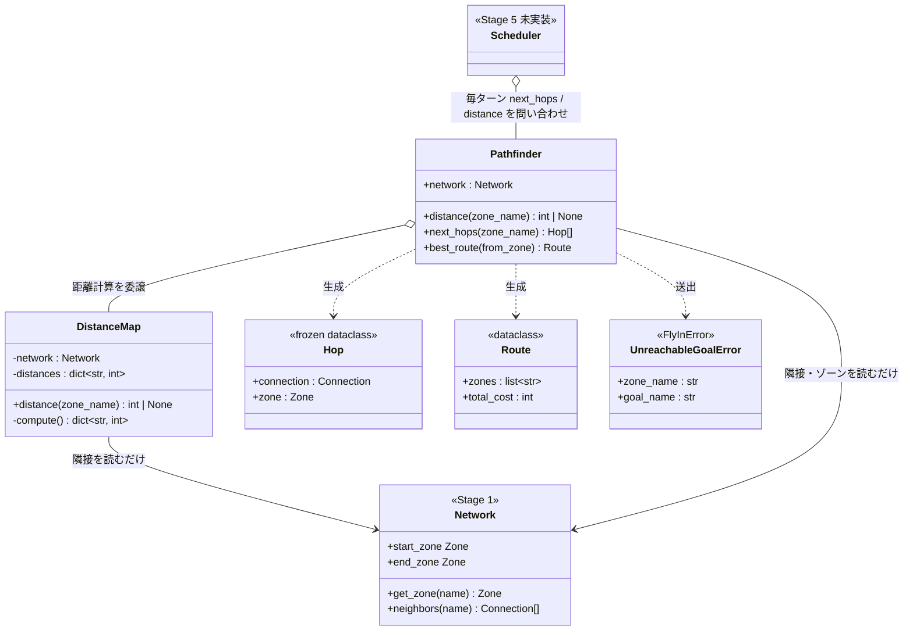
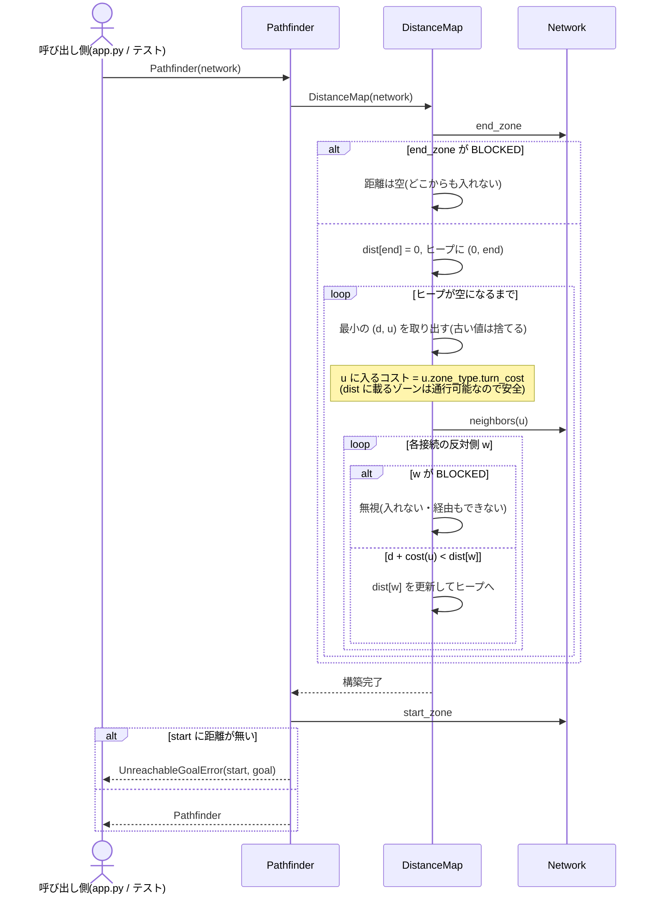
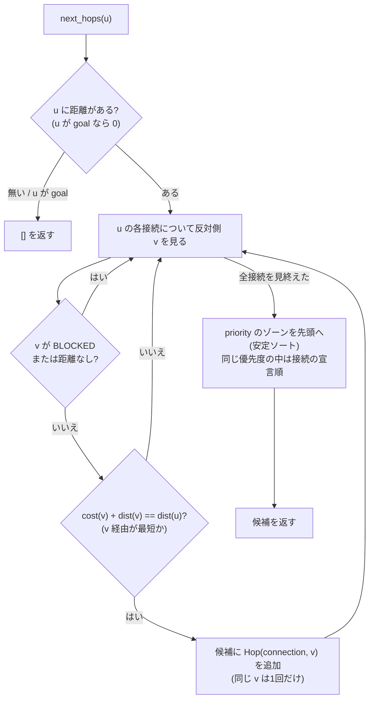

# ワークフロー: Stage 3(Pathfinding)詳細

- 日付: 2026-10-16
- 依頼内容: 残りステージの実装(`docs/decisions.md` 2026-10-16「残りステージの実装方針」)の第1弾として、
  Stage 3 の着手前の設計整理を行う
- 前提:
  - `docs/research/2026-09-17_workflow-all-stages.md` の Stage 3 を詳細化したもの。
  - 距離の事前計算は `docs/decisions.md` 2026-10-03「目的地までの距離はダイクストラ法で事前計算する」に従う。
  - 到達不能の検出は `docs/decisions.md` 2026-10-16「goal に到達できないことは、ゴールからの距離計算で検出する」に従う。
  - 移動先の選び方(最小距離の隣接ゾーン、priority は同距離時のタイブレークのみ)は
    `docs/decisions.md` 2026-10-16「残りステージの実装方針」3 に従う。

## ゴール

パース済みの `Network` から、各ゾーンについて「ゴール(`end_hub`)までにあと何ターンかかるか」を
1回のダイクストラ法で求め、Stage 5(スケジューラ)が毎ターン使う問い合わせを提供する。

- ゾーンごとの残りターン数(距離)の参照
- あるゾーンから「最短で進める次の一手」の候補一覧(priority を同距離の中でだけ先に並べる)
- start(または任意のゾーン)から goal までの最短経路1本(表示・テスト用)
- start から goal に届かない場合の、行番号を持たない明確なエラー

容量(`max_drones` / `max_link_capacity`)はここでは扱わない(毎ターン変わる動的な状態のため、Stage 5 の責務)。

## 対象ファイル

| ファイル | 内容 | 状態 |
|---|---|---|
| `droneflow/pathfinding/distance_map.py` | `DistanceMap`(ゴールからのダイクストラ、距離の保持と参照) | 新規 |
| `droneflow/pathfinding/pathfinder.py` | `Route`、`Hop`、`Pathfinder`(次の一手・最短経路・到達不能の検出) | スケルトンを置き換え |
| `droneflow/errors.py` | `UnreachableGoalError(FlyInError)` | 追加 |

スケルトンの `find_path` / `find_k_paths` は削除する(理由は `docs/decisions.md` 2026-10-16
「Stage 3 の API をスケルトンから変更する」)。`Scheduler(network, pathfinder)` のコンストラクタは変えない。

## 構造図(静的な形)

継承は使わない。`Pathfinder` は `DistanceMap` を持ち、距離の計算と保持を任せる(委譲)。
`Network` には一切書き込まない(読み取り専用の利用者)。

## 挙動図(実行時の振る舞い)

### (a) 構築: 距離の事前計算と到達不能の検出

自己ループ(`a-a`)は `w == u` となり `d + cost(u) > d` なので更新されず、無害。

### (b) 問い合わせ: 次の一手の候補(Stage 5 が毎ターン使う)

`cost(v) + dist(v) == dist(u)` を満たす v はすべて「v に進めば最短のまま goal に着ける」一手で、
必ず `dist(v) < dist(u)`(前進)になる。priority 側が遠回りなら、そもそも候補に入らない
(タイブレークのみ。`docs/decisions.md` 2026-10-16 の方針3)。

### (c) 問い合わせ: 最短経路1本

`best_route(from_zone)`(省略時は start)は、`next_hops` の先頭を goal まで辿った `Route` を返す。
`total_cost` は `from_zone` の距離と等しい。`from_zone` から goal に届かない場合は `UnreachableGoalError`。

### (d) 例

| マップ | 結果 |
|---|---|
| S08(`s-n-g` と `s-p-g`、p は priority) | `next_hops("s")` = `[p, n]`、`best_route()` = `s→p→g`(コスト2) |
| S09(`s-r-g`、r は restricted / `s-a-b-g`) | `dist(s)=3`、`next_hops("s")` = `[r, a]`(どちらも3ターン) |
| X02 / X03 / X05(goal に届かない) | `Pathfinder(network)` が `UnreachableGoalError` |
| X10(経路の横に閉路) | 無限ループせず、`best_route()` = `s→c1→c2→g` |

## 作業項目

1. `errors.py` に `UnreachableGoalError(FlyInError)` を追加する(`zone_name` / `goal_name` 属性、
   行番号を含まないメッセージ)。
2. `distance_map.py`: `DistanceMap`。`heapq` を使ったダイクストラ(グラフライブラリは使わない)。
   `distance(zone_name)` は届かないゾーン(BLOCKED を含む)に `None`、存在しない名前には `ZoneNotFoundError`。
3. `pathfinder.py`: `Hop` を追加し、`Pathfinder` を `distance` / `next_hops` / `best_route` に置き換える。
   構築時に start の到達可能性を確認する。
4. `flake8` / `mypy --strict` / 既存テストを通す。

## スコープ外

- 容量(ゾーン・接続)を考慮した移動の可否(Stage 5)。
- ドローンへの経路の割り当て・負荷分散・デッドロック回避(Stage 5)。複数経路の列挙(旧 `find_k_paths`)は作らない。
- restricted 接続上の飛行中の扱い(Stage 4)。
- 単体テストの作成(別のテスト設計・作成フェーズで行う)。

## 完了条件(Done)

- `droneflow/pathfinding/` に `NotImplementedError` が残っていない。
- 上の表(d)の結果が、配布マップ・`revie_case/maps/` に対する手動確認で得られる。
- 既存テストがすべて通り、`flake8` と `mypy --strict` がエラーなしで通る。

## レビュー時の確認事項

- `docs/decisions.md` の 2026-10-03(ダイクストラ、BLOCKED 除外、重み=入るゾーンの `turn_cost`、容量を混ぜない)・
  2026-09-17(自己ループ許可)・2026-10-16(到達不能の検出、priority はタイブレークのみ)と実装が食い違っていないか。
- `turn_cost` を `is_traversable` の確認より先に呼んでいないか(BLOCKED で `ValueError` になる)。
- priority が遠回りでも優先されてしまう経路がないか(候補は最短のものだけか)。
- `Network` に書き込んでいないか。グラフ系ライブラリを import していないか。
- `docs/bugs.md` に記録すべき不整合が残っていないか。
