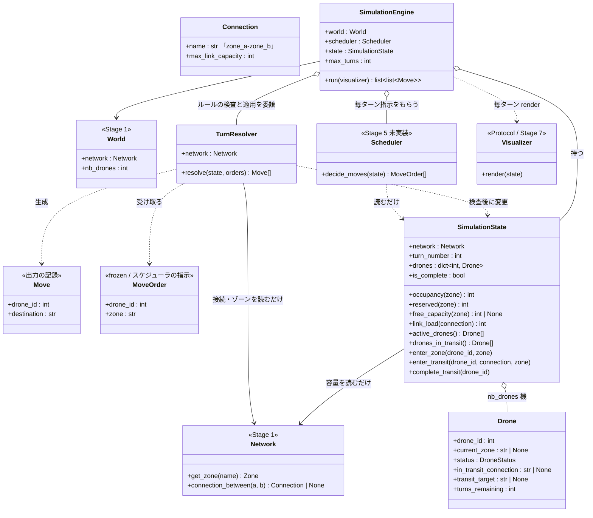
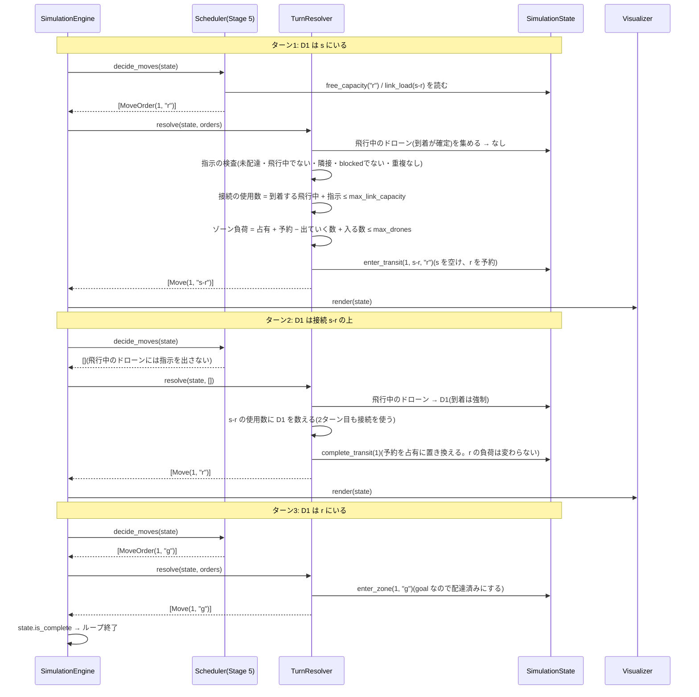
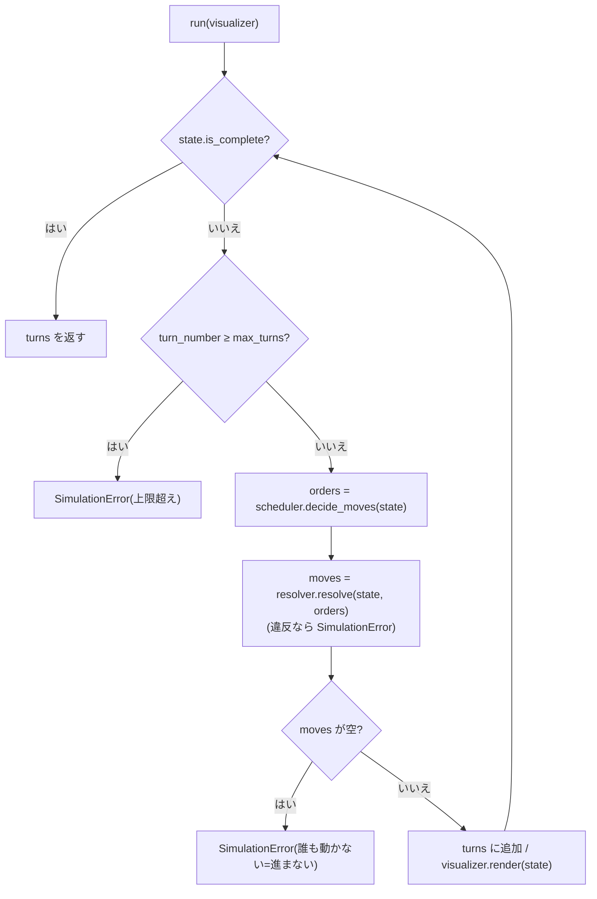
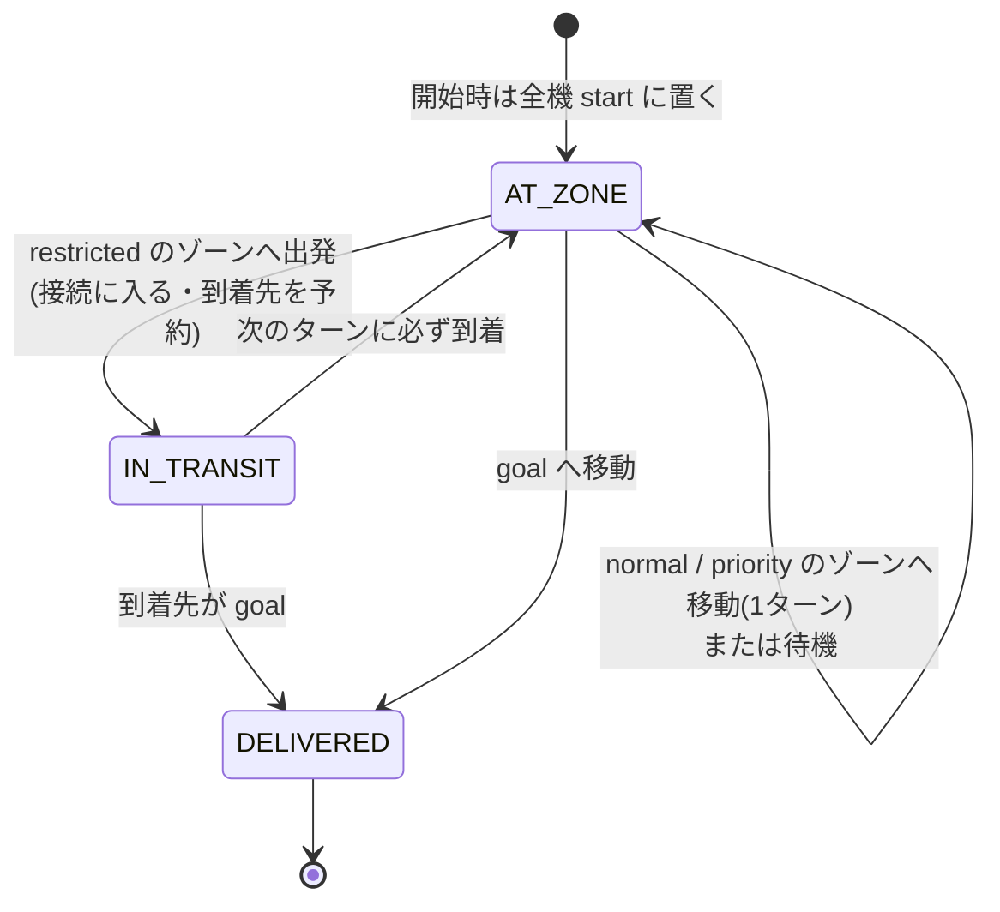

# ワークフロー: Stage 4(Simulation Engine)詳細

- 日付: 2026-10-16
- 依頼内容: 残りステージの実装(`docs/decisions.md` 2026-10-16「残りステージの実装方針」)の第2弾として、
  Stage 4 の着手前の設計整理を行う
- 前提:
  - `docs/research/2026-09-17_workflow-all-stages.md` の Stage 4 を詳細化したもの。
  - 容量は毎ターン `SimulationState` を見て判定する(`docs/decisions.md` 2026-10-03「侵入の可否は容量起因のものと地形起因のものを分けて扱う」)。
  - 出力は `Move.destination` をそのまま `D<ID>-<destination>` にする。行内の順序はフォーマッタでは変えず、
    動きのないターンは出力しない(`docs/decisions.md` 2026-10-03「Stage 6 を先に実装する」)。
  - 誰をどこへ動かすか(`Scheduler.decide_moves`)は Stage 5 の責務。Stage 4 では骨組みのまま残す。

## ゴール

1ターンずつ世界を進め、**課題のルール(VII.2 / VII.3 / VII.5)を守らせる**エンジンを作る。
スケジューラが出した移動の指示が違反していれば `SimulationError` で止める(防御的な検査。出力の検証スクリプトではない)。

- ゾーン容量: 既定1(パーサが補完済み)。start / end は無制限(`Zone.has_unlimited_capacity`)。
  同じターンに出ていくドローンの分は、入ってくるドローンを数える前に空く。
- 接続容量: 同じターンに同じ接続を通るドローンの数は `max_link_capacity` 以下。
- restricted への移動は2ターン: 1ターン目は接続に入り(`D<ID>-<接続名>`)、2ターン目に必ず到着する(`D<ID>-<ゾーン>`)。
  接続上で待つことはできないので、**到着先の容量は出発の時点で予約する**。飛行中のドローンは2ターンとも接続を使う。
- goal に着いたドローンは配達済みとなり、以後は追跡・出力しない。全員が配達済みになったら終了。
- 無限ループの防止: 誰も動かないターン、またはターン数の上限超えで `SimulationError`。
- `SimulationEngine.run` は `list[list[Move]]`(`TurnLogFormatter` の入力)を返し、可視化があれば毎ターン `render(state)` を呼ぶ。

## 対象ファイル

| ファイル | 内容 | 状態 |
|---|---|---|
| `droneflow/simulation/state.py` | `Move`(出力の記録)、`MoveOrder`(スケジューラからの指示)、`SimulationState`(ドローン・占有数・予約数) | スケルトンを置き換え |
| `droneflow/simulation/turn_resolver.py` | `TurnResolver`(1ターン分の指示を検査し、状態に適用して `Move` を返す) | 新規 |
| `droneflow/simulation/engine.py` | `SimulationEngine`(ターンのループ、上限・無進行の検出、可視化の呼び出し) | スケルトンを置き換え |
| `droneflow/simulation/scheduler.py` | `decide_moves` の戻り値を `list[MoveOrder]` に変更(中身は Stage 5) | シグネチャのみ変更 |
| `droneflow/models/connection.py` | `Connection.name`(出力用の接続名 `zone_a-zone_b`) | 追加 |
| `droneflow/models/network.py` | `Network.connection_between(a, b)`(2ゾーン間の接続を引く) | 追加 |
| `droneflow/models/drone.py` | `Drone.transit_target`(飛行中の到着先ゾーン名) | 追加 |

## 構造図(静的な形)

継承は使わない。`SimulationEngine` は「状態」「ルール(`TurnResolver`)」「判断(`Scheduler`)」を部品として持つ(委譲)。
`SimulationState` はデータと問い合わせ、`TurnResolver` は検査と適用、と役割を分ける。どちらも `Network` には書き込まない。

### 指示(`MoveOrder`)と記録(`Move`)を分ける理由

スケジューラは「ドローン d をゾーン z へ」とだけ指示する(`MoveOrder(d, z)`)。z が restricted なら、エンジンが
出力用の記録を `Move(d, "<接続名>")` にし、次のターンに自動で `Move(d, z)` を足す。出力の書式(接続名にするかどうか)を
知っているのはエンジンだけになり、スケジューラは出力の形式を気にせずに済む。

## 挙動図(実行時の振る舞い)

### (a) 1ターンの流れ(restricted への2ターン移動を含む)

例: `s - r - g`(r は restricted、容量1)。ドローン1機。

検査で1つでも違反があれば、状態を一切変えずに `SimulationError` を送出する(全部検査してから適用する)。

### (b) エンジンのループと無限ループの防止

### (c) ドローンの状態遷移

`DroneStatus.WAITING` は Stage 4 では使わない(「待機」はターンごとの行動で、状態ではないため。`docs/decisions.md` 参照)。

### (d) 数え方の例

| 状況 | 結果 |
|---|---|
| a(容量1)にいる D1 が b へ、同じターンに D2 が a へ | 合法(出ていく分が先に空く) |
| a-b(容量1)を挟んで D1: a→b、D2: b→a(入れ替わり) | ゾーンは合法だが、接続 a-b を2機が使うので違反 |
| r(restricted、容量1)へ D1 が出発した次のターンに、D2 も r へ出発 | 違反(r は D1 の予約で埋まっている) |
| D1 が s-r を飛行中のターンに、D2 も s-r(容量1)へ出発 | 違反(D1 が2ターン目も接続を使う) |
| goal へ同じターンに何機でも | 合法(goal は無制限) |

## 作業項目

1. `Connection.name` / `Network.connection_between` / `Drone.transit_target` を追加する。
2. `state.py`: `MoveOrder` を追加し、`SimulationState(network, nb_drones)` を実装する(全機を start に置く、占有数と予約数、問い合わせ、変更の基本操作)。
3. `turn_resolver.py`: `TurnResolver.resolve` を実装する(到着の強制、指示の検査、接続容量・ゾーン容量の検査、適用、ドローンID順の `Move` を返す)。
4. `engine.py`: `SimulationEngine(world, scheduler, max_turns=None)` と `run` を実装する。
5. `scheduler.py`: `decide_moves` の戻り値の型を `list[MoveOrder]` にする(実装は Stage 5)。
6. 手書きの仮スケジューラ(`Pathfinder.next_hops` に沿って空いていれば進む)で、課題の例と配布マップを1機で動かして確認する。
7. `flake8` / `mypy --strict` / 既存テストを通す。

## スコープ外

- 誰をどこへ動かすかの判断・負荷分散・デッドロック回避(Stage 5、`Scheduler.decide_moves`)。
- 可視化の中身(Stage 7)。エンジンは `render(state)` を呼ぶだけ。
- `app.py` での組み立て(Stage 5 以降でスケジューラと一緒に行う)。
- 出力の検証スクリプト(`docs/decisions.md` 2026-10-16「出力の検証スクリプトは今は作らない」)。
- 単体テストの作成(別のテスト設計・作成フェーズで行う)。

## 完了条件(Done)

- `droneflow/simulation/state.py` と `engine.py` に `NotImplementedError` が残っていない(`scheduler.py` は Stage 5 まで残る)。
- 仮スケジューラで、課題の例(VII.5)と配布マップを1機で start から goal まで、ルールを守って動かせる。
- 上の表(d)の違反が `SimulationError` になる。
- 既存テストがすべて通り、`flake8` と `mypy --strict` がエラーなしで通る。

## レビュー時の確認事項

- `docs/decisions.md` の 2026-10-03(容量は毎ターン判定)・2026-10-03 Stage 6(`Move.destination` はそのまま出力、空のターンは出力しない)と食い違っていないか。
- 出ていくドローンの分を先に空けてから、入ってくるドローンを数えているか(最終的な負荷で判定しているか)。
- restricted の到着先を出発時に予約しているか。予約が到着時に占有へ置き換わり、二重に数えていないか。
- 飛行中のドローンが2ターン目も接続容量に数えられているか。
- 違反時に状態を途中まで変えてしまっていないか(全部検査してから適用しているか)。
- start / end の容量を数えていないか。配達済みのドローンが出力・占有に残っていないか。
- `docs/bugs.md` に記録すべき不整合が残っていないか。
