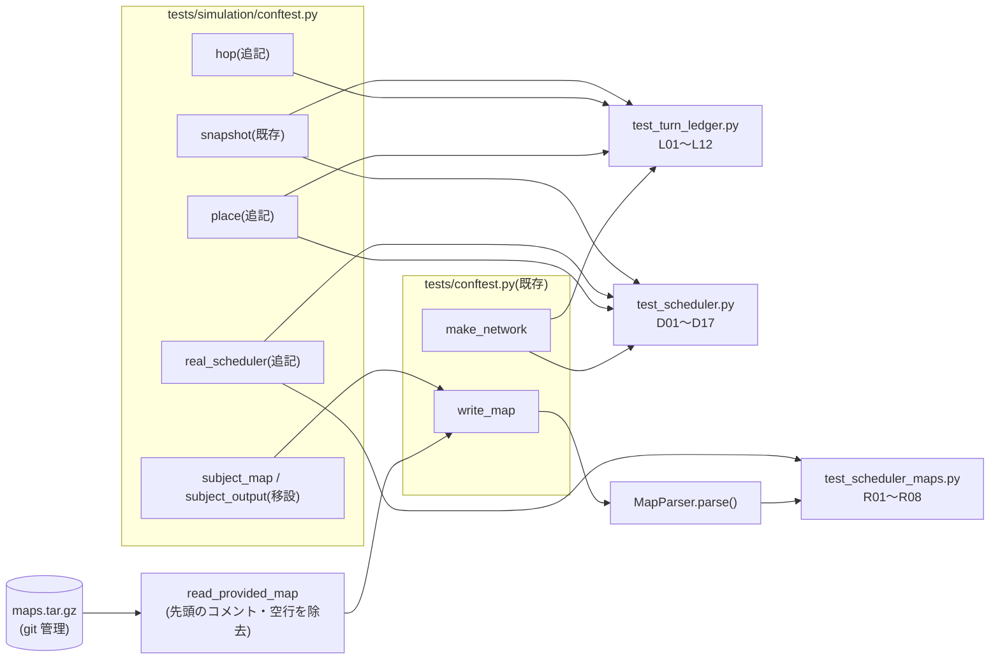

# テスト設計: Stage 5(Multi-Drone Scheduler)

- 日付: 2026-10-17
- フェーズ: **テスト設計** → **テスト作成済み**(2026-10-17。末尾の「作成フェーズの結果」を参照)
- 対象ブランチ: `test/stage5_scheduler`(`feature/stage5_scheduler` から分岐)
- 対象コード: `droneflow/simulation/turn_ledger.py`(`TurnLedger`)、`droneflow/simulation/scheduler.py`
  (`Scheduler.decide_moves` / `Scheduler.is_on_priority_route`)。`Pathfinder` / `SimulationState` / `TurnResolver` /
  `SimulationEngine` は変更されていないので対象外(読むだけ。E2E で結合として使う)。
- 参照した決定: `docs/decisions.md`
  - 2026-10-17「Stage 5 の API(`Scheduler` は `TurnLedger` で空きを数え、最短の一手の中で空いている最初の候補へ進める)」(以下 **API5**)
  - 2026-10-17「『優先ルート上のドローン』の定義」(以下 **優先ルート**)
  - 2026-10-17「判断の順序を『距離が近い順』を先にし、優先ルートは同じ距離の中のタイブレークにする」(以下 **案B**)
  - 2026-10-16「restricted への移動は、出発時に到着先の容量を予約し…」(以下 **予約**)、「容量の数え方(退出を先に空ける、
    接続は向きを区別しない)」(以下 **容量**)、「無限ループは『誰も動かないターン』と…」(以下 **無限ループ**)、
    「`nb_drones` は『ファイルの物理的な1行目』に限る」(E2E のマップの書き方)、「priority は次の1手の同点の中だけで優先する」
- 参照した資料: `docs/research/2026-10-17_workflow-stage5-scheduler.md`(設計)、`docs/research/2026-10-17_stage5-benchmark.md`
  (配布マップ10枚+課題の例のターン数)、`docs/research/2026-09-05_foreword-ja-and-requirements.md`(VII.7 の目標値・IX のボーナス条件)
- 参照したバグ記録: `docs/bugs.md`(Stage 5 に関係する既知のバグはなし。配布マップの1行目コメントの件は、E2E で先頭のコメント・
  空行を取り除くことで避ける。下記「配布マップの読み方」)
- 書式の手本: `docs/research/2026-10-16_test-design-stage4-simulation.md`

## 方針

- `tests/` は `droneflow/` の構成に対応させる。`tests/simulation/` に3ファイルを追加する。
- 単体テスト(L 系・D 系)のネットワークは**テストコード内で組み立てる**(`make_network`)。ドローンの配置は、検査をしない
  基本操作(`SimulationState.enter_zone` / `enter_transit`)で直接作ってよい(Stage 4 と同じ方針。隣接していない場所に置いても
  よい。準備のための操作であり、検査対象ではない)。
- **検査対象は `TurnLedger` / `Scheduler` の戻り値**。D 系は `decide_moves` が返した `MoveOrder` のリストを**順序ごと**比べる
  (docstring で「判断の順序で返す」と定めているため、リストの並びで判断の順序を観察できる)。
- E2E(R 系)だけがパーサーを通す。課題の例は文字列で、配布マップ10枚は**リポジトリ直下の `maps.tar.gz` を `tarfile` で読む**
  (理由は下記「配布マップの読み方」)。
- `revie_case/` と、ベンチマークに使ったアドホックなスクリプト(scratchpad)には**依存しない**。
- 期待値は手計算で決められる小さなネットワーク(ゾーン数 2〜7)に限る。下表の期待値は、設計時に `feature/stage5_scheduler` の
  実装で実行して一致を確認した(アドホック、コミットしない)。
- `tests/README.md` のカバレッジ欄への追記は作成フェーズで行う。

## ファイル構成

```
tests/
├── conftest.py                    # 変更なし(make_network / write_map をそのまま使う)
└── simulation/
    ├── conftest.py                # 追記: place / hop / real_scheduler / subject_map の各フィクスチャ
    ├── test_turn_ledger.py        # 新規: L01〜L12
    ├── test_scheduler.py          # 新規: D01〜D17
    └── test_scheduler_maps.py     # 新規: R01〜R08(E2E。課題の例・配布マップ10枚)
```

- ID の接頭辞: `L` = Ledger、`D` = decide_moves(Scheduler)、`R` = Run(E2E)。Stage 4 の `S`(SimulationState)・`T`(TurnResolver)・
  `G`(engine)、Stage 3 の `E` と重ならないようにした。
- 既存と同じく `__init__.py` は置かない(ファイル名は既存と重複しない)。

## 共有フィクスチャ・ヘルパー(`tests/simulation/conftest.py` に追記)

| 名前 | 中身 | 使うケース |
|---|---|---|
| `place(network, nb_drones, at=None, flying=None) -> SimulationState` | 状態を作り、`at={1: "a", 2: "b"}` のドローンを `enter_zone` で、`flying={1: ("s", "r")}` のドローンを `enter_transit(id, connection_between(s, r), r)` で置く。指定のないドローンは start のまま。`at` に end の名前を書けば配達済みになる | L 系・D 系 |
| `hop(network, from_zone, to_zone) -> Hop` | `Hop(network.connection_between(from_zone, to_zone), network.get_zone(to_zone))`。`next_hops` が返さない向き(start へ戻るなど)の `Hop` も作れる | L 系 |
| `real_scheduler(network) -> Scheduler` | `Scheduler(network, Pathfinder(network))` | D 系・R 系 |
| `subject_map() -> str`(と `subject_output() -> list[str]`) | 課題の例のマップ文字列と期待出力7行。今は `test_engine.py` のモジュール定数(`SUBJECT_SAMPLE_MAP` / `SAMPLE_OUTPUT` / `RESTRICTED_ONLY_MAP`)なので、conftest に移してフィクスチャで渡し、`test_engine.py` もそれを使うよう書き換える(推奨) | R01, R02, R03, R07 |

- 既存の `snapshot` フィクスチャ(Stage 4)を L12・D17 で再利用する。
- `subject_map` を conftest に移す代わりに、`test_scheduler_maps.py` に同じ文字列を複製する案もある(下記「確認したい点」2)。
- テストファイル同士の import はしない(Stage 4 と同じ。conftest のフィクスチャ経由で渡す)。

### 配布マップの読み方(`test_scheduler_maps.py` 内のヘルパー)

```
MAPS_ARCHIVE = Path(__file__).resolve().parents[2] / "maps.tar.gz"   # リポジトリ直下

PROVIDED_MAPS = [   # (アーカイブ内のパス, nb_drones, ターン数の上限, 根拠)
    ("maps/easy/01_linear_path.txt",            2,  6, "VII.7"),
    ("maps/easy/02_simple_fork.txt",            4,  8, "VII.7"),
    ("maps/easy/03_basic_capacity.txt",         4,  6, "VII.7"),
    ("maps/medium/01_dead_end_trap.txt",        5, 12, "VII.7"),
    ("maps/medium/02_circular_loop.txt",        6, 15, "VII.7"),
    ("maps/medium/03_priority_puzzle.txt",      5, 12, "VII.7"),
    ("maps/hard/01_maze_nightmare.txt",         8, 30, "VII.7"),
    ("maps/hard/02_capacity_hell.txt",         12, 35, "VII.7"),
    ("maps/hard/03_ultimate_challenge.txt",    15, 45, "VII.7"),
    ("maps/challenger/01_the_impossible_dream.txt", 25, 44, "IX: 参考記録45を下回る"),
]

def read_provided_map(member: str) -> str:
    # tarfile で member を読み、UTF-8 で復号し、先頭のコメント行(# で始まる)と空行だけを取り除いて返す。
    # 中身(2行目以降のコメントを含む)は変えない。
```

- テストでは `write_map(read_provided_map(member))` で `tmp_path` に書き、`MapParser` → `Pathfinder` → `Scheduler` →
  `SimulationEngine` を通す。
- **リポジトリ直下の `maps.tar.gz` を読む理由**(テスト内にマップ本文を埋め込まない):
  1. `maps.tar.gz` は git で追跡されており(`main` / `develop` の両方)、クローンすれば必ずある。`revie_case/` や scratchpad と違い、
     リポジトリ外・未追跡のファイルへの依存にはならない。
  2. 課題で配布されたそのものを使うので、写し間違い・改変の心配がない。10枚で約470行あり(challenger だけで約190行)、
     テストに埋め込むと読みにくく、配布物との一致を保証する手段もなくなる。
  3. `tarfile` は標準ライブラリで、展開せずにメモリ上で読めるため、作業ディレクトリを汚さない。
  4. 先頭のコメント・空行の除去は、ベンチマーク(`2026-10-17_stage5-benchmark.md`)と同じ手順で、2026-10-16 の
     「`nb_drones` は物理的な1行目」の方針に合わせるための最小限の加工。
- 代わりに `tests/` が「プロジェクトから独立して分離できる」(共通ルール)ことへの影響: `tests/` を削除してもアプリは動く点は変わらない。
  逆に `tests/` だけを別の場所に持ち出すとアーカイブが見つからなくなるため、R06 でアーカイブの存在と中身を最初に確かめ、
  無ければ**分かりやすいメッセージで失敗**させる(`skip` にすると、知らないうちに E2E が1件も走らなくなるため)。
- 埋め込み案(テストデータとして `.py` に複製する)も検討したが、上記 2 の理由で見送り。決定は作成フェーズでユーザーに確認する(確認したい点 1)。



### E2E のターンごとの検査(`run_checked(world)`、R03 で使う)

`SimulationEngine.run` は違反があれば止まるが、「遠回りしていない」「進んでいる」ことまでは見ない。そこで R03 では
エンジンを使わず、同じループを手で回して毎ターン次を確かめる(戻り値は全ターンの `Move` のリスト)。

1. `orders = scheduler.decide_moves(state)` の `drone_id` に重複がない。
2. 指示を受けた全ドローンが `AT_ZONE`(飛行中・配達済みには指示しない)。
3. 各指示の行き先が `pathfinder.next_hops(今いるゾーン)` のどれか(遠回りしない)で、`distance(行き先) < distance(今いるゾーン)`。
4. `TurnResolver.resolve(state, orders)` が例外を出さない(台帳が許した指示は必ず合法)。
5. 戻り値の `moves` が空でない(誰も動かないターンがない)。
6. ループは `default_turn_limit(world)` 回以内に `state.is_complete` になる(超えたら失敗)。

## ケース一覧

表記: `s-a a-g` は接続(記述順 = 宣言順)。`r` = RESTRICTED、`p` = PRIORITY(明記したもの)、それ以外は NORMAL。
hub の容量は省略時 1、接続容量は省略時 1。`cap(a)=2` は hub a の `max_drones`、`link(s-a)=2` は接続 s-a の `max_link_capacity`。
`O(1,"a")` は `MoveOrder(1, "a")`。`at={1:"a"}` / `flying={1:("s","r")}` は `place` の引数。`L` は `TurnLedger(state)`。

### TurnLedger(`tests/simulation/test_turn_ledger.py`)

| ID | 対象 | セットアップ | 期待結果 | 意義・守る決定/仕様 |
|---|---|---|---|---|
| L01 | 空きの基本 | `s-a a-g`、2機とも s | `L.has_room(hop(s,a))` が True。`L.record("s", hop(s,a))` の後は False(a は cap 1。接続 s-a も容量1で使用済み) | API5 2(ゾーン・接続の両方を見る) |
| L02 | ゾーン容量の境界 | `s-a a-g`、cap(a)=2、link(s-a)=3、3機、`at={1:"a"}` | 最初は True、1件 record した後は False(占有1+入る1 = 2 で満杯) | 容量1(上限ちょうどまで)。接続には余裕があるのでゾーンだけで判定されること |
| L03 | 同ターンの退出は空きになる | `s-a a-g`、2機、`at={1:"a"}`。`L.record("a", hop(a,g))` | その後 `L.has_room(hop(s,a))` が True | 容量1(最終的な負荷で判定、出ていく分は同じターンに使える) |
| L04 | まだ記録していない退出は数えない | L03 と同じ状態で record せずに | `L.has_room(hop(s,a))` が False | API5 3(それまでに出した指示だけで判定する=保守的)。D02 の「距離が近い順に判断する」理由そのもの |
| L05 | end は無制限 | `s-a a-g`、cap(a)=5、link(a-g)=5、5機、`at={1..4:"a"}` | `has_room(hop(a,g))` → `record("a", hop(a,g))` を4回繰り返して毎回 True | 容量3(start/end は数えない) |
| L06 | start は無制限 | L05 と同じ状態(start に1機) | `has_room(hop(a,s))`(start へ戻る向き)が True | 容量3。`free_capacity` が `None` の分岐 |
| L07 | 予約で満杯の restricted | `s-r s-q q-r r-g`、r は restricted(cap 1)、link(s-r)=2、2機、`flying={1:("s","r")}`、`at={2:"q"}` | `has_room(hop(q,r))` が False(接続 q-r は空いているが、r は予約で満杯) | 予約1(飛行中の機が到着先の容量を出発時から使う) |
| L08 | 飛行中の機は接続を使う | `s-r r-g`、r は restricted、cap(r)=2、2機、`flying={1:("s","r")}` | `has_room(hop(s,r))` が False(r には空きがあるが、s-r(容量1)は到着する D1 が使う) | 予約3(到着のターンも接続容量に数える)、`link_load` の分岐 |
| L09 | 飛行中+接続容量2 | `s-r r-g`、r は restricted、cap(r)=3、link(s-r)=2、3機、`flying={1:("s","r")}` | 最初は True、1件 record した後は False(r にはまだ空きが1あるので、接続で止まったと分かる) | 予約3 と台帳の使用数の合算(`link_load + 使用数 < 容量`) |
| L10 | 接続は両方向で共有 | `s-a a-b b-g`、cap(a)=2、cap(b)=2、2機、`at={1:"a", 2:"b"}`。`L.record("a", hop(a,b))` | `has_room(hop(b,a))` が False(接続 a-b(容量1)を逆向きに使えない) | 容量2(向きを区別しない) |
| L11 | 接続ごと・ゾーンごとに別々に数える | `s-a s-b a-g b-g`、3機。`L.record("s", hop(s,a))` | `has_room(hop(s,b))` が True、`has_room(hop(s,a))` が False | 記録が他の接続・ゾーンに漏れない(辞書のキーの取り違えの検出) |
| L12 | 台帳は状態を変えない | L03 の操作(has_room と record)の前後 | `snapshot(state)` が等しい | API5(Scheduler は state を読むだけ)。台帳が `SimulationState` を書き換えていたら、resolver で二重に数えることになる |

### Scheduler(`tests/simulation/test_scheduler.py`)

| ID | 対象 | セットアップ | 期待結果 | 意義・守る決定/仕様 |
|---|---|---|---|---|
| D01 | 1機・直線 | `s-a a-g`、1機 | `decide_moves(state) == [O(1,"a")]` | 最小の正常系 |
| D02 | 距離が近い順+退出の再利用 | `s-a a-b b-g`、2機、`at={1:"a", 2:"b"}` | `[O(2,"g"), O(1,"b")]`(D2 が先に判断され、D2 の退出で空いた b に D1 が入る) | 案B(距離が近い順。移動先の機は必ず先に判断済み)、容量1。ID順だと D1 が先に見られて待機してしまう |
| D03 | 距離は優先ルートより先 | `s-p p-a a-g`、p は priority、2機、`at={1:"p", 2:"a"}` | `[O(2,"g"), O(1,"a")]` | 案B(優先ルートは同じ距離の中のタイブレークにすぎない)。旧順序(優先ルートを先)なら D1 が先に見られて待機していた(課題の例が11ターンになった原因) |
| D04 | 同じ距離なら優先ルート(今いるゾーンが priority)が先 | `s-x s-y x-c y-c c-g`、x は priority、2機、`at={1:"y", 2:"x"}`(どちらも距離2) | `[O(2,"c")]`(c は cap 1。ID の小さい D1 ではなく D2 が取り、D1 は待機) | 優先ルート(1)、案B のタイブレーク |
| D05 | 同じ距離なら優先ルート(次の一手が priority)が先 | `s-u s-y u-p y-q p-g q-g`、p は priority、2機、`at={1:"y", 2:"u"}`(どちらも距離2) | `[O(2,"p"), O(1,"q")]`(両方動けるが、並びで D2 が先に判断されたと分かる) | 優先ルート(2)(`next_hops` の先頭が priority) |
| D06 | 同じ距離・同じ優先度は ID 順 | `s-a a-g`、3機(全機 s) | `[O(1,"a")]`(a は cap 1。D2・D3 は待機) | 案B の最後のタイブレーク(drone_id)、決定的であること |
| D07 | `is_on_priority_route` の判定 | パラメタライズ: ① `s-p p-g`(p priority)で `"p"` → True / ② 同じ網で `"s"` → True(次の一手が p)/ ③ `s-a a-p p-g`(p priority)で `"s"` → False(priority は2手先)/ ④ `s-a a-g s-p p-q q-g`(p priority)で `"s"` → False(p は遠回りなので `next_hops` に入らない)/ ⑤ ①の網で `"g"` → False(end には次の一手がない) | 各期待値どおり | 優先ルートの定義(2手先・遠回りの priority は見ない)。2026-10-16「priority は次の1手の同点の中だけ」 |
| D08 | `is_on_priority_route` の例外 | `s-a a-g` で `"nope"` | `ZoneNotFoundError` | docstring の Raises |
| D09 | 遠回りしない(待つ) | `s-a a-g s-b b-c c-g`、2機(全機 s) | `[O(1,"a")]`(D2 は空いている b(遠回り)へは行かず待機) | API5 1(候補は `next_hops` だけ)、2026-10-16「距離が最小の隣接ゾーン…」 |
| D10 | 先頭の候補のゾーンが満杯なら2番目 | `s-p s-n p-g n-g`、p は priority、3機 | `[O(1,"p"), O(2,"n")]`(D3 は待機) | API5 1(空いている最初の候補。`next_hops` は priority を先頭に並べる) |
| D11 | 先頭の候補の接続が満杯なら2番目 | `s-a s-b a-g b-g`、cap(a)=2、3機 | `[O(1,"a"), O(2,"b")]`(a には空きがあるが s-a(容量1)が使用済み) | 台帳の接続容量の判定が Scheduler から使われていること |
| D12 | 飛行中の機には指示しない | `s-r r-g`、r は restricted、cap(r)=2、2機、`flying={1:("s","r")}` | `[]`(D1 は飛行中なので対象外。D2 は s-r(容量1)が到着する D1 で使用中なので待機) | API5 1、予約2(飛行中への指示は resolver が拒否する)。全員待機なら空リスト |
| D13 | 配達済みの機には指示しない | `s-a a-g`、2機、`at={1:"g"}`(D1 は配達済み) | `[O(2,"a")]` | 配達済みは以後扱わない(容量3) |
| D14 | restricted への指示はゾーン名 | `s-r r-g`、r は restricted、1機 | `[O(1,"r")]`(`"s-r"` ではない) | Stage 4 API(スケジューラは行き先のゾーンを名指しし、接続名の出力はエンジンが作る) |
| D15 | restricted な end | `s-g`、g は restricted、link(s-g)=3、4機 | `[O(1,"g"), O(2,"g"), O(3,"g")]`(end は無制限なので接続容量だけで止まる) | 容量3+予約(end が restricted でも予約で満杯にならない) |
| D16 | end に届かないゾーンにいる機 | `s-a a-g`、isolated=`("x",)`、1機、`at={1:"x"}` | `SimulationError`(メッセージに `D1` と `'x'`) | docstring の Raises。最短の一手だけをたどる限り起きないが、状態が壊れたときに黙って待機し続けない(無限ループ検出に頼らない)ことを守る |
| D17 | state を変えず、指示は resolver が受理する | D02 の状態で `decide_moves` → `TurnResolver(network).resolve(state, orders)` | `decide_moves` の前後で `snapshot` が等しい。resolve は例外を出さず、出力は `D1-b D2-g` | API5 3(台帳が許した指示は必ず合法)。Scheduler は読むだけ |

### E2E(`tests/simulation/test_scheduler_maps.py`)

| ID | 対象 | セットアップ | 期待結果 | 意義・守る決定/仕様 |
|---|---|---|---|---|
| R01 | 課題の例(VII.5 の前のマップ) | `subject_map` を `write_map` → `MapParser` → `SimulationEngine(world, real_scheduler(...)).run()` → `TurnLogFormatter().emit` | 標準出力が `subject_output` の**7行と完全に一致**(`D1-corridorA` … `D5-goal`) | 案B(当初の順序では11ターンだった。退行の検出)。tunnelB が1機ずつしか通さないので7が下限 |
| R02 | restricted だけの経路 | corridorA を blocked にしたマップ(`RESTRICTED_ONLY_MAP`)で R01 と同じ流れ | 出力が12行で、Stage 4 の G10 の期待出力と同じ(`D1-hub-roof1`、`D1-roof1`、…、`D5-goal`) | 予約・接続名の出力を本物の Scheduler で通す。roof1 は cap 1 なので2ターンおきにしか出発できない |
| R03 | ターンごとの不変条件 | パラメタライズ: 課題の例、`RESTRICTED_ONLY_MAP`、配布マップ10枚(計12)。`run_checked(world)`(上記) | 上記 1〜6 がすべてのターンで成り立ち、最後に `delivered_count == nb_drones` | API5 3(指示は常に resolver に受理される)、API5 1(遠回りしない)、無限ループ(解けるマップで「誰も動かないターン」が起きない) |
| R04 | 配布マップのターン数(VII.7) | パラメタライズ: `PROVIDED_MAPS` の easy / medium / hard の9枚。`read_provided_map` → `write_map` → 既定の上限で `engine.run()` | 例外なし、`engine.state.is_complete`、`delivered_count == nb_drones`、`len(turns) <= 上限`(6/8/6、12/15/12、30/35/45) | VII.7 の目標。現状は 4/4/4、8/15/8、13/16/26(benchmark)。circular_loop は15で目標ちょうど(restricted+容量1の出口による下限。benchmark の分析) |
| R05 | challenger | `maps/challenger/01_the_impossible_dream.txt` で R04 と同じ | 全25機が配達済み、`len(turns) < 45`(現状43) | IX のボーナス条件(参考記録45を下回る)。README では「解けなくてもよい」マップなので、R04 と分けて失敗の意味を区別する |
| R06 | 配布マップのアーカイブ | `MAPS_ARCHIVE` を `tarfile` で開く | ファイルが存在する(無ければ `pytest.fail` で「リポジトリ直下の maps.tar.gz が必要」)。`.txt` のメンバーがちょうど `PROVIDED_MAPS` の10件。各マップを `read_provided_map` した1行目が `nb_drones: <表の機数>` | テストデータの前提の確認。アーカイブが差し替わったとき、R04/R05 の失敗ではなくここで原因が分かるようにする |
| R07 | 決定的であること | 課題の例と `hard/03_ultimate_challenge` を、それぞれ別の `World` で2回実行 | 2回の出力(全ターンの `Move` のリスト)が等しい | 案B(ID順のタイブレークで結果が一意)。dict/set の順序などに依存していないこと |
| R08 | 下限の健全性 | R04 の9枚+課題の例 | `len(turns) >= pathfinder.distance(start)`(1機がゴールまでに必要な最短ターン)。課題の例は `== 7`、linear_path は `>= 3` | ターン数の数え方の退行(到着ターンを数えない等で目標を「達成」してしまう)を防ぐ |

ケース数: L 系 12、D 系 17、R 系 8 の **計37件**(パラメタライズの展開後は D07 が5、R03 が12、R04 が9、R07 が2、R08 が10 件になる)。

## 作成フェーズへの申し送り

1. `place` で配置するときは、検査をしない基本操作で隣接していない場所にも置ける。D02 の `at={2:"b"}` のように、
   期待値に効くのは「どこにいるか」だけなので、経路どおりに動かした状態を作る必要はない。
2. D 系は `decide_moves` の戻り値を**リストの並びごと**比べる(並びが判断の順序。docstring「in decision order」)。
   集合で比べると D02・D03・D05 の意味がなくなる。
3. R04 の上限は VII.7 の目標値そのもの(現状の実測値ではない)。実測値で `==` にするとアルゴリズムの改善でも落ちるため、
   ターン数の固定は課題の例(R01、7行)だけにする。実測値は表の「期待結果」欄とベンチマークに記録として残す。
4. 配布マップの1行目のコメントを取り除く処理は `read_provided_map` に閉じ込め、パーサーの方針(物理的な1行目)は変えない。
   取り除くのは**先頭に連続するコメント行と空行だけ**(途中のコメントはパーサーが扱う)。
5. R03 は `SimulationEngine` を使わずにループを回すので、上限(`default_turn_limit`)の確認もヘルパー側で行う。
6. `test_engine.py` の定数を conftest のフィクスチャに移す場合、G07・G09・G10 の書き換えも同じコミットで行い、
   既存のテストが通ることを確認する。

## 設計中に気づいた点・確認したい点(実装のバグではない)

(→ 5点とも作成フェーズの前に決定済み。下記「確認したい点への回答(決定)」)

実装のバグは見つからなかった(`docs/bugs.md` への追記なし)。L01〜L12・D01〜D17・R01〜R08 の期待値は、設計時に実装で確認済み。

1. **配布マップの読み方**: リポジトリ直下の `maps.tar.gz`(git 管理)を `tarfile` で読む案を推奨した(上記の理由)。
   テスト内に埋め込む案にするか確認したい。
2. **課題の例の定数の置き場所**: `test_engine.py` の `SUBJECT_SAMPLE_MAP` / `SAMPLE_OUTPUT` / `RESTRICTED_ONLY_MAP` を
   `tests/simulation/conftest.py` のフィクスチャに移す(推奨。`test_engine.py` も書き換える)か、`test_scheduler_maps.py` に複製するか。
3. **challenger の上限**: IX の「45ターン未満」に合わせて `< 45` とした。README の参考記録「45」と同数も許す(`<= 45`)か、
   成績対象外なので完走だけを確認するかを決めたい。
4. **circular_loop は目標と同数(15)**: 今のルール(予約・接続を2ターン使う)の下限なので、ルールの解釈を変えない限り揺れないが、
   restricted の扱いを変えるときはこのケースが最初に落ちる。
5. **D16 の前提**: 「end に届かないゾーンにいる機」は通常の運用では起きない(最短の一手は距離が真に減る)。状態を直接作って
   例外の契約だけを確かめるテストで、異常系の保険という位置づけでよいか。

## 確認したい点への回答(決定、2026-10-17)

1. **配布マップの読み方**: リポジトリ直下の `maps.tar.gz`(git 管理)を `tarfile` でメモリ上で読み、先頭のコメント行・
   空行だけを取り除く案で決定。アーカイブが無い場合は `skip` ではなく分かりやすいメッセージで失敗させる(R06 ほか、
   アーカイブを読むすべてのケース)。
2. **課題の例の定数の置き場所**: `tests/simulation/conftest.py` のフィクスチャ(`subject_map` / `subject_output` /
   `restricted_only_map`)に移し、`test_engine.py`(G07・G09・G10)もそれを使うよう書き換える(意味は変えない)。
3. **challenger の上限**: 全25機の配達と `len(turns) < 45`(現状43)を確認する。
4. **circular_loop が目標と同数(15)**: 目標ちょうど(`<= 15`)で合格とする。
5. **D16**: 例外の契約を確かめる異常系の保険のテストとして残す。

## 作成フェーズの結果(2026-10-17)

### コミット(`test/stage5_scheduler`)

| コミット | 内容 |
|---|---|
| `76ce76f` | 課題の例の定数を `tests/simulation/conftest.py` のフィクスチャへ移設、`test_engine.py` の G07・G09・G10 を書き換え |
| `2009f5e` | `place` / `hop` / `real_scheduler` フィクスチャの追加と `test_turn_ledger.py`(L01〜L12) |
| `72c9c98` | `test_scheduler.py`(D01〜D17) |
| `4b972dc` | `test_scheduler_maps.py`(R01〜R08) |
| (本コミット) | `tests/README.md` のカバレッジ欄、本ファイルの決定・結果の追記 |

### 結果

- 追加したテスト: L 系12件、D 系17ケース(D07 のパラメタライズで展開後21件)、R 系8ケース(展開後37件)。
  計 70 件(展開後)。
- `pytest tests -q`: **335 passed**(全体)、約 0.6 秒。Stage 5 の追加分(E2E 含む)は約 0.3 秒で、配布マップ10枚を
  複数回走らせても全体の実行時間はほとんど増えていない。
- `flake8 droneflow tests fly_in.py`: 指摘なし。`mypy --strict droneflow fly_in.py`: 指摘なし。
- `droneflow/` は変更していない。`revie_case/` と scratchpad のスクリプトには依存していない。
- 実装のバグは見つからなかった(`xfail` なし、`docs/bugs.md` への追記なし)。
- 実測のターン数(R04・R05 の記録。テストは目標値で比べる): linear_path 4 / simple_fork 4 / basic_capacity 4 /
  dead_end_trap 8 / circular_loop 15 / priority_puzzle 8 / maze_nightmare 13 / capacity_hell 16 /
  ultimate_challenge 26 / challenger 43。ベンチマーク(`2026-10-17_stage5-benchmark.md`)と一致。

### 設計からの細かな変更・補足

- `place` / `hop` / `real_scheduler` は conftest のモジュール関数(`place_drones` / `make_hop` / `make_real_scheduler`)を
  返すフィクスチャとして実装した(既存のスタブと同じ形。テストファイルから conftest を import しない)。
- `test_scheduler.py` の `MoveOrder` は別名 `O` を使わずにそのまま書いた(flake8 の E741「紛らわしい変数名」を避けるため)。
- R03〜R08 のマップの読み込みは、`test_scheduler_maps.py` 内のフィクスチャ `load_world` にまとめた(キー `subject` /
  `restricted_only` か、アーカイブ内のパスを受け取り、`write_map` → `MapParser` で `World` を返す)。
- R05 の上限は `< 45` で書いた(`PROVIDED_MAPS` の表の 44 と同じ意味)。
- R08 で「課題の例は `== 7`」としたのはターン数(1機の最短距離は3)。`len(turns) >= 最短距離` は全10件で確認する。
- アーカイブが無いときの失敗(`pytest.fail`)は、`MAPS_ARCHIVE` を存在しないパスに差し替えてアドホックに確認した
  (コミットしない)。
