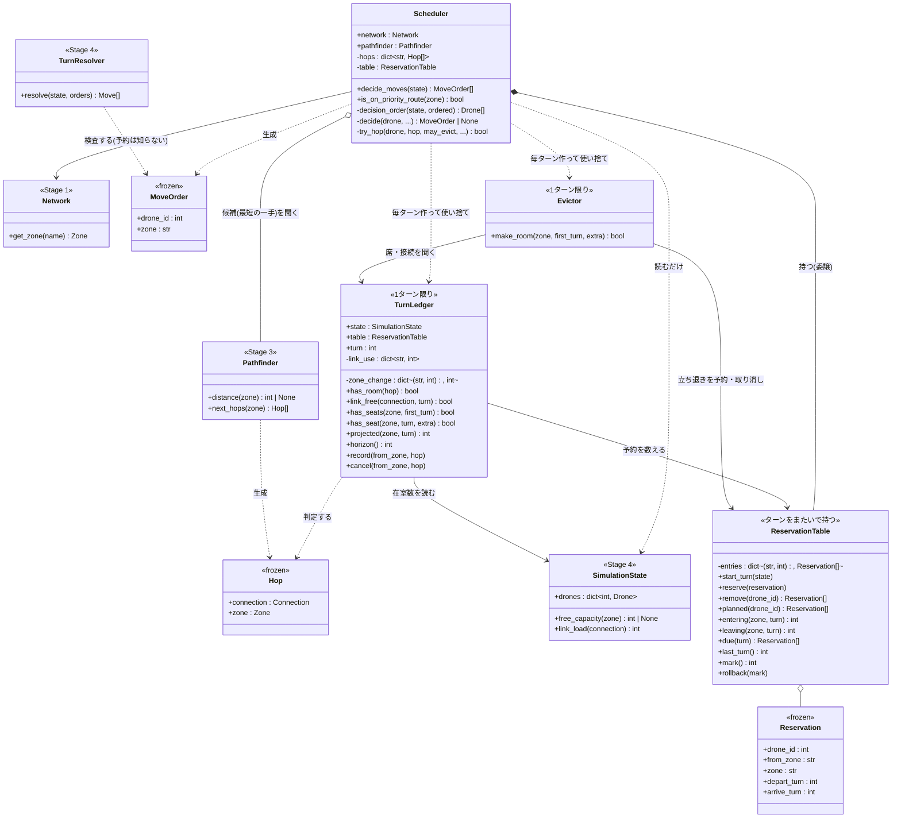
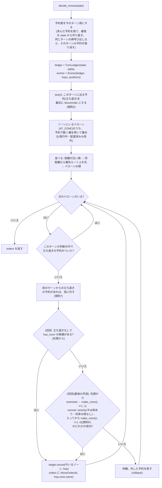
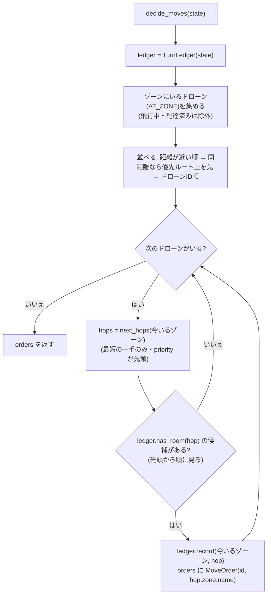
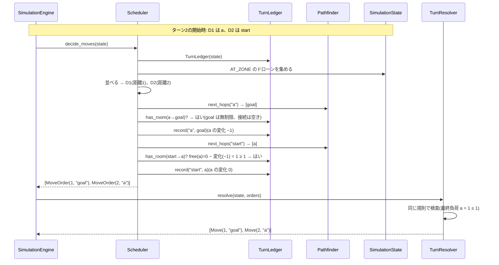
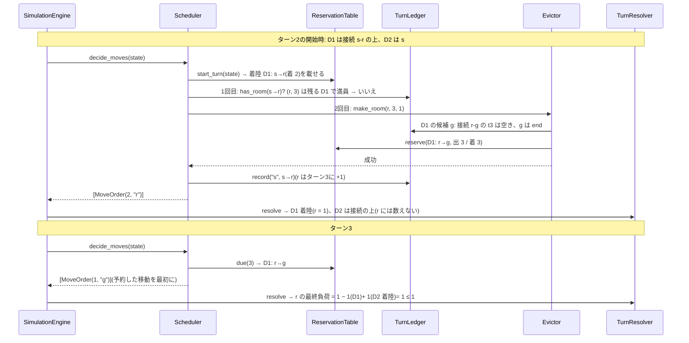

# ワークフロー: Stage 5(Multi-Drone Scheduler)詳細

- 日付: 2026-10-17
- 依頼内容: 残りステージの実装(`docs/decisions.md` 2026-10-16「残りステージの実装方針」)の第3弾として、
  Stage 5 の着手前の設計整理を行う
- 前提:
  - `docs/research/2026-09-17_workflow-all-stages.md` の Stage 5 を詳細化したもの。
  - 判断の順序はユーザーの設計(`docs/decisions.md` 2026-10-16「残りステージの実装方針」2)を、
    2026-10-17 のユーザー判断で「飛行中 → ゴールに近い順 → 同じ距離の中で優先ルートを先 → ID順」に改めたもの
    (`docs/decisions.md` 2026-10-17「判断の順序を『距離が近い順』を先にし…」)。
  - 移動先の候補は `Pathfinder.next_hops`(最短の一手だけ。priority は同点の中で先頭)をそのまま使い、
    **遠回りはしない**(同 3、2026-10-16「距離が最小の隣接ゾーン…」「priority は次の1手の同点の中だけで優先する」)。
  - ルール(容量の数え方・restricted の予約・接続は双方向で共有)は Stage 4 の `TurnResolver` と同じ
    (`docs/decisions.md` 2026-10-16「Stage 4 の API」「restricted への移動は…」「容量の数え方…」)。

> **2026-10-19 更新(予約表と立ち退きを実装)**: `docs/research/2026-10-18_design-timed-reservation.md` の設計
> (予約表1つ・立ち退き・最後の手段・規則6')を実装した(ブランチ `feature/timed_reservation`)。
> この文書の構造図・挙動図 (a)・台帳の数え方の表は実装後の形に改めた。挙動図 (b) は予約が絡まない例なので、そのまま成り立つ。
> restricted と立ち退きが絡む例(S07)は (c) に追加した。以前の数え方・流れは「(旧)」として残す。

## ゴール

`Scheduler.decide_moves(state) -> list[MoveOrder]` を実装し、配布マップすべてで `nb_drones` 全機を
ルール違反なく goal に届ける。

- 飛行中(restricted へ移動中)のドローンには指示を出さない(エンジンが着地させる)。
- 「ゴールまでの距離が近いゾーンにいるドローン」から順に判断する。同じ距離の中では「優先ルート上のドローン」を先にし、
  それでも同じならドローンID順。
- 各ドローンは `next_hops` の候補を先頭から見て、**このターンまだ空きがある最初の候補**へ進む。
  どの候補にも空きがなければ待機する(指示を出さない)。
- 空きの判定は、そのターンにすでに出した指示を反映した**台帳(`TurnLedger`)**で行い、
  `TurnResolver` が拒否しない指示だけを出す。

### 「優先ルート上のドローン」の定義

ゾーンにいるドローンのうち、次のどちらかに当てはまるもの。

1. 今いるゾーンが `zone=priority`。
2. `next_hops(今いるゾーン)` の先頭が `zone=priority`(= 最短の一手の中に priority のゾーンがある。
   `next_hops` は priority を先頭に並べるため、先頭を見れば足りる)。

「2手先以降に priority がある」ことは見ない(2026-10-16「priority は次の1手の同点の中だけで優先する」と同じ範囲に揃える)。
優先ルートかどうかは、同じ距離のドローンの中の順序(タイブレーク)にだけ使う。

## 対象ファイル

| ファイル | 内容 | 状態 |
|---|---|---|
| `droneflow/simulation/turn_ledger.py` | `TurnLedger`(1ターン分の指示と予約表から、ゾーンの席・接続の使用数を数える) | 新規(2026-10-19 に将来のターンの席を追加) |
| `droneflow/simulation/scheduler.py` | `Scheduler.decide_moves`(予約した移動を先に、判断の順序、候補の選択、最後の手段の立ち退き) | スケルトンを置き換え(2026-10-19 に予約表を持つ) |
| `droneflow/simulation/reservation_table.py` | `Reservation` / `ReservationTable`(予約表。`mark` / `rollback`) | 2026-10-19 新規 |
| `droneflow/simulation/evictor.py` | `Evictor`(立ち退きの再帰と取り消し、1ターン限り) | 2026-10-19 新規 |

`Pathfinder` / `SimulationState` / `SimulationEngine` は変更しない(読むだけ)。`TurnResolver` は 2026-10-19 に、
着陸を最終負荷に数え、restricted への出発は数えないように変えた(Stage 4 の文書を参照)。

## 構造図(静的な形)

継承は使わない。`Scheduler` は `Pathfinder` と `ReservationTable` を持ち(委譲)、1ターンの数え上げは `TurnLedger`、
立ち退きは `Evictor` に任せる。`TurnLedger` は `TurnResolver` と同じ規則を「指示を1つ足すごとに」判定でき、
さらに予約表に載っている将来のターンの席も数える形にしたもの。`decide_moves` は1ターンに1回呼ぶ前提で、
同じターンにもう一度呼ばれたら、そのターンに作った予約を捨てて計画し直す(前のターンを渡されたら予約表を空にして始め直す)。

### `TurnLedger` の数え方(2026-10-19 以降)

t は今計画しているターン(`state.turn_number + 1`)。

| 対象 | 判定 | 指示を記録したときの変化 |
|---|---|---|
| 見込みの在室数 `projected(z, T)` | 「今いる数(`state.occupancy`)+ t〜T に z へ入る予約・指示 − t〜T に z から出る予約・指示」 | 出発元はターン t に −1。移動先はターン t に +1(restricted ならターン t+1 に +1) |
| 席 `has_seat(z, T, extra)` | `projected(z, T) + extra ≤ max_drones`。start / end は常に席あり | — |
| `has_room(hop)`(立ち退きなし) | 接続に空き、かつ入るターン(normal / priority は t、restricted は t+1)から `horizon()` までの**どのターンにも席がある**(規則3・規則6) | — |
| 接続 c `link_free(c, T)` | 「T に出発する予約のうち c を通る数」+(T = t なら記録した指示の数)< `max_link_capacity` | 使用数 +1(向きは区別しない) |

- 予約表には、このターンに着陸する機(毎ターン `SimulationState` から作り直す)と、立ち退きの予約が載る。
  着陸する機は着陸のターン(t)から在室に数え、接続の使用には数えない。
- 残る機(出ていく予約のない機)は、将来もずっとそこにいるものとして数える。
- `horizon()` は予約表に載っている最後のターン(と t+1 の大きいほう)。それより後は在室数が変わらないので見なくてよい。
- `cancel(from_zone, hop)` は `record` の取り消し(規則6' で、入ってから立ち退きに失敗したとき)。

#### (旧)2026-10-18 までの数え方

| 対象 | 空きの判定 | 指示を記録したときの変化 |
|---|---|---|
| ゾーン z(start / end 以外) | `state.free_capacity(z) − 変化(z) ≥ 1` | 出発元 −1、移動先 +1 |
| ゾーン z(start / end) | 常に空きあり(`free_capacity` が None) | 記録はするが判定に使わない |
| 接続 c | `使用数(c) < max_link_capacity` | 使用数 +1(向きは区別しない) |

- `free_capacity` は「いる数+予約数」から求めるので、restricted の予約(飛行中の分)は最初から埋まっている。
  restricted へ出発する指示は、移動先に +1 するだけで予約の規則と一致する(`TurnResolver` も出発時に数える)。
- 飛行中(このターンに着地する)ドローンは着地で接続を空けるので、接続の使用数には数えない(2026-10-18 に改めた。当初は `state.link_load(c)` を足し、着地で使う接続も最初から埋まっているとしていた)。
- 退出(−1)は記録した時点から空きとして使える。最終的な負荷で判定する `TurnResolver` に対し、
  台帳は「途中までの指示」で判定するので、後から退出が増えても違反にはならない(保守的)。

## 挙動図(実行時の振る舞い)

### (a) 1回の `decide_moves` の流れ(2026-10-19 以降)

`make_room` は失敗するとその試みで作った仮の予約をすべて取り消す。規則6' で入った後に失敗したら、`ledger.cancel` で記録も取り消す。
立ち退きの再帰の流れは `docs/research/2026-10-18_design-timed-reservation.md` の 4.3 の図のとおり。

#### (旧)2026-10-18 までの流れ

### (b) エンジンとのやり取り(1ターン)

例: `start - a - goal`(a は容量1)、ドローン2機。ターン2で D1 が a を出て、同じターンに D2 が a に入る。

### (c) 予約表と立ち退き(S07: `s → r → g`、r は restricted・容量1、2機)

## デッドロックが起きない理由

(2026-10-19 補足: 予約表と立ち退きを入れた後も成り立つ。予約した移動と着陸はターンの最初に必ず起きる。
どちらもないターンでは下の 2 の議論がそのまま成り立つ(距離が最小の機の行き先には、まだ予約が入っていない。
予約を作るのは、それより後に判断される距離の大きい機だけ)。詳しくは設計文書の 6。)

この方針では、移動は必ず「ゴールまでの距離が真に小さいゾーン」への移動になる(`next_hops` は
`turn_cost(v) + dist(v) = dist(u)` を満たす v だけを返し、`turn_cost ≥ 1`)。そのため次が言える。

1. 飛行中のドローンがいれば、そのターンは必ず着地があり、誰かが動く。
2. 飛行中のドローンがいなければ、ゾーンにいるドローンのうち距離が最小の1機 D(ゾーン u)を考える。
   D の候補 v は `dist(v) < dist(u)` なので、v には誰もいない(全員の距離は `dist(u)` 以上)し、予約もない(飛行中がいない)。
   接続にも飛行中のドローンはいない。D より先に判断されたドローンが誰も指示を受けていなければ、v にも接続にも空きがあり
   (容量は正の整数)、D は動ける。誰かが先に指示を受けていれば、その時点で動くドローンがいる。
3. よって毎ターン少なくとも1機が動き(または着地し)、「誰も動かないターン」(`SimulationError`)は起きない。
4. 1回の動き(着地を含む)ごとに、全機の「残り距離の合計」が1以上減る(restricted は出発と着地で計2)。
   合計の初期値は `nb_drones × dist(start)` 以下なので、ターン数もこれ以下で必ず終わる。
   `dist(start) ≤ 2 × (ゾーン数 − 1)` なので、エンジンの上限 `2 × ゾーン数 × nb_drones` を超えることもない。

相互待ち(A が B の空きを、B が A の空きを待つ)は、距離が単調に減る向きにしか動かないため構造的に起きない。

### 距離順を先にする理由(当初の「優先ルートを先」から変更)

当初は優先ルートのドローンを距離に関係なく先に判断していた。その場合、優先ルートのドローンの移動先に
「まだ判断されていない(このあと出ていく)ドローン」がいると、退出が台帳に載っておらず満員に見えて1ターン待ってしまう
(課題の例で下限7ターンに対し11ターン)。距離が近い順を先にすると、移動先(距離が真に小さいゾーン)にいるドローンは
必ず先に判断済みなので、同じターンの退出で空いた分を常に使える。1周の判断で足りる。

## 作業項目

1. `turn_ledger.py`: `TurnLedger(state)` を実装する(`has_room(hop)`、`record(from_zone, hop)`)。
2. `scheduler.py`: `Scheduler(network, pathfinder)` を実装する(`next_hops` のゾーンごとのキャッシュ、
   `is_on_priority_route(zone)`、判断の順序、最初の空き候補の選択、`decide_moves`)。
3. 配布マップ10枚と課題の例で `MapParser → Pathfinder → Scheduler → SimulationEngine` を通し、
   ターン数を課題の目標(VII.7)と比べる(アドホック、コミットしない)。結果は
   `docs/research/2026-10-17_stage5-benchmark.md` に記録する。
4. `flake8` / `mypy --strict` / 既存テストを通す。

## スコープ外

- 遠回り(最短でない一手)による負荷分散・戦略的な迂回(ユーザー判断で採らない)。
- 時間展開の予約方式など、別方式のスケジューラ(2026-10-16 の代替案)。
- 目標ターン数に合わせたアルゴリズムの調整(届かない場合は原因と選択肢を報告するだけ)。
- `app.py` / `cli.py` での組み立て(別ステージ)。
- 単体テストの作成(別のテスト設計・作成フェーズで行う)。

## 完了条件(Done)

- `droneflow/simulation/scheduler.py` に `NotImplementedError` が残っていない。
- 配布マップ10枚と課題の例で、全機が `SimulationError` なしに goal に着く。
- 既存テストがすべて通り、`flake8` と `mypy --strict` がエラーなしで通る。

## レビュー時の確認事項

- 飛行中のドローンに指示を出していないか。配達済みのドローンを判断に含めていないか。
- 候補は `next_hops` だけか(遠回りや自己ループの移動をしていないか)。
- 台帳の規則が `TurnResolver` と一致しているか(退出で空く、restricted は着陸のターンから数える、接続は双方向で共有、
  着陸する機は接続を使わない、start / end は数えない)。将来のターンの席(予約表)も見ているか。
- 予約した移動を最初に出しているか。立ち退きは最後の手段(1回目は立ち退きなし)か。失敗した試みの予約がすべて取り消されているか。
  先に動いた機の予約を消しているか(規則7)。
- 判断の順序が「距離が近い順 → 同距離なら優先ルート → ID順」になっているか。優先ルートの定義が上記どおりか。
- `docs/decisions.md` の 2026-10-16 の各決定(特に priority の扱い、遠回りしない)と食い違っていないか。
- `docs/bugs.md` に記録すべき不整合が残っていないか。
