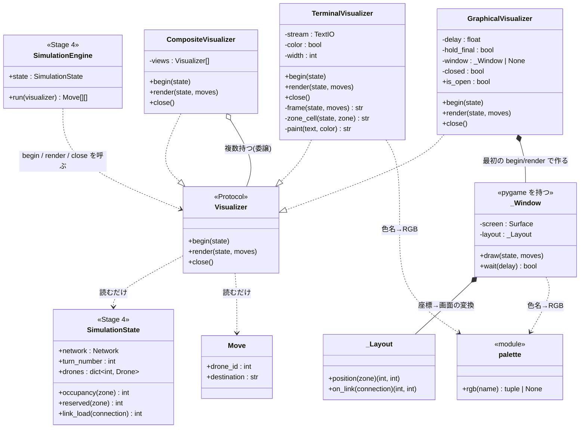
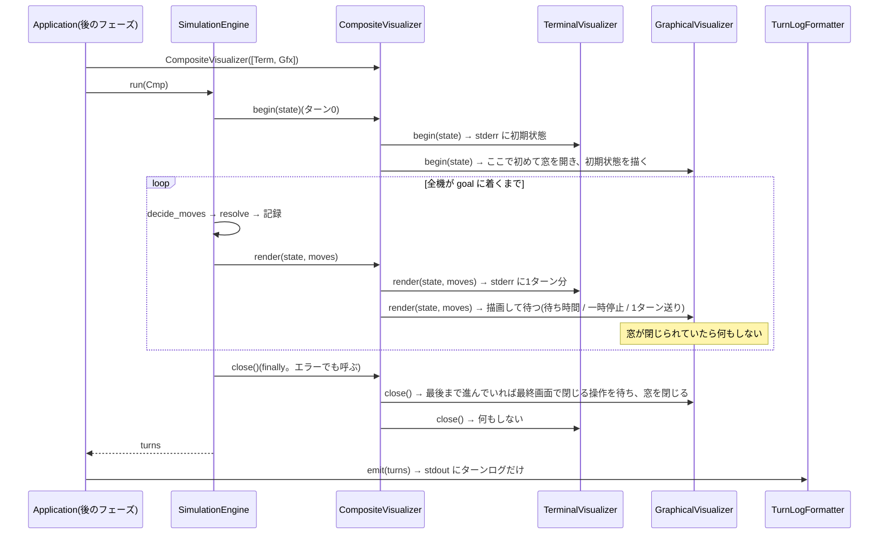
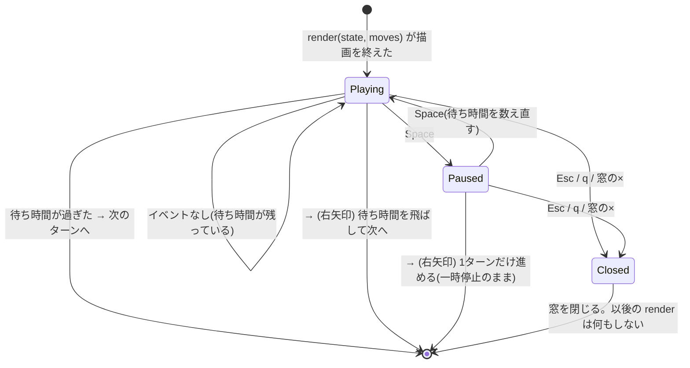

# ワークフロー: Stage 7(Visualization)詳細

- 日付: 2026-10-17
- 依頼内容: 残りステージの実装(`docs/decisions.md` 2026-10-16「残りステージの実装方針」)の第4弾として、
  Stage 7(可視化)の着手前の設計整理を行う
- 前提:
  - `docs/research/2026-09-17_workflow-all-stages.md` の Stage 7 を詳細化したもの。
  - ターミナル(ANSI カラー、ゾーンの `color=` を使う)とグラフィカル(pygame)の**両方**を作る
    (`docs/decisions.md` 2026-10-16「残りステージの実装方針」4)。pygame は Python 3.14 用のビルドがないため、
    互換の `pygame-ce`(2.5.8、`import pygame` で使える、型スタブ同梱)を `.venv` に入れてある。
  - 課題の要件: VI(色は任意の1語の文字列で、決まった一覧はない)、VII.1(色付きのターミナル出力でドローンの移動と
    ゾーンの状態を示す、またはネットワークとドローンの位置を示すグラフィカル画面、または両方)、
    VII.6(可視化の質は副次的な評価指標)、VIII(README に可視化の機能を書く)。
  - 出力形式(VII.5)の1ターン1行のログは、可視化の有無にかかわらず崩さない。
  - Stage 4 のテスト設計で挙がった「`render(state)` には状態しか渡らず、そのターンに誰が動いたかが分からない」
    という点をここで解消する。

## ゴール

1. `Visualizer` の約束(プロトコル)を「開始・毎ターン・終了」の3つにし、毎ターンの呼び出しにそのターンの `Move` を渡す。
2. `TerminalVisualizer`: 毎ターン、ターン番号・このターンの移動・各ゾーンの占有数と容量・接続上を飛行中のドローンを、
   ゾーン名を `color=` の色で塗って短くまとめて表示する。**出力先は標準エラー出力(stderr)**にし、
   標準出力(stdout)は可視化の有無にかかわらず課題どおりのターンログだけにする。
3. `GraphicalVisualizer`(pygame): ゾーンを座標どおり(画面に収まるよう拡大縮小)に描き、接続を線(容量の表示つき)、
   ゾーンの色・容量に対する埋まり具合・ドローンの点(飛行中は接続の上)・ターン数を表示する。
   一時停止・1ターン送り・自動再生(待ち時間を設定可)と、途中で閉じる操作を持つ。
4. `CompositeVisualizer`: 複数のビューに同じ呼び出しを配る(`--visual=both` 用)。
5. pygame の import は `graphical_view.py` の中だけに閉じ込め、pygame がなくてもほかは動くようにする。

## API(スケルトンからの変更)

| 対象 | 変更前 | 変更後 |
|---|---|---|
| `Visualizer`(プロトコル) | `render(state)` | `begin(state)` / `render(state, moves)` / `close()` |
| `SimulationEngine.run` | 毎ターンの後に `render(state)` | 最初に `begin(state)`、毎ターンの後に `render(state, moves)`、最後に(例外でも)`close()` |

- `begin(state)`: 1ターン目の前に1回。ターン0(全機が start)の状態を表示する。グラフィカルはここで初めて窓を開く。
- `render(state, moves)`: ターンを適用して記録した直後に1回。`moves` はそのターンの `Move`(ドローンID順、空でない)。
- `close()`: `run` の終わりに必ず1回(`try/finally`。`SimulationError` で止まった場合も呼ぶ)。窓を閉じる。
- エンジンの戻り値・例外・`render` の回数とタイミング(ターンの適用後に1回ずつ、誰も動かないターンでは呼ばない)は変えない。
  既存テストの `RecordingVisualizer` は、シグネチャに合わせて `render(state, moves)` にし、何もしない `begin` / `close` を
  足すだけ(アサーションは変えない)。

## 対象ファイル

| ファイル | 内容 | 状態 |
|---|---|---|
| `droneflow/visualization/base.py` | `Visualizer` プロトコル(`begin` / `render` / `close`) | スケルトンを変更 |
| `droneflow/visualization/composite.py` | `CompositeVisualizer`(複数ビューへの配信) | 新規 |
| `droneflow/visualization/palette.py` | 色の名前 → RGB の表と引き当て(pygame に依存しない) | 新規 |
| `droneflow/visualization/terminal_view.py` | `TerminalVisualizer`(ANSI カラーのテキスト、stderr) | スケルトンを置き換え |
| `droneflow/visualization/graphical_view.py` | `GraphicalVisualizer`(pygame の窓、操作) | スケルトンを置き換え |
| `droneflow/simulation/engine.py` | `begin` / `render(state, moves)` / `close` の呼び出し | 変更 |
| `tests/simulation/conftest.py` | `RecordingVisualizer` をプロトコルに合わせる | 変更(アサーションは変えない) |

`cli.py` / `app.py`(`--visual` の解釈とビューの組み立て、ターンログの印字)はこのステージでは触らない(後の CLI/アプリのフェーズ)。

## 構造図(静的な形)



- 継承は使わない。プロトコルは構造的な型(`..|>` は「同じ形を持つ」の意味)。`CompositeVisualizer` はビューを持って配るだけ。
- `GraphicalVisualizer` は pygame の状態(窓・フォント・時計)を `_Window` に分け、構築時には何も開かない。
  座標の拡大縮小は `_Layout` に分ける。
- ビューは状態を**読むだけ**で、変えない。

### 色の決め方

1. `palette.rgb(name)`: よく使う色名(配布マップに出る black / blue / brown / crimson / cyan / darkred / gold / green / lime /
   magenta / maroon / orange / purple / red / violet / yellow、および gray / grey / white / pink など)の RGB 表を引く。
   大文字小文字は区別しない。見つからなければ None。
2. グラフィカルは、表になければ pygame の色名表(`pygame.Color` が知っている名前)も試す。
3. どちらにもない名前(例: `rainbow`)と `color` 省略(None)は**既定の色**にする。例外にはしない。
4. ターミナルは RGB を 24bit の ANSI(`ESC[38;2;r;g;bm`)で出す。色を出すのは「`NO_COLOR` が空でない値で設定されていない」
   かつ「出力先が端末(`isatty()`)」のときだけ(コンストラクタの `color=True/False` で上書き可)。

### ターミナル表示の形(1ターン分)

```
=== Turn 3 | moved 2 | delivered 1/5 ===
moves: D1-goal D4-corridorA
  hub         start  2/-     corridorA   P      2/2*   roof1       R      0/1
  roof2       .      1/1*    tunnelB     .      1/1*   obstacleX   X      --
  goal        end    1/-
drones: hub[D5] corridorA[D3 D4] roof2[D2] tunnelB[...]
in flight: D2 hub-roof1 -> roof1
```

- ゾーンは宣言順に、端末の幅に合わせて1行に複数並べる(54ゾーンのマップでも数十行にならないように)。
- 種別の印: `.` normal、`P` priority、`R` restricted、`X` blocked、start / end は `start` / `end`。
- 容量: `いる数/max_drones`(start / end は `/-` で無制限)、満員は `*`、予約(飛行中の到着予定)があれば `+N`。blocked は `--`。
- ゾーン名を `color=` の色で塗る。色を出さない設定でも、文字だけで同じ情報が読める。
- 出力はすべて ASCII(Windows でリダイレクトしたときの文字コードで落ちないように)。

## 挙動図(実行時の振る舞い)

### (a) ビューを使った1回の実行



### (b) グラフィカルの待ち(1ターン分の event loop)



- 上下の矢印(または `+` / `-`)で待ち時間を半分 / 2倍にする。
- 待っている間も60fps程度でイベントを処理し、窓が固まらないようにする。
- `close()` のとき、最後のターンまで描いていて `hold_final=True` なら、「finished」と表示して Esc / q / × を待つ。
  途中で止まった場合(エラー)は待たずに閉じる。

### 途中で窓を閉じたとき

窓を閉じても**シミュレーションは止めない**。以後の描画だけをやめ、エンジンは最後まで計算し、ターンログは最後まで出る。
ターミナル表示(both のとき)も続く。

## 作業項目

1. `base.py`: プロトコルを `begin` / `render(state, moves)` / `close` にする。
2. `engine.py`: `run` で `begin` → 毎ターン `render(state, moves)` → `finally` で `close`。`tests/simulation/conftest.py` の
   `RecordingVisualizer` を合わせる。
3. `palette.py`: 色名の表と `rgb(name)`。
4. `terminal_view.py`: 1ターン分の文字列を作る処理と、stderr への書き出し、色を出すかの判定。
5. `graphical_view.py`: `_Layout`(座標の変換)、`_Window`(描画と待ち)、`GraphicalVisualizer`(遅延の作成と閉じた後の扱い)。
6. `composite.py`: `CompositeVisualizer`(すべてのビューに配り、`close` は1つが失敗しても全部呼ぶ)。
7. 課題の例と hard のマップで、ターミナル(出力を保存)とグラフィカル(`SDL_VIDEODRIVER=dummy`)を通して確かめる(アドホック、コミットしない)。
8. `flake8` / `mypy --strict` / 既存テストを通す。

## スコープ外

- `cli.py` / `app.py`(`--visual` の解釈、ビューの組み立て、ターンログの印字のタイミング)。後の CLI/アプリのフェーズで行う。
- README への可視化機能の記載(VIII)。Stage 9(ドキュメント)で行う。
- 可視化の単体テスト(別のテスト設計・作成フェーズで行う)。
- アニメーション(ターンの途中の補間)、マウスでの拡大・移動、副次指標(VII.6)の計算と表示。
- Windows の古いコンソール(conhost)で ANSI を有効にする処理。

## 完了条件(Done)

- `droneflow/visualization/` に `NotImplementedError` が残っていない。
- 課題の例と hard のマップで、ターミナル表示が stderr に出て、stdout には何も出ない。
- `SDL_VIDEODRIVER=dummy` で、グラフィカル表示が窓を開いて全ターンを描き、例外なく閉じる。
- pygame を import しなくても `droneflow.visualization.base` / `terminal_view` / `composite` と `engine` が使える。
- 既存テストがすべて通り、`flake8` と `mypy --strict` がエラーなしで通る。

## レビュー時の確認事項

- エンジンの振る舞い(戻り値・例外・`render` の回数とタイミング)が変わっていないか。`close` がエラーのときも呼ばれるか。
- ビューが状態を変えていないか(読むだけか)。
- stdout に可視化の出力が混ざらないか。`NO_COLOR` と端末でない出力先で色の制御文字が出ないか。
- 知らない色名・`color` なしで落ちないか。blocked・restricted・priority・start / end の表示が区別できるか。
- 飛行中のドローンが接続の上に描かれ、予約が容量の表示に出ているか。
- pygame の import が `graphical_view.py` に閉じているか。構築だけでは窓が開かないか。窓を閉じた後の `render` が何もしないか。
- `docs/decisions.md`(特に 2026-10-16 の出力形式、2026-10-03 のフォーマッタ)と `docs/bugs.md` と食い違っていないか。
