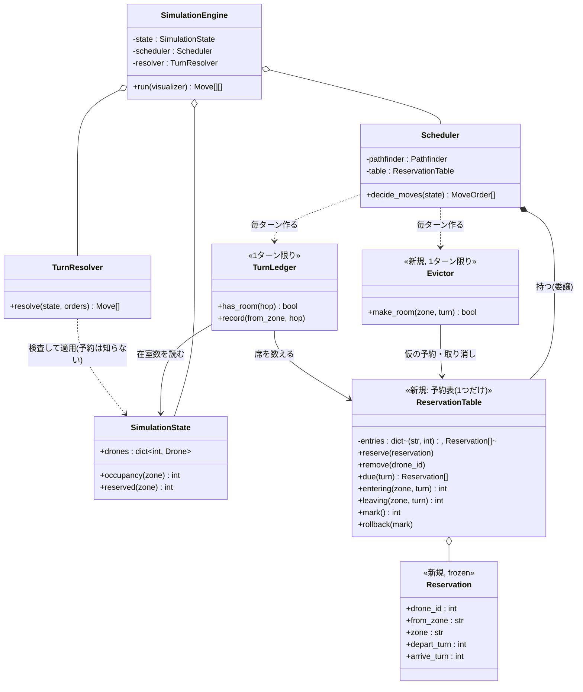
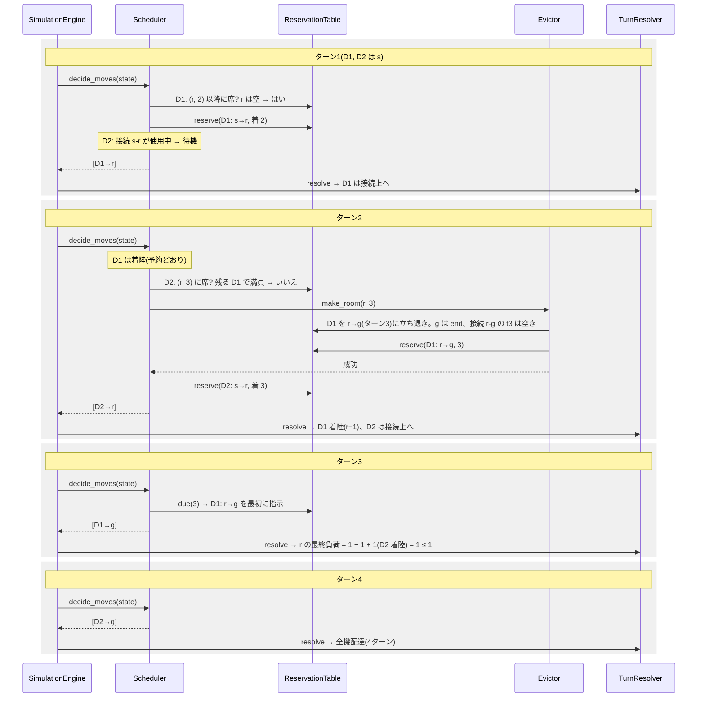
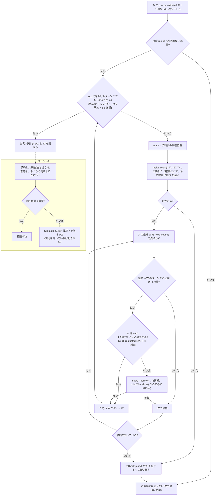

# 設計案: restricted の予約表と立ち退き

- 日付: 2026-10-18
- 依頼内容: S07(`revie_case/maps/sim/S07_restricted_no_wait_on_link.txt`)を4ターンで終えられるよう、
  restricted への移動を「どのゾーンに、どのターンに、どのドローンが入るか」の予約表で管理する(ユーザーのモデル)。
- ブランチ: `feature/timed_reservation`(`fix/restricted_link_release` から作成)
- **この文書は設計案のみ。コードとテストは変更していない。** 試作は scratchpad の使い捨てで、コミットしていない。
- 改訂履歴(どれも 2026-10-18):
  1. 初版: 「約束」による設計(コミット `ed947b8` / `d3dfd3a`)。ユーザー判断で取り下げ(仕組みが大きすぎる)。
  2. 第2版: ユーザーのモデル「予約表だけ。r に今いる機は数えない」(コミット `439f901`)。配布マップでは問題ないが、
     出口が細い restricted で**接続上で詰まる**(着陸できない)ことが分かった。
  3. **本版**: ユーザーの補足「席がなければ、r にいる機を立ち退かせる。立ち退きも移動なので同じ予約表に入れる」。
     試作では、どのマップでも詰まりは0件。

## 用語

| 用語 | 意味 |
|---|---|
| **予約表** | 「ゾーン z に、ターン T に入るドローン」の表。`{(z, T): [予約]}`。表はこの1つだけ。 |
| **予約** | 予約表の1行。「ドローン D が、ターン T に、ゾーン u から z へ入る」。restricted へ出発した機の着陸と、立ち退きの移動が載る。 |
| **立ち退き** | 席を空けるために、ゾーンにいるドローンを決まったターンに次のゾーンへ動かすこと。その移動も予約として表に載せる。 |
| **残る機** | ゾーンにいて、そこから出ていく予約のない機。将来もずっとそこにいるものとして数える。 |
| **席がある** | ゾーン z のターン T について「残る機 + T までに z に入る予約 − T までに z から出る予約」+1 が容量以下であること。 |
| **接続上で詰まる** | 着陸のターンに満員で着陸できないこと。接続の上では待てない(課題 VII.3)ので、ルール違反の `SimulationError`。 |
| **t / t+1** | t は今決めているターン、t+1 はその次のターン。 |

## 1. 背景: S07 で何が起きているか

マップ: `s → r → g`、`r` は restricted(入るのに2ターン)・容量1、ドローン2機。接続はどちらも容量1。

### 今のプログラム(5ターン)

今は、restricted へ出発する機は「r にいる数 + 予約数」が容量未満のときだけ出発できる。r に着陸した D1 がいる間は D2 が出発できない。

| ターン | 出力 | 説明 |
|---|---|---|
| 1 | `D1-s-r` | |
| 2 | `D1-r` | D1 が着陸。D2 は r が埋まっているので待つ |
| 3 | `D1-g D2-s-r` | |
| 4 | `D2-r` | |
| 5 | `D2-g` | 5ターン |

### 本設計(4ターン)

ターン2で D2 が出発するには、ターン3の r に席が要る。r には D1 が残っているので、**D1 をターン3に g へ立ち退かせる予約**を作る。
行き先 g は end(無制限)なので、この予約は必ず作れる。こうしてターン3の r に席ができ、D2 は出発できる。

| ターン | 出力 | 予約表に載るもの | ターンの終わりの r |
|---|---|---|---|
| 1 | `D1-s-r` | (r, 2): D1 が s から | 0 |
| 2 | `D1-r D2-s-r` | (g, 3): D1 が r から(立ち退き) / (r, 3): D2 が s から | 1(D1) |
| 3 | `D1-g D2-r` | — | 1(D2)。予約どおり D1 が出て、D2 が着く |
| 4 | `D2-g` | — | 0 |

## 2. 規則

1. **restricted への移動は強制**: 出発した機は次のターンに必ず着陸する(今と同じ。エンジンが自動で着陸させる)。
2. **予約表は1つ**: 着陸も立ち退きも、移動はすべて「(入るゾーン, 入るターン) に、どの機がどこから」の予約として同じ表に載せる。
   約束・凍結のような別の仕組みは作らない。
3. **出発してよい条件**: ターン t に restricted の r へ出発してよいのは、**t+1 以降、予約表に載っているどのターンでも r に席がある**とき。
   席を数えるときは、r に残る機(出ていく予約のない機)を数える。席がなければ、**立ち退き**(4)を試す。
   - 接続容量: 出発するターンは数え、着陸するターンは数えない(2026-10-18 の決定のまま)。
4. **立ち退き**: r の席がターン T に足りないとき、r に T−1 の終わりに確実にいて、予約のない機 X を1機選び、ターン T に r から出す予約を作る。
   1. X の行き先 W は `next_hops(r)` の候補を先頭から(遠回りしない)。
   2. 接続 r–W の、ターン T の使用数(予約の分)が容量未満であること。
   3. W に X の席があること。W が normal / priority なら (W, T) 以降、W が restricted なら X は T に出発して T+1 に着くので (W, T+1) 以降。
      W が end なら常に席がある。
   4. W に席がなければ、W にいる機を同じやり方で立ち退かせる(**再帰**)。
   5. どこかで失敗したら、その試みで作った仮の予約を**すべて取り消す**。立ち退きができなければ、最初のドローンはその候補をあきらめ、
      次の候補を試すか、待つ。
5. **予約した移動は、そのターンの最初に必ず行う**: 着陸と同じく、ふつうの判断より先に処理する。
6. **ふつうの移動も予約表を守る**: normal / priority のゾーン W へふつうに入るときも、今のターンと、予約表に載っている将来のどのターンでも
   W に席があることを確かめる(立ち退きの機のために取った席を、ほかの機が先に使ってしまわないため)。
   **規則6'(2026-10-18 採用、8.1)**: 将来の席が足りなくても、入る機自身(または W にいる機)をその予約されたターンまでに立ち退かせる予約が
   作れるなら入ってよい(作れなければ入らない)。
7. **凍結はしない**: 将来のターンに立ち退きの予約がある機でも、それより前にふつうの判断で動けるなら動いてよい。そのときは、
   その機の予約を表から消す(もう出ていったので、席を空けるという目的は果たされている)。
8. **新しい検出は1つだけ**: 着陸のターンに満員で着陸できない(接続上で詰まる)なら `SimulationError`。
   「予約が守られたか」「席が空いているか」の専用の検査は作らない(規則 3〜6 を守っていれば起きない。破れば詰まりかゾーン容量の違反として見つかる)。
9. **変えないもの**: 判断の順序(距離 → 優先ルート → ID)、遠回りしない、start / end は無制限、接続は向きを区別せず共有、
   自己ループの指示は拒否、誰も動かないターンはエラー。

### 2.1 立ち退きの再帰が必ず終わる理由

- 立ち退きの移動は `next_hops` の一手なので、`dist(W) = dist(z) − turn_cost(W)`、`turn_cost ≥ 1` より **dist(W) < dist(z)**。
- 再帰するたびに、ゴールまでの距離が真に小さいゾーンへ移る。距離は0以上の整数なので、再帰の深さは dist(r) 以下で、
  同じゾーンに戻ること(循環)はない。end(距離0)では必ず席があるので、そこで止まる。
- restricted を通るたびに予約のターンが1つ先に進むが、深さが有限なので、ターンも有限で止まる。
- 1つのゾーンについて立ち退かせる候補は1機だけ試せばよい(同じゾーンにいる機は、行き先の候補が同じなので結果も同じ)。

### 2.2 詰まらない理由

- ゾーン z のターン T の実際の在室数は、「残る機 + 入る予約 − 出る予約」以下になる。残る機が予定より早く出ていくことはあっても(規則7)、
  予約にない機が入ってくることはない(規則6。restricted へはそもそも予約なしでは入れない)。
- 予約した移動は、その時点で行き先の席と接続を取ってあり、ターンの最初に行う(規則5)ので、実行できる。
- よって着陸のターンにも必ず席があり、「接続上で詰まる」は起きない。第2版で詰まった例(5.3)も、この規則では詰まらない。

### 2.3 深さの制限がない

restricted がいくつ続いても、立ち退きの再帰がそのぶん先のターンまで予約を作るだけで、同じ規則で扱える。
試作では restricted が3つ続くマップ(`s → r1 → r2 → r3 → g`、3機)が9ターン(毎ターン1機ずつ出発できる下限)になった。

## 3. データとクラス

### 3.1 予約表

```text
Reservation(予約、frozen dataclass)
    drone_id : int
    from_zone : str     # どこから
    zone : str          # どこへ入るか
    depart_turn : int   # 出ていくターン(restricted なら着陸は depart_turn + 1)
    arrive_turn : int   # 入るターン

ReservationTable(予約表)
    _entries : dict[tuple[str, int], list[Reservation]]   # (zone, arrive_turn) → 予約
    reserve(reservation)
    remove(drone_id)                       # 規則7、または実行した後
    entering(zone, turn) / leaving(zone, turn) -> int
    due(turn) -> list[Reservation]         # そのターンに出ていく予約(規則5)
    mark() -> int / rollback(mark)         # 立ち退きの試みを取り消すため
```

### 3.2 誰が持つか

- **`Scheduler` が `ReservationTable` を持つ**(委譲)ことを提案する。
  - 第8項のとおり `TurnResolver` は予約を検査しないので、予約表を知る必要がない。予約表は「どう動かすかを計画する」ための道具で、
    スケジューラの持ち物にするのが自然。
  - 着陸は予約表にも載せるが、毎ターン `SimulationState`(飛行中の機と行き先)から作り直す。途中の状態から渡されても正しく動くようにするため。
  - 予約した移動は、スケジューラがそのターンの最初にふつうの `MoveOrder` として出す。そのため
    **`decide_moves(state) -> list[MoveOrder]` はそのまま**で、`TurnPlan` のような新しい型は要らない。
  - 注意: スケジューラが1ターンをまたいで情報を持つことになる。`decide_moves` は1ターンに1回だけ呼ぶ前提を docstring に書き、
    同じターンにもう一度呼ばれたら、そのターンに作った予約を捨ててから計画し直す。
- 代わりに `SimulationState` に持たせる案もある(状態が1か所にまとまる)。ただしその場合、新しい予約をスケジューラから
  `TurnResolver` に渡す手段(戻り値の型の変更)が要る。
- `SimulationState` の `reserved(zone)` / `load(zone)`(表示が使う)は今のまま残す。

### 3.3 台帳(`TurnLedger`)

| 判定 | 今 | 変更後 |
|---|---|---|
| normal / priority の W へ | 接続に空き、かつこのターンの最終負荷 ≤ 容量 | 加えて、予約表に載っている将来のどのターンでも W に席がある(規則6) |
| restricted の r へ出発 | 接続に空き、かつ「いる数+予約数」に空き | 接続に空き、かつ t+1 以降のどのターンでも r に席がある(規則3)。なければ立ち退きを試す |
| 予約した移動 | — | ターンの最初に記録する(規則5) |

席の数え方(見込みの在室数)は台帳に置き、立ち退きの再帰は小さなクラス(`Evictor`、1ターン限り)に分けて、
`Scheduler`(誰を先に・どこへ)、`TurnLedger`(数)、`Evictor`(誰を立ち退かせるか)の役割を分ける。

### 3.4 検査(`TurnResolver`)

- 着陸する機を、行き先の最終負荷に数える。restricted への出発は、出発のターンの負荷に数えない(ターンの終わりには接続の上にいる)。
- 満員のゾーンに着陸する機がいれば、「接続上で詰まった」として `SimulationError`(例: `turn 3: D3 is stuck on connection 's-r': zone 'r' is full`)。
- それ以外は今のまま(予約は知らない)。

## 4. 図

### 4.1 構造図



継承は使わない。`SimulationEngine` と `TurnResolver` の呼び出し方は変わらない。

### 4.2 挙動図: S07 のターン1〜4



### 4.3 挙動図: 出発・立ち退き・「接続上で詰まる」の経路



## 5. 試作の結果

- 方法: プロジェクトのパーサーと `Pathfinder` だけを使い、判断と規則を試作の中で書き直した(scratchpad、使い捨て)。
  完走したすべての出力を、試作とは別に書いた再生チェッカー(各ターンの最終負荷が容量以下、接続は出発のみ数えて容量以下、
  restricted へ出発した機は次のターンに必ず着く、隣のゾーンにしか動かない、最後に全機配達)で確かめ、違反は0件。
- 列: 「今」= 今のプログラム、「第2版」= 立ち退きなしのユーザーのモデル、「本設計」= 立ち退きあり。

### 5.1 ターン数

| マップ | 今 | 第2版 | **本設計** |
|---|---|---|---|
| S07 | 5 | 4 | **4** |
| 課題の例 | 7 | 7 | **7** |
| circular_loop | 15 | 10 | **10** |
| the_impossible_dream | 45 | 43 | **44** |
| restricted だけの例(テスト R02 のマップ) | 12 | 8 | **8** |
| revie_case X11(大きな格子) | 73 | 71 | **71** |
| 配布マップのほか9枚 | 4,4,4,8,8,13,16,26 | 同じ | **同じ** |
| revie_case のほか(S01〜S12、P01・P02・P04〜P06、X01・X04・X06〜X10) | — | 同じ | **同じ** |
| restricted が2つ続く(2機) | 7 | 6 | **6** |
| restricted が3つ続く(3機) | 11 | 9 | **9** |
| restricted → normal → restricted(3機) | 10 | 8 | **8** |
| 出口の接続が細い(例K1) | 6 | **詰まる** | **6** |
| 出口のゾーンが小さい(例K2) | 7 | **詰まる** | **7** |

- 配布マップ10枚・課題の例・revie_case: **詰まり0件、今より悪くなったマップなし**。
- the_impossible_dream は 44 で、`test_challenger_beats_reference`(45未満)を満たす。第2版の 43 より1ターン多いのは、
  第2版が「在室機がたまたま出ていけた」場面でも、本設計は立ち退きの予約が作れたときだけ出発させるため(安全な分、慎重)。

### 5.2 ランダムなマップ(参考)

restricted を多めに含む小さなマップ(ゾーン3〜12、2〜15機、容量1〜3、接続容量1〜2)7,832枚。偏った集まりなので、割合は目安。

| 項目 | 結果 |
|---|---|
| 本設計で詰まった | **0枚** |
| 第2版で詰まった | 350枚 |
| 本設計が今より良い / 悪い | 2,849枚 / **6枚** |
| 本設計が第2版より良い / 悪い(第2版が完走したもの) | 0枚 / 196枚 |
| 立ち退きの予約を、その前にふつうの判断で動いて消した(規則7) | 配布マップでは the_impossible_dream で7回 |

今より悪くなった6枚は、どれも「start から goal へ restricted を含む経路が2本あり、立ち退きで出発できるようになった機が、
下流の詰まりやすい経路に多く入ってしまう」型(先に出発できることが、いつも早く着くことにはならない。規則違反ではない)。
「まず立ち退きなしで全部の候補を見て、どれも使えないときだけ立ち退きを試す」(最後の手段)にすると、6枚 → 1枚になり、
配布マップ・revie_case の結果は変わらなかった(Q-C)。

### 5.3 例K1: 第2版では詰まり、本設計では詰まらない

`s → r → g`、r は restricted・容量2、`s-r` は接続容量2、`r-g` は接続容量1、4機。

第2版(r に今いる機を数えない):

| ターン | 出力 | ターンの終わりの r |
|---|---|---|
| 1 | `D1-s-r D2-s-r` | 0 |
| 2 | `D1-r D2-r D3-s-r D4-s-r` | 2(D1, D2)。D3・D4 は在室機を数えずに出発 |
| 3 | `D1-g` だけ(`r-g` は容量1) | 2 − 1 + 2 = **3 > 2 → D3・D4 が接続上で詰まる** |

本設計:

| ターン | 出力 | 予約表に載るもの | 説明 |
|---|---|---|---|
| 1 | `D1-s-r D2-s-r` | (r,2): D1, D2 | |
| 2 | `D1-r D2-r D3-s-r` | (g,3): D1 が r から(立ち退き) / (r,3): D3 | D3 のために D1 を立ち退かせる。**D4 のために D2 も立ち退かせたいが、`r-g` のターン3はもう D1 の予約で埋まっている** → 失敗・取り消し、D4 は待つ |
| 3 | `D1-g D3-r D4-s-r` | (g,4): D2 が r から / (r,4): D4 | |
| 4 | `D2-g D4-r` | | |
| 5 | `D3-g` | | |
| 6 | `D4-g` | | 6ターン(今と同じ)。詰まりなし |

出口の接続が1ターンに1機しか通さないので、入る数も自然に1ターン1機に抑えられる。

## 6. 課題の規則(VII.2 / VII.3)との関係

| 規則 | 本設計での扱い |
|---|---|
| ゾーンは各ターン容量以下(VII.2) | 今と同じ最終負荷の検査(着陸する機も数える) |
| 接続容量(VII.2) | 出発の数を検査(着陸は数えない)。立ち退きの予約は、そのターンの接続の使用数を先に取る |
| restricted は次のターンに必ず着き、接続上で待てない(VII.3) | 出発は着陸のターンの席が予約表で確保できたときだけ(2.2)。万一着陸できなければ `SimulationError`(違反した出力は出さない) |
| 出ていく機は同じターンに空きを作る(VII.3) | 今と同じ最終負荷の規則。予約した立ち退きも同じターンに空きを作る |
| 隣のゾーンへの移動・待機・restricted への接続だけ(VII.3) | 立ち退きの移動も `next_hops` の一手(隣・最短)。自己ループは `next_hops` に出ない |

デッドロック: 予約した移動と着陸はターンの最初に必ず起きる。どちらもないターンでは、今と同じく「距離が最小の機は必ず動ける」議論が成り立つ
(その機の行き先には、まだ予約が入っていない。予約を作るのは、それより後に判断される距離の大きい機だけ)。

## 7. 影響

### 7.1 変更するファイル

| ファイル | 変更 |
|---|---|
| `droneflow/simulation/reservation_table.py`(新規) | `Reservation`、`ReservationTable` |
| `droneflow/simulation/evictor.py`(新規) | `Evictor`(立ち退きの再帰と取り消し) |
| `droneflow/simulation/scheduler.py` | 予約表を持つ。ターンの最初に予約した移動を指示、restricted への出発で席を確かめ、なければ立ち退き |
| `droneflow/simulation/turn_ledger.py` | 将来のターンの席(予約表)も見る |
| `droneflow/simulation/turn_resolver.py` | 着陸を最終負荷に数え、restricted への出発は数えない。「接続上で詰まった」のメッセージ |
| `state.py` / `engine.py` | 変更なし(docstring の「予約が席を埋める」の説明だけ直す) |
| 可視化 | 変更不要 |

### 7.2 API

- `Scheduler.decide_moves(state) -> list[MoveOrder]`、`TurnResolver.resolve(state, orders)`、`SimulationEngine` は**そのまま**。
- 新しい公開クラスは `Reservation` / `ReservationTable`(と `Evictor`)。

### 7.3 テストの期待が変わるもの(一覧のみ。テストは編集していない)

このブランチですでに失敗している5件:

| テスト | 今の期待 | 本設計での期待 |
|---|---|---|
| `test_scheduler.py::test_no_order_for_drone_in_flight`(D12) | 指示なし | `[MoveOrder(2, "r")]`(接続は着陸で空き、r は容量2で、着陸して残る D1 と合わせて2) |
| `test_turn_ledger.py::test_drone_in_flight_uses_its_link`(L08) | False | True |
| `test_turn_ledger.py::test_link_counts_flight_and_orders_together`(L09) | 記録後 False | True(接続2のうち1、r は 1 + 1 + 1 = 3 ≤ 3) |
| `test_turn_resolver.py::test_landing_still_uses_the_connection[1]`(T14) | 接続の違反 | 合法(`D1-r D2-s-r`) |
| `test_scheduler_maps.py::test_challenger_beats_reference`(R05) | 45 未満(今は45で失敗) | **44 で通る見込み** |

本設計で期待が変わるもの:

| テスト | 今の期待 | 本設計での期待 |
|---|---|---|
| `test_turn_resolver.py::test_reserved_restricted_zone_is_full`(T13) | 2ターン目の D2 の出発は `zone 'r'` の違反 | 合法(`D1-r D2-s-r`)。`TurnResolver` は予約を検査しなくなる。次のターンに D1 が出なければ「接続上で詰まった」になる |
| `test_turn_resolver.py::test_violation_leaves_state_unchanged[into_reserved_zone]`(T21d) | 違反で状態が変わらない | 違反にならないので、場面を作り直す(例: 着陸で満員になる「接続上で詰まった」の場面) |
| `test_scheduler_maps.py::test_restricted_only_map_output`(R02) | 12行 | **8行**: `D1-hub-roof1` / `D1-roof1 D2-hub-roof1` / `D1-roof2 D2-roof1 D3-hub-roof1` / `D1-goal D2-roof2 D3-roof1 D4-hub-roof1` / `D2-goal D3-roof2 D4-roof1 D5-hub-roof1` / `D3-goal D4-roof2 D5-roof1` / `D4-goal D5-roof2` / `D5-goal` |
| 配布マップの目標(R04) | — | circular_loop 15 → 10、ほかは同じで目標内 |

変わらないもの:

- `test_turn_ledger.py::test_reservation_fills_restricted_zone`(L07): 台帳の `has_room` は立ち退きをしないので False のまま。
- `test_state.py`、`test_turn_resolver.py::test_departure_frees_room_for_reservation`(T16)。
- `test_engine.py::test_restricted_route_end_to_end`(G10): テスト用の `FollowerScheduler` は今の数え方で動き、より慎重なだけなので12行のまま。
- `test_scheduler_maps.py::test_every_turn_is_sound`(R03): 予約した移動もふつうの `MoveOrder`(最短の一手)なので、そのまま通る見込み。

新しく要るテスト(作成フェーズで設計): S07 の4ターン、立ち退きの成功(goal へ / normal を通る再帰 / restricted を通る再帰)、
失敗と取り消し(例K1 の D4)、予約した移動がふつうの判断より先に出る、凍結しない(先に動いたら予約が消える)、
「接続上で詰まった」の `SimulationError` で状態が変わらない、restricted が3つ続くマップ。

## 8. 決定事項と未決事項

> **2026-10-18 更新**: Q-A・Q-B・Q-C はユーザー判断で推奨案に決定した(`docs/decisions.md` 2026-10-18)。
> 規則6 と 規則6' の選択は 8.1 のとおり(試作の結果、6' は 6 と同じかそれ以上・詰まり0件)。

### Q-A. 予約表を誰が持つか(**決定: 案1**)

- 案1(採用): `Scheduler` が持つ。`decide_moves` / `resolve` / エンジンの形が変わらない。`TurnResolver` は予約を検査しないので要らない。
- 案2: `SimulationState` が持つ。状態が1か所にまとまるが、新しい予約をスケジューラから渡すため戻り値の型を変える必要がある。

### Q-B. 出発・立ち退きの予約を `TurnResolver` でも検査するか(**決定: 作らない**)

- ユーザーのモデルどおり作らない。破られれば「接続上で詰まった」かゾーン容量の違反として見つかる。

### Q-C. 立ち退きは「最後の手段」にするか(**決定: 案1**)

- 案1(採用): 各機はまず立ち退きなしで候補をすべて見て、どれも使えないときだけ、先頭から立ち退きを試す。
  ランダムなマップで今より悪くなる例が 6 → 1 枚。配布マップ・revie_case の結果は同じ。
  判断の詳細(例・残った1枚・README 用の英文)は `docs/research/2026-10-18_last-resort-eviction.md`。
- 案2: 候補を先頭から見て、restricted で席がなければその場で立ち退きを試す(規則どおりの素直な形)。

### 8.1 規則6 と 規則6'(ふつうの移動と、将来の予約された席)

ユーザーの質問:「居座らないように予約するのは無理そうでしたか」。

- **規則6(初めの案)**: ふつうの移動で normal / priority のゾーン W に入るとき、W の将来の予約された席(立ち退きで入ってくる機の席)を
  使ってしまうなら、その W には入らない。
- **規則6'(ユーザーの案)**: そういうときでも、**入ってくる機自身(または W にいる別の機)を、その予約されたターンまでに W から立ち退かせる予約**が
  作れるなら入ってよい。立ち退きは restricted への出発と同じ仕組み(`next_hops` の一手、行き先の席、接続、再帰、失敗したら取り消し)。
  作れなければ入らない(= 規則6 と同じ)。「最後の手段」も同じく適用する(1回目は立ち退きなし、2回目で立ち退き)。

#### 試作の結果(どちらも「最後の手段」あり)

| 項目 | 規則6 | 規則6' |
|---|---|---|
| 接続上で詰まった(全マップ) | 0 | **0** |
| 配布マップ10枚・課題の例・revie_case のターン数 | S07 4、circular_loop 10、the_impossible_dream 44 など | **すべて同じ** |
| 配布マップ・revie_case で規則6 が入場を止めた回数 | 0回 | (規則6' の立ち退きも0回) |
| ランダムなマップ 7,832枚: 今より良い / 悪い | 2,846 / 1 | 2,846 / 1 |
| ランダムなマップ: 規則6' が規則6 より良い / 悪い | — | **1枚 / 0枚** |
| 規則6 が入場を止めた場面(ランダムなマップ) | 1枚・9回 | 1枚で立ち退きを1回使い、ほかは規則6 と同じ判断 |

規則6' が効いた1枚(12機)では、ターン10に、z10 にいる D4 が normal の z5(容量1)へ入ろうとした。z5 にはターン11に、z4 から立ち退く
D5 の席が予約されている。

- 規則6: D4 は z5 に入れず待つ。全体で20ターン。
- 規則6': D4 は z5 に入り、同時に「D4 がターン11に z5 → goal へ出る」立ち退きの予約を作る(goal は end なので必ず成功)。
  ターン11に D4 が出て、D5 が入る。全体で19ターン(今のプログラムは30ターン)。

#### できるか・新しい危険はあるか

- **できる**。立ち退きの仕組みをそのまま使えば、追加の規則は「ふつうの移動で将来の席が足りないとき、入った後で W の席を立ち退きで確保する」だけ。
- 時間をまたぐ連鎖: W から立ち退く機の行き先 W' にも将来の予約があるかもしれないが、立ち退きの席の確認はもともと「そのターン以降のすべてのターン」で
  行っているので、同じ確認で扱える。restricted を通ればさらに1ターン先の予約になるが、距離が真に減るので再帰は必ず終わる(2.1 と同じ)。
- 入った機自身に立ち退きの予約がつくので、その機は予約したターンに必ず動く(凍結はしない。先に動ければ予約は消える)。
- 詰まらない理由(2.2)はそのまま成り立つ: 規則6' で入った機も、予約された席を使う前に必ず出ていく予約を持っている。
- 気になる点: 立ち退きを使う場面が「restricted への出発」から「ふつうの移動」にも広がるので、コードの分岐とテストが増える。
  ただし、配布マップでは一度も起きず、ランダムなマップでも 7,832 枚中1枚だけで、効果は小さい。

#### 判断

規則6' は規則6 と同じかそれ以上の結果で、詰まりは0件。ユーザーの案なので**規則6' を採用**とし、decisions.md に記録した(実装前に報告する)。
ただし効果はまれな場面に限られるので、実装の手間を減らしたい場合は規則6 のままでも結果はほぼ変わらない。

### これまでの決定の扱い

| 項目 | 扱い |
|---|---|
| 約束案の Q1〜Q6、`TurnPlan` | **不要 / 取り消し**(約束がない。`decide_moves` は `list[MoveOrder]` のまま) |
| Q4(challenger の45) | 本設計では44で通る見込み。別調査は、実装後に45未満にならなかった場合だけ |
| Q5(表示) | 表示しない(予約の着陸は今も「+N arriving」で見える) |
| 第2版の安全策の候補(M2L / M3 / M5) | 不要(本設計で詰まりが起きないため)。代替案として decisions.md に記録 |

## 9. 作業項目(実装する場合の順番の案)

1. `Reservation` / `ReservationTable`(`mark` / `rollback` を含む)とその単体テスト。
2. `TurnResolver`: 着陸を最終負荷に数える、restricted への出発は数えない、「接続上で詰まった」。
3. `TurnLedger`: 将来のターンの席。
4. `Evictor` と `Scheduler`(予約した移動を先に、出発の判定、立ち退き、規則7)。
5. 既存テストの期待の更新(7.3)と新しいテスト。配布マップ・課題の例・revie_case の再計測。

## レビュー時の確認事項

- 予約表が1つだけか(約束・凍結のような別の仕組みがないか)。
- 立ち退きの移動が `next_hops` の一手か。失敗したときに仮の予約がすべて取り消されているか。
- 予約した移動を、ふつうの判断より先に指示しているか。先に動いた機の予約を消しているか(規則7)。
- ふつうの移動も、将来のターンの予約された席を使っていないか(規則6)。
- `TurnResolver` で、着陸が最終負荷に数えられ、restricted への出発が出発のターンに数えられていないか。

## 付録: 取り下げた案

- **約束案(初版)**: r にいる機に「次のターンに必ず出ていく」約束をさせ、行き先の席も約束の連鎖で確保する。約束した機が動かなければ
  `SimulationError`。約束の行き先に restricted を許すには先のターンまで見る必要があり、凍結(約束のある機は前のターンに動けない)、
  取り消し、`TurnPlan` などの API 変更も要った。仕組みが大きすぎるとして取り下げ。詳細はコミット `d3dfd3a` の版。
- **第2版(立ち退きなし)**: r にいる機を数えずに出発させる。配布マップでは最良の結果(the_impossible_dream 43)だが、
  出口が細い restricted で詰まる(偏ったランダムなマップで 4.5%)。安全策として M2L(出口が goal の分だけ在室機を差し引く。必ず詰まらないが
  連続する restricted での改善を失う)、M3(出口から出られる数を見積もる。詰まりは減るが0にならない)、M5(試し実行し、詰まったら M2L で
  やり直す)を検討した。詳細はコミット `439f901` の版。
