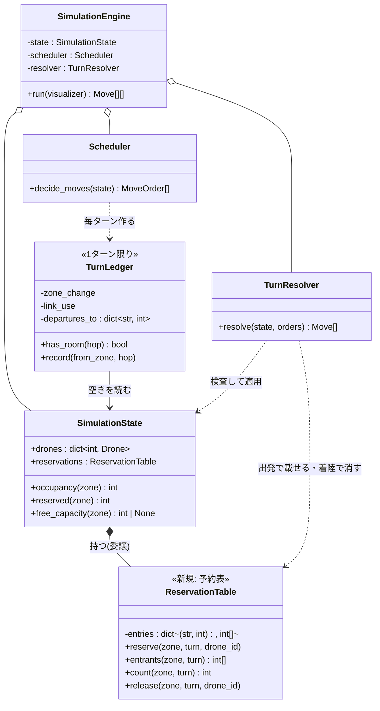
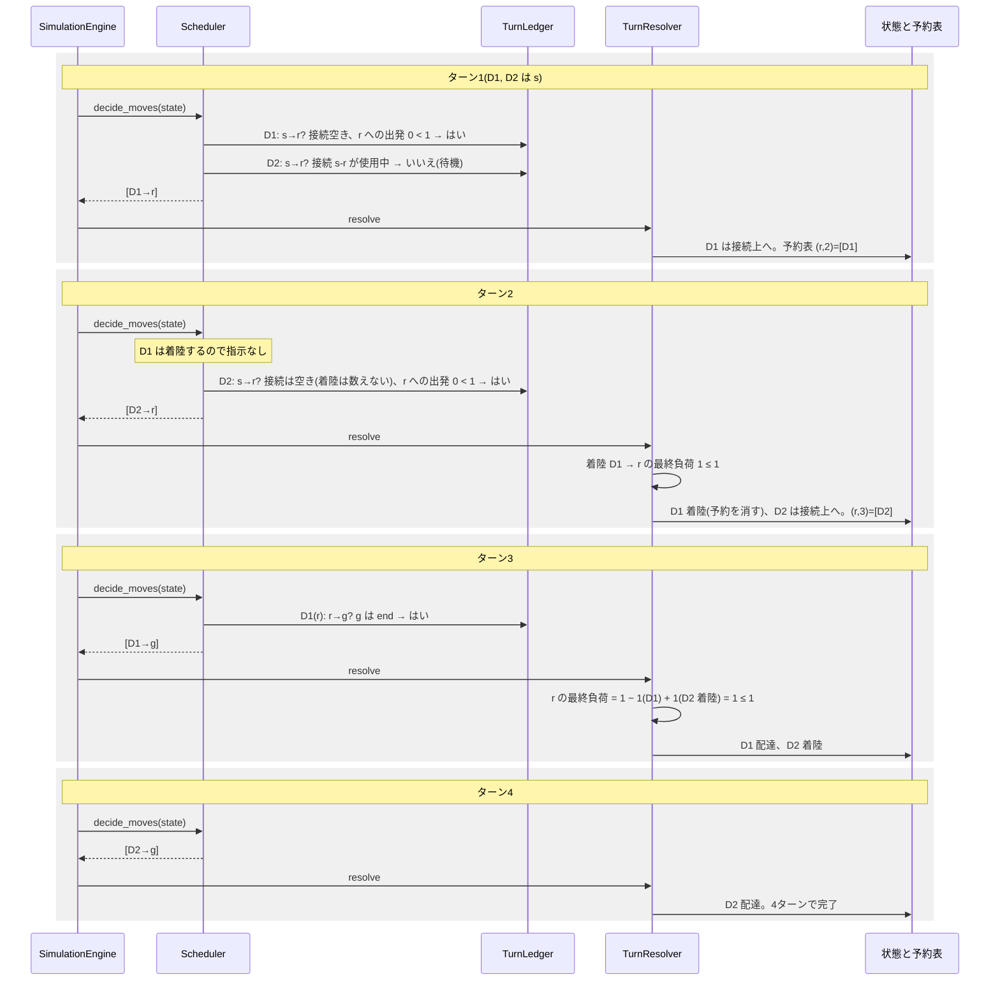
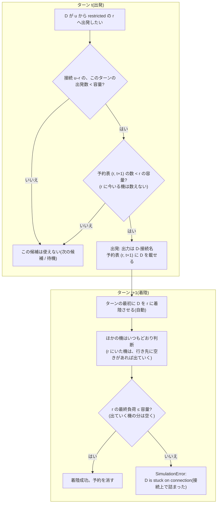

# 設計案: restricted の予約表(到着ターンごとの予約)

- 日付: 2026-10-18
- 依頼内容: S07(`revie_case/maps/sim/S07_restricted_no_wait_on_link.txt`)を4ターンで終えられるよう、
  restricted への予約を「どのゾーンに、どのターンに、どのドローンが入るか」の表で管理する(ユーザーのモデル)。
- ブランチ: `feature/timed_reservation`(`fix/restricted_link_release` から作成)
- **この文書は設計案のみ。コードとテストは変更していない。** 試作は scratchpad の使い捨てで、コミットしていない。
- 改訂履歴:
  - 初版(コミット `ed947b8` / `d3dfd3a`)は「約束」(ゾーンにいる機に、次のターンに必ず出ていくと約束させる)による設計だった。
    ユーザー判断で**取り下げ**(仕組みが大きすぎる)。要点だけ末尾の「付録: 取り下げた約束案」に残した。
  - 本版(2026-10-18 改訂)はユーザーのモデルによる設計。

## 用語

| 用語 | 意味 |
|---|---|
| **予約表** | 「ゾーン z に、ターン T に入ることを許されたドローン」の表。`{(z, T): [ドローンID, ...]}`。restricted へ出発したドローンだけが載る。 |
| **予約** | 予約表の1行。ドローン D がターン t に restricted の r へ出発すると、`(r, t+1)` に D が載る。 |
| **着陸** | 飛行中のドローンが、出発の次のターンに r に入ること。必ず起きなければならない(課題 VII.3)。 |
| **接続上で詰まる** | 着陸のターンに r が満員で、ドローンが着陸できないこと。接続の上では待てないので、ルール違反(新しい `SimulationError`)。 |
| **t / t+1** | t は今決めているターン、t+1 はその次のターン。 |

## 1. 背景: S07 で何が起きているか

マップ: `s → r → g`、`r` は restricted(入るのに2ターン)・容量1、ドローン2機。接続はどちらも容量1。

### 今のプログラム(5ターン)

今の規則では、restricted へ出発するドローンは「r にいる数 + 予約数」が容量未満のときだけ出発できる。
r に**今いる**ドローンも数えるので、r が埋まっている間は出発できない。

| ターン | 出力 | ターンの終わりの r | 説明 |
|---|---|---|---|
| 1 | `D1-s-r` | 0機(D1 は接続上) | D1 が出発 |
| 2 | `D1-r` | 1機(D1) | D1 が着陸。D2 は「r にいる D1 + 予約」で満員とみなされ待つ |
| 3 | `D1-g D2-s-r` | 0機 | |
| 4 | `D2-r` | 1機(D2) | |
| 5 | `D2-g` | 0機 | |

### ユーザーのモデル(4ターン)

restricted へ向かうドローンが席を必要とするのは**着陸するターン**だけ。その時点で r にいるドローンは、
それまでにふつうの判断で出ていくはずなので、出発のときには数えない。数えるのは「同じターンに着陸する予定の機」(予約表)だけ。

| ターン | 出力 | 予約表 | ターンの終わりの r |
|---|---|---|---|
| 1 | `D1-s-r` | (r, 2): [D1] | 0機 |
| 2 | `D1-r D2-s-r` | (r, 3): [D2] | 1機(D1) |
| 3 | `D1-g D2-r` | — | 1機(D2)。D1 が出るのと同じターンに D2 が着く |
| 4 | `D2-g` | — | 0機 |

ターン3の r の容量は、これまでどおりの「最終負荷」の規則で判定する: 出ていく D1 の分が同じターンに空き、着陸する D2 が入って1機。

## 2. 規則

1. **restricted への移動は強制**: 出発したドローンは、次のターンに必ず着陸する(今と同じ。エンジンが自動で着陸させる)。
2. **出発してよい条件**: ターン t に restricted の r へ出発してよいのは、**予約表の (r, t+1) に載っている数が r の容量未満**のとき。
   出発すると、そのドローンが (r, t+1) に載る。
   - r に今いるドローンは数えない。
   - 接続容量: 出発するターンは数え、着陸するターンは数えない(このブランチの元になった 2026-10-18 の決定のまま)。
3. **着陸のターンの判定**: 着陸は今と同じくターンの最初に適用し、r の容量はほかの移動と同じ「最終負荷」(出ていく機が同じターンに空きを作る)で判定する。
4. **新しい検出は1つだけ**: 着陸のターンに r の最終負荷が容量を超える(=着陸する機が入れず、接続の上に残ることになる)なら、
   `SimulationError`(例: `turn 3: D3 is stuck on connection 's-r': zone 'r' is full`)。
   「約束が守られたか」「席が空いているか」のような専用の検査は作らない。
5. **変えないもの**: スケジューラの判断の順序(距離 → 優先ルート → ID)、遠回りしない、着陸を先に適用する、start / end は無制限、
   接続は向きを区別せず共有、自己ループの指示は拒否、誰も動かないターンはエラー。

### 予約表は「飛行中のドローン」と同じ情報

restricted への移動はちょうど2ターン(出発の次のターンに必ず着陸)なので、(r, t+1) に載るのは**ターン t に出発した機だけ**。
つまり予約表の中身は、今の `SimulationState` がすでに持っている「飛行中のドローンと行き先」(`Drone.transit_target`、`reserved(zone)`)と同じになる。
規則2は「このターンに r へ出発する機の数が r の容量未満」と言い換えられる。

それでも、ユーザーの考え方(「どのゾーンに、どのターンに、誰が入るか」)をコードの形にそのまま出すため、小さなクラス `ReservationTable` として持つことを提案する(2.1)。

### 2.1 データの持ち方

```text
ReservationTable(予約表。SimulationState が持つ)
    _entries : dict[tuple[str, int], list[int]]   # (ゾーン名, ターン) → 入るドローンID(出発順)
    reserve(zone, turn, drone_id)                  # 出発のときに TurnResolver が呼ぶ
    entrants(zone, turn) -> list[int]              # (zone, turn) に入る予定の機
    count(zone, turn) -> int
    release(zone, turn, drone_id)                  # 着陸したら消す
```

- `SimulationState` が `ReservationTable` を1つ持つ(継承ではなく委譲)。今の `_reserved: dict[str, int]` をこれに置き換え、
  `reserved(zone)`(表示が使う「次のターンに着く数」)は `table.count(zone, turn_number + 1)` を返すようにする。
- `load(zone)`(表示用)と `free_capacity(zone)` の意味は今のまま残す(normal / priority のゾーンには予約が入らないので、
  これらのゾーンでは今までと同じ値になる)。restricted への出発の判定には使わなくなる。

## 3. スケジューラ・台帳・検査の変更

### 3.1 台帳(`TurnLedger`)

| 移動 | 今 | 変更後 |
|---|---|---|
| normal / priority の W へ | 接続に空き、かつ `free(W) − 変化(W) ≥ 1` | 変更なし |
| restricted の r へ出発 | 接続に空き、かつ `free(r) − 変化(r) ≥ 1`(r にいる機・予約・このターンの出発をすべて数える) | 接続に空き、かつ **このターンに r へ出発する数(記録済み)< 容量** |
| 出発の記録 | 移動先 r に +1(r の負荷として数える) | 予約の数に +1。r の負荷(ゾーンの変化)には足さない |
| end へ | 接続だけ | 変更なし |

### 3.2 スケジューラ(`Scheduler`)

**変更なし**。判断の順序も、`next_hops` の先頭から空きのある候補を選ぶことも同じで、「空き」の意味が台帳の中で変わるだけ。
`decide_moves(state) -> list[MoveOrder]` もそのまま(約束がなくなったので、指示以外に返すものはない)。

### 3.3 検査(`TurnResolver`)

| 手順 | 今 | 変更後 |
|---|---|---|
| 着陸 | 指示なしで自動。予約は負荷に入っているので再検査しない | 自動(同じ)。**着陸する機を、行き先の最終負荷に +1 として数える** |
| restricted への出発 | 行き先の負荷に +1(予約として) | 行き先の負荷には数えない(ターンの終わりには接続上にいる)。予約表に載せる |
| ゾーン容量 | 最終負荷 ≤ 容量 | 同じ。ただし超えたゾーンに着陸する機がいれば、**「接続上で詰まった」** として、どの機がどの接続で詰まったかを示すメッセージにする |
| 接続容量 | 出発する機の数 ≤ 容量 | 変更なし |
| 出発時の予約数 ≤ 容量 | (今は負荷として検査) | 専用の検査は作らない(ユーザーのモデル)。スケジューラが守る規則で、破られれば次のターンの「接続上で詰まった」で見つかる |

### 3.4 どこまで続いても扱える(深さの制限がない)

出発の判定は「同じターンに着陸する予定の機」しか見ず、ゾーンにいる機の行き先を先読みしない。
そのため、restricted がいくつ続いても、毎ターン同じ判定をくり返すだけで流れる。試作では restricted が3つ続くマップ
(`s → r1 → r2 → r3 → g`、3機)が9ターン(毎ターン1機ずつ出発できる下限)になった。約束案では、続く数だけ先のターンまで見る必要があった。

| ターン | 出力 |
|---|---|
| 1 | `D1-s-r1` |
| 2 | `D1-r1 D2-s-r1` |
| 3 | `D1-r1-r2 D2-r1 D3-s-r1` |
| 4 | `D1-r2 D2-r1-r2 D3-r1` |
| 5 | `D1-r2-r3 D2-r2 D3-r1-r2` |
| 6 | `D1-r3 D2-r2-r3 D3-r2` |
| 7 | `D1-g D2-r3 D3-r2-r3` |
| 8 | `D2-g D3-r3` |
| 9 | `D3-g` |

その代わり、**ゾーンにいる機が本当に出ていけるかは保証しない**。出ていけなかったときが「接続上で詰まる」場合で、4章で調べた。

## 4. 図

### 4.1 構造図



新しいクラスは `ReservationTable` だけ。`Scheduler` と `SimulationEngine` の形は変わらない。

### 4.2 挙動図: S07 のターン1〜4



### 4.3 挙動図: 出発の判定と「接続上で詰まる」経路



## 5. 試作の結果

- 方法: プロジェクトのパーサーと `Pathfinder` だけを使い、判断と規則を試作の中で書き直した(scratchpad、使い捨て)。
  完走したすべての出力を、試作とは別に書いた再生チェッカー(各ターンの最終負荷が容量以下、接続は出発のみ数えて容量以下、
  restricted へ出発した機は次のターンに必ず着く、隣のゾーンにしか動かない、最後に全機配達)で確かめ、違反は0件。
- 列: 「今」= 今のプログラム、「約束案」= 取り下げた約束案(t+1 まで)、「新モデル」= 本設計、「M2L」= 下の 5.3 の安全策。

### 5.1 ターン数

| マップ | 今 | 約束案 | **新モデル** | M2L |
|---|---|---|---|---|
| S07 | 5 | 4 | **4** | 4 |
| 課題の例 | 7 | 7 | **7** | 7 |
| circular_loop | 15 | 10 | **10** | 10 |
| the_impossible_dream | 45 | 45 | **43** | 45 |
| restricted だけの例(テスト R02 のマップ) | 12 | 8 | **8** | 12 |
| revie_case X11(大きな格子) | 73 | 71 | **71** | 73 |
| 配布マップのほか9枚(easy 3枚・dead_end_trap・priority_puzzle・maze_nightmare・capacity_hell・ultimate_challenge) | 4,4,4,8,8,13,16,26 | 同じ | **同じ** | 同じ |
| revie_case のほか(S01〜S12、P01・P02・P04〜P06、X01・X04・X06〜X10) | — | 同じ | **同じ** | 同じ |
| restricted が2つ続く(`s→r1→r2→g`、2機) | 7 | 7 | **6** | 7 |
| restricted が3つ続く(3機) | 11 | 11 | **9** | 11 |
| restricted → normal → restricted(3機) | 10 | 9 | **8** | 10 |
| r1(容量1)→ r2(容量2)(3機) | 9 | 9 | **7** | 9 |
| r1・r2 とも容量2(4機) | 7 | 7 | **6** | 7 |
| **出口の接続が細い**(下の例K1) | 6 | 6 | **詰まる** | 6 |
| **出口のゾーンが小さい**(下の例K2) | 7 | 7 | **詰まる** | 7 |

- 配布マップ10枚・課題の例・revie_case では、**「接続上で詰まる」は0件**。
- the_impossible_dream が 43 になり、`test_challenger_beats_reference`(45未満)を満たす。
- 新モデルは、完走したマップでは今のプログラムより悪くならなかった(下のランダムなマップでも同じ)。

### 5.2 ランダムなマップでの「接続上で詰まる」の数

restricted を多めに含む小さなマップ(ゾーン3〜12、2〜15機、容量1〜3、接続容量1〜2)を 7,832 枚作って実行した。
restricted がかなり多い偏った集まりなので、割合は「起きうるかどうか」の目安として読んでほしい。

| 方式 | 詰まった | 完走したもののうち、今より良い / 悪い |
|---|---|---|
| **新モデル(そのまま)** | **350枚(4.5%)** | 2,719 / 0 |
| M1: 着陸のあるゾーンの機を最優先で判断 | 配布・revie_case でも詰まりが増える(下記) | — |
| M1b: 同じ距離の中で、着陸のあるゾーンの機を先に | 333枚 | 2,723 / 1 |
| M3: 出口の通れる数を見積もって出発を控える | 78枚 | 2,778 / 0 |
| M2L: 出口が goal の分だけ「出ていく」とみなし、ほかの在室機は数える | **0枚** | 1,288 / 6 |
| 約束案(参考) | 0枚(約束で保証) | — |

### 5.3 詰まる例と、その理由

#### 例K1: 出口の接続が細い

`s → r → g`、r は restricted・容量2、`s-r` は接続容量2、`r-g` は接続容量1、4機。

| ターン | 出力 | 予約表 | r(ターンの終わり) |
|---|---|---|---|
| 1 | `D1-s-r D2-s-r` | (r,2)=[D1,D2]。D3・D4 は接続 `s-r`(容量2)が埋まって待つ | 0 |
| 2 | `D1-r D2-r D3-s-r D4-s-r` | (r,3)=[D3,D4]。r にいる D1・D2 は数えない | 2 |
| 3 | `D1-g`、D2 は `r-g` が使用中で動けない | — | 2 − 1 + 2 = **3 > 2 → D3・D4 が接続上で詰まる** |

理由: r には1ターンに2機入れるのに、r から出られるのは1ターンに1機(`r-g` の容量1)。入ってくる速さが出ていく速さを上回ると、
r にいる機が出ていききれず、着陸する場所がなくなる。

#### 例K2: 出口のゾーンが小さい

`s → r → a → g`、r は restricted・容量2、a は normal・容量1、`s-r`・`r-a` は接続容量2、4機。
ターン1・2は K1 と同じ。ターン3に D1 は a へ出られるが、a は容量1なので D2 は出られず、r が 3 > 2 になって D3・D4 が詰まる。

まとめると、詰まるのは **r に入る速さ(r の容量と、入る接続の容量)が、r から出る速さ(出口の接続容量と、出口のゾーンの空き)より大きい** とき。
ランダムなマップでは、ほかに「r の出口のゾーンに、別の方向から来た機が先に入る(合流)」型もあった。

### 5.4 対策の候補(小さい順)と効果

| 対策 | 内容 | 効果 | 気になる点 |
|---|---|---|---|
| M1 | 着陸のあるゾーンにいる機を、判断の順序の最初にする | **悪化**。R02 のマップ・X11 などでも詰まるようになった | 距離が近い順(先にいる機が空きを作る)を崩すため |
| M1b | 同じ距離の中だけで、着陸のあるゾーンの機を先にする | 350 → 333 枚。ほとんど効かない | 詰まりの主因は順序ではなく、出口の速さ |
| M3 | 出発のとき「r の在室数 − 出口から今出られる数の見積もり」を予約に足す | 350 → 78 枚 | 見積もりなので0にならない。circular_loop が 10 → 12 に悪化 |
| **M2L** | 出発のとき「r の在室数 − 出口が goal の接続容量の合計」を予約に足す(goal へ出る機は必ず出られるので数えない。ほかの在室機は数える) | **0枚**。必ず詰まらない(下記) | 連続する restricted での改善を失う(R02 のマップ 12、the_impossible_dream 45、X11 73)。S07・circular_loop の改善は残る |
| M5 | 新モデルで一度「試し実行」(出力なし)し、詰まったら M2L でやり直す | **0枚**。配布マップ・revie_case の結果は新モデルと同じ | 最悪で計算が2倍(10万機の X07 でも1秒台の見込み)。ターンログは試し実行の後に出す必要がある |

M2L が必ず詰まらない理由: r の出口に goal があれば、r にいる機は `r-g` の容量の数まで、次のターンに必ず goal へ出られる
(goal は無制限で、`r-g` を使うのは r にいる機だけ)。それ以外の在室機は残るものとして数えるので、着陸する数 + 残る数 ≤ 容量 になる。

## 6. 課題の規則(VII.2 / VII.3)との関係

| 規則 | 新モデルでの扱い |
|---|---|
| ゾーンは各ターン容量以下(VII.2) | 今と同じ最終負荷の検査。着陸する機も数える |
| 接続容量(VII.2) | 出発の数を検査(着陸は数えない。2026-10-18 の決定) |
| restricted は次のターンに必ず着き、接続上で待てない(VII.3) | 着陸は自動。着陸できない(満員)ときは**ルール違反として止める**(新しい「接続上で詰まった」エラー)。違反した出力は出さない |
| 出ていく機は同じターンに空きを作る(VII.3) | 今と同じ最終負荷の規則。着陸のターンにも使う |

「接続上で詰まった」が起きると、そのマップは解けずにエラーで終わる(違反した出力を出すわけではない)。
配布マップ・revie_case では起きないが、評価で別のマップを使われたときに起きうる。これをどう扱うかが 8 章の Q-A。

## 7. 影響

### 7.1 変更するファイル

| ファイル | 変更 |
|---|---|
| `droneflow/simulation/reservation_table.py`(新規) | `ReservationTable` |
| `droneflow/simulation/state.py` | `_reserved` を `ReservationTable` に置き換え(`reservations` 属性)。`enter_transit` で予約、`complete_transit` で解除。`reserved(zone)` は次のターンの予約数 |
| `droneflow/simulation/turn_ledger.py` | restricted への出発は「このターンの出発数 < 容量」で判定し、ゾーンの変化には足さない |
| `droneflow/simulation/turn_resolver.py` | 着陸を最終負荷に数え、restricted への出発は数えない。満員で着陸できないときの「接続上で詰まった」メッセージ |
| `scheduler.py` / `engine.py` | 変更なし(docstring の「予約が席を埋める」の説明だけ直す) |
| 可視化 | 変更不要(`reserved` / `load` は残る。`load` は「在室+着陸予定」で、restricted では容量を一時的に超えて見えることがある。表示の色分けの扱いは実装時に確認) |

### 7.2 API

- `Scheduler.decide_moves(state) -> list[MoveOrder]` は**そのまま**(約束がないので `TurnPlan` は要らない)。
- `TurnResolver.resolve(state, orders)` もそのまま。
- `SimulationState.reservations`(新規の属性)。

### 7.3 テストの期待が変わるもの(一覧のみ。テストは編集していない)

このブランチですでに失敗している5件:

| テスト | 今の期待 | 新モデルでの期待 |
|---|---|---|
| `test_scheduler.py::test_no_order_for_drone_in_flight`(D12) | 指示なし | `[MoveOrder(2, "r")]`(接続は着陸で空き、r への出発は 0 < 2) |
| `test_turn_ledger.py::test_drone_in_flight_uses_its_link`(L08) | False | True |
| `test_turn_ledger.py::test_link_counts_flight_and_orders_together`(L09) | 記録後 False | True(接続2のうち1、r への出発 1 < 3) |
| `test_turn_resolver.py::test_landing_still_uses_the_connection[1]`(T14) | 接続の違反 | 合法(`D1-r D2-s-r`)。テスト名・docstring も合わなくなる |
| `test_scheduler_maps.py::test_challenger_beats_reference`(R05) | 45 未満(今は45で失敗) | **43 で通る見込み**(試作) |

新モデルで期待が変わるもの:

| テスト | 今の期待 | 新モデルでの期待 |
|---|---|---|
| `test_turn_ledger.py::test_reservation_fills_restricted_zone`(L07) | False(飛行中の D1 が r の席を取っている) | True(このターンの r への出発は0。D1 はこのターン着陸し、次のターンに出ていく前提) |
| `test_turn_resolver.py::test_reserved_restricted_zone_is_full`(T13) | 2ターン目の D2 の出発は `zone 'r'` の違反 | 合法(`D1-r D2-s-r`)。r の席は着陸のターンに判定する |
| `test_turn_resolver.py::test_violation_leaves_state_unchanged[into_reserved_zone]`(T21d) | 違反で状態が変わらない | 違反にならないので、場面を作り直す(例: 着陸で満員になる「接続上で詰まった」の場面) |
| `test_scheduler_maps.py::test_restricted_only_map_output`(R02) | 12行 | **8行**: `D1-hub-roof1` / `D1-roof1 D2-hub-roof1` / `D1-roof2 D2-roof1 D3-hub-roof1` / `D1-goal D2-roof2 D3-roof1 D4-hub-roof1` / `D2-goal D3-roof2 D4-roof1 D5-hub-roof1` / `D3-goal D4-roof2 D5-roof1` / `D4-goal D5-roof2` / `D5-goal` |
| 配布マップの目標(R04) | — | circular_loop 15 → 10、ほかは同じで目標内 |

変わらないもの: `test_state.py`(`reserved` / `load` / `free_capacity` の値は同じ)、`test_turn_resolver.py::test_departure_frees_room_for_reservation`(T16)、
`test_engine.py::test_restricted_route_end_to_end`(G10。テスト用の `FollowerScheduler` は今の数え方で動き、より慎重なだけなので12行のまま)、
`test_scheduler_maps.py::test_every_turn_is_sound`(R03。`decide_moves` と `resolve` の形は同じ)。

新しく要るテスト(作成フェーズで設計): 着陸で満員になると「接続上で詰まった」の `SimulationError` で状態が変わらない、予約表の載せ方・消し方、
S07 の4ターン、restricted が続くマップ、例K1(新モデルの既知の限界として)。

## 8. 未決事項

### Q-A. 「接続上で詰まる」をどう扱うか

- 案1: 新モデルのまま(エラーで止める)。配布マップ・revie_case では0件。ランダムな偏ったマップでは4.5%。
- 案2: M2L(出口が goal の分だけ在室機を差し引く)。必ず詰まらないが、restricted が続く場所での改善を失う(the_impossible_dream 45)。
- 案3: M5(新モデルで試し実行し、詰まったら M2L でやり直す)。詰まらず、配布マップでは新モデルと同じ結果。仕組みが1段増える。
- 推奨: **案3**。評価で配布以外のマップを使われたときにエラーで止まるのを避けつつ、ユーザーのモデルの結果(S07 4、circular_loop 10、
  the_impossible_dream 43)をそのまま得られる。やり直しの仕組みが重いと感じるなら、案1で始め、例K1 を既知の限界として記録しておく。

### Q-B. 出発時の予約数を `TurnResolver` でも検査するか

- 規則2(予約数 < 容量)はスケジューラの規則で、ユーザーのモデルでは専用の検査を作らない。破られても次のターンの「接続上で詰まった」で見つかる。
- 推奨: 作らない(ユーザーのモデルどおり)。ただし、詰まりの原因が「予約しすぎ」か「在室機が出られなかった」かは、エラーメッセージで区別できない。

### これまでの決定の扱い(約束案のときの Q1〜Q6)

| 項目 | 新モデルでの扱い |
|---|---|
| Q1(約束を作るきっかけ) | **不要**(約束がない) |
| Q2(予定表を何ターン先まで持つか) | **不要**。予約表は次のターンの分だけで、restricted がいくつ続いても扱える(3.4) |
| Q3(`plan_turn` / `TurnPlan`) | **取り消し**。`decide_moves(state) -> list[MoveOrder]` のままでよい |
| Q4(challenger の45) | 新モデルでは 43 になり、テストは通る見込み。別調査は「新モデルで45未満にならなかった場合だけ」行う |
| Q5(約束の表示) | **不要**。予約は今も「+N arriving」として表示されている |
| Q6(約束は最後の手段) | **不要**。特別な手順がなく、restricted か normal かは今と同じく `next_hops` の先頭から空きのある候補を選ぶだけ。ランダムなマップでも、完走したもので今より悪くなる例はなかった |

## 9. 作業項目(実装する場合の順番の案)

1. `ReservationTable` と `SimulationState` の置き換え。
2. `TurnResolver`: 着陸を最終負荷に数える、restricted への出発は数えない、「接続上で詰まった」のメッセージ。
3. `TurnLedger`: restricted への出発の判定。
4. Q-A の結論に応じて、M2L / 試し実行を足す。
5. 既存テストの期待の更新(7.3)と、新しいテスト。配布マップ・課題の例・revie_case の再計測。

## レビュー時の確認事項

- restricted への出発の判定が「このターンの出発数(= 予約表の (r, t+1))< 容量」だけになっているか。在室機を数えていないか。
- 着陸が最終負荷に数えられ、restricted への出発が出発のターンの負荷に数えられていないか(`TurnLedger` と `TurnResolver` で同じか)。
- 「接続上で詰まった」で、状態が一切変わらずに `SimulationError` になるか。
- 接続容量は出発のターンだけ数えているか。

## 付録: 取り下げた約束案(要点)

- 内容: restricted へ出発するときに次のターンの席がなければ、r にいる機に「次のターンに必ず出ていく」約束をさせ、その行き先の席も約束の連鎖で確保する。
  約束した機が動かなければ `SimulationError`。約束の行き先に restricted を許すには、2ターン先以降まで見る必要があった(凍結・取り消しなども必要)。
- 良かった点: 詰まりが原理的に起きない(席を保証してから出発する)。
- 取り下げた理由(ユーザー判断): 仕組みが大きすぎる(約束・連鎖・凍結・取り消し、`TurnPlan` などの API 変更)。
  試作でも、新モデルのほうが連続する restricted で良い結果になった(the_impossible_dream 45 → 43 など)。
- 詳しい内容(約束の規則、図、2ターン先の検討)は、コミット `d3dfd3a` の版のこの文書に残っている。
