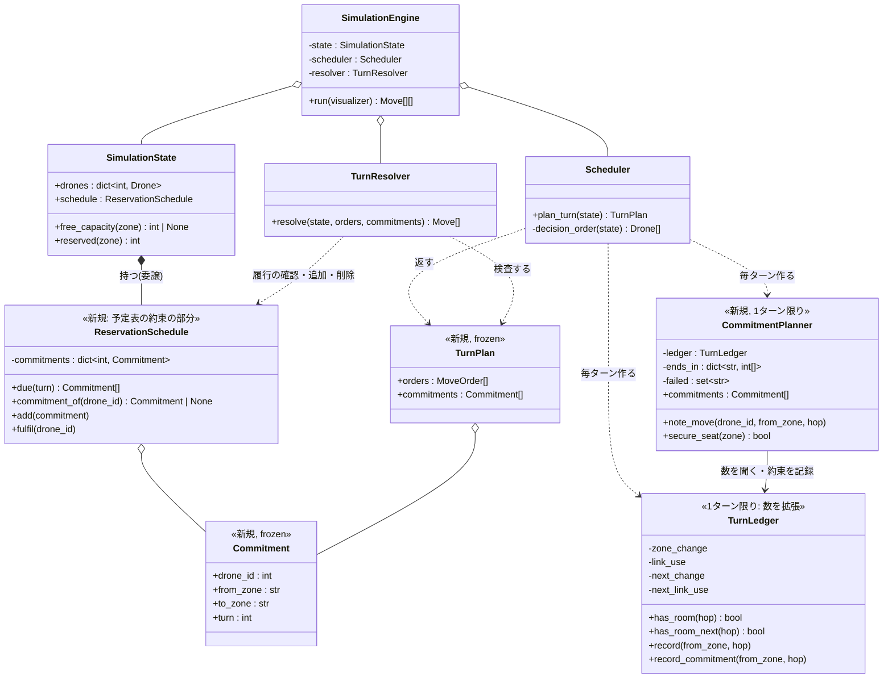
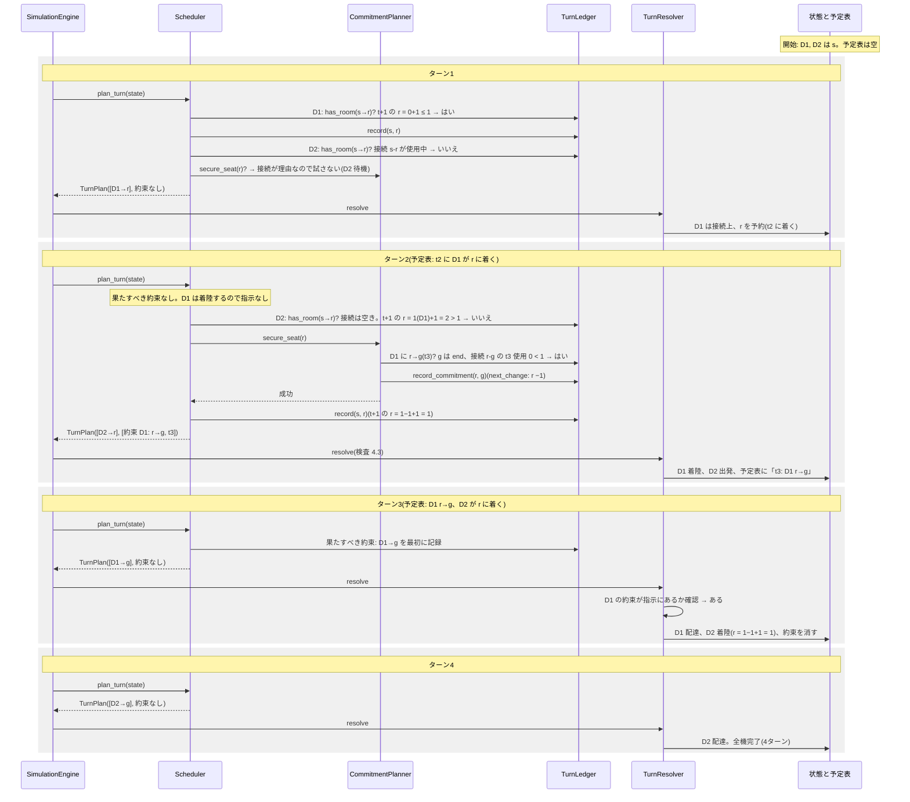
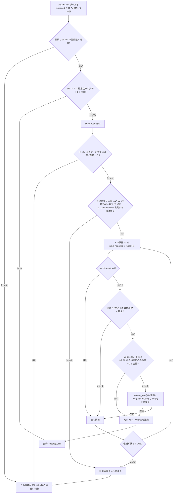

# 設計案: 予定表と約束による restricted の予約(Stage 4/5 の変更)

- 日付: 2026-10-18
- 依頼内容: S07(`revie_case/maps/sim/S07_restricted_no_wait_on_link.txt`)を4ターンで終えられるよう、
  ユーザーのアイデア「予約をターンつきの予定表で管理し、"約束" された退出を空きとして使う」を設計に落とす。
  **この文書は設計案のみ。コードとテストは変更していない。**
- ブランチ: `feature/timed_reservation`(`fix/restricted_link_release` から作成)
- 前提として変えないもの(`docs/decisions.md`):
  - 判断の順序「距離が近い順 → 同じ距離なら優先ルート上 → ID順」、遠回りしない(候補は `next_hops` だけ)
  - ゾーン容量は最終的な負荷で判定(同じターンの退出で空く)、start / end は無制限
  - 接続容量は向きを区別せず共有。出発するターンは数え、restricted に着くターンは数えない(2026-10-18)
  - 自己ループの指示は拒否、誰も動かないターンはエラー

## 用語

この文書で新しく使う言葉。

| 用語 | 意味 |
|---|---|
| **予定表** | 「どのドローンが、どのターンに、どこにいるか(どこへ動くか)」の決まっている分の一覧。今のプログラムにも一部がすでにある(restricted へ飛行中のドローンは「次のターンに必ず着く」ので予定表の1行といえる)。今回、ここに「約束」を加える。 |
| **約束** | 「ドローン X は、次のターン(t+1)に、ゾーン Z から隣のゾーン W へ必ず動く」という決まり。一度した約束は取り消せず、t+1 に X が動かなければルール違反(`SimulationError`)。 |
| **席** | あるターンの終わりに、あるゾーンにドローン1機が入れる余地。容量 `max_drones` の数だけある。 |
| **連鎖** | X の約束を成り立たせるために、X の行き先 W にいるドローン Y にも約束をさせ、Y の行き先にいる Z にも…と、約束を次々につなぐこと。 |
| **t / t+1** | t は今決めているターン、t+1 はその次のターン。 |

## 1. 背景: S07 で何が起きているか

マップ: `s → r → g`、`r` は restricted(入るのに2ターン)・容量1、ドローン2機。接続はどちらも容量1。

### 今のプログラム(5ターン)

今の規則では、restricted へ出発するドローンは**出発したターンに** `r` の席を1つ予約し(「いる数+予約数」が容量以下)、
次のターンに必ず着く(課題 VII.3: 接続の上で待てない)。

| ターン | 出力 | ターンの終わりの `r` | 予約(`r`) | 説明 |
|---|---|---|---|---|
| 1 | `D1-s-r` | 0機 | 1(D1) | D1 が出発し `r` の席を予約 |
| 2 | `D1-r` | 1機(D1) | 0 | D1 が着く。D2 も出発したいが、`r` は D1 で埋まっている(負荷1=容量1)ので待つ |
| 3 | `D1-g D2-s-r` | 0機 | 1(D2) | D1 が出ていったので、D2 が出発・予約 |
| 4 | `D2-r` | 1機(D2) | 0 | |
| 5 | `D2-g` | 0機 | 0 | |

### ユーザーが期待する形(4ターン)

| ターン | 出力 | ターンの終わりの `r` |
|---|---|---|
| 1 | `D1-s-r` | 0機 |
| 2 | `D1-r D2-s-r` | 1機(D1)。D2 は接続の上 |
| 3 | `D1-g D2-r` | 1機(D2)。D1 が出るのと同時に D2 が着く |
| 4 | `D2-g` | 0機 |

ターン2の終わりの時点で `r` にいるのは D1 だけで、D2 はまだ接続の上にいる。
D2 が着くターン3に `r` が1機以下であれば、どのターンでも容量は守られている。問題は、**ターン2の時点では「ターン3に D1 が出ていく」ことが
保証されていない**ので、D2 の着陸を保証できないこと。D1 が何かの理由でターン3に動けなければ、D2 は接続の上で待つしかなくなり、
VII.3 に反する。今のプログラムが D2 を待たせているのは、この保証がないからで、規則としては正しい。

### アイデア

ターン2で D2 が出発を考えるとき、「ターン3の `r`」を見る。そこで **D1 に「ターン3に `r` から `g` へ必ず動く」と約束させられれば**、
ターン3の `r` には D2 の席がある。D1 の行き先 `g` は end(無制限)なので、この約束は必ず守れる。だから D2 は出発してよい。

## 2. 予定表のデータ

### 2.1 何を覚えるか

予定表は「次のターン(t+1)に決まっていること」だけを覚えれば足りる(先のターンまで要らない理由は 3.3)。

| 予定表の行 | どこに持つか | 今のプログラム |
|---|---|---|
| 飛行中のドローンが t+1 に着く(着陸の予定) | 今までどおり `Drone`(`transit_target`)と `SimulationState.reserved(zone)` | **変更なし** |
| ドローンが t+1 に Z から W へ動く(約束) | 新しい `ReservationSchedule`(`SimulationState.schedule`) | 新規 |

着陸の予定はすでに `SimulationState` にあり、表示(ターミナル・グラフィカル)も `reserved()` を使っているので、そのまま残す。
新しく覚えるのは約束だけ。

```text
Commitment(約束、frozen dataclass)
    drone_id : int    # 約束したドローン
    from_zone : str   # いまいるゾーン Z(t の終わりにここにいる)
    to_zone : str     # 動く先 W(Z の隣、restricted ではない)
    turn : int        # 動くターン(= 約束を作ったターン + 1)

ReservationSchedule(予定表のうち約束の部分)
    _commitments : dict[int, Commitment]   # drone_id → 約束(1機につき最大1つ)
    due(turn) -> list[Commitment]           # そのターンに果たすべき約束(drone_id 順)
    commitment_of(drone_id) -> Commitment | None
    add(commitment)                         # TurnResolver だけが呼ぶ
    fulfil(drone_id)                        # 約束どおり動いたら消す。TurnResolver だけが呼ぶ
```

### 2.2 誰が持つか(委譲)

- `SimulationState` が `ReservationSchedule` を1つ持つ(`state.schedule`)。継承はしない。
  「状態はデータと問い合わせだけ」「変更は `TurnResolver` だけが行う」という Stage 4 の分担をそのまま保つ。
- 予定表を `SimulationState` の外(エンジンが別に持つ)にする案も考えたが、`TurnResolver.resolve(state, ...)` と
  `Scheduler` が同じものを見る必要があり、引数が増えるだけなので、状態の一部にした。

### 2.3 今の仕組みとの対応

| 今 | 変更後 |
|---|---|
| restricted への出発で `r` を予約(`reserved`) | 同じ。予約は「t+1 の席」を取ることだ、と意味をはっきりさせるだけ |
| `TurnLedger`: 1ターンの増減(`zone_change`、`link_use`) | 同じものに加え、**t+1 の増減**(`next_change`、`next_link_use`)を数える |
| `TurnResolver`: このターンの最終負荷を検査 | 加えて「t+1 の約束込みの負荷」と「果たすべき約束が果たされたか」を検査 |
| `Scheduler.decide_moves` → `list[MoveOrder]` | 指示と新しい約束の組(`TurnPlan`)を返す(API は 6 と未決事項 Q3) |

## 3. 約束の規則

### 3.1 いつ約束を作るか

ドローン D がゾーン u から restricted のゾーン R へ出発したいが、**t+1 の R に席がない**ときだけ。
そのとき、R に t の終わりにいるドローンの1機に、t+1 に R から出る約束をさせられないか試す(「席を確保する」と呼ぶ)。

normal / priority への移動では約束を作らない(理由は未決事項 Q1)。

### 3.2 約束してよい条件(連鎖)

ゾーン Z にいるドローン X に「t+1 に Z → W」を約束させてよいのは、次をすべて満たすとき。

1. X は t の終わりに Z にいる(t に着陸する機、t に Z へ普通に入った機、t に指示がなく Z にとどまった機)。
   t に restricted へ出発した機(t+1 は接続の上)、すでに約束のある機は除く。
2. W は `next_hops(Z)` の1つ(最短の一手。遠回りしない)。
3. W は restricted ではない(約束は t+1 で完結する移動に限る。3.3)。
4. 接続 Z–W の t+1 の使用数(すでにある約束の分)が容量未満。
5. **W の t+1 の席が保証されている**:
   - W が end なら常に保証(無制限)。
   - W の「t+1 の約束込みの負荷」+1 が容量以下なら保証。
   - そうでなければ、W にいるドローン Y に「t+1 に W → W'」を約束させられれば保証(**連鎖**。Y についても同じ 1〜5 を確かめる)。

どれかが満たせなければ約束しない。約束が1つも作れなければ、D は今までどおり待つ。

- Z にいる候補が何機いても、行き先の候補(`next_hops(Z)`)と数え方は同じなので、**1機だけ試せば足りる**(判断の順序で最初の機)。
- 連鎖の途中で失敗したときは、その連鎖では何も記録しない(成功した段から順に、深い方から記録する)ので、取り消しは要らない。

### 3.3 なぜ t+1 だけか

- restricted へ出発したドローンが席を必要とするのは、着く t+1 だけ。だから t+1 の席が保証できれば十分。
- 約束の行き先を restricted にすると、その約束自体が「t+1 に出発 → t+2 に着く」移動になり、t+2 の席の保証が要る。
  すると予定表を t+2、t+3…と先まで持ち、台帳も複数ターン分を数えることになって、仕組みが大きくなる。
- 行き先を restricted 以外に限れば、約束の移動は t+1 の中で完結し、予定表は「次の1ターン分」だけで閉じる。
- 代わりに、restricted が2つ続く場所(下の例2)では恩恵がない。これは未決事項 Q2。

### 3.4 連鎖が必ず終わる理由(循環しない)

- 約束の移動は `next_hops` の一手なので、`dist(W) = dist(Z) − turn_cost(W)`、`turn_cost ≥ 1` より **`dist(W) < dist(Z)`**。
  連鎖は Z → W → W' → … と、ゴールまでの距離が真に小さいゾーンへしか進まない。
- 距離は0以上の整数なので、連鎖の長さは `dist(Z)` 以下で、同じゾーンに戻ること(循環)はない。end(距離0)に着くか、途中で失敗して終わる。
- 1ターンの中で「席を確保できなかったゾーン」は覚えておき、同じターンにもう一度試さない。
  - これで正しい理由: 確保を試す時点で、そのゾーンと、それより距離が小さいゾーンにいるドローンは**すべて判断済み**
    (判断は距離が近い順)。このあと同じターンに起きるのは、距離が大きいドローンの指示(そのゾーンへ入る=席が減る)と
    新しい約束(行き先の席が減る)だけで、席が増えることはない。
  - よって1ターンの探索は「ゾーン数+接続数」程度で終わる。

### 3.5 約束を守らせる

- 約束したドローンは、t+1 に**必ず**約束どおり動く。`Scheduler` は t+1 の最初に、果たすべき約束を指示として出し、台帳に記録する
  (判断の順序より前。ほかの機はその残りの空きを使う)。
- `TurnResolver` は、果たすべき約束のある機に、約束どおりの指示がない(または別のゾーンへの指示がある)ターンを `SimulationError` で拒否する。
- 約束の移動は t+1 に必ず合法になる: 行き先の席と接続は、約束を作った t の時点で「t+1 の約束込みの負荷」として取ってあり、
  t+1 のほかの指示はその残りしか使えない(台帳が先に約束を記録するため)。

## 4. スケジューラと台帳の変更

### 4.1 台帳(`TurnLedger`)の数え方

`free(Z) = max_drones − いる数 − 予約数`(`SimulationState.free_capacity`、変更なし。t の開始時点の値で、t に着陸する機は予約数に入っている)。

| 数えるもの | 今 | 変更後 |
|---|---|---|
| `zone_change[Z]`(t の増減) | 出発元 −1、移動先 +1(restricted への出発も +1) | 変更なし |
| `next_change[Z]`(t+1 の約束の増減) | なし | 約束の行き先 +1、約束の出発元 −1 |
| `link_use[c]`(t の接続) | 出発する機の数 | 変更なし |
| `next_link_use[c]`(t+1 の接続) | なし | 約束の移動の数 |

判定(「空きがある」の条件):

| 移動 | 条件 |
|---|---|
| t に normal / priority の W へ | `link_use(c) < 容量` かつ `free(W) − zone_change(W) ≥ 1`(このターンの終わり)かつ `free(W) − zone_change(W) − next_change(W) ≥ 1`(t+1 の約束込み) |
| t に restricted の R へ出発 | `link_use(c) < 容量` かつ `free(R) − zone_change(R) − next_change(R) ≥ 1`(t+1 の約束込み)。満たさなければ席の確保を試す |
| 約束: t+1 に Z → W(W は restricted 以外) | `next_link_use(c) < 容量` かつ(W が end、または `free(W) − zone_change(W) − next_change(W) ≥ 1`、または W の席の確保に成功) |
| end へ | 接続だけ見る(今と同じ) |

約束がなければ `next_change` は0なので、表は今の規則と同じになる(今の規則は「約束なし」の特別な場合)。

- normal の W に「t+1 の約束込み」の条件が要る理由: W に「t+1 に W へ入る」約束(連鎖の一段)があるとき、t のうちに別の機が W に入ると、
  t+1 に約束の機が入れなくなる。逆に W の機に「t+1 に出る」約束があっても、t の終わりにはまだ W にいるので、
  このターンの終わりの条件(1つ目)は別に守る必要がある。
- 「それまでの指示だけで判定する(保守的)」性質は保たれる: 後から増えるのは、このターンの退出(空きが増える)、入場(検査される)、
  約束(行き先の席を減らし、出発元の t+1 の席を増やす)だけで、許した指示が後で違反になることはない。

### 4.2 1ターンの判断(`Scheduler`)

1. **果たすべき約束**(`state.schedule.due(t)`)を、そのまま指示にして台帳に記録する。
2. 着陸する機には指示を出さない(今と同じ)。
3. 残りのゾーンにいる機を、今と同じ順序(距離 → 優先ルート → ID)で判断する。t+1 の約束がすでにある機は飛ばす
   (実際には、約束させられる機は要求した機より距離が小さく、先に判断済みなので、ここで出会うことはない。念のための確認)。
4. 各機は `next_hops` の候補を先頭から見て、台帳で空きのある最初の候補へ進む。
   restricted への候補で t+1 の席だけが足りないときは、**席の確保**(3.2)を試し、成功すれば約束を記録して出発する。
5. 指示と新しい約束を返す。

席の確保の探索は、新しいクラス `CommitmentPlanner`(1ターン限り、`Scheduler` が毎ターン作る)に分ける。
`Scheduler` は「誰を先に・どこへ」、`TurnLedger` は「数」、`CommitmentPlanner` は「誰に約束させるか」を受け持つ(委譲)。
`CommitmentPlanner` は「t の終わりに各ゾーンにいる機」(約束の候補)を、ゾーンごとの一覧で持つ
(10万機の X07 のようなマップで、毎回全機をなめないため)。

### 4.3 検査(`TurnResolver`)

今の手順に次を加える。どれかに違反すれば、状態を一切変えずに `SimulationError`。

1. **約束の履行**: `state.schedule.due(t)` の各約束について、その機に `MoveOrder(drone_id, to_zone)` があること。
   ない、または別のゾーンへの指示なら違反(例: `turn 3: D1 must move from 'r' to 'g' as committed on turn 2`)。
2. **新しい約束の妥当性**: 機が存在し、配達済みでない。t の終わりに `from_zone` にいる(t に restricted へ出発しない、
   t に別のゾーンへ動かない)。`to_zone` は `from_zone` の隣で、blocked でも restricted でもなく、`from_zone` と同じでない。
   1機に1つまで、すでにある約束と重ならない。`turn = t+1`。
3. **接続(t)**: 出発する機(約束の履行を含む)が容量以下(今と同じ。着陸は数えない)。
4. **接続(t+1)**: 新しい約束で使う数が容量以下。
5. **ゾーン(このターンの終わり)**: 今と同じ最終負荷の検査。ただし restricted への出発(移動先 +1)はここでは数えない
   (その機は t の終わりには接続の上にいる)。
6. **ゾーン(t+1 の約束込み)**: 5 の負荷 + restricted への出発 + 約束で入る数 − 約束で出る数 が容量以下。
   今の「予約込みの負荷」の検査は、これの約束なしの場合にあたる。
7. 適用: 約束を果たした機を予定表から消し(`fulfil`)、新しい約束を加える(`add`)。

## 5. 図

### 5.1 構造図



継承は使わない。約束の数え方は `TurnLedger` と `TurnResolver` の両方に同じ規則で入る(今の「台帳と検査は1対1」を保つ)。

### 5.2 挙動図: S07 のターン1〜4



### 5.3 挙動図: restricted へ出発してよいか(席の確保と約束)



## 6. 例(ターンの表)

以下のターン数は、下の「試作」の結果と一致している。

### 例1: S07(4ターン)

| ターン | 出力 | 終わりの `r` | 予定表(次のターン) | 説明 |
|---|---|---|---|---|
| 1 | `D1-s-r` | 0 | t2: D1 が `r` に着く | D2 は接続 `s-r` が使用中で待つ |
| 2 | `D1-r D2-s-r` | 1(D1) | t3: D2 が `r` に着く / **約束 D1: `r`→`g`** | t3 の `r` = 1 − 1(約束)+ 1(D2)= 1 |
| 3 | `D1-g D2-r` | 1(D2) | なし | D1 は約束どおり動く。D2 着陸 |
| 4 | `D2-g` | 0 | なし | |

### 例2: 連鎖が失敗する(待つ)— restricted が2つ続く

マップ: `s → r1 → r2 → g`、`r1` と `r2` は restricted・容量1、2機。

| ターン | 出力 | 説明 |
|---|---|---|
| 1 | `D1-s-r1` | |
| 2 | `D1-r1` | D2 が `r1` へ出発したい。t3 の `r1` の席には D1 の約束が要るが、D1 の行き先 `r2` は restricted(3.2 の条件3)→ 約束できず、D2 は待つ |
| 3 | `D1-r1-r2 D2-s-r1` | D1 が出発したので t4 の `r1` は空き |
| 4 | `D1-r2 D2-r1` | |
| 5 | `D1-g D2-r1-r2` | |
| 6 | `D2-r2` | |
| 7 | `D2-g` | 7ターン(今と同じ) |

約束の行き先に restricted を許せば(t+2 まで予定表を持てば)6ターンにできる(未決事項 Q2)。

### 例3: 連鎖が成功する — normal のゾーンを通る連鎖

マップ: `s → r → a → g`、`r` は restricted・容量1、`a` は normal・容量1、3機。

| ターン | 出力 | 予定表に加わる約束 | 説明 |
|---|---|---|---|
| 1 | `D1-s-r` | | |
| 2 | `D1-r D2-s-r` | D1: `r`→`a`(t3) | `a` は空き → 約束できる |
| 3 | `D1-a D2-r D3-s-r` | D2: `r`→`a`(t4)、D1: `a`→`g`(t4) | D2 の約束には t4 の `a` の席が要る。`a` の D1 に `a`→`g` を約束させて確保(**連鎖**) |
| 4 | `D1-g D2-a D3-r` | D3: `r`→`a`(t5)、D2: `a`→`g`(t5)… | 以下同様 |
| 5 | `D2-g D3-a` | | |
| 6 | `D3-g` | | 6ターン(今は8ターン) |

### 例4: 課題の例(7ターンのまま)

最短経路は `hub → corridorA(priority)→ tunnelB → goal`(3ターン)で、restricted の `roof1` を通る経路(4ターン)は最短ではない。
どの機も restricted へ出発しないので、約束は一度も作られず、判断は今と同じ。出力は課題の7行のまま(試作で確認)。

### 例5(参考): 配布マップ circular_loop(15 → 10)

出口 `exit_point` が restricted・容量1。今は「`exit_point` が空くまで次の機が出発できない」ので2ターンに1機だったが、
約束で `exit_point` の機が「次のターンに goal へ出る」ことを保証できるので、毎ターン1機が出発できる。
最初の出発がターン3、6機目の出発がターン8、着陸9、goal 10 で、この経路の下限になる。

### 課題の規則(VII.2 / VII.3)を破らない理由

| 規則 | 守られる理由 |
|---|---|
| ゾーンは各ターン容量以下(VII.2) | `TurnResolver` が毎ターン最終負荷を検査する(4.3 の5)。約束はこの検査を緩めない |
| 同じターンに同じゾーンへ入るのは容量の範囲内(VII.2) | 同上(最終負荷で判定) |
| 接続容量(VII.2) | t の出発の数を検査(4.3 の3)。t+1 の約束の分も先に数えておく(4.3 の4)ので、t+1 にあふれない |
| restricted は次のターンに必ず着き、接続上で待てない(VII.3) | 出発は「t+1 の約束込みの負荷」に席があるときだけ(4.3 の6)。そこで空きとして数えた退出は約束で、t+1 に必ず起きる(4.3 の1)。約束の移動自体の席と接続も t に確保済み(3.5)。よって着陸は必ず合法 |
| 出ていく機は同じターンに空きを作る(VII.3) | 今と同じ最終負荷の規則。約束はこれを「次のターンの退出」に使うだけで、使ってよいのは約束(必ず起きる)だけ |
| 動けるのは隣のゾーン・待機・restricted への接続だけ(VII.3) | 約束の移動も `next_hops` の一手(隣・最短)。自己ループは `next_hops` に出ない |

デッドロックについて: 約束がある機は t+1 に必ず動き、着陸もある。どちらもないターンは今と同じ「距離最小の機は必ず動ける」議論がそのまま成り立つ
(距離最小の機の行き先には、まだ約束も新しい予約もない。約束を作るのは、それより後に判断される距離の大きい機だけ)。
「誰も動かないターン」は起きない。残り距離の合計が毎ターン減ることも変わらない。

## 7. 影響

### 7.1 変更するファイル

| ファイル | 変更 |
|---|---|
| `droneflow/simulation/schedule.py`(新規) | `Commitment`、`ReservationSchedule` |
| `droneflow/simulation/state.py` | `SimulationState.schedule` を持つ。`TurnPlan` を置く(`MoveOrder` の隣)。`free_capacity` などの意味は変えない |
| `droneflow/simulation/turn_ledger.py` | `next_change`、`next_link_use`、`has_room` の条件追加、`has_room_next`、`record_commitment` |
| `droneflow/simulation/commitment_planner.py`(新規) | `CommitmentPlanner`(席の確保・連鎖の探索) |
| `droneflow/simulation/scheduler.py` | 果たすべき約束を先に出す、席の確保を試す、`TurnPlan` を返す |
| `droneflow/simulation/turn_resolver.py` | 4.3 の検査の追加、約束の追加・削除 |
| `droneflow/simulation/engine.py` | 約束を `resolve` に渡す(1〜2行) |
| `droneflow/pathfinding/pathfinder.py` | 変更なし |
| 可視化(`terminal_view.py` / `graphical_view.py`) | 変更不要(`reserved` / `load` の意味は同じ)。約束の表示は任意 |

### 7.2 API の変更

- `Scheduler.plan_turn(state) -> TurnPlan`(新規)。エンジンはこちらを呼ぶ。`decide_moves` をどうするかは Q3。
- `TurnResolver.resolve(state, orders, commitments=())`: 約束は省略可能な第3引数にする。既存の `resolve(state, [...])` の呼び出し(テスト多数)はそのまま動く。
- `SimulationState.schedule`(新規の属性)。

### 7.3 テストへの影響(一覧のみ。テストは編集していない)

このブランチですでに失敗している5件(2026-10-18「restricted の到着ターンは接続容量に数えない」による。約束とは独立):

| テスト | 今の期待 | 新しい期待 |
|---|---|---|
| `test_scheduler.py::test_no_order_for_drone_in_flight`(D12) | 指示なし(D2 は接続 `s-a` 待ち) | `[MoveOrder(2, "r")]`(着陸する D1 は接続を使わず、`r` は容量2) |
| `test_turn_ledger.py::test_drone_in_flight_uses_its_link`(L08) | `has_room` が False | True |
| `test_turn_ledger.py::test_link_counts_flight_and_orders_together`(L09) | 1回記録した後 False | True(接続容量2のうち1、`r` は容量3のうち2) |
| `test_turn_resolver.py::test_landing_still_uses_the_connection[1]`(T14) | 接続 `s-r` の違反 | 合法(`D1-r D2-s-r`)。テスト名・docstring も規則と合わなくなっている |
| `test_scheduler_maps.py::test_challenger_beats_reference`(R05) | 45 未満 | **約束を入れても45のまま**(試作)。閾値を変えるか、原因を調べるかはユーザー判断(Q4) |

この設計で期待が変わるもの:

| テスト | 今の期待 | 新しい期待 |
|---|---|---|
| `test_scheduler_maps.py::test_restricted_only_map_output`(R02) | 12行 | **8行**: `D1-hub-roof1` / `D1-roof1 D2-hub-roof1` / `D1-roof2 D2-roof1 D3-hub-roof1` / `D1-goal D2-roof2 D3-roof1 D4-hub-roof1` / `D2-goal D3-roof2 D4-roof1 D5-hub-roof1` / `D3-goal D4-roof2 D5-roof1` / `D4-goal D5-roof2` / `D5-goal`(試作の出力) |
| `test_scheduler_maps.py::test_every_turn_is_sound`(R03) | `decide_moves` の指示を `resolve` に渡す手書きのループ | ループが約束を渡さないと、約束込みのスケジューラの指示が拒否される。`plan_turn` を使う形に直す必要あり |
| `tests/simulation/conftest.py` の `FollowerScheduler` などのテスト用スケジューラ | `decide_moves` を上書き | エンジンが `plan_turn` を呼ぶなら、`plan_turn` を上書きする形に直す(Q3) |

変わらないもの(確認済みの考え方):

- `test_engine.py::test_restricted_route_end_to_end`(G10、12行): テスト用の `FollowerScheduler`(約束を作らない)で動かすので12行のまま。
  上の Q3 の直しだけで済む。
- `test_turn_resolver.py::test_reserved_restricted_zone_is_full`(T13)と `into_reserved_zone`(T21d): 約束なしで `r` が埋まっている状況なので、
  これまでどおり拒否。docstring の「予約が席を埋める」は正しいまま。
- `test_turn_ledger.py::test_reservation_fills_restricted_zone`(L07): 台帳の `has_room` は約束を探さないので False のまま。
- `test_state.py` の予約まわり: `reserved` / `load` / `free_capacity` の意味は変えないので変わらない。
- 配布マップの目標(R04): circular_loop は 15 → 10、ほかは同じで、すべて目標内。

新しく要るテスト(作成フェーズで設計する): 約束の履行チェック(約束した機に指示がない・別の行き先)、約束の妥当性(隣でない、restricted、
t に出発する機、二重の約束)、t+1 の接続容量、このターンの終わりと t+1 の両方のゾーン検査、連鎖の成功・失敗、S07 の4ターン。

## 8. 未決事項(ユーザーの判断が要るもの)

> **2026-10-18 更新**: Q1・Q3・Q4・Q5 はユーザー判断で推奨案に決定した(`docs/decisions.md` 2026-10-18「予定表と約束の設計: Q1・Q3・Q4・Q5 の決定」)。
> Q2 は判断材料を求められたため、下の「11. Q2 の判断材料」にまとめた(未決)。

### Q1. 約束を作るきっかけは restricted への出発だけにするか(**決定: 案A**)

- 案A(推奨): restricted への出発で t+1 の席が足りないときだけ。連鎖は normal / priority / end を通ってよい(例3)。
- 案B: normal / priority への移動でも、席が足りなければ約束を探す。
- 推奨の理由: normal への移動はそのターンのうちに完結する。移動先の機が**同じターンに**出ていくなら、それはすでに「最終負荷で判定」
  (VII.3、2026-10-16 の決定)で空きとして使えている(距離が近い順に判断するので、出ていく機は先に判断済み)。
  約束が保証するのは**次のターン**の退出なので、このターンに入りたい normal の移動には役に立たない。
  restricted は「出発は t、席が要るのは t+1」と時間がずれるので、次のターンの保証が意味を持つ。

### Q2. 予定表を何ターン先まで持つか(連鎖の深さ)(**未決**。判断材料は 11)

- 案A(推奨): t+1 だけ。約束の行き先は restricted 以外。連鎖の長さは制限しない(距離で自然に有限、3.4)。
- 案B: t+2 以降も持ち、約束の行き先に restricted を許す。例2が 7 → 6 になるが、予定表・台帳・検査が複数ターン分になり、
  約束のための約束が先のターンに伸びて、理解もテストも大きくなる。
- 案C: 連鎖の長さを1(約束の行き先は end か空きのあるゾーンだけ)に制限する。S07 と circular_loop は同じ結果だが、例3と R02 の改善の一部を失う。
- 推奨の理由: 案A で S07 と配布マップの改善はすべて得られ(試作)、予定表が「次の1ターン分」で閉じて分かりやすい。

### Q3. スケジューラの API(**決定: 案A**)

- 案A(推奨): `Scheduler.plan_turn(state) -> TurnPlan(orders, commitments)` を新しく作り、エンジンはこれを呼ぶ。
  `decide_moves` は削除し、テスト(`decide_moves(...) == [MoveOrder...]` の形のもの、テスト用スケジューラ)を `plan_turn(...).orders` に直す。
- 案B: `decide_moves` を「`plan_turn(state).orders` を返す」薄い窓口として残す。既存のスケジューラ単体テストは直さずに済むが、
  約束を落とすので、エンジンが使わない窓口が残る(使い方を誤りやすい)。
- 案C: `decide_moves` の戻り値だけを `TurnPlan` に変える。名前は保てるが、すべての呼び出し側が変わるのは案A と同じ。
- 推奨の理由: 戻り値の意味(指示+約束)が名前に出るほうが読み違えにくい。テストの直しは機械的。

### Q4. challenger(the_impossible_dream)が45のまま(**決定: 案A**)

- 試作では約束を入れても45(約束は0回。この地図では restricted の席が詰まる場面がない)。`test_challenger_beats_reference`(45未満)は通らない。
- 案A(推奨): この変更とは切り離し、43 → 45 に増えた原因(2026-10-18 の接続の規則変更)を別に調べる。それまでテストは失敗のまま記録しておく。
- 案B: テストの閾値を「45以下」に変える(参考記録と同数)。
- 案C: 接続の規則変更(到着ターンを数えない)を戻す。S07 の4ターンには、到着ターンに接続が空くことも必要なので、この設計とは両立しない。

### Q5. 約束の表示(**決定: 表示しない**)

- 今の出力(VII.5)に約束は出ない(出してはいけない)。ターミナル・グラフィカル表示で「D1 は次のターンに g へ」と見せるかは任意。
  推奨: 今回は表示しない(必要になったら Stage 7 側で `state.schedule` を読むだけで足せる)。

## 9. 試作(使い捨て。コミットしていない)

設計どおりに動くかを確かめるため、scratchpad に約150行の試作を書いた。プロジェクトのパーサーと `Pathfinder` だけを使い、
判断・台帳・約束の探索は試作の中で書き直したもの(`droneflow/simulation/` には触れていない)。
出力は、別に書いた再生チェッカー(各ターンの最終負荷が容量以下、接続は出発のみ数えて容量以下、restricted へ出発した機は次のターンに必ず着く、
隣のゾーンにしか動かない、最後に全機配達)ですべて違反0件だった。「約束なし」の列は試作の約束を切ったもので、今のプログラムの結果と一致する
(試作の作りが今のプログラムと同じ規則であることの確認)。

| マップ | 約束なし(=今) | 約束あり | 作った約束の数 |
|---|---|---|---|
| **S07** | 5 | **4** | 1 |
| 課題の例 | 7 | 7 | 0 |
| restricted だけの例(R02 のマップ) | 12 | **8** | 7 |
| 例2(restricted が2つ続く) | 7 | 7 | 0 |
| 例3(normal を通る連鎖) | 8 | **6** | 3 |
| `r` 容量2・接続容量1(2026-10-18 の例) | 4 | 4 | 0 |
| easy 3枚 | 4 / 4 / 4 | 同じ | 0 |
| dead_end_trap / priority_puzzle | 8 / 8 | 同じ | 0 |
| **circular_loop** | 15 | **10** | 5 |
| maze_nightmare / capacity_hell / ultimate_challenge | 13 / 16 / 26 | 同じ | 0 |
| the_impossible_dream | 45 | 45 | 0 |
| revie_case S01〜S12(S07 以外) | 3,4,3,4,1,3,2,3,4,3,3 | 同じ | 0 |
| revie_case P01,P02,P04,P05,P06 | 7,4,5,2,3 | 同じ | 0 |
| revie_case X01,X04,X06〜X10 | 1,3,1,1,201,4,5 | 同じ | 0 |
| revie_case X11(大きな格子) | 73 | **71** | 76 |

- 悪くなったマップはない。改善は restricted の席が詰まる地図(S07、circular_loop、R02 のマップ、X11)だけ。
- 試作は約束の候補を毎回全機から探す簡略版で、10万機の地図での速さは確かめていない(本実装ではゾーンごとの一覧を持つ。4.2)。
- 試作の「約束なし」は今のプログラムと同じ結果だが、試作そのものは本実装ではない。数字は設計の見込みとして扱うこと。

## 10. 作業項目(実装する場合の順番の案)

1. `schedule.py`(`Commitment`、`ReservationSchedule`)と `SimulationState.schedule`。
2. `TurnResolver`: 約束の履行・妥当性・t+1 の接続・2つのゾーン検査(4.3)。この時点で、手で作った約束を渡すテストで規則を確かめられる。
3. `TurnLedger`: t+1 の数え方(4.1)。
4. `CommitmentPlanner` と `Scheduler.plan_turn`、エンジンの呼び出し。
5. 既存テストの期待の更新(7.3。テストの設計・作成フェーズで)。配布マップ・課題の例・revie_case の再計測。
6. `docs/decisions.md` に決定(Q1〜Q5 の結論)を、`docs/research/2026-10-18_stage8-validation.md` に再計測を追記。

## レビュー時の確認事項

- 約束の行き先が `next_hops` の一手で、restricted でないか。
- 台帳(4.1)と検査(4.3)の規則が1対1で対応しているか(「このターンの終わり」と「t+1 の約束込み」の2つ)。
- 果たすべき約束を、判断の順序より先に記録しているか。約束した機に別の指示を出していないか。
- 席の確保の失敗を覚える範囲が1ターンに限られているか。
- 約束なしの場合に、今の規則と同じ結果になるか(課題の例7ターン、配布マップの値)。

## 11. Q2 の判断材料(2ターン先での到着が起きる場面)

- 追記日: 2026-10-18
- 依頼: 「2ターン先での到着が起きる場面を検討してください」(Q2 を決める前の材料)
- 方法: 下の小さなマップと、配布マップ10枚・revie_case のマップを、試作(scratchpad、**使い捨て・コミットしていない**)で
  予定表の先読み H を変えて実行した。H=0 が今のプログラム、H=1 が「t+1 だけ」(本設計)、H=2 が「t+2 まで」、H=3・4 が一般化(t+k)。
  すべての出力を、試作とは別に書いた再生チェッカー(容量・接続・restricted の着陸・隣接)で確かめ、違反は0件。
  試作の H=1 は、9 章の試作と同じ結果を出すことを確かめた。

### 11.1 「2ターン先」が必要になる理由

t+1 だけの設計では、約束の行き先に restricted を使えない(3.3)。restricted へ向かう約束は「t+1 に出発 → t+2 に着く」なので、
**t+2 の行き先の席**が要るからだ。つまり、t+2 まで見ると結果が変わるのは、次の形がある場合だけ:

> 席を空けてほしい機(restricted R にいる機、または連鎖の途中の機)の**次の一手が restricted** である。

この形を「**restricted の出口が restricted**」と呼ぶ。以下の場面はすべてこの形の変種。

### 11.2 場面ごとの比較

マップはすべて `s` が start、`g` が end。特に書かない限り、ゾーン容量1・接続容量1。

#### 場面A: restricted が2つ続く(6 章の例2)

`s → r1 → r2 → g`(r1・r2 は restricted)、2機。

| ターン | t+1 だけ(7ターン) | t+2 まで(6ターン) |
|---|---|---|
| 1 | `D1-s-r1` | `D1-s-r1` |
| 2 | `D1-r1` | `D1-r1 D2-s-r1` |
| 3 | `D1-r1-r2 D2-s-r1` | `D1-r1-r2 D2-r1` |
| 4 | `D1-r2 D2-r1` | `D1-r2 D2-r1-r2` |
| 5 | `D1-g D2-r1-r2` | `D1-g D2-r2` |
| 6 | `D2-r2` | `D2-g` |
| 7 | `D2-g` | |

理由: ターン2で D2 が出発するには、ターン3の r1 の席が要る。そのためには D1 が「ターン3に r1 → r2 へ出発する」約束が要り、
その約束には「ターン4の r2 の席」が要る(2ターン先)。t+1 だけでは作れない約束なので、D2 は1ターン待つ。

#### 場面B: restricted が出口に1つだけ(S07、goal の隣)

`s → r → g`、2機。**t+1 だけでも t+2 まででも4ターン**。r の機の出口が goal(restricted でない)なので、t+1 の約束で足りる。
circular_loop(出口 `exit_point` の次が goal)も同じで、H=1 と H=2 はどちらも10ターン。

#### 場面C: 奥にある restricted(normal を挟んで restricted)

`s → r1 → n → r2 → g`(n は normal)、3機。今10 / t+1 だけ9 / t+2 まで8。

| ターン | t+1 だけ(9ターン) | t+2 まで(8ターン) |
|---|---|---|
| 1 | `D1-s-r1` | `D1-s-r1` |
| 2 | `D1-r1 D2-s-r1` | `D1-r1 D2-s-r1` |
| 3 | `D1-n D2-r1` | `D1-n D2-r1 D3-s-r1` |
| 4 | `D1-n-r2 D2-n D3-s-r1` | `D1-n-r2 D2-n D3-r1` |
| 5 | `D1-r2 D2-n-r2 D3-r1` | `D1-r2 D2-n-r2 D3-n` |
| 6 | `D1-g D2-r2 D3-n` | `D1-g D2-r2 D3-n-r2` |
| 7 | `D2-g D3-n-r2` | `D2-g D3-r2` |
| 8 | `D3-r2` | `D3-g` |
| 9 | `D3-g` | |

理由: ターン3で D3 が出発するには、t4 の r1 の席 → r1 の D2 が t4 に n へ → t4 の n の席 → n の D1 が t4 に r2 へ出発、
という連鎖になる。最後の一段が restricted(t5 に着く)なので、t+2 まで見ないと連鎖が完成しない。
「restricted の出口が restricted」が、normal を1つ挟んで現れた形。

#### 場面D: 容量が2以上

| マップ | 機数 | 今 | t+1 だけ | t+2 まで |
|---|---|---|---|---|
| `s → r1(容量2) → r2(容量2) → g`、接続容量2 | 4 | 7 | 7 | **6** |
| `s → r1(容量1) → r2(容量2) → g` | 3 | 9 | 9 | **7** |

容量が大きくても、出口が restricted である限り t+1 の約束は作れない(作れるかどうかは容量ではなく、出口の種類で決まる)。
2つ目の例では r2 に余裕があるので t+2 の席はいつも空いており、t+2 の約束がすべて成功して2ターン縮む。

#### 場面E: 接続容量が効いている

`s → r1(容量2) → r2(容量2) → g`、`r1-r2` だけ接続容量1、4機。**今・t+1・t+2 すべて8ターン**。
r1 から r2 へは1ターンに1機しか出発できず、ここが本当の上限になっている。席を先に確保しても、細い接続は太くならない。
試作の t+2 では約束が2回作られたが、ターン数は同じだった(出発の順番が入れ替わるだけ)。

#### 場面F: 手前に normal、goal 側に restricted が2つ

`s → a → r1 → r2 → g`(a は normal)、3機。今10 / t+1 だけ10 / **t+2 まで8**。
場面A と同じ理由。t+2 では「t+2 の約束のため、t+1 は動かずに待つ」機が1回出た(11.4 の「凍結」)。

#### 場面G: restricted が3つ続く(t+2 では足りない)

`s → r1 → r2 → r3 → g`、3機。今11 / t+1 だけ11 / t+2 まで10 / **t+3 まで9**。

| ターン | t+2 まで(10ターン) | t+3 まで(9ターン) |
|---|---|---|
| 1 | `D1-s-r1` | `D1-s-r1` |
| 2 | `D1-r1 D2-s-r1` | `D1-r1 D2-s-r1` |
| 3 | `D1-r1-r2 D2-r1` | `D1-r1-r2 D2-r1 D3-s-r1` |
| 4 | `D1-r2 D2-r1-r2 D3-s-r1` | `D1-r2 D2-r1-r2 D3-r1` |
| 5 | `D1-r2-r3 D2-r2 D3-r1` | `D1-r2-r3 D2-r2 D3-r1-r2` |
| 6 | `D1-r3 D2-r2-r3 D3-r1-r2` | `D1-r3 D2-r2-r3 D3-r2` |
| 7 | `D1-g D2-r3 D3-r2` | `D1-g D2-r3 D3-r2-r3` |
| 8 | `D2-g D3-r2-r3` | `D2-g D3-r3` |
| 9 | `D3-r3` | `D3-g` |
| 10 | `D3-g` | |

理由: ターン3で D3 が出発するための連鎖は「D2 が t4 に r1 → r2(t5 着)、そのため D1 が t5 に r2 → r3(t6 着)」と、t+3 まで伸びる。
**restricted が k 個続くと、t+k まで見ないと毎ターン1機を流せない**。t+2 は「2個続く」場合にちょうどの値で、自然な止めどころではない。

#### 場面H: t+2 のほうが悪くなる(まれ)

ランダムに作ったマップ(14機、start から goal へ restricted を含む2本の経路があり、片方は下流に容量1のゾーンがある)で、
今19 / t+1 だけ **13** / t+2 まで **14**。ターン3に違いが出る:

- t+1 だけ: D8 は空きがなく待ち、ターン4に上の経路(下流が速い)へ出発する。
- t+2 まで: t+2 の約束で下の経路の席が確保でき、D8 がターン3に下の経路へ出発する。その経路は下流が詰まりやすく、全体の終わりが1ターン遅れる。

先読みは「出発できるか」だけを良くするもので、「どの経路に行くのがよいか」は見ていない。早く出発できることが、いつも早く着くことにはならない。
貪欲なスケジューラ(各機が今のターンにできる一番よさそうな手を選ぶ方式)に共通の性質で、規則違反ではない。

### 11.3 実際にどれくらい起きるか

#### 形の数(最短経路上)

`next_hops` をたどって start から到達できるゾーン(=どれかの最短経路上)だけを数えた。

| マップ | 機数 | 最短経路上の restricted | その容量 | restricted → restricted の一手 | 出口がすべて restricted の restricted | 最長の連続 |
|---|---|---|---|---|---|---|
| 配布 easy 3枚・dead_end_trap・priority_puzzle・maze_nightmare・capacity_hell・ultimate_challenge | — | 0 | — | 0 | 0 | 0 |
| circular_loop | 6 | 1(`exit_point`) | 1 | 0 | 0 | 1 |
| the_impossible_dream | 25 | 8 | 1×6、2×2 | 6 | 6 | 5(`overflow_hell5 → overflow_hell4 → conv_restricted7 → 8 → 9`) |
| 課題の例 | 5 | 0(`roof1` は最短経路にない) | — | 0 | 0 | 0 |
| revie_case S06・S07・S09 | 1〜2 | 1 | 1 | 0 | 0 | 1 |
| revie_case P04 | 2 | 1 | 2 | 0 | 0 | 1 |
| revie_case X11(大きな格子) | 40 | 41 | すべて3 | 0 | 0 | 1 |
| revie_case のほか(S・P・X) | — | 0 | — | 0 | 0 | 0 |

「restricted の出口が restricted」は、**配布マップでは the_impossible_dream だけ**、revie_case には1つもない。

#### ターン数(試作)

| マップ | 今(H=0) | t+1 だけ(H=1) | t+2 まで(H=2) | t+3 / t+4 |
|---|---|---|---|---|
| easy 3枚 | 4 / 4 / 4 | 同じ | 同じ | 同じ |
| dead_end_trap / priority_puzzle | 8 / 8 | 同じ | 同じ | 同じ |
| circular_loop | 15 | 10 | 10 | 10 |
| maze_nightmare / capacity_hell / ultimate_challenge | 13 / 16 / 26 | 同じ | 同じ | 同じ |
| **the_impossible_dream** | 45 | 45 | **44** | 44 / 44 |
| 課題の例 | 7 | 7 | 7 | 7 |
| S07 | 5 | 4 | 4 | 4 |
| restricted だけの例(R02 のマップ) | 12 | 8 | 8 | 8 |
| X11 | 73 | 71 | 71 | 71 |
| revie_case のほか(S・P・X) | 変化なし | 同じ | 同じ | 同じ |
| 場面A〜G | 上の各表 | | | |

- the_impossible_dream は t+2 で 44 になり、`test_challenger_beats_reference`(45未満)を満たす。t+3 以上では変わらない
  (約束は 43 → 51 回、「凍結」の待ちは 8 → 23 回に増えるが、ターン数は同じ)。
- ほかの配布マップ・revie_case では t+2 の効果はない。

#### ランダムなマップでの傾向(参考)

restricted を多めに含む小さなマップ(ゾーン3〜12、2〜15機、容量1〜3)を約7,800枚作り、ターン数を比べた(下の「最後の手段」ルールあり)。

| 比較 | 良くなった | 悪くなった |
|---|---|---|
| t+1 だけ vs 今 | 2,054枚 | 0枚(「最後の手段」なしでは5枚) |
| t+2 vs t+1 | 916枚 | 2枚(場面H の型) |
| t+3 vs t+2 | 129枚 | 3枚 |

ランダムなマップは restricted がかなり多い偏った集まりなので、割合そのものに意味は薄い。「restricted が続く地図では t+2 で縮む場面は
珍しくない」「悪くなることは、まれだがある」ことだけを読み取ってほしい。

#### 付随する発見: t+1 の設計にも入れたい「最後の手段」ルール

ランダムなマップで、**t+1 だけの設計でも、今より1ターン悪くなる**マップが5枚見つかった。原因はどれも同じで、
候補が「restricted(約束で席が作れる)」と「normal(そのまま空いている)」の2つあるとき、`next_hops` の順で先に来る restricted を、
約束を作ってまで選んでしまい、その先が詰まった。

対策として「**まず約束なしで全部の候補を見て、どれも空いていないときだけ約束を作る**」(約束は最後の手段)にすると、
悪くなるマップは0枚になり、良くなるマップは少し増えた。S07・circular_loop・R02 のマップ・X11 のターン数は変わらない
(X11 で作る約束は 76 → 19 回に減る)。t+1 だけの設計(4.2 の手順4)にこのルールを足すことを提案する(11.6 の Q6)。

### 11.4 t+2 にするための費用

#### 増える状態と規則

| 項目 | t+1 だけ | t+2 まで(t+k も同じ形) |
|---|---|---|
| 約束の行き先 | restricted 以外 | restricted も可(t+1 に出発、t+2 に着く「飛行の約束」) |
| 約束のターン | t+1 だけ | t+1 または t+2 |
| 約束の候補 | t の終わりにゾーンにいる機 | 加えて、t+1 に着陸する機(t+2 の約束の候補) |
| 台帳 | t と t+1 の2段 | t, t+1, t+2 の3段(ゾーンの負荷、接続の使用数をターンごとに) |
| 検査(`TurnResolver`) | このターンの終わり、t+1 の約束込み | t+1・t+2 それぞれの約束込みの負荷と接続(k 段) |
| 新しい規則 | — | **凍結**: t+2 に約束のある機は、t+1 に動いてはいけない(約束の出発元にいなければならない)。違反は `SimulationError` |
| 席の確保 | 1回の連鎖で、成功か失敗か | 1つの移動に「t+1 と t+2 の両方の席」が要ることがあり、片方だけ確保して失敗すると、**取り消し**(作った約束を戻す仕組み)が要る |

#### 約束どうしの関係と、通り(スループット)を下げる危険

- 1機に約束は1つ。t+2 の約束をした機は、t+1 のほかの計画(別の連鎖)の候補にならない。
- **凍結**: t+2 の約束をした機は、t+1 にもっとよい手が空いても動けない。the_impossible_dream では t+2 で8回、t+3 で23回この待ちが起きた
  (ターン数は悪くならなかった)。
- **過剰な約束**: 取り消しをしないと、連鎖の途中まで作って失敗した約束が残り、必要のない「必ず動く」「動いてはいけない」が増える。
  試作は取り消しをしない簡略版。
- **悪くなることがあるか**: ある(場面H。ランダムな約7,800枚で t+2 が t+1 より悪いもの2枚、t+3 が t+2 より悪いもの3枚)。
  規則違反ではなく、先に出発させた経路の選び方の問題。理論的に「悪くならない」とは言えない。

#### 実装・テストの大きさ(見込み)

- 新規・変更するクラスは t+1 と同じ(`ReservationSchedule`、`TurnLedger`、`CommitmentPlanner`、`TurnResolver`)だが、どれも
  「1段」が「k 段の配列」になり、席の確保は再帰に取り消しが加わる。t+1 だけの設計より、コードはおよそ1.5〜2倍、検査の分岐が増える。
- テスト: t+1 の分に加えて、飛行の約束、t+2 の席、凍結の違反、t+1 と t+2 の両方が要る確保、取り消し、場面A・C・G 型の結果。
  テストの数は t+1 の分のおよそ倍になる見込み。
- 一度「k 段」にすれば、t+2 と t+k の差は定数 H の値だけになる(試作も同じコードで H を変えただけ)。

#### 一般化(t+k)と、t+2 で止めることの意味

- 一般化はできる: 予定表と台帳を H ターン先まで持ち、約束の行き先に restricted を許し、着く時刻が t+H 以内の約束だけを作る。
- 必要な H は、マップの「最短経路上で restricted が連続する最大の数」で決まる(場面G)。マップを読んだときに計算できる
  (the_impossible_dream は5、ほかの配布マップは1以下)。
- t+2 は「restricted が2つ続く」場合にだけちょうどよい値で、**自然な止めどころではない**。t+2 にするなら、同じ仕組みで H をマップから決める一般化のほうが筋がよい。
- ただし the_impossible_dream では H を3以上にしても 44 から縮まず、約束と凍結が増えるだけだった。

### 11.5 まとめ(学習者向け)

予定表を「次のターンまで」見るか、「2ターン先まで」見るか、という選択。違いが出るのは、
**席を空けてほしいドローンの出口が、また restricted のとき**だけ。restricted は着くまでに2ターンかかるので、その出発を約束するには2ターン先の席まで見る必要がある。

| 選択肢 | 良い点 | 気になる点 |
|---|---|---|
| **A. t+1 だけ**(今の設計) | 仕組みが小さい(台帳2段、取り消し不要、凍結なし)。S07・circular_loop・R02 のマップ・X11 の改善はすべて得られる。「最後の手段」ルールを足せば、今より悪くなる例は見つかっていない | restricted が続く場所(the_impossible_dream、場面A・C・D・F・G)では今と同じ。challenger は45のまま(Q4 で別に調査) |
| **B. t+2 まで** | the_impossible_dream が 44(challenger の目標を満たす)。restricted が2つ続く場所は毎ターン流せる | 台帳が3段、飛行の約束、凍結、取り消しが要り、コードとテストが大きくなる。3つ以上続くと足りない(場面G)。まれに悪くなる(場面H) |
| **C. 一般化(t+H、H はマップから計算)** | B と同じ仕組みで、どれだけ restricted が続いても毎ターン流せる | B と同じ費用。H が大きいと凍結と約束が増える。配布マップでは B 以上の効果はない |

**推奨: A(t+1 だけ)に「最後の手段」ルール(Q6)を足して実装する**。

- 配布マップで t+2 が効くのは the_impossible_dream の1ターンだけで、それは Q4 で決めたとおり別の調査(43 → 45 に増えた原因)の対象。
  そちらで45未満に戻れば、t+2 の唯一の実益はなくなる。
- t+2 以上は、仕組みが一段大きくなり(凍結・取り消し・k 段の検査)、学習の上でも「1ターン先の約束」を確実に理解・テストしてからのほうがよい。
- 約束にはターンを持たせてある(`Commitment.turn`)ので、後で C に広げるときもデータの形は変えずに済む。
- もし challenger の目標(45未満)を約束の仕組みで達成したいなら、B ではなく C を選ぶ(B は C の H=2 の特別な場合で、費用は同じ)。

### 11.6 新しい確認事項

#### Q6. 約束は「最後の手段」にするか(t+1 の設計への追加)

- 案A(推奨): 各機はまず約束なしで `next_hops` の候補をすべて見て、空いている候補がなければ、先頭から順に約束による席の確保を試す。
- 案B: 今の設計どおり、候補を先頭から1つずつ見て、restricted なら(空いていなければ)その場で約束を試す。
- 推奨の理由: 試作では、案B で今より悪くなるマップがランダムに5枚あり、案A では0枚だった。配布マップ・revie_case の結果は同じ。
  約束は「必ず動く」という縛りを増やすので、ほかに手がないときだけ使うほうが筋がよい。
