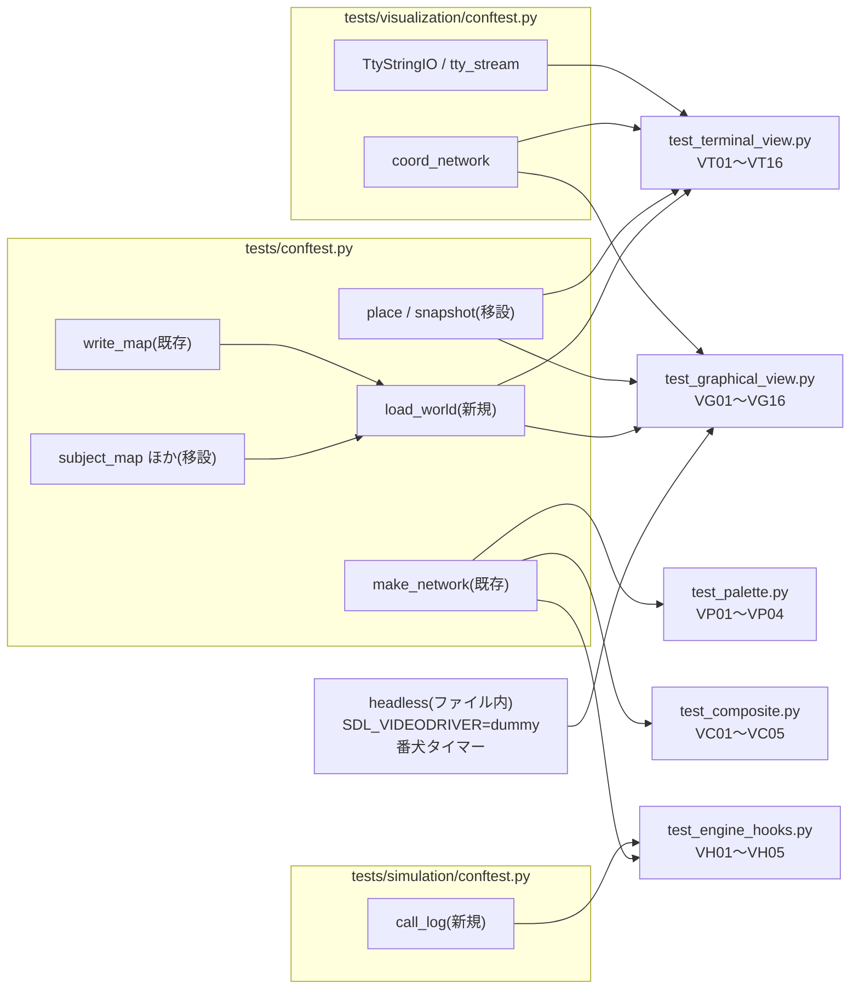

# テスト設計: Stage 7(Visualization)

- 日付: 2026-10-18
- フェーズ: **テスト設計**(テストコードはまだ書かない。作成フェーズは別途)
- 対象ブランチ: `test/stage7_visualization`(`feature/stage7_visualization` から分岐)
- 対象コード: `droneflow/visualization/palette.py`(`rgb`)、`composite.py`(`CompositeVisualizer`)、
  `terminal_view.py`(`TerminalVisualizer` / `color_enabled`)、`graphical_view.py`(`GraphicalVisualizer` / `zone_rgb` / `_Layout`)、
  `droneflow/simulation/engine.py`(`SimulationEngine.run` の `begin` / `render` / `close` の呼び出し)。
  `base.py` はプロトコルだけなので直接のテストはしない(各ビューとスタブがプロトコルに合うことは mypy で見る)。
- 参照した決定: `docs/decisions.md`
  - 2026-10-17「Stage 7 の API(`Visualizer` を `begin` / `render(state, moves)` / `close` の3つにする)」(以下 **API7**)
  - 2026-10-17「ターミナル表示は stderr に出し、stdout はターンログだけにする」(以下 **stderr**)
  - 2026-10-17「色の名前は自前の表 → pygame の色名 → 既定色の順に引き、知らない名前でも落とさない」(以下 **色**)
  - 2026-10-17「グラフィカル表示(pygame)の窓の扱い: 最初の描画で開き、途中で閉じても計算は続ける」(以下 **窓**)
  - 2026-10-18「グラフィカル表示の y 軸は上向きにする」(以下 **y上**)
  - 2026-10-18「ステップ実行(1ターンずつ進める)を可視化の層に持たせ、both ではグラフィカル側だけが進行を握る」(以下 **ステップ**)
  - 2026-10-18「CLI のフェーズで実装する可視化まわりの方針」(CLI はスコープ外。`hold_final=True` が既定になることだけ参照)
- 参照した資料: `docs/research/2026-10-17_workflow-stage7-visualization.md`(設計・完了条件・レビュー時の確認事項)
- 参照したバグ記録: `docs/bugs.md`(Stage 7 に関係する既知のバグはなかった。本設計で2件を追記した。下記「設計中に見つけた実装の問題」)
- 書式の手本: `docs/research/2026-10-17_test-design-stage5-scheduler.md`

## 方針

- `tests/` は `droneflow/` の構成に対応させ、`tests/visualization/` を新設する。エンジンのフック(VH 系)は `engine.py` の
  テストなので `tests/simulation/` に置く。
- **ターミナル表示は `io.StringIO` に書かせて文字列で検査する**。端末かどうかは `isatty()` だけで判定しているので、
  `isatty()` が True を返す `StringIO` の小さな派生クラス(`TtyStringIO`)で「端末」を作る(本物の端末・`sys.stdin` は使わない)。
  `NO_COLOR` は `monkeypatch.setenv` / `delenv` で切り替える。stdout に何も出ないことは `capsys` で確かめる。
- **グラフィカル表示はヘッドレスで動かす**。`SDL_VIDEODRIVER=dummy` をフィクスチャで `monkeypatch.setenv` してから
  `pygame.display.init()` する(SDL が読むのは `display.init` の時点なので、import より後でよい。設計時に確認済み)。
  pygame が無い環境では `pytest.importorskip("pygame")` でファイルごと skip する(下記「pygame のスキップ」)。
- **入力は本物のイベントキューに `pygame.event.post` で積む**。ビューは `begin` / `render` の中で待つ(ステップ実行では
  一時停止で待ち続ける)ので、イベントは呼び出しの**前**に積んでおく。窓を開く前でも、フィクスチャで `display.init()` 済みなら
  積んだイベントは `set_mode` の後も残る(設計時に確認済み)。
- **待ち時間に頼らない**: 自動再生のテストは `delay=0`、ステップ実行のテストは `delay=60`(=イベントが来ない限り進まない)にする。
  実時間の `sleep` は使わない。万一のハングを防ぐため、フィクスチャで**番犬のタイマー**
  (`pygame.time.set_timer(pygame.QUIT, ms, loops=1)`)を仕掛ける。番犬が鳴ると窓が閉じ、`is_open` が False になるので、
  テストはハングせずに**アサーションで落ちる**。
- 期待値の文字列(見出し・`moves:` など)は、設計時に `feature/stage7_visualization` の実装で出力して確認した(アドホック、コミットしない)。
- ビューは状態を読むだけ(API7)。ターミナル・グラフィカルとも、描画の前後で `snapshot` が等しいことを1件ずつ確かめる。
- `revie_case/` と scratchpad のスクリプトには依存しない。配布マップは Stage 5 と同じく `maps.tar.gz` を `tarfile` で読む(VP03 のみ)。
- `tests/README.md` のカバレッジ欄と `tests/visualization/README.md` は作成フェーズで書く(テストフォルダごとの README は共通ルール)。

## ファイル構成

```
tests/
├── conftest.py                     # 変更: place / snapshot / subject_map / restricted_only_map / load_world を移設・追加
├── simulation/
│   ├── conftest.py                 # 変更: 移設したものを削除、CallLogVisualizer と call_log を追加
│   └── test_engine_hooks.py        # 新規: VH01〜VH05(エンジンが begin / render / close を呼ぶ契約)
└── visualization/
    ├── README.md                   # 新規(作成フェーズ)
    ├── conftest.py                 # 新規: TtyStringIO, tty_stream, coord_network
    ├── test_palette.py             # 新規: VP01〜VP04(pygame 不要)
    ├── test_composite.py           # 新規: VC01〜VC05(pygame 不要)
    ├── test_terminal_view.py       # 新規: VT01〜VT16(pygame 不要)
    └── test_graphical_view.py      # 新規: VG01〜VG16(pygame が無ければ skip)
```

- ID の接頭辞は `V`(Visualization)+ 対象の1文字: `VP` = palette、`VC` = composite、`VT` = terminal、`VG` = graphical、
  `VH` = engine の hook。既存の `S` / `T` / `G`(Stage 4)、`L` / `D` / `R`(Stage 5)、`E`(Stage 3)、`T` / `M`(重複キー)と重ならない。
- 既存と同じく `__init__.py` は置かない。ファイル名は既存と重複しない(`test_engine_hooks.py` は `test_engine.py` と別名)。

## 共有フィクスチャ・ヘルパー

### `tests/conftest.py` へ移設・追加(推奨)

`tests/visualization/` からは `tests/simulation/conftest.py` のフィクスチャが見えない(conftest はディレクトリ単位)。
テストファイル同士・conftest 同士の import はしない方針なので、両方で使うものをルートへ上げる(意味は変えない)。

| 名前 | 中身 | 使うケース |
|---|---|---|
| `place`(移設) | Stage 5 の `place_drones` そのまま | VT03〜VT05, VT15, VG09 |
| `snapshot`(移設) | Stage 4 の `take_snapshot` そのまま | VT15, VG09 |
| `subject_map` / `subject_output` / `restricted_only_map`(移設) | 課題の例のマップ・期待出力、corridorA を blocked にしたマップ | VT04, VT16, VG06, VG07, VH 系 |
| `load_world(text) -> World`(新規) | `write_map(text)` → `MapParser(path).parse()` | VT04, VT16, VG06, VG07 |

- 移設は1コミットで行い、既存の `tests/simulation/` のテストがそのまま通ることを確認する(Stage 5 の作成時と同じ手順)。
- 代案: `tests/visualization/conftest.py` に同じものを複製する。重複が増えるので推奨しない(確認したい点 1)。

### `tests/simulation/conftest.py` に追加

| 名前 | 中身 | 使うケース |
|---|---|---|
| `CallLogVisualizer` / `call_log` | 呼ばれた順に `("begin", turn, start_occupancy)` / `("render", turn, list(moves))` / `("close",)` を1つのリストに積む。`state` は呼ばれた時点の値をコピーして残す(エンジンが後で書き換えるため)。コンストラクタ引数 `fail_on`(`"begin"` / `"render"` / `"close"` / `None`)で、その呼び出しで `RuntimeError("view")` を出せる | VH 系 |

- 既存の `RecordingVisualizer`(`recorder`)は Stage 4 のテストが使っているので変えない。呼び出しの**順序**と `begin` / `close` を
  見るために別のスタブを足す。

### `tests/visualization/conftest.py`(新規、pygame 不要)

| 名前 | 中身 | 使うケース |
|---|---|---|
| `TtyStringIO` | `io.StringIO` の派生で `isatty()` が True | VT 系 |
| `tty_stream(text="") -> TtyStringIO` | 上の工場。入力にも出力にも使う | VT09, VT12, VT14 |
| `coord_network(zones, edges="", colors=None, types=None) -> Network` | `[("s", 0, 0), ("a", 10, 0), ("g", 10, 10)]` のように**座標付き**でゾーンを登録する(最初が start、最後が end、ほかは hub・容量1)。`make_network` は全ゾーンを (0, 0)・色なしにするので、座標と色が効くテストにはこちらを使う | VT07, VT08, VT10, VG03〜VG05, VG14 |

### `tests/visualization/test_graphical_view.py` 内(pygame が要るのでファイル内に閉じる)

```
os.environ.setdefault("PYGAME_HIDE_SUPPORT_PROMPT", "1")   # importorskip が先に pygame を読むので、案内文を止める
pygame = pytest.importorskip("pygame")
from droneflow.visualization.graphical_view import GraphicalVisualizer, zone_rgb, _Layout

@pytest.fixture
def headless(monkeypatch) -> Headless:
    monkeypatch.setenv("SDL_VIDEODRIVER", "dummy")
    monkeypatch.setenv("SDL_AUDIODRIVER", "dummy")
    pygame.display.init()          # イベントを先に積めるように、窓より前に初期化しておく
    pygame.event.clear()
    pygame.time.set_timer(pygame.QUIT, 3000, loops=1)    # 番犬(既定3秒)
    yield Headless(post_key=..., post_quit=..., post_motion=..., watchdog=...)
    pygame.time.set_timer(pygame.QUIT, 0)                 # 番犬を止める
    pygame.display.quit(); pygame.font.quit()             # 次のテストに窓・キューを持ち越さない
```

- `post_key(key)` は `pygame.event.post(Event(KEYDOWN, key=key))`、`post_quit()` は `Event(QUIT)`、`post_motion(pos)` は `MOUSEMOTION`。
- `watchdog(ms)` は番犬を短く掛け直す(VG08「一時停止で始まる」の証明に使う)。
- **pygame のスキップ**: `pytest.importorskip("pygame")` はモジュールの先頭で呼ぶ(ファイル全体が skip になり、
  `tests/visualization/` のほかのファイルは pygame なしで走る)。`PYGAME_HIDE_SUPPORT_PROMPT` を先に設定するのは、
  importorskip が `graphical_view` より先に pygame を読むと案内文が stdout に出るため(本体の import 順と同じ効果。値は上書きしない)。
- `_Layout` は先頭が `_` の内部クラスだが、pygame の描画を通さずに座標変換を確かめられる最小の継ぎ目なので、そのまま import して使う
  (公開名にするかは確認したい点 2)。



## ケース一覧

表記: `s-a a-g` は `make_network` の接続。`coord[(s,0,0),(a,10,0),(g,10,10)]` は `coord_network` の座標。`TV(...)` は
`TerminalVisualizer(...)`、`GV(...)` は `GraphicalVisualizer(...)`。`out` / `inp` は `StringIO` または `TtyStringIO`。
期待値の `ESC` は `"\x1b"`。

### palette(`tests/visualization/test_palette.py`、pygame 不要)

| ID | 対象 | セットアップ | 期待結果 | 意義・守る決定/仕様 |
|---|---|---|---|---|
| VP01 | 表の値 | `rgb("red")`、`rgb("darkred")`、`rgb("crimson")`、表の全エントリ | `(220, 40, 40)` / `(139, 0, 0)` / `(220, 20, 60)`。全エントリが 0〜255 の整数3つ | 色(24bit で似た赤を区別する)。表の書き間違い(4要素・範囲外)の検出 |
| VP02 | 大文字小文字を区別しない | パラメタライズ: `"RED"`, `"Red"`, `"rEd"` | すべて `rgb("red")` と同じ | 色(大文字小文字は区別しない) |
| VP03 | 配布マップの色名 | `maps.tar.gz` の全 `.txt` と課題の例から `color=(\w+)` を集める | `rainbow` 以外はすべて `rgb(name) is not None`。`rgb("rainbow") is None`(17種のうち16が表にある) | 色(配布マップの色は表で塗れる)。`rainbow` は決定で「ない名前」の例として挙がっている唯一の色。アーカイブが無ければ Stage 5 と同じく `pytest.fail` |
| VP04 | 知らない名前・None と、pygame なしの import | ① `rgb("rainbow")`、`rgb("")`、`rgb(None)` ② サブプロセス(`sys.executable -c`)で `droneflow.simulation.engine` / `visualization.terminal_view` / `composite` / `palette` を import し `"pygame" in sys.modules` を出力 | ① すべて `None`(例外なし) ② `False` | 色(知らない名前で落とさない)、窓 1(pygame の import は `graphical_view.py` の中だけ)。完了条件「pygame を import しなくても … 使える」 |

### CompositeVisualizer(`tests/visualization/test_composite.py`、pygame 不要)

テスト内のスタブ `LogView(name, log, fail=False)`: 3メソッドとも `log.append((name, メソッド名))` し、`fail` のとき `close` で
`RuntimeError(name)` を出す(VC05 は `render` で出す)。

| ID | 対象 | セットアップ | 期待結果 | 意義・守る決定/仕様 |
|---|---|---|---|---|
| VC01 | 呼び出しを順に配る | ビュー a, b。`begin(state)` → `render(state, moves)` → `close()` | `log` が `[(a,begin),(b,begin),(a,render),(b,render),(a,close),(b,close)]`。各ビューが受け取った `state` / `moves` は渡したものと同一(`is`) | API7(both 用に同じ呼び出しを配る)。ビューの順序を保つ |
| VC02 | 1つの close が失敗しても残りを閉じる | ビュー a(失敗), b | `pytest.raises(RuntimeError, match="a")`。`log` に `(b,close)` がある(a の後に b も閉じた) | API7「1つのビューが失敗しても残りをすべて閉じる」 |
| VC03 | 複数の close が失敗した場合 | ビュー a(失敗), b(失敗), c(失敗) | 3つとも閉じる(log)。送出されるのは最後の `c`、その `__context__` が `b`、`b.__context__` が `a`(docstring どおり) | composite.py の docstring「earlier ones chained to it as context」。**現状は `__context__` が `None` で、a・b の失敗が失われる**(下記バグ1)。修正方針が決まるまで `xfail(strict=True)` |
| VC04 | ビューなし | `CompositeVisualizer([])` で3メソッド | 何も起きない(例外なし) | 境界。`ExitStack` が空でも動く |
| VC05 | render の失敗はそのまま伝わる | ビュー a(render で失敗), b | `RuntimeError("a")`。b の render は呼ばれない。その後 `close()` すれば a, b とも閉じる | 現状の挙動の記録(render は後始末ではないので止めてよい)。エンジンが `finally` で close するので窓は残らない(VH04 と組で守る) |

### TerminalVisualizer(`tests/visualization/test_terminal_view.py`、pygame 不要)

| ID | 対象 | セットアップ | 期待結果 | 意義・守る決定/仕様 |
|---|---|---|---|---|
| VT01 | 既定の出力先は stderr | `capsys` を使い、`TV()`(引数なし)を**テスト内で**構築して `begin` → `render` → `close` | `capsys.readouterr()` の `out == ""`、`err` に `=== Turn 0 (start)` | stderr 1。`sys.stderr` は構築時に読むので、capsys が差し替えた後に構築する |
| VT02 | begin の内容 | `s-a a-g`、2機、`TV(out, color=False, width=100)` で `begin` | 1行目 `=== Turn 0 (start) \| 2 drones \| 3 zones, 2 connections ===`、2行目が凡例(`key: S=start E=end ...`)、ゾーンの行に `s S 2/-` と `a . 0/1`、`drones: s[D1 D2]`。`in flight:` の行はない | stderr 3(初期状態=ターン0)、API7 の begin |
| VT03 | 1フレームの内容と `frame` | 上と同じ網で `place(at={1:"a"})`、`moves=[Move(1,"a")]`。① `TV(out,...).frame(state, moves)` ② `render` | ① 戻り値の1行目 `=== Turn 0 \| moved 1 \| delivered 0/2 ===`(turn は place では進まない)、`moves: D1-a`、`a . 1/1*`(満杯の `*`)、`drones:` に `a[D1]`。この時点で `out` は空(書かない) ② `out` の中身が ① の行を `\n` でつないだもの | stderr 3、`frame` の docstring「without writing」 |
| VT04 | restricted・blocked・end の表示 | `restricted_only_map` を `load_world`、本物の Scheduler で1ターン進めた状態を `render`(または engine + VT16 の出力から2フレーム目を取り出す) | `moves: D1-hub-roof1`(接続名)、`roof1 R 0/1+1*`(予約 `+1` と満杯)、`corridorA X --`、`in flight: D1 hub-roof1 -> roof1`。最終フレームで `goal E 5/-` | 予約(飛行中は接続上・到着先に予約)、2026-10-16 の出力用の接続名、レビュー確認事項「予約が容量の表示に出ているか」「blocked・restricted・start/end が区別できるか」 |
| VT05 | ドローンIDのまとめ方 | `s-a a-g`、cap(a)=2、7機、`place(at={4:"a", 6:"a"})` で `begin` | `drones:` の行に `s[D1..D3 D5 D7]` と `a[D4 D6]`(2連続は `D1 D2` のまま、3連続から `..`) | `_id_ranges` の境界(差が2以上で範囲表記)。多数の機でも1行に収める工夫 |
| VT06 | 幅での折り返しと長い名前の省略 | 名前が20文字のゾーンを含む網、`TV(out, color=False, width=40)`、moves 8件の `frame` | ゾーン名はセルで18文字(17文字+`~`)に切られる。`drones:` には完全な名前。`moves:` が複数行になり、2行目以降は `moves:` の幅(6文字+1)の空白で始まる。見出し・凡例以外の各行の長さが 40 以下 | stderr 3(端末の幅に合わせて並べる)。凡例は幅を見ないので除外 |
| VT07 | 色なしの強制 | `coord_network` に `color=red` のゾーン、`TV(out, color=False)` で begin / render | `ESC` が1文字も含まれない | stderr 2(`color=False` で強制) |
| VT08 | 色ありの強制 | VT07 と同じ網で `TV(out, color=True)` | ゾーン名の直前に `ESC[38;2;220;40;40m`、直後に `ESC[0m`。見出しが `ESC[1m` で始まる | stderr 2・色(24bit、palette と同じ値) |
| VT09 | 色の自動判定 | パラメタライズ(`color=None`): ① `out=StringIO()`、NO_COLOR なし → off ② `out=TtyStringIO()`、NO_COLOR なし → on ③ ② に `NO_COLOR=1` → off ④ ② に `NO_COLOR=""`(空)→ on。`monkeypatch.setenv` / `delenv(raising=False)` で設定し、`TV(out).color` と `color_enabled(out)` を見る | 各期待どおり。①③では begin の出力に `ESC` がない | stderr 2(端末でない出力先・`NO_COLOR` は空でない値のときだけ)。開発者の環境変数に左右されないよう、全パターンで NO_COLOR を明示的に設定/削除する |
| VT10 | 知らない色・色なし | `color=rainbow` のゾーンと `color` なしのゾーン、`TV(out, color=True)` で begin / render | 例外なし。2つのゾーン名の直前に `ESC[38;2` が付かない(端末の既定色のまま)。ほかのゾーンは塗られる | 色(知らない名前で落とさない、塗らない) |
| VT11 | close は flush するだけ | `out` を flush 回数を数える StringIO 派生にし、`close()` | flush が呼ばれる。`out.closed is False`、その後も `out.write` できる | stderr 1(stderr は自分のものではないので閉じない) |
| VT12 | ステップ実行: 端末の入力で待つ | `s-a a-g`、2機(3ターンで終わる)、`inp=tty_stream("\n"*5)`、`TV(out, color=False, step=True, input_stream=inp)` を `SimulationEngine.run` に渡す(`capsys` 併用) | `out` の `-- press Enter for the next turn --` が **3回**(begin・ターン1・ターン2の後。最後のターン3の後は出ない)。`inp` から3行消費(残り2行)。プロンプトの後に次のフレームが来る順序。`capsys` の out は空 | ステップ 1(初期状態を含む・最後を除く、プロンプトは出力先へ) |
| VT13 | 端末でない入力では待たない | ① `inp=StringIO("\n"*5)`(isatty False)で VT12 と同じ ② `step=False` で `inp=tty_stream("\n"*5)` | ① `TV.step is False`、プロンプト0回、`inp.tell() == 0`(1文字も読まない)、run が完走 ② 同じくプロンプト0回・読まない | ステップ 1(パイプ・リダイレクトでは止まらない)。入力を読まないことで「待たない」を時間に頼らず確かめる |
| VT14 | EOF でステップを切る | `inp=tty_stream("")`(すぐ EOF)で VT12 と同じ | プロンプトは1回だけ(begin の後)、以後 `TV.step is False`、run は完走し全フレームが出る | ステップ 1(入力が終わったら以後は待たない) |
| VT15 | 状態を変えない | VT03 の状態で `begin` / `render` / `frame` の前後 | `snapshot` が等しい | API7(ビューは読むだけ) |
| VT16 | エンジン経由の E2E | `subject_map` を `load_world`、本物の Scheduler、`TV(out, color=False, width=100)`、`capsys` | `=== Turn` の見出しが `len(turns)+1` 個(7ターン+初期状態)、最後の見出しが `=== Turn 7 \| moved 1 \| delivered 5/5 ===`、`capsys` の out は空 | stderr 1(可視化の有無で stdout が変わらない)、完了条件「課題の例でターミナル表示が stderr に出て、stdout には何も出ない」 |

### GraphicalVisualizer(`tests/visualization/test_graphical_view.py`、ヘッドレス・pygame が無ければ skip)

VG03〜VG05 は窓を開かない(`headless` 不要)。それ以外は `headless` を使う。

| ID | 対象 | セットアップ | 期待結果 | 意義・守る決定/仕様 |
|---|---|---|---|---|
| VG01 | 構築しただけでは何も開かない | `headless`、`GV(delay=0, hold_final=False)` を構築 | `is_open is False`、`pygame.display.get_surface() is None` | 窓 1(最初の描画で開く) |
| VG02 | begin で窓が開く | `GV(delay=0, size=(640, 480), hold_final=False)` で `s-a a-g` の初期状態を `begin` | `is_open is True`、`get_surface().get_size() == (640, 480)`、`get_caption()[0] == "Fly-in"`。`close()` 後は `is_open is False` かつ `pygame.display.get_init() is False` | 窓 1・API7 の close(窓を確実に閉じる) |
| VG03 | 座標変換(y は上向き) | `_Layout(coord[(s,0,0),(a,10,0),(g,10,10)], (1200,800))` | `position("s")` と `position("a")` の画素 y が等しく、`a` の x が `s` より大きい。`g` の画素 y が `a` より**小さい**(上に描かれる)。全点が窓の中で、上端は状態表示の帯(34px)より下。設計時の値: s=(60,702) a=(1140,702) g=(1140,64) | y上(数学の向き)。x は右向きのまま。窓の外・帯の下に隠れないこと |
| VG04 | 座標変換の縮退 | パラメタライズ: ① 全ゾーンが同じ座標 ② x がすべて同じ(縦一列、y が 0 と 5) ③ 横に長い (0,0)-(100,1) | 例外(ゼロ除算)なし。① 全点が同じ画素 ② x は窓の中央、y=5 のほうが上 ③ 2点の画素 y の差が 0 より大きい(潰れきらない)が x の差より十分小さい | `_Layout` の `span == 0` の分岐、`_MAX_STRETCH`(片方の軸だけ極端に伸ばさない) |
| VG05 | 色の引き方 | パラメタライズ: `"red"` → palette の `(220,40,40)`(pygame の `(255,0,0)` ではない)/ `"aquamarine"` → pygame の `(127,255,212)` / `"rainbow"`・`""`・`None` → `DEFAULT_ZONE_RGB` | 各期待どおり、例外なし | 色(表 → pygame の色名 → 既定色の順) |
| VG06 | 全ターンを描いて閉じる | パラメタライズ: `subject_map`、`restricted_only_map`。`GV(delay=0, hold_final=False)` を本物の Scheduler の `SimulationEngine.run` に渡す | 例外なし、ターン数は可視化なしと同じ(7 / 12)、run の後 `is_open is False`、`display.get_init() is False` | 完了条件「`SDL_VIDEODRIVER=dummy` で窓を開いて全ターンを描き、例外なく閉じる」。restricted の飛行中(接続の中点)・配達済み(描かない)の描画経路を通す |
| VG07 | 途中で閉じても計算は続く | パラメタライズ: `QUIT` / `K_ESCAPE` / `K_q`。`post` してから VG06 と同じ run(`subject_map`) | begin の待ちで窓が閉じる。run は完走して7ターンを返す(出力は可視化なしと同じ)。run の後 `is_open is False`、例外なし | 窓 3(閉じても止めない、以後の render は何もしない)、窓 2(Esc・q・×) |
| VG08 | ステップ実行は一時停止で始まる | `GV(delay=0, step=True, hold_final=False)`、イベントを積まず、`watchdog(200)` | `begin` から戻った時点で `is_open is False`(番犬の QUIT まで待ち続けた=自分では進まなかった)。対照: 同じ条件で `step=False` なら `is_open is True` | ステップ 2(一時停止で始まる)。`delay=0` でも進まないことを、時間を測らずに窓の状態で確かめる |
| VG09 | 右矢印で1ターンずつ進む | `GV(delay=60, step=True, hold_final=False)`。`post_key(K_RIGHT)` → `begin`、`post_key(K_RIGHT)` → `render(place(at={1:"a"}), [Move(1,"a")])` | どちらも戻り、`is_open is True`(番犬は鳴っていない)。render の前後で `snapshot` が等しい | ステップ 2(右矢印1回で1ターン)、窓 2。`delay=60` なので、右矢印以外で進んだら番犬で落ちる。API7(読むだけ) |
| VG10 | Space で自動再生に戻る | `GV(delay=0, step=True, hold_final=False)`、`post_key(K_SPACE)` → `begin` | 戻り、`is_open is True` | ステップ 2「Space で自動再生に切り替え」、窓 2(Space で一時停止 / 再開) |
| VG11 | 待ち時間の変更と上下限 | ① `GV(delay=1.0, step=True)`、`K_UP` → `K_RIGHT` を積んで begin、`close()` ② `delay=1.0` で `K_DOWN` ×4 → `K_RIGHT` ③ `delay=0.1` で `K_UP` ×3 → `K_RIGHT` | `close()` 後の `GV.delay` が ① `0.5` ② `5.0`(1→2→4→5 で上限)③ `0.05`(下限) | 窓 2(上下で半分 / 2倍)。`_shut` が窓の待ち時間を `delay` に書き戻すことで観察できる |
| VG12 | close は何度呼んでもよい | ① begin 前に `close()` ② begin → `close()` → `close()` | どちらも例外なし、`is_open is False` | API7(エンジンは1回だが、both で2重に閉じても落ちない) |
| VG13 | 最後の画面で閉じる操作を待つ | `GV(delay=0, hold_final=True)` で全機配達済みの状態(`place(at={1:"g"})`)を `render`、続けて `post_key(K_ESCAPE)` → `close()` | close が戻り(番犬より前)、`is_open is False` | 窓 4(完走したら `close` で Esc・q・× を待つ)。待ちの終わり方をイベントで確かめる(テストでハングしない) |
| VG14 | 待たずに閉じる場合 | パラメタライズ: ① 完走していない状態(ターン0)で render → `close()`(エラーで止まった場合)② 完走した状態で render した後 `post_quit()` で窓を閉じてから(`render` 1回で閉じる)`close()`。`_Window.wait_for_quit` を `monkeypatch` で呼び出しを数えるスパイに差し替える | どちらも `wait_for_quit` が呼ばれない、`is_open is False` | 窓 4(エラーで止まった場合は待たずに閉じる)、窓 3(閉じた後は何もしない)。スパイは内部名への依存だが、時間を測らずに「待たなかった」を示す最小の継ぎ目 |
| VG15 | マウスを重ねた詳細表示 | `GV(delay=60, step=True)`、`_Layout(network, size).position("a")` の位置に `post_motion` → `K_RIGHT` → `begin` | 例外なし、`is_open is True` | 窓 2(マウスで詳細)。ツールチップの描画経路のスモークテスト(画素の検査はしない) |
| VG16 | import で stdout に何も出ない | サブプロセス(`sys.executable -c "import droneflow.visualization.graphical_view"`)、環境から `PYGAME_HIDE_SUPPORT_PROMPT` を除く | stdout が空、終了コード0 | 窓 5(案内文が stdout に混ざらない)。同じプロセスでは import 済みのため、サブプロセスで確かめる |

### エンジンのフック(`tests/simulation/test_engine_hooks.py`、pygame 不要)

`call_log` で呼び出しの並びを1つのリストとして比べる。

| ID | 対象 | セットアップ | 期待結果 | 意義・守る決定/仕様 |
|---|---|---|---|---|
| VH01 | begin は1ターン目の前に1回 | `s-a a-g`、2機、`follower_scheduler` | `log[0] == ("begin", 0, 2)`(ターン0・start に2機)。`begin` はちょうど1回 | API7 1(初期状態を見せる) |
| VH02 | render は毎ターン、そのターンの moves で | VH01 と同じ | render の記録が `len(turns)` 個で、ターン番号が 1, 2, …、各 `moves` が `turns[i]` と等しい(ドローンID順、空でない) | API7 2(`moves` はそのターンの `Move`) |
| VH03 | 成功時の close | VH01 と同じ | 並び全体が `begin, render×n, close`。`close` はちょうど1回で最後 | API7 3 |
| VH04 | エラーで止まっても close | パラメタライズ: ① `idle_scheduler`(1ターン目で誰も動かない)② `oscillating_scheduler` + `max_turns=3`(上限)③ `scripted_scheduler` で隣接していないゾーンへの指示(resolver の違反) | どれも `SimulationError` が**そのまま**伝わる。並びは ① `begin, close` ② `begin, render×3, close` ③ `begin, close`(違反したターンは render しない) | API7 3(`try/finally` で `SimulationError` でも close)。Stage 4 の G 系(例外の種類・render の回数)と矛盾しないこと |
| VH05 | ビューの render が失敗しても close | `CallLogVisualizer(fail_on="render")` | run から `RuntimeError("view")` が伝わる(別の例外に包まない)。並びは `begin, render, close` | API7 3(`finally` なのでビューの失敗でも窓が残らない) |

ケース数: VP 4、VC 5、VT 16、VG 16、VH 5 の **計46件**(パラメタライズの展開後は VP02 が3、VT09 が4、VG04 が3、VG05 が5、VG06 が2、
VG07 が3、VG11 が3、VG12 が2、VG14 が2、VH04 が3)。うち VG 系16件は pygame が無ければ skip。

## 作成フェーズへの申し送り

1. **イベントは呼び出しの前に積む**。`begin` / `render` / `close` は待ちの中でイベントを読むので、後から積む手段はない。
   `headless` が `display.init()` 済みなので、窓を開く前の `post` も有効(設計時に確認)。
2. **番犬は「ハングしない」ためのもの**。番犬が鳴った場合は `is_open` が False になって落ちるので、期待が `is_open is True` の
   ケース(VG09〜VG11, VG15)はそのまま検出できる。番犬で正常終了とみなすのは VG08 だけ。番犬は teardown で必ず止める
   (止めないと次のテストに QUIT が届く)。
3. **実時間に頼らない**: 経過時間のアサーションは書かない。待ち時間を変える VG11 も `delay` の値で確かめる。
4. ターミナルの文字列は `color=False`・`width` を明示して比べる(端末の幅・環境変数に左右されない)。色の検査(VT08)だけ `color=True`。
5. `TerminalVisualizer` の既定の出力先は**構築時**の `sys.stderr`。VT01 は capsys が有効になってから構築する。
6. VT12〜VT14 の `step=True` には入力ストリームを必ず渡す(省略すると本物の `sys.stdin` を見る。pytest 下では端末でないので
   待たないが、テストの意図が環境に依存する)。
7. VC03 は `xfail(strict=True, reason="docs/bugs.md 2026-10-18 CompositeVisualizer.close")` で書く。直したら strict の xfail が
   落ちるので、外し忘れない。docstring 側を直す方針になった場合は、VC03 を「最後の失敗が送出される」だけに書き換える。
8. `tests/conftest.py` への移設は単独のコミットにし、既存の 335 件が通ることを確かめてから Stage 7 のテストを足す。
9. `flake8` と `mypy --strict`(tests を対象にしている範囲で)を通す。`_Layout` の import には `# noqa` は要らない(先頭 `_` は lint の対象外)。

## 設計中に見つけた実装の問題(`docs/bugs.md` に記録、コードは変更していない)

1. **`CompositeVisualizer.close` が先に失敗したビューの例外を失う**(`droneflow/visualization/composite.py:36`)。
   docstring は「several fail, the last failure is raised, with the earlier ones chained to it as context」だが、実際は最後の
   例外だけが送出され `__context__` は `None`。`with` の本体で例外が起きていないとき、`ExitStack` はコールバック同士の例外を
   つながない(CPython の `ExitStack._fix_exception_context` が `__context__ is None` のとき何もしない)。全ビューを閉じる点は正しい。
   VC03 で検出。
2. **ステップ実行のグラフィカル表示で、最後のターンでも右矢印を待つ**(`droneflow/visualization/graphical_view.py:546`)。
   `_show` は `state.is_complete` でも `window.wait()` を呼ぶので、`step=True` では最後のフレームで一時停止のまま止まる。
   `hold_final=True` だと「右矢印 → finished の表示 → Esc」の2段階になり、finished の表示は右矢印を押すまで出ない。
   ターミナルのステップ実行は「最後のターンを除く」なので、両者がそろっていない。仕様(ステップの決定)が最後のターンを
   どう扱うかを定めていないため、**要確認**として記録した(テストケースには入れていない。確認したい点 3)。

## 確認したい点

1. **フィクスチャの移設**: `place` / `snapshot` / `subject_map` / `restricted_only_map` / `subject_output` を `tests/conftest.py` に
   上げ、`load_world` を新設する案でよいか(`tests/simulation/` のテストは書き換えず、そのまま通る想定)。
2. **`_Layout` の扱い**: 内部クラスのまま import してテストする(推奨。コード変更なし)か、`Layout` として公開名にするか。
   VG14 の `_Window.wait_for_quit` のスパイも同様に内部名への依存になる。
3. **ステップ実行の最後のフレーム**(バグ2): グラフィカルも最後のターンでは一時停止しない(ターミナルとそろえる。`hold_final` の
   待ちに任せる)か、今のまま「最後のフレームも右矢印で確認」にするか。決まったら VG にケースを1件足す。
4. **`begin` の失敗時の close**: `engine.py:71` の `visualizer.begin(...)` は `try` の外にあるため、begin が例外を出すと close が
   呼ばれない。both で「ターミナルの begin は成功、グラフィカルの窓が開けない」場合、ターミナル側の close(flush)は呼ばれない。
   API7 の「エラーでも close」は `SimulationError` を想定した決定なので現状でもよいか、begin も `try` に入れるか。
   (現状の挙動をテストで固定はしていない。)
5. **close の失敗で run の戻り値が失われる**: 正常に完走しても、ビューの close が例外を出すと run は例外で終わり、ターン一覧を返さない。
   CLI でターンログをターンごとに出す方針(2026-10-18)なら実害は小さいが、close の失敗を握りつぶすか伝えるかを CLI のフェーズで決めたい。
6. **close の後に begin / render**: `GraphicalVisualizer` は窓を一度も開かずに `close()` した場合、その後の `render` で窓が開く
   (`_closed` が立たない)。エンジンの呼び方では起きないので、テストでは固定していない。
7. **`palette.py` の docstring**: 「all those used by the maps handed out with the subject」とあるが、challenger の end_hub の
   `color=rainbow` は表にない(決定では「ない名前の例」として挙がっている)。docstring を「rainbow 以外」と直すかどうか。VP03 は
   現状の表(rainbow は None)を期待値にしている。
