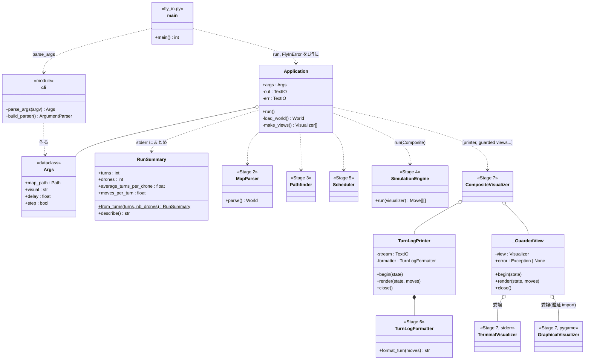
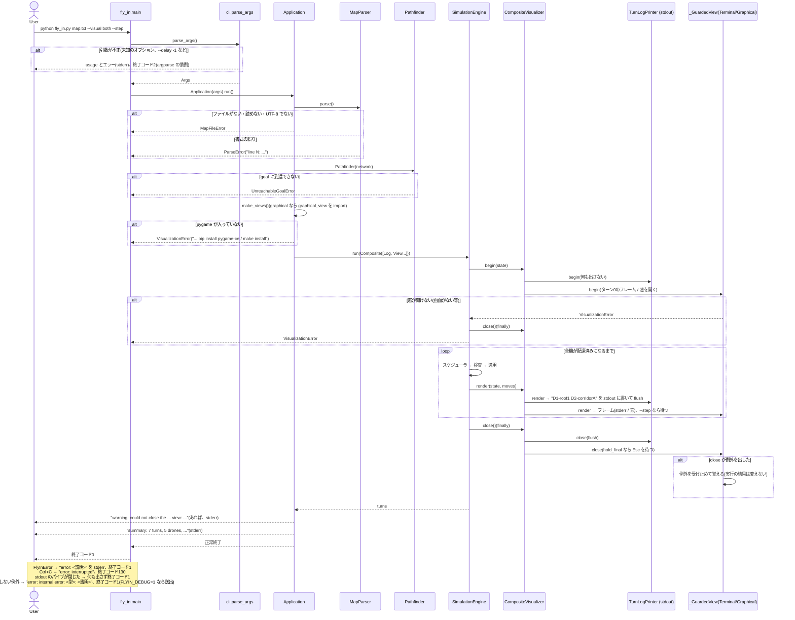

# ワークフロー: CLI / Application の配線と Makefile(Stage 0 の仕上げ + Stage 2〜7 の接続)

- 日付: 2026-10-18
- 依頼内容: `cli.py` / `app.py` / `fly_in.py` を実装して Stage 2〜7(パーサー・経路探索・シミュレーション・スケジューラ・
  出力・可視化)を1本の実行につなぎ、課題 III.2 の `Makefile` と `requirements.txt` を用意する(ユーザーの明示的な指示で
  Claude が実装する)。
- 前提:
  - `docs/decisions.md` 2026-10-18「CLI のフェーズで実装する可視化まわりの方針」: ターンログはターンごとに stdout へ、
    `--visual` の既定は `terminal`、グラフィカルは `--delay`(既定 0.5)と `hold_final=True`。
  - 同 2026-10-18「ステップ実行…both ではグラフィカル側だけが進行を握る」: `--step` の組み立て方。
  - 同 2026-10-17「ターミナル表示は stderr に出し、stdout はターンログだけにする」。
  - 同 2026-10-16「`nb_drones` は物理的な1行目に限る」: 配布マップ10枚は1行目がコメントなので、そのままでは読めない。
  - 同 2026-10-03「Stage 6 を先に実装」: `TurnLogFormatter` は状態を持たず、空のターンは出さない。
  - `docs/research/2026-10-18_test-design-stage7-visualization.md` の確認したい点5(`close` の失敗で `run` の戻り値が失われる)
    を、このフェーズで決める。
  - 課題: III.1(例外で落ちない、リソースは context manager)、III.2(Makefile の規則と lint のフラグ)、
    VII.5(出力形式)、VII.6(副次指標は任意)、VIII(README は Stage 9 で行う)。

## ゴール

1. `python fly_in.py <map> [--visual {terminal,graphical,both,none}] [--delay SECONDS] [--step]` で、マップを読み、
   シミュレーションを最後まで行い、**stdout には課題 VII.5 のターンログだけ**を、ターンが進むたびに1行ずつ出す。
   stdout の内容は `--visual` / `--step` / `--delay` によらずバイト単位で同じ。
2. 可視化(ターミナル表示)・総ターン数などのまとめ・警告・エラーは、すべて stderr に出す。
3. エラーは「`error: <1行の説明>`」を stderr に出して終了コード1。トレースバックは出さない。対象は `FlyInError` 全般
   (パースエラー・到達不能・シミュレーションエラー)に加え、マップファイルが開けない・読めない場合と、
   グラフィカル表示を求めたのに pygame(pygame-ce)が入っていない・窓が開けない場合。
4. ビューの `close()` が失敗しても、実行の結果(終了コード・ターンログ・まとめ)は変えず、警告を1行出すだけにする。
5. 課題 III.2 の `Makefile`(install / run / debug / clean / lint / lint-strict)と `requirements.txt` を置く。
   Linux / macOS(採点環境)で動くことを第一にし、Windows(Git Bash + GNU make)でも動くようにする。

## 対象ファイル

| ファイル | 内容 | 状態 |
|---|---|---|
| `droneflow/cli.py` | `Args`(`map_path` / `visual` / `delay` / `step`)と `parse_args`(argparse) | スケルトンを置き換え(`debug` を削除) |
| `droneflow/app.py` | `Application`: 読み込み → 経路探索 → スケジューラ → エンジン、ビューの組み立て、まとめの出力 | スケルトンを置き換え |
| `droneflow/output/turn_log_view.py` | `TurnLogPrinter`: ターンごとに `TurnLogFormatter.format_turn` の1行を stdout に書く観測者(`Visualizer` の形) | 新規 |
| `droneflow/output/summary.py` | `RunSummary`: ターン一覧から総ターン数・1機あたりの平均ターン数・1ターンあたりの移動数を求める | 新規 |
| `droneflow/errors.py` | `MapFileError`(マップが開けない・読めない)、`VisualizationError`(可視化が使えない) | 追加 |
| `droneflow/visualization/graphical_view.py` | 窓を開くときの `pygame.error` を `VisualizationError` にする | 小変更 |
| `fly_in.py` | `KeyboardInterrupt`(Ctrl+C)と `BrokenPipeError`(`| head` など)も1行で終える。予期しない例外は最後の砦で1行(`FLYIN_DEBUG=1` では送出) | 変更 |
| `Makefile` | install / run / debug / clean / lint / lint-strict(+ test / fclean) | 新規 |
| `.gitattributes` | `Makefile` の改行を LF に固定(Windows の `core.autocrlf` 対策) | 新規 |
| `requirements.txt` | pygame-ce / flake8 / mypy / pytest(pytest は `mypy . --strict` が `tests/` を検査するのにも要る) | 新規 |
| `setup.cfg` | flake8 の除外(`.venv` など)と mypy の設定(`explicit_package_bases` など) | 新規 |
| `maps/subject_example.txt` | 課題 VII.5 の例のマップ(`make run` の既定) | 新規 |

## 構造図(静的な形)

- `TurnLogPrinter` は `Visualizer` プロトコルと同じ形(`begin` / `render` / `close`)なので、エンジンから見ればビューの1つ。
  継承は使わず、`CompositeVisualizer` に並べる(合成)。**先頭に置く**ので、各ターンでターンログの行がフレームより先に出る。
- `_GuardedView` は「見るための」ビュー(ターミナル・グラフィカル)だけを包み、`close()` の例外を受け止めて覚える。
  ターンログの `TurnLogPrinter` は包まない(stdout の書き込み失敗は隠さない)。
- `GraphicalVisualizer`(と pygame)は `--visual` が `graphical` / `both` のときだけ import する。

### `--visual` と `--step` の組み立て

| `--visual` | ビュー(`TurnLogPrinter` の後ろに並ぶもの) | `--step` のとき |
|---|---|---|
| `terminal`(既定) | `TerminalVisualizer()` | `TerminalVisualizer(step=True)`(Enter で進む。入力が端末でなければ待たない) |
| `graphical` | `GraphicalVisualizer(delay, hold_final=True)` | `GraphicalVisualizer(..., step=True)`(右矢印で進む) |
| `both` | `TerminalVisualizer()`, `GraphicalVisualizer(delay, hold_final=True)` | ターミナルは `step=False`、グラフィカルだけ `step=True` |
| `none` | なし | 何もしない(無視) |

`--delay` はグラフィカルの待ち時間(0以上の有限な秒数)。グラフィカルを使わないモードでは使わない(エラーにはしない)。

## 挙動図(実行時の呼び出し順)

- シミュレーション中のエラー(`SimulationError`)のときも、エンジンの `finally` でビューは閉じられ、それまでのターンログは
  すでに stdout に出ている。まとめは出さない。
- `close()` の例外を受け止めるのは、`SimulationError` などで止まった後の `close()` の失敗が元のエラーを置き換えないようにするため
  でもある(`finally` の中で例外が起きると、元の例外は `__context__` に回り、表に出るのは `close()` の例外になる)。

## 作業項目

1. `errors.py`: `MapFileError` と `VisualizationError` を追加。
2. `output/turn_log_view.py`(`TurnLogPrinter`)と `output/summary.py`(`RunSummary`)。
3. `cli.py`: argparse で `map` / `--visual` / `--delay` / `--step`。`--delay` は0以上の有限な数に限る。
4. `app.py`: `Application.run`、`_load_world`(`OSError` / `UnicodeDecodeError` → `MapFileError`)、`_make_views`
   (pygame の `ModuleNotFoundError` → `VisualizationError`)、`_GuardedView`、警告とまとめの出力。
5. `graphical_view.py`: 窓を開くときの `pygame.error` を `VisualizationError` にし、pygame の表示を片付けて「閉じた」状態にする。
6. `fly_in.py`: `KeyboardInterrupt` と `BrokenPipeError` の扱い。予期しない例外の最後の砦(`make debug` は `FLYIN_DEBUG=1` で pdb に渡す。
   2026-10-18 のユーザー判断で追加)。
7. `Makefile` / `requirements.txt` / `setup.cfg` / `.gitattributes` / `maps/subject_example.txt`。
   (当初は `requirements-dev.txt` に pytest を分ける案だったが、`tests/` があると `mypy . --strict` が pytest なしでは通らないため、
   `requirements.txt` にまとめた。`docs/decisions.md` 2026-10-18 参照)
8. アドホックな確認(コミットしない): 課題の例とコメントを除いた配布マップを、`--visual` の4つのモードで実行し、
   stdout が同一であること、終了コード、エラーメッセージ(不正なマップ、ないファイル、ディレクトリ)を確かめる。
   グラフィカルは `SDL_VIDEODRIVER=dummy` と、窓を閉じるイベントを送るスクリプトで確かめる。
9. `docs/decisions.md` / `docs/bugs.md` に記録。

## スコープ外

- 単体テスト(別のテスト設計・作成フェーズで行う)。
- README(VIII)。Stage 9 で行う。
- 配布マップを読めるようにすること(`nb_drones` は物理的な1行目に限る、という決定は変えない)。
- `--visual` のほかの細かい設定(窓の大きさ、色のオン・オフ)を CLI に出すこと。色は `NO_COLOR` で消せる。

## 完了条件(Done)

- `cli.py` / `app.py` に `NotImplementedError` が残っていない。
- 課題の例で `D1-roof1 D2-corridorA` で始まる7行が stdout に出て、`--visual` の4つのモードで stdout がバイト単位で同じ。
- 不正なマップ・ないファイル・ディレクトリ・到達不能のマップで、`error: ...` の1行と終了コード1になり、トレースバックが出ない。
- `make` がある環境で、`make install` → `make run` / `make lint` / `make lint-strict` / `make clean` が動く。
- 既存テスト(410件)がすべて通り、`flake8` と `mypy --strict`、課題 III.2 の lint コマンドがエラーなしで通る。

## レビュー時の確認事項

- stdout にターンログ以外(まとめ、警告、pygame の案内文、ターミナル表示)が混ざらないか。各行を書いた直後に flush しているか。
- `--step` の組み立てが 2026-10-18 の決定(both ではグラフィカルだけが進行を握る)のとおりか。
- エラーがすべて1行・終了コード1になるか。`close()` の失敗が元のエラーを隠さないか、成功した実行を失敗にしないか。
- pygame の import が `--visual graphical/both` のときだけか(`terminal` / `none` は pygame なしで動くか)。
- `Makefile` の lint が課題 III.2 のフラグそのままか。`.venv` の中を flake8 が見ていないか。Linux/macOS で `bin/`、Windows で
  `Scripts/` を使い分けているか。
- `docs/decisions.md`(特に 2026-10-16 の `nb_drones`、2026-10-17/18 の可視化)と `docs/bugs.md` と食い違っていないか。
