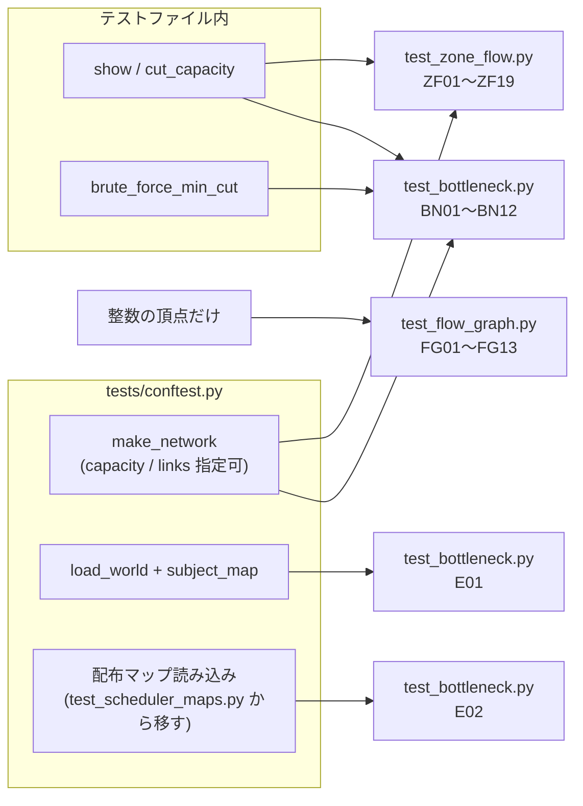

# テスト設計: 詰まる場所の発見(最大フロー・最小カット)

- 日付: 2026-10-19(作成 2026-10-20)
- フェーズ: **テスト設計**(テストコードはまだ書かない。作成は別フェーズで行う)
- 対象ブランチ: `test/bottleneck_finder`
- 対象コード: `droneflow/pathfinding/flow_graph.py`(`FlowGraph`)、`droneflow/pathfinding/zone_flow.py`(`Bottleneck`、`ZoneFlowGraph`)、
  `droneflow/pathfinding/bottleneck.py`(`ConnectionBottleneck` = A、`ShortestHopBottleneck` = B)
- 参照した設計: `docs/research/2026-10-19_workflow-bottleneck-finder.md`(モデル化・挙動図・実測値の表(d))
- 参照した決定: `docs/decisions.md` の 2026-10-19 の各項目
  - 「詰まる場所は最大フロー・最小カットで見つける(A: 全体のグラフ、B: 最短経路だけのグラフ)」
  - ワークフロー記載のユーザー決定: 1. A と B はクラスを分ける(委譲) 2. 最大フローは機数 N(`limit`)で打ち切る 3. 最小カットが複数あるときは start に一番近いカット
  - 「`tests/` は `main`(提出物)に含めない」(テストは `develop` 側のみ)
- 参照したバグ記録: `docs/bugs.md`(本機能に関する既知のバグはなし。2026-10-19 の2件は Scheduler と Makefile のもの)
- 参照した課題の条項: VII.3(ゾーンタイプ。blocked は進入不可、restricted は2ターン)、VII.4(`nb_drones` は物理的な1行目、`max_drones` / `max_link_capacity` の既定値1)

## 方針

- `tests/pathfinding/` に3ファイルを追加する(`droneflow/pathfinding/` の3モジュールに1対1で対応)。
- `FlowGraph` のテストは**整数の頂点だけ**で組む(ゾーンを知らない汎用部品なので、`Network` を使わない)。
- `ZoneFlowGraph` / finder のテストは、共有フィクスチャ `make_network`(`capacity=` / `links=` で容量を指定できる)で組む。
  start/end の `max_drones` を持たせる・hub の `max_drones=None` など、`make_network` で作れない形だけ `Zone` / `Connection` を直接組む。
- パーサーを通す E2E は、課題の例(`load_world(subject_map)`)と配布マップ(`maps.tar.gz`)だけ。
  `revie_case/` には**依存しない**(未追跡のため)。必要な形(S11, S12)はコード内で再現する。
- 期待値は手計算できる小さなネットワーク(ゾーン数 2〜8)に限る。性質ベースのケース(BN12)だけは乱数で作ったネットワークを全探索の最小カットと比べる。
- 期待値の検証: 表の「検証」列に **実行** とあるものは、本ブランチの実装を `.venv` の Python で実行して値を確認した(2026-10-20)。
  初版の後に実装が直された(b4dce19, 13a36e2。「設計中に気づいた点」参照)ので、修正後の実装で全ケースを再実行した。
  本設計では全件を実行で確認したので、手計算だけのケースはない。
- 各ケースは独立(finder・グラフを毎回作る)で、乱数は固定シードのみ。

## ファイル構成

```
tests/
├── README.md                     # 作成フェーズでカバレッジ欄に3ファイルを追記する
├── conftest.py                   # 配布マップの読み込みヘルパーをここへ移す(後述、決定済み)
└── pathfinding/
    ├── conftest.py               # 変更なし(grid_network のみ)
    ├── test_flow_graph.py        # FG01〜FG13
    ├── test_zone_flow.py         # ZF01〜ZF19
    └── test_bottleneck.py        # BN01〜BN12, E01〜E02
```

- 既存と同じく `__init__.py` は置かない(ファイル名は他と重複しない)。
- E2E(E01, E02)は finder の結果を見るので `test_bottleneck.py` に置く。

## 共有フィクスチャ・ヘルパー

### 既存のものを使う

- `make_network`(`tests/conftest.py`): `edges` / `types` / `capacity`(hub の `max_drones`、既定1)/ `links`(接続の `max_link_capacity`、既定1)。
  start/end は常に `max_drones=None`。ゾーンは初出順(start, end が先頭)、接続は記述順で登録される。
- `load_world` / `subject_map`(`tests/conftest.py`): 課題の例を `nb_drones: 5` を1行目に置いた形でパースする。

### 配布マップの読み込み(E02 用)

`tests/simulation/test_scheduler_maps.py` に `MAPS_ARCHIVE` / `open_archive` / `read_provided_map`(`maps.tar.gz` を展開せずに読み、
**先頭のコメント行・空行だけを削除**して `nb_drones` を物理的な1行目にする)がある。配布マップの1行目はコメントのことがあり、
パーサーは `nb_drones` が物理的な1行目にあることを要求する(decisions 2026-10-16)ので、この処理が必要。

- **決定(2026-10-20、ユーザー判断)**: `read_provided_map` と `MAPS_ARCHIVE`(と `open_archive`)を `tests/conftest.py` に移し、
  共有のヘルパー/フィクスチャ(例: `provided_map`)として `test_scheduler_maps.py` と `test_bottleneck.py` の両方から使う。
  既存の `test_scheduler_maps.py` の書き換えは別コミットにする。
- 採らなかった案: `test_bottleneck.py` に同じ関数を複製する(既存ファイルに触れないが、重複する)。

### テストファイル内のヘルパー

- `show(b: Bottleneck) -> tuple[int, list[str], list[str], bool]`: `(throughput, ゾーン名のリスト, 接続名のリスト, limits_flow)`。
  `Zone` / `Connection` 同士の比較より失敗時の差分が読みやすい(stage3 の `hop_names` と同じ考え方)。
- `cut_capacity(b)`: `sum(z.max_drones) + sum(c.max_link_capacity)`(BN12 用)。
- `brute_force_min_cut(network) -> int`(BN12 用): start/end 以外の通行できる hub と自己ループでない接続を「切れる要素」とし、
  要素の部分集合を容量の小さい順に試して、取り除くと start から end へ届かなくなる最小の容量の合計を返す(届かないなら 0)。
  グラフ系ライブラリは使わない(DFS を手で書く)。



## ケース一覧

表記: `s-a a-g` は接続(記述順)。`cap{a:2}` は hub の `max_drones`、`link{s-a:3}` は接続の `max_link_capacity`(書かないものは1)。
`r` = RESTRICTED、`x` = BLOCKED。結果は `show()` の形 `(throughput, zones, connections, limits_flow)` で書く。
FlowGraph の頂点は `add_vertex` の戻り値(0 から順)、辺は「tail→head(容量)」。

### FlowGraph(`tests/pathfinding/test_flow_graph.py`)

| ID | 観点 | 入力/手順 | 期待結果 | 狙い | 検証 |
|---|---|---|---|---|---|
| FG01 | 頂点の番号 | 空のグラフで `add_vertex()` を3回 | `0, 1, 2` | 頂点は「渡された整数」(docstring)。後のケースの前提 | 実行 |
| FG02 | 辺の番号と逆辺の対 | 頂点3つ。`add_arc(0,1,3)`、`add_arc(1,2,2)` | 戻り値 `0`, `2`(偶数)。`endpoints(0)==(0,1)`、`endpoints(1)==(1,0)`、`endpoints(2)==(1,2)`、`endpoints(3)==(2,1)`。どの辺 e でも `endpoints(e ^ 1)` は `endpoints(e)` の逆 | 「偶数番が元の辺、次の奇数番が逆辺、`arc ^ 1` で互いに引ける」(ワークフロー(b))。カットの読み戻しが `endpoints` に依存する | 実行 |
| FG03 | 負の容量 | 頂点2つ。`add_arc(0,1,-1)` | `ValueError`(メッセージに `-1`)。その後の `add_arc(0,1,0)` は `0` を返す(失敗した呼び出しで番号が進まない)。容量0は許される | 例外契約(docstring の Raises)。検査が状態の変更より前にあること | 実行 |
| FG04 | 存在しない頂点(parametrize) | 頂点2つ。a) `add_arc(0,9,1)` b) `add_arc(9,0,1)` c) `add_arc(-1,0,1)` d) `add_arc(0,-1,1)`。別に e) `add_arc(-1,0,-5)` | a〜d `IndexError`、メッセージ `no such vertex: <番号>`(9 / -1)。e) は `ValueError`(容量の検査が先)。どの場合も、その後の `add_arc(0,1,1)` は `0` を返す | 例外契約。head 側・tail 側の両方を検査し、壊れた辺を残さないこと。c)・d) は b4dce19 の修正(「気づいた点」1: 以前は負の番号が末尾の頂点として通っていた) | 実行 |
| FG05 | 単純な直列 | `0→1(3)`, `1→2(2)`。フロー前に `reachable_from(0)`、`max_flow(0,2,10)`、フロー後に `reachable_from(0)` | フロー前 `{0,1,2}`。`max_flow == 2`。フロー後 `{0,1}`(飽和した `1→2` で止まる) | 最大フロー = 経路上の最小容量。`reachable_from` が残余グラフ(残り容量 > 0)だけを辿ること | 実行 |
| FG06 | 並列の経路・並列の辺 | a) `0→1(2)`, `0→1(3)`(同じ2頂点の間に2本) b) `s→a(1), a→t(1), s→b(1), b→t(1)` | a) `max_flow(0,1,100) == 5` b) `== 2` | 多重辺・複数の増加路の合計。BFS を繰り返して全経路を使い切ること | 実行 |
| FG07 | 流せない・逆向きの辺 | 頂点2つ。`0→1(0)`, `1→0(5)` | `max_flow(0,1,5) == 0`。`reachable_from(0) == {0}` | 容量0の辺を通らない。`1→0` の逆辺(残り容量0)を初期状態で辿らない。到達不能なら 0 を返して止まる | 実行 |
| FG08 | 逆辺による打ち消し(最大フロー) | 頂点 s,x,y,t,p,q,u,v を順に追加。容量1の辺を `s→x, x→y, y→t, x→p, p→q, q→t, s→u, u→v, v→y` の順に追加。`max_flow(s,t,10)` | `2`。フロー後 `reachable_from(s) == {s}` | 最短の増加路 s-x-y-t(3本)を先に取ると、2本目は `y→x` の逆辺を通って `x→y` の流れを打ち消さないと見つからない(s-u-v-y-x-p-q-t)。逆辺の更新(`residual[arc^1] += push`)が無い実装では 1 になる | 実行 |
| FG09 | 打ち消しの途中経過 | FG08 と同じグラフ。a) `max_flow(s,t,1)` b) `reachable_from(s)` c) 続けて `max_flow(s,t,10)` d) `reachable_from(s)` | a) `1` b) 8頂点すべて(特に `x` を含む: `s→x` は飽和しているので、`x` へは逆辺 `y→x` でしか届かない) c) `1`(合計2) d) `{s}` | 1本目が s-x-y-t であること(BFS の最短性)と、逆辺に残り容量が生まれることを公開APIだけで確認する。「フローはグラフに残る」(docstring)ので2回目の呼び出しは続きから流す | 実行 |
| FG10 | `limit` での打ち切り | 頂点2つ、`0→1(10)`。a) `max_flow(0,1,4)` b) `reachable_from(0)` c) `max_flow(0,1,10)` d) `reachable_from(0)` e) `max_flow(0,1,5)` | a) `4`(1回の増加の中でも `limit - flow` で切る) b) `{0,1}`(まだ流せる) c) `6` d) `{0}` e) `0` | ユーザー決定2(N で打ち切る)。push を `limit - flow` で抑える分岐。打ち切り後もグラフに残り容量が残ること(`limits_flow=False` の根拠) | 実行 |
| FG11 | `limit` が 0 以下 | 頂点2つ、`0→1(10)`。`max_flow(0,1,0)`、`max_flow(0,1,-2)`、その後 `reachable_from(0)` と `max_flow(0,1,10)` | `0`、`0`、`{0,1}`、`10`(何も流していない) | `FlowGraph` 自身は `limit` を検査しない(`while flow < limit` に入らない)。`limit < 1` の `ValueError` は `ZoneFlowGraph` の責任(ZF03)であることを分けて確認する | 実行 |
| FG12 | 始点 = 終点(parametrize) | 頂点2つ、`0→1(10)`。a) `max_flow(0,0,3)` b) `max_flow(1,1,3)` c) `max_flow(0,0,0)`。その後 `reachable_from(0)` と `max_flow(0,1,100)` | a〜c `ValueError`、メッセージ `source and sink are the same vertex: <番号>`。その後 `{0,1}`、`10`(グラフは変わっていない) | b4dce19 の修正(「気づいた点」7: 以前は `min()` の空引数の `ValueError` が偶然出ていた)。c) は `limit` が 0 でも、フローの処理より前に検査されること | 実行 |
| FG13 | 存在しない始点・終点(parametrize) | 頂点2つ、`0→1(10)`。a) `max_flow(0,5,3)` b) `(5,0,3)` c) `(-1,0,3)` d) `(0,-1,3)` e) `(5,5,3)`。別に f) 空のグラフで `max_flow(0,0,1)` | a〜f すべて `IndexError`、メッセージ `no such vertex: <番号>`(e・f は始点 = 終点だが `ValueError` ではない)。a〜e の後の `max_flow(0,1,100)` は `10` | b4dce19 の修正。存在の検査が「始点 = 終点」の検査より先であること。負の番号を末尾の頂点として扱わないこと | 実行 |

### Bottleneck / ZoneFlowGraph(`tests/pathfinding/test_zone_flow.py`)

`ZoneFlowGraph` を直接使うケースは、`ZoneFlowGraph(network, limit)` に `add_hop` を手で足してから `solve()` する。
それ以外は A(`ConnectionBottleneck(network).find(limit)` = 全接続を両方向に `add_hop`)を使ってよい(ZoneFlowGraph の振る舞いを見るのが目的)。

| ID | 観点 | 入力/手順 | 期待結果 | 狙い | 検証 |
|---|---|---|---|---|---|
| ZF01 | `Bottleneck` は frozen | `Bottleneck(1, (), ())` | 属性への代入が `dataclasses.FrozenInstanceError`。同じ値の2つが `==` | 結果を呼び出し側が書き換えられないこと(ワークフロー: frozen dataclass)。BN07 の等価比較の前提 | 実行 |
| ZF02 | `limits_flow` の真理値表(parametrize) | `make_network("s-a a-g")` のゾーン a・接続 s-a を使い、a) zones だけ b) connections だけ c) 両方 d) どちらも空 | a〜c `True`、d `False` | 「カットが見つかったか」= `zones` か `connections` が空でない(docstring) | 実行 |
| ZF03 | `limit < 1` は `ValueError` | `ZoneFlowGraph(make_network("s-g"), limit)`、limit = 0, -1(parametrize)。比較として limit = 1 | 0, -1 は `ValueError`(メッセージに値を含む)。1 は例外なし | 例外契約(`__init__` の Raises)。境界値 1 は通る | 実行 |
| ZF04 | 接続の容量が詰まる | `s-a a-g`、`cap{a:5}`、limit 5 | `(1, [], ["s-a"], True)` | 接続のカット。s-a と a-g は同じ容量1だが、start に近い s-a を返す(ユーザー決定3) | 実行 |
| ZF05 | ゾーンの容量が詰まる | `s-a a-g`、`cap{a:2}`、`link{s-a:3, a-g:3}`、limit 5 | `(2, ["a"], [], True)` | ゾーン内の辺 `in(a)→out(a)` がカットになり、ゾーンとして読み戻されること | 実行 |
| ZF06 | 同じ容量のカットが並ぶとき(start に一番近い) | a) `s-a a-b b-g`、`cap{a:2, b:2}`、`link{s-a:2, a-b:2, b-g:2}` b) a の `link{s-a:3}` 版。どちらも limit 5 | a) `(2, [], ["s-a"], True)` b) `(2, ["a"], [], True)`(a-b, b, b-g も容量2だが返さない) | ユーザー決定3。5か所が同じ容量2のとき、残余グラフで start から届く範囲の境界=最も start 寄りが選ばれること。b) で「接続→ゾーン→接続」の順に1段ずつ奥へずれること | 実行 |
| ZF07 | start / end はカットに出ない | a) `Zone` を直接組み、start・end に `max_drones=1`、hub a に `max_drones=2`、`s-a`, `a-g` を `max_link_capacity=3`、limit 5 b) `s-g`、`link{s-g:3}`、limit 3 | a) `(2, ["a"], [], True)`(start/end の容量1は効かない) b) `(3, [], ["s-g"], True)`(start も end も zones に出ない) | 始点 = `out(start)`、終点 = `in(end)` なので、両端のゾーン内の辺は経路にもカットにも現れない(ワークフローのモデル化表)。パーサーは start/end の max_drones を捨てるが、コードで組んだ場合も防御的に無視されること | 実行 |
| ZF08 | 容量の制限が無い hub(`max_drones=None`)は詰まらない | `Zone` を直接組み、hub a を `max_drones=None` にする(start/end も None)。a) `s-a`, `a-g` を容量2、limit 5 b) 容量10、limit 4 c) 容量4、limit 4 | a) `(2, [], ["s-a"], True)` b) `(4, [], [], False)`(a は飽和せず、まだ流せる) c) `(4, [], ["s-a"], True)`(a ではなく接続 s-a) | 13a36e2 の修正(「気づいた点」3): 無制限のゾーンの容量は `limit + 1` なので、flow が limit に届いてもカットにならない。修正前は b) が `(4, ["a"], [], True)` だった。c) は接続と同じ値でも無制限のゾーンを報告しないこと | 実行 |
| ZF09 | limit に届いて、まだ余裕がある | `s-a a-g`、`cap{a:3}`、`link{s-a:3, a-g:3}`、limit 2 | `(2, [], [], False)` | 「N 機に対しては詰まりなし」(ワークフロー(c) の `in(end) ∈ S` の分岐) | 実行 |
| ZF10 | ちょうど飽和 | a) ZF09 のネットワークで limit 3 b) 同じく limit 4 c) `s-g`(容量1)で limit 1 | a) `(3, [], ["s-a"], True)` b) 同じ `(3, [], ["s-a"], True)` c) `(1, [], ["s-g"], True)` | flow == limit でもそれ以上流せなければカットを返す(ワークフロー(c) の注記)。ZF09 との区別がレビュー確認事項 | 実行 |
| ZF11 | BLOCKED のゾーンは使わない | `s-x x-g s-a a-g`、`types{x: BLOCKED}`、`cap{x:5}`、`link{s-x:5, x-g:5}`、limit 5。`ZoneFlowGraph` に全接続を両方向で `add_hop` | `(1, [], ["s-a"], True)`。zones に x が出ない | BLOCKED には頂点を作らず、触れる一手を捨てる(`add_hop` の docstring、VII.3)。容量の大きい x 経由が数えられたら 6 になる | 実行 |
| ZF12 | 自己ループは使わない | `s-a a-a a-g s-s`、`link{a-a:9, s-s:9}`、limit 5(A で両方向に追加) | `(1, [], ["s-a"], True)`。a-a・s-s は connections に出ない | `from_zone == to_zone` の早期 return。パーサーは自己ループを許容する(decisions 2026-09-17) | 実行 |
| ZF13 | 存在しないゾーン名の一手(parametrize) | `s-a a-g`、`cap{a:5}`、limit 5。`add_hop(c_sa, from, to)` を a) `("s","nope")` b) `("nope","a")` c) `("nope","nope")`。続けて同じグラフに `add_hop(c_sa,"s","a")`、`add_hop(c_ag,"a","g")` して `solve()` | a〜c すべて `ZoneNotFoundError`、`zone_name == "nope"`。その後の `solve()` は `(1, [], ["s-a"], True)`(失敗した呼び出しで辺が残らない) | 13a36e2 の修正(「気づいた点」4)。to 側・from 側の両方を検査すること。c) は同じ名前2つ=自己ループの形でも、存在の検査が自己ループの読み飛ばしより先であること | 実行 |
| ZF14 | 一手は片方向 | `s-a a-g`、`cap{a:5}`。`add_hop(c_ag,"g","a")`、`add_hop(c_sa,"a","s")`(逆向きだけ)、limit 5 | `(0, [], [], False)` | `add_hop` は `out(from)→in(to)` の1本だけ足す。B が `next_hops` の向きだけを使う前提 | 実行 |
| ZF15 | 同じ接続は1回だけ報告 | `s-a a-g`、`cap{a:5}`。`add_hop(c_sa,"s","a")` を2回、`add_hop(c_ag,"a","g")` を3回、limit 5 | `(2, [], ["s-a"], True)`(s-a の2本の辺が両方カットに入るが、connections には1回) | `id(connection)` の集合で重複を除き、`network.connections` から並べ直す処理。A では1つの接続の両方向の辺が同時にカットを横切ることは構造上起きない(「気づいた点」2)ため、平行な一手で再現する | 実行 |
| ZF16 | 接続は宣言順 | `s-a a-g s-b b-g`、`cap{a:5, b:5}`。`add_hop` を `b→g, s→b, a→g, s→a` の順(宣言の逆)で追加、limit 5 | `(2, [], ["s-a", "s-b"], True)` | 結果は `add_hop` の順ではなく `network.connections` の順(`Bottleneck` の docstring) | 実行 |
| ZF17 | ゾーンは宣言順 | `s-b b-g s-a a-g`、`cap{a:1, b:1}`、全接続 3、limit 5(ゾーン登録順は s, g, b, a) | `(2, ["b", "a"], [], True)` | 結果は `network.zones` の順(名前順 a, b ではない) | 実行 |
| ZF18 | 一機も流せない | a) `s-x x-g`、`types{x: BLOCKED}` b) 非連結 `s-a b-g`。どちらも A、limit 5 | どちらも `Bottleneck(0, (), ())`、`limits_flow is False` | 流量0のとき、start から出る辺に流れが無いのでカットは空になる。`limits_flow` の docstring(13a36e2 で修正)どおり、False は「余裕あり」だけでなく「end に届かない(throughput 0)」場合も含む(「気づいた点」5)。パーサーは到達不能を検出しないので A ではありうる | 実行 |
| ZF19 | start または end が BLOCKED(コード内で組む) | a) `s-a a-g`、`types{s: BLOCKED}` で `ZoneFlowGraph(net,3).solve()` b) `types{g: BLOCKED}` で A、limit 3 | どちらも `Bottleneck(0, (), ())` | `start not in _ends or end not in _ends` の早期 return(パーサーは `ParseError` にするので防御的な分岐)。`SimulationError` 等にならないこと | 実行 |

### finder(`tests/pathfinding/test_bottleneck.py`)

`A(net)` = `ConnectionBottleneck(net)`、`B(net)` = `ShortestHopBottleneck(net, Pathfinder(net))`。

| ID | 観点 | 入力/手順 | 期待結果 | 狙い | 検証 |
|---|---|---|---|---|---|
| BN01 | A は接続を両方向に使う | `a-s g-a`(どちらも宣言が逆向き)、limit 5 | A・B とも `(1, [], ["a-s"], True)` | A は `zone_a→zone_b` と `zone_b→zone_a` の両方を足す。宣言の向きに依存しない | 実行 |
| BN02 | B は最短でない接続を使わない | `s-a a-g s-b b-c c-g`、limit 5 | A `(2, [], ["s-a", "s-b"], True)`、B `(1, [], ["s-a"], True)` | B の通過量 < A =「最短経路にこだわることで損している」(decisions 2026-10-19)。B は `next_hops` の矢印だけを使う | 実行 |
| BN03 | restricted は容量だけで扱う | a) `s-r r-g`、`types{r: RESTRICTED}`、`link{s-r:3, r-g:3}`、limit 5 b) `s-r r-g s-a a-g`、`types{r: RESTRICTED}`、limit 5 | a) A `(1, ["r"], [], True)`(2ターンかかっても通過量は max_drones の1のまま) b) A `(2, [], ["s-r", "s-a"], True)`、B `(1, [], ["s-a"], True)` | ワークフロー「restricted は1ターンあたり容量ぶん通せると近似する」。B で r が外れるのは `next_hops` の距離比較(turn_cost 2)の結果で、A は同じ容量として数える | 実行 |
| BN04 | BLOCKED を含むネットワーク | `s-x x-g s-a a-g`、`types{x: BLOCKED}`、`cap{x:5}`、`link{s-x:5, x-g:5}`、limit 5 | A・B とも `(1, [], ["s-a"], True)` | finder 経由でも BLOCKED を数えない(B では `next_hops` も x を返さないので、両方で一致) | 実行 |
| BN05 | 自己ループを含むネットワーク | `s-a a-a a-g s-s`、`link{a-a:9, s-s:9}`、limit 5 | A・B とも `(1, [], ["s-a"], True)` | A は自己ループも `add_hop` に渡すが捨てられる。B は `next_hops` が自己ループを返さない | 実行 |
| BN06 | `limit < 1` は `ValueError`(parametrize) | `s-g` で A・B の `find(0)`、`find(-1)` | すべて `ValueError` | finder の Raises(`ZoneFlowGraph` に委譲)。B は `Pathfinder` の構築は成功してから `find` で失敗 | 実行 |
| BN07 | 同じ finder を何度でも使える | 課題の例(`load_world(subject_map)`)。A で `find(1)`, `find(5)`, `find(2)`, `find(1)`。B で `find(1)` | A: `find(1)` `(1, [], [], False)`。`find(5)` `(2, [], ["hub-roof1", "hub-corridorA"], True)`。`find(2)` は `find(5)` と同じ(ちょうど飽和)。2回目の `find(1)` は1回目と `==`。B: `find(1)` `(1, [], ["hub-corridorA"], True)` | `find` のたびに `ZoneFlowGraph` を作り直す(ワークフロー: 残り容量が前回の呼び出しに引きずられない)。limit による3つの状態(余裕あり・ちょうど・超過)を1つのマップで確認 | 実行 |
| BN08 | 全部が最短なら A = B | `s-a s-b a-g b-g`(S11 の形)、limit 4 | A・B とも `(2, [], ["s-a", "s-b"], True)` | 遠回りが無いマップでは差が出ないこと(配布マップの多くと同じ) | 実行 |
| BN09 | ゾーンより接続が狭い | `s-a a-g`、`cap{a:2}`、`link{s-a:2}`、limit 2(S12 の形) | A `(1, [], ["a-g"], True)` | start から遠い側の接続が唯一の最小カットなら、start 寄りでなくてもそれを返す(「start に近い」は同容量のときだけ効く) | 実行 |
| BN10 | A は到達不能でも例外にしない | `s-a b-g`、limit 5 | A `Bottleneck(0, (), ())`、`limits_flow is False`。B は `Pathfinder(net)` の構築で `UnreachableGoalError`(finder まで届かない) | A は `Pathfinder` を使わない。到達不能の検出は Stage 3 の責任のまま(decisions 2026-10-16)。ZF18 と同じく、`limits_flow` の docstring(修正後)の「throughput 0 でも False」に従う | 実行 |
| BN11 | `Network` に書き込まない | `s-a a-g s-b b-g`。`copy.deepcopy` で控えてから A・B の `find(3)` | `network.zones` と `network.connections` が控えと `==` | レビュー確認事項「`Network` に書き込んでいないか」 | 実行 |
| BN12 | 性質: 全探索の最小カットと一致 | シード 0〜39 の `random.Random(seed)` で、hub 2〜5個(15%で BLOCKED、20%で RESTRICTED、`max_drones` 1〜3)、接続 hub数+1〜+5本(容量1〜3、重複なし)のネットワークを作る(hub はすべて `isolated` にも渡して必ず登録する)。各ネットワークで mc = `brute_force_min_cut` を求め、limit ∈ {1, max(1,mc), mc+1, 100} で A を解く。B は `Pathfinder` が作れるときだけ limit 100 で解く | A: `throughput == min(mc, limit)`。`limits_flow == (mc > 0 and limit >= mc)`。`limits_flow` のとき `cut_capacity == throughput`。B: `throughput <= A の throughput`(limit 100)、`limits_flow` なら `cut_capacity == throughput`。`Pathfinder` が `UnreachableGoalError` なら mc == 0 | 個々の期待値に頼らない総合チェック(最大フロー最小カット定理)。切れる要素は最大15個で、全40枚の実行は約0.05秒 | 実行 |

### E2E(パーサー経由、`tests/pathfinding/test_bottleneck.py`)

| ID | 観点 | 入力/手順 | 期待結果 | 狙い | 検証 |
|---|---|---|---|---|---|
| E01 | 課題の例 | `load_world(subject_map).network`、limit 5(と 3) | A `(2, [], ["hub-roof1", "hub-corridorA"], True)`(limit 3 でも同じ)。B `(1, [], ["hub-corridorA"], True)` | ワークフロー表(d) の1行目。restricted(roof1)・priority(corridorA, max_drones 2)・`max_link_capacity=2`・孤立した blocked(obstacleX)が混ざった実例。A > B の代表例 | 実行 |
| E02 | 配布マップ10枚(parametrize) | `maps.tar.gz` の各マップを先頭のコメント・空行を除いてパースし、limit = `nb_drones` で A・B を解く(ID は `easy/01_linear_path` など) | 下表 | ワークフロー表(d) の再現。`nb_drones` が表の機数と一致することも確認する | 実行 |

E02 の期待値(`(throughput, zones, connections)`、`limits_flow` はすべて `True`):

| マップ | nb_drones | A | B |
|---|---|---|---|
| easy/01_linear_path | 2 | `(1, [], ["start-waypoint1"])` | 同じ |
| easy/02_simple_fork | 4 | `(2, [], ["start-junction"])` | 同じ |
| easy/03_basic_capacity | 4 | `(2, ["bottleneck"], [])` | 同じ |
| medium/01_dead_end_trap | 5 | `(1, [], ["junction-correct_path"])` | 同じ |
| medium/02_circular_loop | 6 | `(1, [], ["loop_b-exit_point"])` | 同じ |
| medium/03_priority_puzzle | 5 | `(2, [], ["start-slow_path1", "start-fast_junction"])` | `(1, [], ["start-fast_junction"])` |
| hard/01_maze_nightmare | 8 | `(1, [], ["maze_c2-bottleneck"])` | `(1, [], ["maze_a1-maze_a2"])` |
| hard/02_capacity_hell | 12 | `(1, [], ["final_bottleneck-goal"])` | `(1, [], ["start-gate3"])` |
| hard/03_ultimate_challenge | 15 | `(1, ["final_gate3"], [])` | `(1, [], ["start-dist_gate1"])` |
| challenger/01_the_impossible_dream | 25 | `(1, [], ["start-gate_hell1"])` | 同じ |

合計: FG 13 + ZF 19 + BN 12 + E 2 = **46 件**(parametrize で展開すると FG04 5、FG12 3、FG13 6、ZF02 4、ZF03 2、ZF08 3、ZF10 3、ZF13 3、ZF18 2、ZF19 2、BN06 4、E02 10 パターン)。
初版(44 件)からの変更: FG12・FG13 を追加、FG04・ZF08・ZF13 を書き直し、ZF18・BN10 の狙いを更新(実装の修正 b4dce19, 13a36e2 を反映)。

## 作成フェーズへの申し送り

- 既存テストと同じく、関数ごとに型ヒントと docstring を付ける(`flake8` / `mypy --strict` を通す前提)。`make_network` は `NetworkFactory` 型で受ける。
- `Bottleneck` 同士・`show()` の結果で比べる。`Bottleneck` を `set` に入れたり `hash` したりしない(「気づいた点」6)。
- ZF07・ZF08 は `make_network` で作れない(start/end は常に None、hub は既定1)ので、`Zone(name, x, y, zone_type, role, max_drones)` と
  `Connection(zone_a, zone_b, max_link_capacity)` で直接組む。
- FG08・FG09 は頂点の追加順・辺の追加順が BFS の経路選択を決めるので、表の順を守る(順を変えると1本目の増加路が変わり、FG09 b) の `x` の確認が意味を失う)。
- BN12 の `brute_force_min_cut` は自己ループ・BLOCKED を除いた要素だけを切る。start/end は切れない(容量無制限)。
- 配布マップの読み込みは案1(決定済み)。`tests/conftest.py` への移動と `test_scheduler_maps.py` の書き換えを先に1コミットで行い、
  既存テストが通ることを確認してから E02 を書く。
- FG13 の (5,5) は「始点 = 終点」より「存在しない」が先に検査されることの確認なので、`ValueError` ではなく `IndexError` を期待する。
- 作成後、`tests/README.md` の「現在のカバレッジ範囲」に3ファイルを追記する。

## 設計中に気づいた点(バグではない、または判断が要るもの)

設計(初版)の後、1・3・4・5・7 を受けて実装が直された(b4dce19, 13a36e2)。2 と 6 は現状のまま。
各項目の「→」以下が修正後の状態で、本ファイルのケースは修正後の実装で再実行した(2026-10-20)。

1. **`add_arc` は負の頂点番号を検出しなかった**。`self._arcs_out[tail]` の参照で範囲外を検出していたため、`add_arc(-1, 0, 1)` は
   Python の負のインデックスとして末尾の頂点に辺を足し、`endpoints` は `(-1, 0)` を返していた。
   → **修正済み(b4dce19)**: `_check_vertex` で `0 <= v < 頂点数` を検査し、範囲外・負の番号とも `IndexError("no such vertex: <v>")`。FG04 で確認する。
2. **A では、1つの接続の両方向の辺が同時にカットを横切ることは起きない**。`out(b)` に入る辺はゾーン内の辺と、b から出る一手の逆辺だけなので、
   `out(b)` が S に入るなら b を通る流れがあり、その逆辺で `in(b)` も S に入る(b が start の場合を除く)。そのため「両方向で出ても1回」の
   重複除去は A では発動しない。ZF15 では同じ一手を2回足して重複除去を確認する。
3. **容量無制限の hub(`max_drones=None`)が、flow == limit のときカットとして報告されていた**。容量を `limit` に置き換えていたため
   (パーサーは hub に必ず整数を入れるので、パース済みのマップでは起きない)。
   → **修正済み(13a36e2)**: 無制限のゾーンの容量は `limit + 1` になり、飽和もカットへの報告もしない。ZF08 b)・c) で確認する。
4. **`add_hop` は存在しないゾーン名を黙って捨てていた**(BLOCKED と同じ `not in self._ends` の分岐に入っていた)。
   → **修正済み(13a36e2)**: 両方の名前を `network.get_zone` で引き、無ければ `ZoneNotFoundError`。この検査は自己ループ・BLOCKED の読み飛ばしより前。
   ZF13 で確認する(BLOCKED のゾーンは存在するので、従来どおり黙って捨てる: ZF11)。
5. **流量0(到達不能)でも `limits_flow` は False**(ZF18, BN10)。docstring は「False は limit に届いて余裕がある」とだけ書いていた。
   → **docstring を修正済み(13a36e2)**: False は「余裕がある」か「end に届かない(throughput 0)」のどちらか、と明記。挙動は変更なし。
   呼び出し側(将来の遠回りの判断)は `throughput` も見る必要がある。ZF18・BN10 は docstring どおりの挙動として確認する。
6. **`Bottleneck` は frozen だが、ゾーン・接続を含むとハッシュできない**。`Zone` / `Connection` が frozen でない dataclass のため
   (`Hop` と同じ。stage3 テスト設計の「気づいた点」1)。空の `Bottleneck` はハッシュできる。テストでは扱わない。
7. **`FlowGraph.max_flow(v, v, limit)`(始点 = 終点)は `ValueError: min() iterable argument is empty`** になっていた(増加路が空のリストになるため)。
   存在しない頂点を渡した場合も、`IndexError` / `KeyError` のどれになるかが偶然に任されていた。
   → **修正済み(b4dce19)**: 最初に両方の頂点の存在を検査し(`IndexError`)、次に始点 = 終点を `ValueError("source and sink are the same vertex: <v>")` にする。
   `limit` の値やフローの処理より前なので、`limit=0` でも例外になり、グラフは変わらない。FG12・FG13 で確認する。
   `ZoneFlowGraph` は始点 `out(start)` と終点 `in(end)` が必ず別の頂点なので、通常の使い方では起きない。
