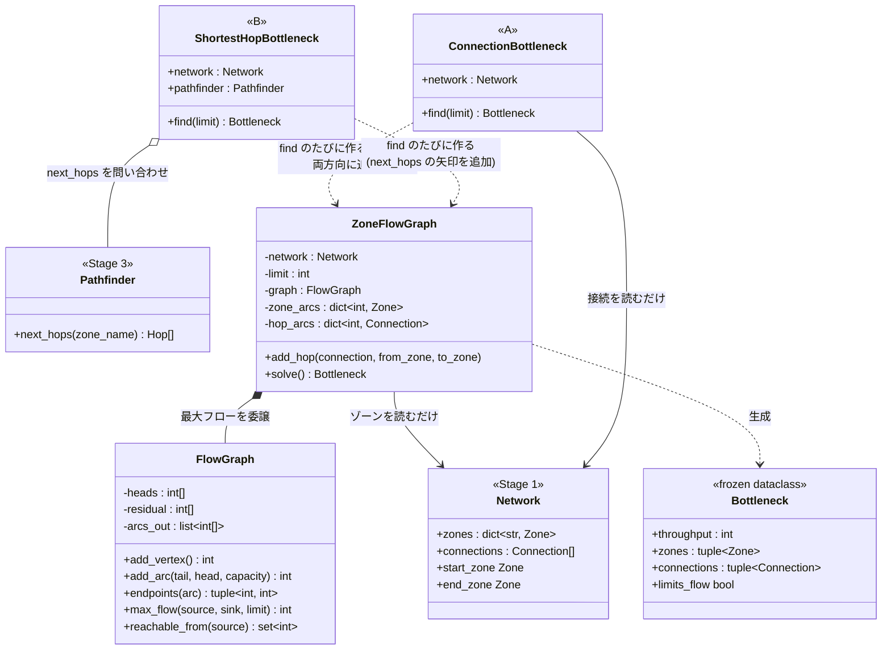
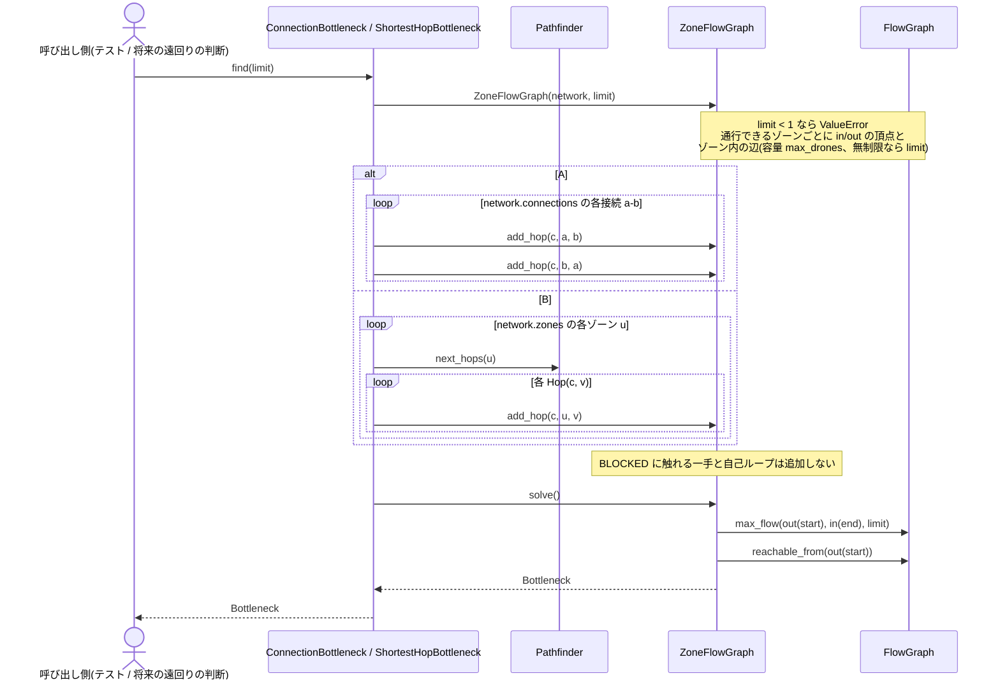
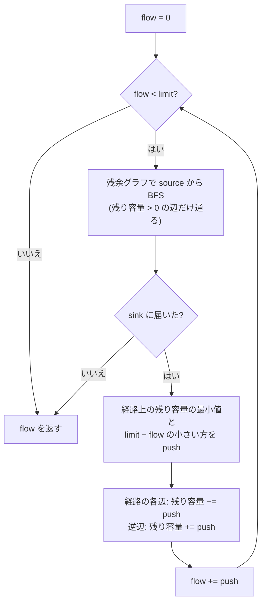
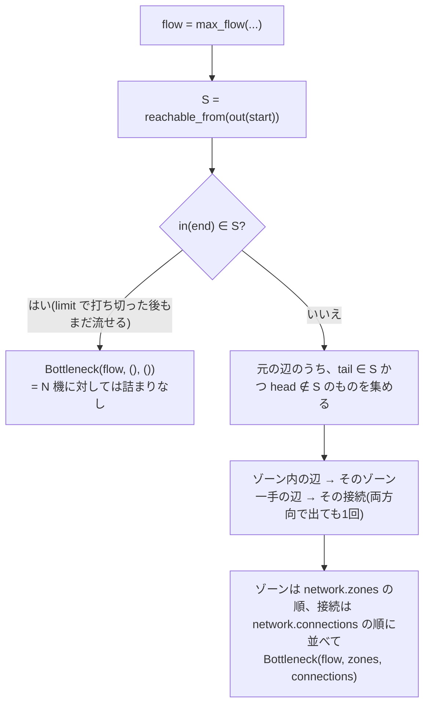

# ワークフロー: 詰まる場所の発見(最大フロー・最小カット)

- 日付: 2026-10-19
- 依頼内容: `docs/decisions.md` 2026-10-19「詰まる場所は最大フロー・最小カットで見つける(A: 全体のグラフ、B: 最短経路だけのグラフ)」の実装。
  実装はユーザーの指示により Claude が行い、決める必要がある点はユーザーに順番に確認する。
- 前提:
  - 選択肢の比較は `docs/research/2026-10-19_bottleneck-detection-options.md`。
  - ユーザーの決定(2026-10-19、この作業の前に確認):
    1. A と B は**クラスを2つに分ける**(共通部分は部品として持つ=委譲)。
    2. 最大フローは**ドローンの台数 N で打ち切る**(`find(limit)`)。
    3. 最小カットが複数あるときは **start に一番近いカット**を返す。
  - Claude が決めた点(ユーザーに報告済み、変更可): 置き場所は `droneflow/pathfinding/`。使う側(遠回りの判断)がまだ無いので
    `Application` にはつながない。

## ゴール

パース済みの `Network` について、「1ターンに何機まで start から end へ流せるか(通過量)」と、それを決めている
「詰まる場所」(ゾーン・接続の組=最小カット)を求める。

- A(`ConnectionBottleneck`): すべての接続を両方向に使ったグラフで求める。
- B(`ShortestHopBottleneck`): `Pathfinder.next_hops` の矢印(最短経路の向き)だけのグラフで求める。
- B の通過量が A より小さければ、「最短経路にこだわることで通過量を損している」と分かる。

経路の長さ(ターン数)は扱わない。遠回りが得になる台数の判断は次の段階(最小費用流などで再検討)。

## モデル化

| 地図の要素 | フローのグラフ |
|---|---|
| 通行できるゾーン z | 頂点 `in(z)` と `out(z)`、その間に容量 `max_drones` の辺(ゾーン内の辺)。容量の制限が無いゾーン(start / end)は `limit` |
| BLOCKED のゾーン | 頂点を作らない。BLOCKED に触れる接続も使わない |
| 接続 a-b(A) | `out(a)→in(b)` と `out(b)→in(a)` の2本、どちらも容量 `max_link_capacity`(向きの無い辺の定番の表し方。行きと帰りの流れは打ち消し合うので、最大フローは正しく求まる) |
| `next_hops(u)` の一手 u→v(B) | `out(u)→in(v)` の1本、容量 `max_link_capacity` |
| 自己ループ a-a | 使わない(通過量に関係しない) |
| 始点・終点 | 始点 = `out(start)`、終点 = `in(end)`(start / end のゾーン内の辺はカットに現れない) |

restricted は入るのに2ターンかかるが、「1ターンあたり容量ぶん通せる」と近似する(予約表の実装後、circular_loop で1ターン1機を確認済み)。
priority は容量に関係しない。

## 対象ファイル

| ファイル | 内容 | 状態 |
|---|---|---|
| `droneflow/pathfinding/flow_graph.py` | `FlowGraph`(頂点は整数、容量つきの辺と残余グラフ、Edmonds-Karp、残余グラフでの到達範囲)。ゾーンを知らない汎用の部品 | 新規 |
| `droneflow/pathfinding/zone_flow.py` | `Bottleneck`(結果、frozen dataclass)、`ZoneFlowGraph`(ゾーンの分割と一手の追加、`FlowGraph` を持って解き、カットをゾーン・接続に戻す) | 新規 |
| `droneflow/pathfinding/bottleneck.py` | `ConnectionBottleneck`(A)、`ShortestHopBottleneck`(B) | 新規 |

既存のファイルは変更しない。

## 構造図(静的な形)

- 継承は使わない。A と B の違いは「どの一手を `ZoneFlowGraph` に入れるか」だけで、ゾーンの分割・解く処理・カットの読み戻しは `ZoneFlowGraph` に集める。
- 最大フローは辺の残り容量を書き換えるので、`find` のたびに `ZoneFlowGraph` を作り直す(同じ finder で `limit` を変えて何度でも呼べる)。
- `Network` には書き込まない。

## 挙動図(実行時の振る舞い)

### (a) A / B の `find(limit)`

### (b) `FlowGraph.max_flow`(Edmonds-Karp、limit で打ち切り)

- 辺は追加した順に番号を振り、偶数番が元の辺、その次の奇数番が逆辺(`arc ^ 1` で互いに引ける)。
- 1回の増加で flow は1以上増えるので、増加は最大 `limit` 回。各回 BFS は O(V+E) なので、全体で **O(limit·(V+E))**。

### (c) `ZoneFlowGraph.solve` のカットの読み戻し

- S は「最後の残余グラフで start から届く範囲」なので、その境界は start に一番近い最小カットになる(ユーザーの決定3)。
- カットの容量の合計は flow と等しい。flow がちょうど limit で、それ以上流せない場合もカットを返す(N 機ちょうどで飽和)。
- `limits_flow` は「カットが見つかったか」(`zones` か `connections` が空でない)。

### (d) 例

実装後の実測値(配布マップ・課題の例、limit = 機数)。

| マップ | 機数 | A | B |
|---|---|---|---|
| 課題の例 | 5 | 2: 接続 `hub-roof1`, `hub-corridorA` | 1: 接続 `hub-corridorA` |
| linear_path | 2 | 1: 接続 `start-waypoint1` | 同じ |
| simple_fork | 4 | 2: 接続 `start-junction` | 同じ |
| basic_capacity | 4 | 2: ゾーン `bottleneck` | 同じ |
| dead_end_trap | 5 | 1: 接続 `junction-correct_path` | 同じ |
| circular_loop | 6 | 1: 接続 `loop_b-exit_point` | 同じ |
| priority_puzzle | 5 | 2: 接続 `start-slow_path1`, `start-fast_junction` | 1: 接続 `start-fast_junction` |
| maze_nightmare | 8 | 1: 接続 `maze_c2-bottleneck` | 1: 接続 `maze_a1-maze_a2` |
| capacity_hell | 12 | 1: 接続 `final_bottleneck-goal` | 1: 接続 `start-gate3` |
| ultimate_challenge | 15 | 1: ゾーン `final_gate3` | 1: 接続 `start-dist_gate1` |
| the_impossible_dream | 25 | 1: 接続 `start-gate_hell1` | 同じ |

- 接続の容量の既定値は1なので、start から出る接続そのものが start に一番近い最小カットになることが多い
  (課題の例では、hub から出る2本の接続がそれぞれ1ターンに1機しか通さない)。
- A の通過量が B より大きいのは課題の例と priority_puzzle。どちらも、遠回りの経路を併用すれば1ターンに2機流せる。
- 検証: 小さなランダムなマップ400枚で、全探索で求めた最小カットの容量と `ConnectionBottleneck` の通過量が一致した
  (カットの容量の合計 = 通過量も確認)。

## 作業項目

1. `flow_graph.py`: `FlowGraph`。グラフ系ライブラリは使わない(BFS は `collections.deque`)。
2. `zone_flow.py`: `Bottleneck`、`ZoneFlowGraph`。
3. `bottleneck.py`: `ConnectionBottleneck`、`ShortestHopBottleneck`。
4. 配布マップ・課題の例で、A・B の値を手で確認する。
5. `flake8` / `mypy`(課題のフラグ・`--strict`)/ 既存テストを通す。

## スコープ外

- 遠回りを使う判断・経路ごとの台数の配分(次の段階)。
- `Application` / `Scheduler` への組み込み。
- 単体テストの作成(別のテスト設計・作成フェーズで行う)。
- 判断の順序をゾーン単位に変える件(2026-10-19 の決定。並べ方が未決)。

## 完了条件(Done)

- 上の表(d)の結果が得られる。
- 既存テストがすべて通り、`flake8` と `mypy`(両方のフラグ)がエラーなしで通る。

## レビュー時の確認事項

- グラフ系ライブラリを import していないか。`Network` に書き込んでいないか。
- BLOCKED のゾーンで `turn_cost` を呼んでいないか(このモジュールでは `turn_cost` を使わない)。
- start / end のゾーン内の辺がカットに出てこないか。両方向の辺が同じ接続を2回出さないか。
- `limit` で打ち切った場合と、ちょうど飽和した場合の区別(`limits_flow`)。
