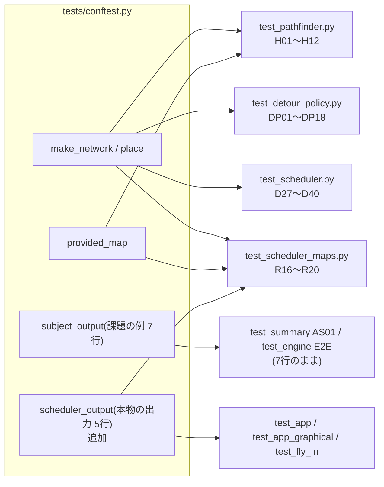

# テスト設計: 遠回りの一手(案B: 一度いたゾーンに戻らない)と、ゾーン単位の判断順

- 日付: 2026-10-20(初版は案A「距離が真に減る遠回り」向け。同日、案B の実装 7c619a9 に合わせて全面的に改訂し、
  さらに「いたゾーン」をターンごとに記録する修正 cccd0c8 に合わせて DP10・DP17・DP18・D39・D40 を改訂)
- フェーズ: **テスト設計**(テストコードはまだ書かない。作成は別フェーズで行う)
- 対象ブランチ: `test/detour_hops`(8538883)
- 対象コード: `droneflow/pathfinding/pathfinder.py`(`Pathfinder.detour_hops`)、`droneflow/simulation/detour_policy.py`
  (`DetourPolicy`: `detours` / `remember(turn, positions)` / `allowed`。`forget` は cccd0c8 で削除)、`droneflow/simulation/scheduler.py`
  (`decide_moves` での `remember(ledger.turn, positions)`、`_decide` / `_first_hop` / `_rank_zones`)
- 参照した設計: `docs/research/2026-10-20_workflow-detour-hops.md`(案B に更新済みの構造図・挙動図・課題の例の表(c))、
  `docs/research/2026-10-20_detour-prototype.md`(試作と計測)、`docs/research/2026-10-17_stage5-benchmark.md`(2026-10-20 の追記)
- 参照した決定: `docs/decisions.md`
  - 2026-10-20「待つことになるドローンには、距離が真に減る遠回りの一手を許す」(3「立ち退きなし → あり」は有効)
  - 2026-10-20「判断の順序は『ゾーン単位: 距離 → 優先ルート → 出口が少ない → 宣言順』にする」
  - 2026-10-20「遠回りの『逆流の防止』は『一度いたゾーンには戻らない』とし、遠回り先の行列も数える」(上の 1・2 を改める。**本設計の基準**)
  - 2026-10-18「立ち退きは最後の手段」、「`tests/` は `main`(提出物)に含めない」
- 参照したバグ記録: `docs/bugs.md`(2026-10-19 の `_start_turn` の再計画は対応済みで D26 が守っている。2026-10-20 の
  「同じターンを別の状態で計画し直すと、前の状態の『いたゾーン』が残る」は cccd0c8 で対応済みで、D40・DP17・DP18 が守る)
- 参照した既存のテスト設計(ID の付け方を合わせる): `2026-10-17_test-design-stage5-scheduler.md`(D01〜D17、R01〜R08)、
  `2026-10-19_test-design-timed-reservation.md`(D18〜D26、R09〜R15)、`2026-10-16_test-design-stage3-pathfinding.md`(P、N、B、E)

## 方針

- 既存テストのうち、**古い規則を前提にして今失敗している23件**を直す(A)。期待値は今の実装を実行して求めた。
  健全性の検査(`run_checked`)は「一手は最短の一手か、**そのドローンが一度もいたことのないゾーンへの** `detour_hops` の一手」に変え、
  遠回りには「距離が真に減る」を求めない(最短の一手には引き続き求める)。各ドローンの遠回りの回数に上限があること(有限回で終わる根拠)も確かめる。
- 今は通っているが古い規則を名前・docstring で主張しているテストを直す(A')。
- 新しいケースを足す(B)。`Pathfinder.detour_hops` は `tests/pathfinding/test_pathfinder.py` に H 系、`DetourPolicy` は新しいファイル
  `tests/simulation/test_detour_policy.py` に DP 系、`Scheduler` は `test_scheduler.py` に D27〜、E2E は `test_scheduler_maps.py` に R16〜。
- ネットワークは `make_network` で組む小さなもの(ゾーン 3〜11 個)。パーサーを通すのは課題の例と配布マップだけ。`revie_case/` には依存しない。
- 期待値の検証: 表の「検証」列の **実行** は、8538883 の実装を `.venv` の Python で実行して値を確認したもの(2026-10-20。
  7c619a9 で求めた値も全件を再実行し、変わったのは D40 だけ)。
  **変異** は、加えて実装の一部を一時的に無効にした版(スクラッチ上のモンキーパッチ。リポジトリは変更していない)で結果が変わり、
  そのケースが該当の処理を検出できることを確かめたもの。「旧」は変更前の develop(8da6648)の結果(参考。テストには書かない)。手計算だけのケースはない。
- 各ケースは独立(スケジューラ・方針を毎回作る)で、乱数は固定シードのみ。

## 実装を読んで分かった前提(テストの組み方に効く)

記号: `dist(z)` = end までの距離、`total(v) = cost(v) + dist(v)`、`below(z)` = z から最短の一手で辿れる先のゾーンの集合、
`ahead(u)` = `below(u)` にいる機の数、`queue(v)` = `below(v) ∪ {v}` にいる機の数(どちらも `positions` で数え、着陸先とこのターンに先に判断した移動を含む)。
条件は `total(v) + queue(v) ≤ dist(u) + ahead(u)`。

1. `detour_hops(u)` は「ゴールに届く隣のうち `next_hops` でないもの」**すべて**(自己ループを除く)。`next_hops(u)` と `detour_hops(u)` は、
   ゴールに届く自分以外の隣を**ちょうど分割**する。総コストは `dist(u)+1` 以上でばらつくので、総コストの小さい順の並べ替えが実際に効く(H08, DP11)。
2. **下流が共通の機は両辺で打ち消し合う**: `below(u)` と `below(v)` の両方に入るゾーン(例: end)にいる機は、`ahead` と `queue` の両方に数えられる(DP06)。
3. **u を通って戻る遠回りは決して許されない**: v から最短の一手で u に来られる(`u ∈ below(v)`)なら `below(u) ⊂ below(v)` なので
   `queue(v) ≥ ahead(u) + (u にいる機の数 ≥ 1、判断している機自身を含む)` で、`total(v) > dist(u)` と合わせて条件は必ず偽になる(DP12)。
   配布マップの遠回りの多くは後ろ向き(下の H12: 「遠ざかる」が大半)だが、この形のものは使われない。後ろ向きの遠回りが使われるのは、
   v の最短経路が u を通らないときだけ(D37 で手作りした)。
4. 「一度いたゾーン」は、`decide_moves` のたびに `remember(ledger.turn, positions)` で、ターンの初めの位置(立っているゾーンと着陸先)を
   **ターンごとに**記録したものの和集合。start も記録される。同じターンに移動した先は、次のターンの初めに記録される。
   すでに報告したターン(またはそれより前のターン)を報告し直すと、そのターン以降の記録を捨ててから記録し直す。そのため、同じターンを別の状態で
   計画し直したとき(D40)も、新しい実行を始めたとき(D39、ターン1を報告し直す)も、古い記録が残らない。
5. 実マップ・ランダムなマップでの観察(実行): R15 の生成器の300枚では遠回り 25 手(14 枚)、内訳は近づく 20・横 5・遠ざかる 0。
   別の生成器(3,000 枚、priority を含む)でも遠ざかる遠回りは 0 手。「一度いた」で止められた判定は 50,202 回中 2 回、`queue` で止められた判定は 26,903 回。
   遠回りでないふつうの移動で前にいたゾーンへ再び入る例は観察されなかった(規則上は禁止されていない。後述の R03 では数えるだけにする)。

## ファイル構成

```
tests/
├── README.md                         # 作成フェーズで「現在のカバレッジ範囲」を更新(後述)
├── conftest.py                       # SCHEDULER_OUTPUT と scheduler_output を追加(A-0。推奨案)
├── test_app.py                       # A: AA01, AA02, AA03, AA11, AA13
├── test_app_graphical.py             # A: AG01 ×2
├── test_fly_in.py                    # A: AM01, AM05, AM10(1), AE01
├── pathfinding/
│   └── test_pathfinder.py            # B: H01〜H12 を追加
├── simulation/
│   ├── test_detour_policy.py         # B: DP01〜DP18(新規)
│   ├── test_scheduler.py             # A: D09 / A': D06 / B: D27〜D40
│   └── test_scheduler_maps.py        # A: R01, R03 ×3, R08, R15 / B: R16〜R20
└── visualization/
    ├── test_graphical_view.py        # A: VG06[subject], VG07 ×3
    └── test_terminal_view.py         # A: VT16
```

- 既存と同じく `__init__.py` は置かない(`test_detour_policy.py` は他と名前が重ならない)。

## 共有フィクスチャ・ヘルパー

### A-0. 課題の例の「期待出力」を2つに分ける(推奨案。確認したい点 1)

`tests/conftest.py` の `SAMPLE_OUTPUT` / `subject_output` は「課題 PDF に載っている出力例(7行)」で、次の2種類のテストに使われている。

| 使い方 | テスト | 7行のままでよいか |
|---|---|---|
| 課題の出力例そのものを使う | `output/test_summary.py` AS01(7ターン・5.00・2.14 の文言)、`simulation/test_engine.py` の E2E(`ScriptedScheduler` で7行を再生し、同じ7行が出ること) | **よい**(課題の例が合法な実行であることの確認。スケジューラに依らない) |
| 本物のスケジューラの出力と比べる | R01、AA01/AA02/AA11、AG01、AM01/AM05、AE01 | **だめ**(今は5行) |

- **推奨**: `SAMPLE_OUTPUT` は課題の出力例のまま残し、`tests/conftest.py` に本物のスケジューラの出力
  `SCHEDULER_OUTPUT`(5行、下記)とフィクスチャ `scheduler_output` を足す。本物のスケジューラを走らせるテストは `scheduler_output` を使う。
  `subject_output` の docstring を「課題に載っている出力例(7行)。本物のスケジューラの出力ではない」に直す。
- 採らなかった案: `SAMPLE_OUTPUT` を5行に書き換える(AS01 が課題の数値を確かめられなくなり、test_engine の E2E の意味が変わる)。

`SCHEDULER_OUTPUT`(検証: 実行。案B でも案A と同じ。`python fly_in.py maps/subject_example.txt --visual none` の出力とも一致):

```
D1-corridorA D2-hub-roof1
D1-tunnelB D2-roof1 D3-corridorA D4-hub-roof1
D1-goal D2-roof2 D3-tunnelB D4-roof1 D5-corridorA
D2-goal D3-goal D4-roof2 D5-tunnelB
D4-goal D5-goal
```

要約の行は `summary: 5 turns, 5 drones, 4.20 turns per drone on average, 3.40 moves per turn`
(配達ターン D1=3, D2=4, D3=4, D4=5, D5=5 で平均 4.20、移動 2+4+5+4+2=17 で 17/5 = 3.40。検証: 実行)。
`test_app.py` / `test_app_graphical.py` / `test_fly_in.py` の定数 `SUMMARY` をこの行に変える(`output/test_summary.py` の `SUBJECT_SUMMARY` は変えない)。

### テストファイル内のヘルパー

- `hop_names(hops)`(`test_pathfinder.py` に既にある): 一手の行き先ゾーン名のリスト。DP 系は同じ関数をファイル内に置く。
- `policy_for(network) -> DetourPolicy`(`test_detour_policy.py` 内): `pf = Pathfinder(network)`、
  `DetourPolicy(pf, {name: pf.next_hops(name) for name in network.zones})`(`Scheduler.__init__` と同じ作り方)。
  DP 系の `positions` では、判断する機を ID 1、ほかの機を ID 7〜9 にする(1 の記録と混ざらないように)。
- `orders_by_turn(network_or_world, state) -> list[list[tuple[int, str]]]`(`test_scheduler.py` と `test_scheduler_maps.py`): 1つの `Scheduler` と
  `TurnResolver` で終わるまで進め、各ターンの `decide_moves` の結果を `(drone_id, zone)` の並びのまま記録する(D30・D37・D38・R16)。
- `run_checked`(既存、A の 2 で変更): ドローンごとに「いたゾーン」を**自分で**記録する(start、各指示の行き先、飛行中の機の着陸先)。



## A. 今失敗している既存テストの更新(23件)

`pytest -q tests` の結果(7c619a9、8538883 とも): **23 failed, 635 passed**。案A の時点の21件に、D09 と R03[hard/01_maze_nightmare] が加わった。
どれも実装の誤りではなく、古い規則を前提にした期待値による失敗。

### `run_checked` の新しい判定(2〜4・6 で使う)

```
visited = {各機: {start}}
毎ターン: 飛行中の機の着陸先を visited に足す
各指示 (id, zone)(here = その機の今のゾーン):
  zone ∈ next_hops(here) なら      → distance(zone) < distance(here) を要求(従来どおり)
  そうでなければ                     → zone ∈ detour_hops(here) かつ zone ∉ visited[id] を要求
                                       (失敗メッセージ: "D{id} enters {zone} again by a detour" / "D{id} takes neither a shortest hop nor a detour")
                                       遠回りの回数 detours[id] += 1
  visited[id] に zone を足す
終了時: どの機も detours[id] ≤ ゾーン数 − 1(遠回りはまだいたことのないゾーンにしか入らないので、これが有限回の上限)
戻り値: 従来の turns に加え、遠回りの総数(R15 の追加検査と R16 で使う)
```

- 1機1指示・`AT_ZONE` の機だけ・resolver が受理・毎ターン誰か動く・既定の上限内、の検査はそのまま残す(強さを保つ)。
- 「ふつうの移動で前にいたゾーンへ再び入る」は規則上禁止されていないので失敗にしない(観察では0回。数えるだけでもよい)。
- 実行で確認: 課題の例(遠回り2手、近づく)、restricted_only(0)、配布マップ10枚(priority_puzzle 2手・近づく、maze_nightmare 3手・横、ほか0)、
  R15 の300枚(25手・14枚)すべてで新しい判定が通る。1機あたりの遠回りの回数の最大は、どのマップでも(R15 の300枚も)1。

| # | テスト(ID) | 何を確かめているか | 今失敗する理由 | 直し方(新しい期待値) | 検証 |
|---|---|---|---|---|---|
| 1 | `simulation/test_scheduler_maps.py::test_subject_sample_map_output`(R01) | 課題の例で、本物のスケジューラの出力が完全一致 | 課題の出力例(7行)と比べている。今は遠回りで5行 | `subject_output` → `scheduler_output`(5行)。docstring を「the real scheduler prints these five lines (two drones go round by roof1)」に | 実行 |
| 2 | `test_scheduler_maps.py::test_every_turn_is_sound[subject]`(R03) | 毎ターンの不変条件 | `run_checked` が「指示は `next_hops` のどれか」を要求し、D2 の `roof1` で `D2 detours` | `run_checked` を上記の判定に。docstring の「each a shortest next hop that lowers the distance」を「a shortest hop that lowers the distance, or a detour into a zone the drone has never been in」に | 実行 |
| 3 | `test_every_turn_is_sound[medium/03_priority_puzzle]`(R03) | 同上 | D2 の `slow_path1` で失敗 | 2 と同じ | 実行 |
| 4 | `test_every_turn_is_sound[hard/01_maze_nightmare]`(R03) | 同上 | D2 の `maze_b1`(**横**の遠回り。距離が同じ)で失敗。案B で新たに使われる | 2 と同じ。遠回りに「距離が減る」を求めないので通る | 実行 |
| 5 | `test_turns_not_below_single_drone_bound[subject]`(R08) | 1機の最短距離を下回らない。課題の例は固定値も確認 | `turns == 7` | `== 5`。`turns >= bound`(3)はそのまま | 実行 |
| 6 | `test_random_restricted_maps_never_get_stuck`(R15) | restricted の多いランダムなマップ300枚が完走 | `run_checked` の判定(map 118 で D2 → z0) | 2 の変更で通る。docstring の「on a detour」を「on a move that is neither a shortest hop nor a detour into a new zone」に。**加えて**300枚の遠回りの合計が1以上であること(実測 25 手・14 枚。遠回りの経路を通っていることの保証) | 実行 |
| 7 | `simulation/test_scheduler.py::test_waits_instead_of_detour`(D09) | `s-a a-g s-b b-c c-g`・2機で、空いている b(距離が s と同じ)へは行かず待つ | 案B では b は横の遠回り(`total(b)=3`、`queue(b)=0`、`dist(s)+ahead=2+1`、3 ≤ 3)なので D2 は b へ行く | **期待を反転**: `[O(1,"a"), O(2,"b")]`。名前を `test_takes_a_sideways_detour`、docstring を「D09: b is as far from g as s; D2 goes sideways there, as it costs no more than queuing behind D1」に。`play_out` は `D1-a D2-b` / `D1-g D2-c` / `D2-g`(待つ場合も3行で、手数は同じ) | 実行 |
| 8 | `test_app.py::test_none_writes_only_the_log`(AA01) | `--visual none`: stdout はログ、stderr は要約 | `log` フィクスチャ(7行)と `SUMMARY` | `log` を `scheduler_output` から作る。`SUMMARY` を新しい要約の行に | 実行 |
| 9 | `test_app.py::test_terminal_keeps_stdout_identical`(AA02) | 端末表示は stderr、stdout は変わらない | 同上 | 同上 | 実行 |
| 10 | `test_app.py::test_log_lines_come_before_each_frame`(AA03) | 各ターンの行が描画より先に出る | `at_render == [1..7]`、`at_close == [7]` | `at_render == [1, 2, 3, 4, 5]`、`at_close == [5]`(`at_begin == [0]` はそのまま) | 実行 |
| 11 | `test_app.py::test_close_failure_after_success_is_a_warning`(AA11) | 成功後の close 失敗は警告だけ | `log` と `SUMMARY` | 8 と同じ | 実行 |
| 12 | `test_app.py::test_failed_run_keeps_the_log_so_far`(AA13) | `SimulationError` でもそれまでの行は残り、表示は閉じる | `stuck_after(2)` のあと3ターン目は `turn 3: D4 is stuck on connection 'hub-roof1': zone 'roof1' is full`(D4 の着陸のため roof1 の D2 を立ち退かせる予約を、止まったスケジューラが出さない) | **推奨**: `stuck_after(3)`、`match="^turn 4: no drone moved"`、出力は `scheduler_output` の先頭3行(`"D1-corridorA D2-hub-roof1\nD1-tunnelB D2-roof1 D3-corridorA D4-hub-roof1\nD1-goal D2-roof2 D3-tunnelB D4-roof1 D5-corridorA\n"`)、`at_close == [3]`。別案: `stuck_after(2)` のまま上の「接続上で詰まった」の完全一致・先頭2行・`at_close == [2]`(確認したい点 2) | 実行(両案とも `RecordingView` で `at_begin [0]`、`at_render [1,2,3]` / `[1,2]`、要約なし) |
| 13 | `test_app_graphical.py::test_stdout_is_the_same_log[graphical]`(AG01) | graphical / both も同じログ | `subject_output` と `SUMMARY` | `scheduler_output` と新しい `SUMMARY` | 実行 |
| 14 | `test_app_graphical.py::test_stdout_is_the_same_log[both]`(AG01) | 同上 | 同上 | 同上 | 実行 |
| 15 | `test_fly_in.py::test_success`(AM01) | 正常終了は 0、stdout はログ、stderr は要約 | `log` と `SUMMARY` | `log` を `scheduler_output` から、`SUMMARY` を新しい行に | 実行 |
| 16 | `test_fly_in.py::test_interrupt_during_the_run`(AM05) | 3ターン目の Ctrl+C: それまでの行は残る | `log` の先頭2行が7行版 | `log` の変更だけで通る(先頭2行は `D1-corridorA D2-hub-roof1` / `D1-tunnelB D2-roof1 D3-corridorA D4-hub-roof1`) | 実行 |
| 17 | `test_fly_in.py::test_close_failure_after_success`(AM10 (1)) | close 失敗でも成功のまま | `SUMMARY` | 新しい `SUMMARY` | 実行 |
| 18 | `test_fly_in.py::test_script_success`(AE01) | 実プロセスで `maps/subject_example.txt` が終了コード0 | `subject_output` と `SUMMARY` | `scheduler_output` と新しい `SUMMARY` | 実行 |
| 19 | `visualization/test_graphical_view.py::test_draws_every_turn_and_closes[subject]`(VG06) | 全ターンを描いて閉じる | `(7 if subject else 8)` | `(5 if which == "subject" else 8)` | 実行 |
| 20〜22 | `test_closing_early_keeps_simulating[quit / escape / q]`(VG07) | 窓を閉じてもシミュレーションは続く | `len(turns) == 7` | `== 5` | 実行 |
| 23 | `visualization/test_terminal_view.py::test_subject_map_end_to_end`(VT16) | ターンごとに1フレーム+ターン0 | `len(turns) == 7`、最後の見出し `=== Turn 7 \| moved 1 \| delivered 5/5 ===` | `== 5`、最後の見出し `=== Turn 5 \| moved 2 \| delivered 5/5 ===`(順に `1 \| moved 2 \| 0/5`、`2 \| 4 \| 0/5`、`3 \| 5 \| 1/5`、`4 \| 4 \| 3/5`、`5 \| 2 \| 5/5`) | 実行 |

### A'. 通っているが、名前・docstring が古い規則を主張しているテスト

| テスト(ID) | 今の主張 | 実際に守っていること | 直し方 | 検証 |
|---|---|---|---|---|
| `test_scheduler.py::test_full_tie_broken_by_drone_id`(D06) | 「同じ距離・同じ優先度なら最小の drone_id」 | 3機とも s にいるので `active_drones()` の順が残るだけ(ドローン ID は判断の順序に使わない) | 名前を `test_same_zone_keeps_active_drone_order`、docstring を「drones in the same zone keep active_drones order」に。期待 `[O(1,"a")]` はそのまま。ゾーンをまたぐ ID 非依存は D35 | 実行 |
| `run_checked` / R15 / `subject_output` の docstring | 「shortest next hop」「on a detour」「seven lines」 | — | A の 2・6、A-0 で直す | — |

- D02〜D05(距離 → 優先ルート)は、広げた出口の数でも結果が変わらない(実行で確認。D04 `[O(2,"c")]`、D05 `[O(2,"p"), O(1,"q")]`)。
- `test_engine.py` の E2E と `test_summary.py` AS01 は課題の出力例を使うので変更不要(A-0)。D16 も変更不要。

## B. 新しいケース

表記: `s-a a-g` は接続(記述順 = 宣言順)。restricted(`R`)・priority(`P`)・blocked は明記したものだけ。hub の容量は省略時1、接続容量は省略時1。
`cap(a)=2`、`link(s-a)=2`。`O(1,"a")` は `MoveOrder(1, "a")`。`at=` / `flying=` は `place` の引数(状態は `turn_number == 0`)。
一手の後の `(r,3)` は「行き先 r、総コスト 3」。

### Pathfinder.detour_hops(`tests/pathfinding/test_pathfinder.py`、H 系)

| ID | 観点 | 入力・手順 | 期待結果 | 狙い | 検証 |
|---|---|---|---|---|---|
| H01 | 基本(近づく遠回り) | `s-a a-g s-r r-g`、r は R。`detour_hops("s")`、`next_hops("s")` | `[(r,3)]`、接続 `["s-r"]`。`next_hops == ["a"]` | `total > dist(u)` を満たす隣。一手は接続と入るゾーンを持つ | 実行 |
| H02 | 横の隣も含む | `s-a a-g s-b b-c c-g`(すべて normal) | `[(b,3)]`(b の距離 2 = s の距離) | 案B で広げた定義(decisions 2026-10-20 案B 1) | 実行 |
| H03 | 後ろ・遠ざかる隣も含む | a) `s-a a-g s-r r-g`、r は R で `detour_hops("a")`、`detour_hops("r")` b) `s-a a-g s-r r-x x-y y-g`、r は R で `detour_hops("s")` | a) どちらも `[(s,3)]`(start へ戻る一手) b) `[(r,5)]`(r の距離 3 > 2) | 「近い・同じ・遠い」のどれでもよい(docstring)。入ってよいかは呼び出し側(DetourPolicy)が決める | 実行 |
| H04 | 最短の一手は含めない | a) `s-u u-g s-r r-g`、u・r とも R b) `s-a a-b b-g s-c c-g`(すべて normal) c) 4×4 のすべて normal のグリッド(左上 start、右下 end) | a) `next_hops == ["u","r"]`、`detour_hops == []` b) `next_hops == ["c"]`、`detour_hops == [(a,3)]` c) `c0_0` は `[]`、`c1_1` は `["c1_0","c0_1"]`、全ゾーンの合計 22 個 | `total > here` で `next_hops` と重ならない。案A と違い、すべて normal のマップにも遠回り(後ろ向き)がある | 実行 |
| H05 | BLOCKED・届かない隣を含めない | a) `s-a a-g s-r r-g s-x x-g`、r は R、x は blocked で `detour_hops("s")`、`detour_hops("x")` b) `s-a a-g s-x x-z`、x は blocked(z はゴールに届かない)で `detour_hops("s")` | a) `[(r,3)]`、`[]` b) `[]` | `there is None` の除外(blocked と、届かないゾーン) | 実行 |
| H06 | 自己ループを含めない | a) `s-a a-g s-r r-g s-s`、r は R で `"s"` b) `s-a a-g s-r r-g a-a`、r は R で `"a"` | a) `[(r,3)]` b) `[(s,3)]`(a 自身は出ない) | 案B で明示した `zone.name == zone_name` の除外 | 実行 |
| H07 | end・届かないゾーン | a) `s-a a-g s-r r-g`(r は R)で `"g"` b) `make_network("s-a a-g", isolated=("z",))` で `"z"` | どちらも `[]`(例外にならない) | `here is None or here == 0` の早期 return | 実行 |
| H08 | 並び順: 総コスト → 宣言順 | a) `s-a a-g s-b b-g a-b` で `detour_hops("a")`(宣言は s-a が先) b) `s-a a-g s-b b-c c-g s-r r-g`、r は R で `"s"` c) `s-a a-g s-r2 r2-g s-r1 r1-g`、r1・r2 は R で `"s"` d) `r2-s s-a a-g r2-g r1-s r1-g`(s 側から逆向きに宣言)、r1・r2 は R で `"s"` | a) `[(b,2), (s,3)]`(宣言順と逆) b) `[(b,3), (r,3)]`(同点は宣言順) c) `["r2","r1"]` d) `["r2","r1"]`、接続 `["r2-s","r1-s"]` | 総コストでの並べ替え(案A では効かなかった)と、同点の宣言順・`other_end` の向き | 実行 |
| H09 | 存在しないゾーン | `s-a a-g` で `detour_hops("nope")` | `ZoneNotFoundError`、`zone_name == "nope"` | 例外契約 | 実行 |
| H10 | 深い位置の遠回り | `s-a a-b b-g s-r r-b`、r は R | `distance("s") == 3`、`next_hops == ["a"]`、`detour_hops == [(r,4)]` | end に隣接しない遠回り | 実行 |
| H11 | 性質: 実マップのすべてのゾーン(parametrize) | 課題の例と配布マップ10枚の全ゾーン u | ① `dist(u)` が None か 0 なら `[]` ② それ以外は、`next_hops(u)` と `detour_hops(u)` の行き先を合わせると「ゴールに届く、u 以外の隣(重複なし)」に**ちょうど**一致 ③ `detour_hops` の総コストはどれも `dist(u)` より大きく、昇順 ④ 同じゾーンが2回出ない | 定義(分割になること)を個別の値に頼らず確かめる | 実行(全マップで違反0) |
| H12 | E2E: 遠回りの一覧 | a) 課題の例の全ゾーン b) 配布マップ10枚の遠回りの個数 | a) `hub: [(roof1,4)]`、`roof1: [(hub,4)]`、`roof2: [(roof1,4)]`、`corridorA: [(hub,4)]`、`tunnelB: [(corridorA,3)]`、`goal`・`obstacleX`: `[]` b) linear_path 2、simple_fork 3、basic_capacity 2、dead_end_trap 4、circular_loop 6、priority_puzzle 7、maze_nightmare 23、capacity_hell 22、ultimate_challenge 40、impossible_dream 82 | 実マップでの固定値。課題の例でスケジューラが使うのは hub → roof1 だけ(ほかは前提 3 で許されない) | 実行 |

### DetourPolicy(`tests/simulation/test_detour_policy.py`、新規、DP 系)

主な網 **M1** = `s-a a-g s-r r-g q-g`、r は R(`dist`: s=2、a=1、r=1、q=1、g=0。`below(s) = {a, g}`、`below(r) = {g}`。
s の遠回りは r(総コスト3)、a と r の遠回りは s(総コスト3)、q は無し)。判断する機は ID 1(記録なし)、`positions` のほかの機は ID 7〜9。

| ID | 観点 | 入力・手順 | 期待結果 | 狙い | 検証 |
|---|---|---|---|---|---|
| DP01 | `detours` | M1 の各ゾーンで `detours(z)` | s `["r"]`、a `["s"]`、r `["s"]`、q `[]`、g `[]`。どれも `pathfinder.detour_hops(z)` と `==` | 構築時のキャッシュが `detour_hops` と一致 | 実行 |
| DP02 | 先に誰もいない | M1、`allowed(1, "s", {})` | `[]`(3 + 0 > 2 + 0) | ahead が 0 なら遠回りしない | 実行 |
| DP03 | 境界: 等しいなら許す | M1、`allowed(1, "s", {9: ("a",0)})` | `["r"]`(3 + 0 = 2 + 1) | `≤`(`<` ではない) | 実行 |
| DP04 | 境界: queue(v) が1つ多いと断る | M1、a) `{9: ("a",0), 8: ("r",0)}` b) `{9: ("a",0), 8: ("r",1)}`(r へ着陸する機) c) `{9: ("a",0), 8: ("a",0), 7: ("r",0)}` | a) `[]`(3 + 1 > 2 + 1) b) `[]` c) `["r"]`(3 + 1 = 2 + 2) | 遠回り先の行列(decisions 案B 3)の「+1 で不可」と「釣り合えば可」 | 実行 |
| DP05 | 着くのが次のターンの機も数える | M1、a) `{9: ("a",1)}` b) `{9: ("a",1), 8: ("a",1), 7: ("r",1)}` | a) `["r"]` b) `["r"]` | 位置のターンは見ず、ゾーンだけで数える(着陸先を含む) | 実行 |
| DP06 | 共通の下流は両辺で打ち消す | M1、a) `{9: ("g",1)}` b) `{9: ("a",0), 8: ("g",1)}` | a) `[]`(g は below(s) と below(r) の両方: 3 + 1 > 2 + 1) b) `["r"]`(3 + 1 ≤ 2 + 2) | 前提 2。end へ着陸する機は遠回りの判断を変えない | 実行 |
| DP07 | 数えない機 | M1、a) `{9: ("s",0)}`(u 自身のゾーン) b) `{9: ("q",0)}`(別の枝) | どちらも `[]`(ahead 0) | u にいる機と、どちらの経路にも無いゾーンの機は数えない | 実行 |
| DP08 | 2手以上先・合流 | `s-a a-b b-g s-r r-b c-b`、r は R(`dist(s)=3`、r の総コスト4、`below(s)={a,b,g}`、`below(r)={b,g}`)。`allowed(1,"s",·)` を a) `{9:("a",0)}` b) `{9:("b",0)}` c) `{9:("c",0)}` d) `{9:("a",0), 8:("b",0)}`。あわせて `detours`: a `["s"]`、b `["a","c","r"]`、c `[]` | a) `["r"]` b) `[]`(合流先 b は両辺) c) `[]` d) `["r"]`(4 + 1 ≤ 3 + 2) | `_zones_below` が繰り返し辿ること。合流先にいる機は打ち消し合う | 実行 |
| DP09 | 最短の一手が複数 | `s-a s-b a-g b-g s-r r-g x-y y-g`、r は R。a) `{9:("b",0)}` b) `{9:("y",0)}` c) `{9:("x",0)}` | a) `["r"]` b) `[]` c) `[]` | どの最短の枝の機も ahead に数え、つながっていない枝は数えない | 実行 |
| DP10 | いたゾーンへは行かない(ターンをまたいで積み重なる・機ごと・着陸先) | M1、`A = {9:("a",0)}`。a) 新しい方針で `allowed(1,"s",A)`、`allowed(2,"s",A)` → `remember(1, {1:("r",0), 2:("s",0)})` → 同じ2つ → `remember(2, {1:("s",1)})` → `allowed(1,"s",A)` b) 新しい方針で `remember(1, {3:("r",1)})`(r へ着陸中の D3)→ `allowed(3,"s",A)`、`allowed(1,"s",A)` | a) 初め D1・D2 とも `["r"]`。ターン1 の報告後 D1 `[]`、D2 `["r"]`。ターン2 の報告後も D1 `[]`(ターン1 の r が残る) b) D3 `[]`、D1 `["r"]` | 逆流の防止(decisions 案B 2)。記録は機ごとで、別のターンの報告は足し合わされる。着陸先も「いた」に入る | 実行 |
| DP11 | 並び順: 総コストの小さい順 | `s-m m-b b-c c-d d-g m-a a-g m-r r-g`、m・r は R(`dist(m)=2`。b の最短経路は m を通らない)。`detours("m")`、`allowed(1,"m",·)` を a) `{9:("a",0)}` b) `{9:("a",0), 8:("a",0)}` c) `{9:("a",0), 8:("a",0), 7:("c",0)}` | `detours == ["r","b","s"]`(総コスト 3, 4, 5。宣言は b が r より先) a) `["r"]` b) `["r","b"]` c) `["r"]`(c は below(b)) | 許された遠回りを総コストの順に返す。予算が大きいほど長い遠回りまで許される | 実行 |
| DP12 | u を通って戻る遠回りは許さない | M1 で `allowed(1, "a", ·)`(a の遠回りは s。`a ∈ below(s)`)を `{1:("a",0)}` に end へ着陸する機を 0〜3 機足して | すべて `[]` | 前提 3 の性質。判断する機自身も queue(s) に数えられる | 実行 |
| DP13 | 遠回りが複数で、片方だけ混む | `s-a a-g s-r2 r2-g s-r1 r1-g`、r1・r2 は R。a) `{9:("a",0)}` b) `{}` c) `{9:("a",0), 8:("r2",0)}` d) `{9:("a",0), 8:("a",0), 7:("r2",0)}` | a) `["r2","r1"]` b) `[]` c) `["r1"]` d) `["r2","r1"]` | 遠回りごとに自分の queue で判定する | 実行 |
| DP14 | end・届かないゾーン | M1 で `allowed(1,"g",{9:("a",0)})`。`s-a a-g s-r r-g`(r は R)に `isolated=("z",)` で `allowed(1,"z",{9:("a",0)})`、`detours("z")` | すべて `[]` | `here is None` の早期 return | 実行 |
| DP15 | 存在しないゾーン | M1 で `detours("nope")`、`allowed(1,"nope",{})` | どちらも `ZoneNotFoundError` | 案B で揃えた契約(初版の「気づいた点」2 への対応) | 実行 |
| DP16 | 引数を変えない・毎回新しいリスト | M1、`positions = {9:("a",0)}` の控えを取って `allowed(1,"s",positions)`。戻り値と `detours("s")` を `clear()` して再度呼ぶ | `positions` が控えと `==`。再度の呼び出しも `["r"]` | 位置表を読むだけ。キャッシュを外に漏らさない | 実行 |
| DP17 | 同じターンを報告し直すと置き換わる | M1、`A = {9:("a",0)}`、新しい方針。a) `remember(1, {1:("s",0)})` → `remember(2, {1:("r",1)})` → `allowed(1,"s",A)` → `remember(2, {1:("s",1)})` → `allowed(1,"s",A)` → もう一度 `remember(2, {1:("s",1)})` → `allowed(1,"s",A)` b) 新しい方針で `remember(1, {1:("r",0)})` → `remember(2, {1:("s",1)})` → `remember(2, {})` → `allowed(1,"s",A)` | a) `[]` → `["r"]`(ターン2 の r は捨てられる)→ `["r"]`(同じ報告の繰り返しは変化なし) b) `[]`(報告し直すのはターン2 だけで、ターン1 の r は残る) | cccd0c8 の修正。同じターンを別の状態で計画し直したとき、前の状態の記録だけを捨てる | 実行・変異(捨てる処理を無効にすると a) の2つ目が `[]`) |
| DP18 | 前のターンを報告すると、それより後の記録を捨てる | M1、`A = {9:("a",0)}`、新しい方針。a) `remember(1, {1:("s",0)})` → `remember(2, {1:("r",1)})` → `remember(3, {2:("r",2)})` → D1・D2 の `allowed` → `remember(2, {1:("s",1), 2:("s",1)})` → D1・D2 → `remember(1, {})` → D1・D2 b) 新しい方針で `remember(5, {1:("r",0)})` → `remember(3, {2:("r",0)})` → D1・D2 | a) `[]`・`[]` → `["r"]`・`["r"]`(ターン2・3 を捨てた)→ `["r"]`・`["r"]` b) D1 `["r"]`(ターン5 は捨てられる)、D2 `[]` | 新しい実行(ターン1 からやり直す)で前の実行の記録が残らない根拠。報告するターンが飛んでいても「それ以降」をまとめて捨てる | 実行・変異(捨てる処理を無効にすると a) の2つ目以降と b) の D1 が `[]`) |

### Scheduler(`tests/simulation/test_scheduler.py`、D27〜D40)

主な網 **M1'** = `s-a a-g s-r r-g`、r は R(s の最短の一手 a、遠回り r)。**S** = `s-a a-g s-b b-c c-g`(s の遠回りは横の b)。

| ID | 観点 | 入力・手順 | 期待結果 | 狙い | 検証 |
|---|---|---|---|---|---|
| D27 | 待つことになる機は遠回りする(同じターンに先に動いた機を数える) | M1'、a) 2機 b) 1機 | a) `[O(1,"a"), O(2,"r")]` b) `[O(1,"a")]`。旧 a) は `[O(1,"a")]` | ターンの初めには誰も先にいない。D1 の a への移動を数えて ahead 1 になる | 実行 |
| D28 | 最短の一手が使えるなら遠回りしない | M1' に `cap(a)=2`、`link(s-a)=2`、2機 | `[O(1,"a"), O(2,"a")]` | 遠回りは最短の一手が使えないときだけ(r も許される状態) | 実行 |
| D29 | 遠回り先が混んでいれば断る(queue) | a) M1' に `cap(r)=2`、`link(s-r)=2`、3機 b) S、3機、`at={3: "b"}` c) S、3機、`at={3: "c"}` | a) `[O(1,"a"), O(2,"r")]`(D3 は queue(r) に D2 がいて 3+1 > 2+1。案A では `[…, O(3,"r")]`) b) `[O(1,"a"), O(3,"c")]`(D2 は b に D3 がいて 3+1 > 2+1 で待つ) c) `[O(3,"g"), O(1,"a"), O(2,"b")]`(先に動いた D3 は g にいて両辺で打ち消すので許される) | 遠回り先の行列(decisions 案B 3)がスケジューラで効くこと。b)・c) は同じ1機の位置だけが違う対 | 実行 |
| D30 | 遠回りは立ち退きなしを先に試す | a) `s-a a-b b-g s-r1 r1-b`、r1 は R、`cap(a)=2`、5機、`at={2:"a", 3:"a"}`、`flying={1:("s","r1")}` b) a) に `s-r2 r2-b`(r2 は R)を足した網 | a) `[O(2,"b"), O(4,"a"), O(5,"r1")]`(D5 は着陸する D1 の立ち退きを予約して r1 へ。6 ≤ 6) b) `[O(2,"b"), O(4,"a"), O(5,"r2")]`(宣言が先の r1 も許されるが、立ち退きの要らない r2 を選ぶ)。`play_out`: a) `D1-r1 D2-b D4-a D5-s-r1` / `D1-b D2-g D5-r1` / `D1-g D3-b` / `D3-g D4-b` / `D4-g D5-b` / `D5-g` b) `D1-r1 D2-b D4-a D5-s-r2` / `D2-g D3-b D5-r2` / `D3-g D4-b` / `D1-b D4-g` / `D1-g D5-b` / `D5-g` | D22 の遠回り版(decisions 2026-10-20 3)。a) で遠回りでも立ち退きを使うこと。初版の網(D3 だけ)は案B では queue(r1) で断られるので、先にいる機を増やした | 実行 |
| D31 | 最短の一手の立ち退きは遠回りより先 | `s-t t-g s-r r-b b-g`、t・r とも R、`flying={1:("s","t")}`。a) 2機 b) 3機 | a) `[O(2,"t")]` b) `[O(2,"t"), O(3,"r")]`。`play_out`: a) `D1-t D2-s-t` / `D1-g D2-t` / `D2-g` b) `D1-t D2-s-t D3-s-r` / `D1-g D2-t D3-r` / `D2-g D3-b` / `D3-g` | 試す順「最短(なし → あり)→ 遠回り(なし → あり)」の境目 | 実行 |
| D32 | 同じ距離なら出口が少ないゾーンが先(宣言順より) | `s-y s-x y-m x-m y-n m-g n-g`(y が先に宣言。出口は y が m, n と遠回り s で3、x が m と s で2)、`at={1:"y", 2:"x"}` | `[O(2,"m"), O(1,"n")]`。旧(ID 順)は `[O(1,"m")]` | 出口を選べる機が、ほかのゾーンの唯一の出口を取らない。出口の数が宣言順より前 | 実行 |
| D33 | 出口の数に遠回りを含める | `s-x s-y x-m y-m m-g x-r r-g`、r は R(出口 x 3、y 2。宣言は x が先)、`at={1:"x", 2:"y"}` | `[O(2,"m"), O(1,"r")]`。旧は `[O(1,"m")]` | 出口 = `len(next_hops) + len(detour_hops)`(広げた遠回りで数える) | 実行 |
| D34 | 優先ルートは出口の数より先 | `s-p s-x p-m p-n x-m m-g n-g`、p は P(出口 p 3、x 2)、`at={1:"x", 2:"p"}` | `[O(2,"m")]`(D1 は待つ)。出口を先にすると `[O(1,"m"), O(2,"n")]` | キーの2番目と3番目の順。この網では待つ機が出ることも記録 | 実行 |
| D35 | 最後は宣言順で、ドローン ID ではない | `s-y s-x y-m x-m m-g`(y が先に宣言、出口はどちらも2)、`at={1:"x", 2:"y"}` | `[O(2,"m")]`。旧は `[O(1,"m")]` | ドローン ID を順序に使わない。D06(同じゾーン)と対 | 実行 |
| D36 | 遠回りのある網でも届かないゾーンの機はエラー | `s-a a-g s-r r-g x-y`、r は R、2機、`at={1:"x"}` | `SimulationError`、`D1 is in 'x', which cannot reach the end zone` | 順位の無いゾーンの検査が残る(D16 の網には遠回りが無い) | 実行 |
| D37 | 遠ざかる遠回り(最短経路が u を通らない v) | `s-m m-c1 c1-c2 c2-g m-v v-w1 w1-w2 w2-w3 w3-g`、m は R・`cap(m)=2`(`dist(m)=3`、`dist(v)=4`、v の最短経路は w 側)。a) 4機、`at={1:"c1", 2:"c2", 3:"m", 4:"m"}` b) 2機、`at={1:"m", 2:"m"}` | a) `[O(2,"g"), O(1,"c2"), O(3,"c1"), O(4,"v")]`(5 + 0 ≤ 3 + 3)。`orders_by_turn` の後のターンは D4 が w1 → w2 → w3 → g(全5ターン) b) `[O(1,"c1")]`(D2 は ahead 1 で 5 > 4、待つ) | 案B で許された「後ろへの一手」が実際に使われる場面と、使われない場面の対(前提 3 の例外側) | 実行 |
| D38 | いたゾーンへ戻らない(行ったり来たりしない) | `s-x x-y x-a a-g y-b b-g`、x, y, a, b とも `cap=2`、3機、`at={2:"y", 3:"y"}`。`orders_by_turn` | ターン1 `[O(2,"b"), O(3,"x"), O(1,"x")]`(D3 は y から横の x へ)、ターン2 `[O(2,"g"), O(1,"a")]`(D3 は y へ戻れば 3+1 ≤ 2+2 で条件を満たすが、y にいたので待つ)。出力 `D1-x D2-b D3-x` / `D1-a D2-g` / `D1-g D3-a` / `D3-g` | 逆流の防止がスケジューラで効く。`remember` が毎ターン呼ばれること | 実行・変異(記録を無視すると、ターン2 に `O(3,"y")` が出る) |
| D39 | 新しい実行では前の実行の記録が残らない | S、2機。1つの `Scheduler` で `play_out` を2回 | 2回とも `D1-a D2-b` / `D1-g D2-c` / `D2-g` | 2回目のターン1 の `remember(1, …)` が、前の実行のターン1 以降の記録を捨てること(D25 の遠回り版。DP18 のスケジューラ側) | 実行・変異(捨てる処理を無効にすると、2回目は `D1-a` / `D1-g D2-a` / `D2-g`) |
| D40 | 同じターンに別の状態を渡すと、その状態から計画し直す | M1'、2機。1つの `Scheduler` で `decide_moves(place(n, 2, flying={2: ("s","r")}))`(`[O(1,"a")]`)の後、同じターン番号の `decide_moves(place(n, 2))` | 新しい `Scheduler` と同じ `[O(1,"a"), O(2,"r")]`(両方を比べ、値も書く)。**通常のテスト**(xfail にしない) | D26 の遠回り版。bugs.md 2026-10-20(cccd0c8 で対応)の再発防止。DP17 のスケジューラ側 | 実行・変異(捨てる処理を無効にすると `[O(1,"a")]`: 1つ目の状態の D2 の着陸先 r が「いた」として残る) |

### E2E(`tests/simulation/test_scheduler_maps.py`、R16〜R20)

| ID | 観点 | 入力・手順 | 期待結果 | 狙い | 検証 |
|---|---|---|---|---|---|
| R16 | 課題の例: ターンごとの指示 | `orders_by_turn(load_world(SUBJECT))` | 1 `[(1,"corridorA"), (2,"roof1")]` / 2 `[(1,"tunnelB"), (3,"corridorA"), (4,"roof1")]` / 3 `[(2,"roof2"), (1,"goal"), (3,"tunnelB"), (5,"corridorA")]` / 4 `[(2,"goal"), (3,"goal"), (5,"tunnelB"), (4,"roof2")]` / 5 `[(4,"goal"), (5,"goal")]` | ワークフロー表(c) の再現。ターン1: D2 は 4 + 0 ≤ 3 + 1(D3〜D5 は接続 hub-roof1 が使用済み)。ターン2: D4 は 4 + 1(着陸する D2)≤ 3 + 2 で、D2 の立ち退きを予約して入る。ターン3: その予約 `(2,"roof2")` が先頭 | 実行 |
| R17 | priority_puzzle の出力 | `output_lines(load_world("maps/medium/03_priority_puzzle.txt"))` | 6行: `D1-fast_junction D2-start-slow_path1` / `D1-fast_path D2-slow_path1 D3-fast_junction D4-start-slow_path1` / `D1-merge_point D2-slow_path2 D3-fast_path D4-slow_path1 D5-fast_junction` / `D1-goal D2-merge_point D3-merge_point D4-slow_path2 D5-fast_path` / `D2-goal D3-goal D4-merge_point D5-merge_point` / `D4-goal D5-goal`。旧は8ターン | restricted の遠回りと、優先ルートのゾーン(fast_path)が同じ距離の slow_path2 より先に判断されること | 実行 |
| R18 | 小さな網での遠回りの効果(parametrize) | M1' を 2・3・4機で `output_lines` | 2機: `D1-a D2-s-r` / `D1-g D2-r` / `D2-g`(旧も3行)。3機: `D1-a D2-s-r` / `D1-g D2-r D3-a` / `D2-g D3-g`(旧4行)。4機: `D1-a D2-s-r` / `D1-g D2-r D3-a` / `D2-g D3-g D4-a` / `D4-g`(旧5行。案A の `D4-s-r` は queue(r) で断られる) | 手で追える大きさの固定値。`run_checked` も同じ行で通る | 実行 |
| R19 | 配布マップのターン数(固定、parametrize) | `PROVIDED_MAPS` の10枚を `run_engine` | linear_path 4、simple_fork 4、basic_capacity 4、dead_end_trap 8、circular_loop 10、**priority_puzzle 6**、maze_nightmare 13、capacity_hell 16、ultimate_challenge 26、impossible_dream 44 | **固定することを推奨**(ベンチマークの回帰を検出する。`2026-10-17_stage5-benchmark.md` の 2026-10-20 の追記と一致)。変更前と違うのは priority_puzzle(8 → 6)だけ。R04/R05(目標以内)はそのまま残す。改善でターン数が変わったときは、この表とベンチマークの記録を一緒に更新する | 実行(案B で再確認) |
| R20 | 配布マップで使われる遠回り | `run_checked` の戻り値の遠回りの数を各マップで見る | 課題の例 2、priority_puzzle 2、maze_nightmare 3(すべて横)、ほかの8枚 0 | 遠回りの規則が変わったことを、出力の行より先に気づけるようにする(R19 が同じでも遠回りの使い方は変わりうる) | 実行 |

- R07(決定的)・R09〜R14 は変更不要(新しい `run_checked` でも通ることを実行で確認)。

## 作成フェーズへの申し送り

- 順番: ① A-0 と A の23件・A' を1コミット(全テストが通る状態に戻す) ② H 系 ③ DP 系(新規ファイル)
  ④ D27〜D40 ⑤ R16〜R20 と R15 の追加 ⑥ `tests/README.md`。コミットは細かく分ける。
- 関数ごとに型ヒントと docstring(先頭に ID)を付ける(`flake8` / `mypy --strict`)。DP 系の `positions` は
  `dict[int, Position]`(`droneflow.simulation.evictor.Position`)。
- `Hop` 同士は `==` で比べられる(frozen dataclass)が、ハッシュはできない。集合には入れない。
- D30・D31・D37・D38・R16 は**リストの順序ごと**比べる。`orders_by_turn` は `decide_moves` の結果を記録してから `TurnResolver.resolve` に渡す。
- DP10・DP17・DP18 の `remember(turn, positions)` は公開メソッドなので直接呼んでよい。`_visited` / `_reported` などの非公開属性は見ない。
  記録の有無は `allowed` の結果で確かめる(M1 では「r にいた機は `[]`、いない機は `["r"]`」)。
- D38〜D40・DP17・DP18 の「変異」の確認は作成フェーズでは不要(設計時に確認済み)。テストには期待値だけを書く。
- `tests/README.md` の更新:
  - `test_scheduler.py`: 判断の順序を「ゾーン単位: 距離 → 優先ルート → 出口(最短+遠回り)が少ない → 宣言順(同じゾーンの中は `active_drones` の順)」に。
    「遠回りせず待つこと」を「待つことになる機は許された遠回り(横・後ろを含む。いたゾーンには戻らない、遠回り先が混んでいれば断る)をすること、
    立ち退きなし → あり、最短の立ち退きより後、新しい実行や同じターンの計画し直しで古い『いたゾーン』が残らないこと」に。
  - `test_scheduler_maps.py`: 「出力7行」を「本物のスケジューラの出力5行」に、毎ターンの検査を「最短の一手で距離が減る、または一度もいたことのない
    ゾーンへの遠回り。遠回りの回数はゾーン数未満」に。R16〜R20 を追記。
  - `test_pathfinder.py` に H01〜H12、新しく `test_detour_policy.py`(DP01〜DP18)、`conftest.py` の `scheduler_output` を追記。

## 設計中に気づいた点(バグではない、または判断が要るもの)

実装は修正していない。初版(案A 向け)の点 1(予算が実質「先に1機いれば出す」)・2(`detours` の存在しない名前)・3(クラス docstring)・
5(ベンチマークの記録)は案B の実装で対応済み。

1. **(対応済み)同じターン番号の別の状態を `decide_moves` に渡すと、前の状態の「いたゾーン」が残っていた**。7c619a9 では M1' で
   `[O(1,"a")]` になり、新しい `Scheduler` の `[O(1,"a"), O(2,"r")]` と食い違った(2026-10-19 の予約表の問題と同じ形)。
   → cccd0c8 で、`remember(turn, positions)` がターンごとに記録し、報告済みのターン以降を捨ててから記録し直すように直された(bugs.md 2026-10-20)。
   `forget` は無くなり、新しい実行の記録の消去も同じ仕組み(ターン1 の報告し直し)で行う。D40 は通常のテスト、DP17・DP18 は単体の確認、
   D39 は新しい実行の確認。いずれも捨てる処理を無効にすると失敗することを確かめた。
2. **後ろ向きの遠回りの多くは決して許されない**(前提 3、DP12)。v から最短の一手で u に戻ってこられる形では、u の行列が v の行列にそのまま含まれるため。
   これは「逆流しない」を条件の側でも保証する性質で、誤りではない。ただし配布マップの遠回り(H12 の合計 196 個。課題の例を含む)の大半はこの形で、
   実際に使われる遠回りは近づくものと横のもの(ランダムなマップでも遠ざかる遠回りは 0 回)。遠ざかる遠回りは D37 のように、v の最短経路が u を通らないときだけ。
3. **判断する機自身が `queue(v)` に数えられることがある**(`u ∈ below(v)` のとき)。2 の理由でその形の遠回りはもともと許されないので、結果には影響しない。
4. **ふつうの(最短の)移動で、前にいたゾーンへ再び入ることは禁止されていない**。遠回りで遠ざかった後、v からの最短経路が前にいたゾーンを通る場合など。
   移動の回数が有限であることには影響しない(最短の移動は距離を真に減らし、遠回りは高々「ゾーン数 − 1」回)。観察では0回なので、R03 では失敗にしない。
5. **ゾーンの順位で待つ機が増える例がある**(D34): 決定どおりの挙動として記録するだけ。
6. 課題の例のターン2で、D4 の遠回り(hub → roof1)は立ち退きありでしか入れず、条件もちょうど等しい(4 + 1 = 3 + 2)。そのため AA13 の `stuck_after(2)` は
   「接続上で詰まった」で止まる(A の 12)。本物の実行では起きない。

## 確認したい点

1. A-0: 課題の出力例(7行)を `subject_output` に残し、本物の出力(5行)を `scheduler_output` として分ける案でよいか(推奨)。
2. AA13: `stuck_after(3)`(「誰も動かない」を保つ、推奨)か、`stuck_after(2)` のまま「接続上で詰まった」を期待するか。
3. R19: 配布マップのターン数を固定値で持つ(推奨)。改善のたびに更新が要る点は了承してもらう。
4. (解決済み)気づいた点 1 は実装を直す方針になり、cccd0c8 で対応された。D40 は通常のテストにする。
