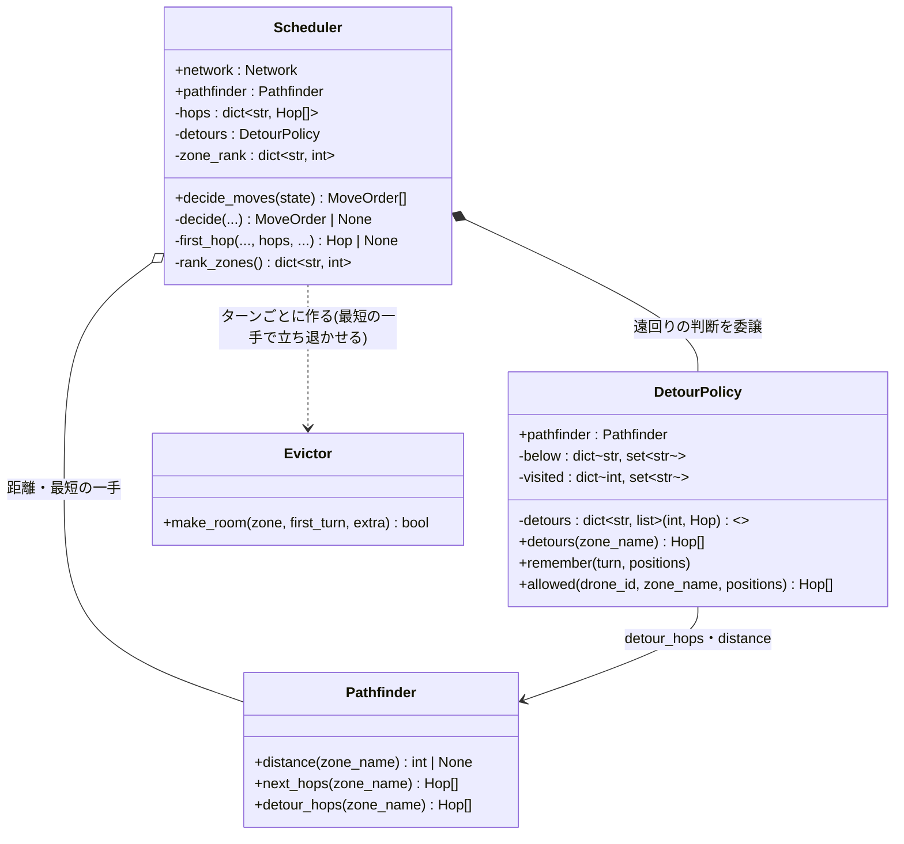
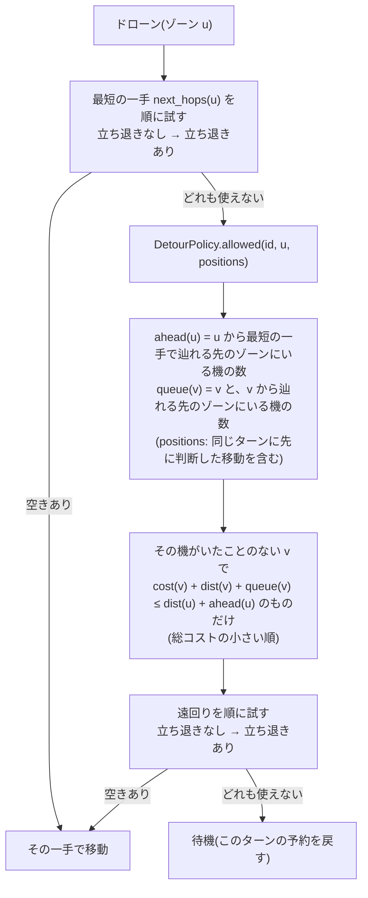
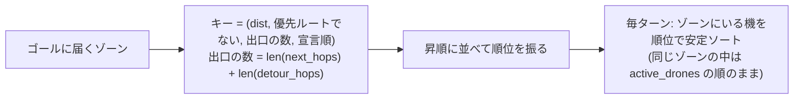

# ワークフロー: 遠回りの一手と、ゾーン単位の判断順

- 日付: 2026-10-20
- 依頼内容: `docs/decisions.md` 2026-10-20 の2項目(「待つことになるドローンには、距離が真に減る遠回りの一手を許す」
  「判断の順序は『ゾーン単位: 距離 → 優先ルート → 出口が少ない → 宣言順』にする」)の実装。実装はユーザーの指示により Claude が行う。
- 更新(2026-10-20): テスト設計で、「距離が真に減る」遠回りは restricted のゾーンにしか成り立たないと分かり、ユーザーの判断で
  「一度いたゾーンには戻らない」+「遠回り先の行列も数える」(案B)に改めた(`docs/decisions.md` の同日の3項目め)。以下はその後の形。
- 前提: 試作と計測は `docs/research/2026-10-20_detour-prototype.md`。実装後、試作とターンログが一致することを確認した
  (配布マップ・課題の例・revie_case・ランダムなマップ 4,871 枚、計 4,907 枚)。

## 対象ファイル

| ファイル | 内容 | 状態 |
|---|---|---|
| `droneflow/pathfinding/pathfinder.py` | `Pathfinder.detour_hops(zone_name)`: ゴールに届くが最短ではない隣のゾーンへの一手(横・後ろも含む、自己ループは除く)を、総コストの小さい順(同点は接続の宣言順)に返す | 追加 |
| `droneflow/simulation/detour_policy.py` | `DetourPolicy`: 各ゾーンの遠回り(総コストつき)と「最短の一手で辿れる先のゾーンの集合」をキャッシュし、各ドローンのいたゾーンをターンごとに記録する(`remember(turn, positions)`)。`allowed(drone_id, zone, positions)` で今許される遠回りを返す | 新規 |
| `droneflow/simulation/scheduler.py` | `DetourPolicy` を持ち(委譲)、最短の一手が使えないときに許された遠回りを試す(`_first_hop` に共通化)。判断の順序をゾーンの順位(`_rank_zones`)で決める | 変更 |
| `README.md` / `README.ja.md` | 課題の例の出力(7 → 5ターン)、次の一手と判断の順序、トレードオフ、計算量、コードの構成 | 変更 |

## 構造図(静的な形)

- 継承は使わない。遠回りを許すかどうかの判断は `DetourPolicy` に分け、`Scheduler` は「どの一手の列を、どの順で試すか」だけを持つ。
- `Evictor` は変更しない。立ち退かされる機は、どこにいても最短の一手で進むので、遠回りした機がいても再帰は必ず終わる。

## 挙動図(実行時の振る舞い)

### (a) 1機の判断(`Scheduler._decide`)

最短の一手(立ち退きを含む)は距離を真に減らし、遠回りはその機がいたことのないゾーンにしか入らない(逆流しない)ので、
各ドローンの移動回数は有限で、実行は必ず終わる。最短の一手を先に試すので、ゴールに最も近い機は必ず動ける(毎ターン少なくとも1機動く)。
`Scheduler.decide_moves` は毎ターンの初めの位置を `remember(turn, positions)` で記録する。記録はターンごとに持ち、同じターンを計画し直すときや
前のターンに戻る(新しいシミュレーション)ときは、そのターン以降の記録を捨ててから記録し直す(`docs/bugs.md` 2026-10-20)。

### (b) 判断の順序(`Scheduler._rank_zones`、構築時に1回)

ゴールに届かないゾーンには順位が無く、そこにいる機がいれば従来どおり `SimulationError`。

### (c) 例: 課題の例(5機)

| ターン | 移動 |
|---|---|
| 1 | D1 → corridorA、D2 → hub-roof1(遠回り。ahead = 1、4 ≤ 3 + 1) |
| 2 | D1 → tunnelB、D2 → roof1、D3 → corridorA、D4 → hub-roof1(遠回り。roof1 の D2 を次のターンに立ち退かせる予約を作る) |
| 3 | D1 → goal、D2 → roof2、D3 → tunnelB、D4 → roof1、D5 → corridorA |
| 4 | D2・D3 → goal、D4 → roof2、D5 → tunnelB |
| 5 | D4・D5 → goal |

## 完了条件(Done)

- 試作とターンログが一致する(案Aの段階で 4,907 枚、案Bの段階で配布マップ・revie_case・ランダムなマップの合計ターン数が試作と一致)。
- `flake8` と `mypy`(両方のフラグ)がエラーなしで通る。
- 既存テストのうち、遠回りしないこと・課題の例の7ターンの出力・ドローン ID の判断順を前提にしたものは、テストのフェーズで新しい規則に合わせて直す。

## レビュー時の確認事項

- 遠回りで、その機が一度いたゾーンに入っていないか(逆流しない)。
- 最短の一手が使えるときに遠回りを選ばないか。
- `Evictor` が遠回りを使わないこと(立ち退きは最短の一手だけ)。
- 判断の順序にドローン ID を使っていないか(同じゾーンの中の並びを除く)。
