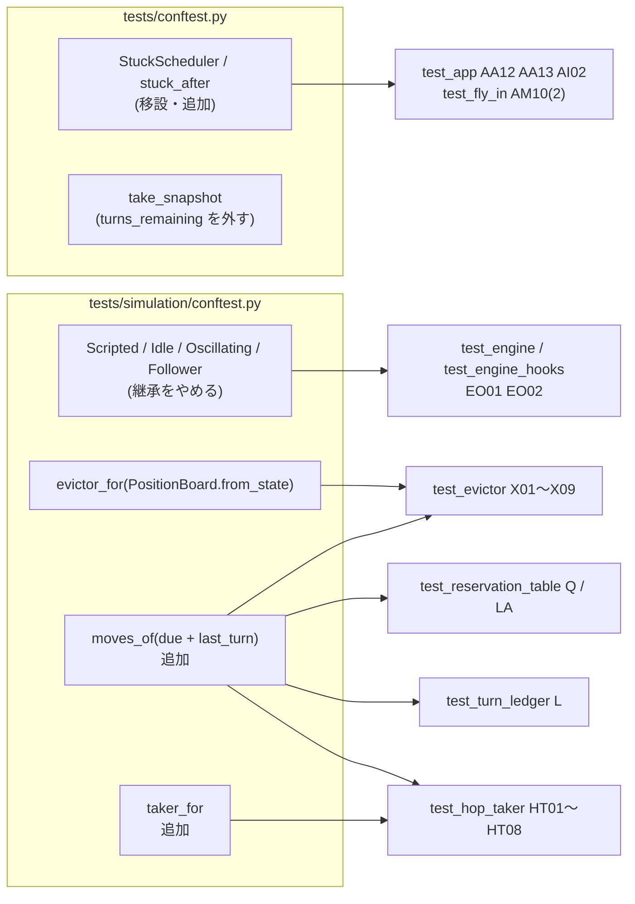

# テスト設計: 全体レビュー(10観点)を受けたリファクタリングへのテストの追従

- 日付: 2026-10-21
- フェーズ: **テスト設計**(テストコードはまだ書かない。作成は別フェーズで行う)
- 対象ブランチ: `test/refactor_review`(03d66bd。`git log develop..HEAD` の22コミット)
- 対象コード: `droneflow/` 全体。特に新しい `simulation/positions.py`(`Position` / `PositionBoard`)、`simulation/observer.py`
  (`TurnObserver` / `ObserverGroup`)、`simulation/hop_taker.py`(`HopTaker`)、`simulation/zone_ranking.py`(`ZoneRanking`)、
  変更された `simulation/engine.py`(`MoveDecider`、`SimulationEngine(world, decider, max_turns)`、`run(observer=None)`)、
  `simulation/scheduler.py`・`evictor.py`・`detour_policy.py`・`reservation_table.py`・`turn_ledger.py`・`state.py`(`Move`)、
  `models/zone.py`・`network.py`・`connection.py`・`world.py`、`pathfinding/pathfinder.py`(`route_cost`)、`parsing/map_reader.py`(`utf-8-sig`)、
  `app.py`(`make_scheduler`)
- 参照した設計: `docs/research/2026-10-21_workflow-refactor-review.md`(変更の一覧・構造図・挙動図)、
  `docs/research/2026-10-21_code-review.md`(R1-1・R1-2 ほか)
- 参照した決定: `docs/decisions.md`
  - 2026-10-21「全体レビュー(10観点)を受けたリファクタリングの範囲と判断」(**本設計の基準**。1 最小カットのコードとテストを削除、
    2 実行に使われないものを削除、3 このターンに立ち退きが決まった機も判断に回す、4 BOM を読み飛ばす、7 `Move` に接続を持たせる、
    8 検証は課題の要件と Linux に絞る)
  - 2026-10-18「`tests/` は `main`(提出物)に含めない」
- 参照したバグ記録: `docs/bugs.md`(2026-10-19・2026-10-20 の「同じターンの計画し直し」は D26・D40・DP17・DP18 が引き続き守る。
  2026-10-20 の「詰まる場所の発見の境界」は、コードの削除とともに対象がなくなる)
- 参照した既存のテスト設計(ID の付け方・表の列を合わせる): `2026-10-20_test-design-detour-hops.md`(H、DP、D27〜D40、R16〜R20)、
  `2026-10-19_test-design-timed-reservation.md`(Q、L、X、D18〜D26)、`2026-10-18_test-design-stage7-visualization.md`(VC、VT、VG、VP)、
  `2026-10-18_test-design-cli-app.md`(AA、AM、AE、AP)

## 方針

- 今のテストは**収集の段階で8件のエラー**(`ImportError` / `AttributeError`)になり、1件も走らない。消えたコードのテストは削除し(A-1)、
  名前や形の変わった API を使うテストは新しい API に書き換える(A-2〜A-4)。期待値は今の実装(03d66bd)を実行して確かめた。
- テスト用のスタブは `Scheduler` を継承せず、`decide_moves` だけを持つふつうのクラス(`MoveDecider` を満たす)にし、
  `SimulationEngine(world, decider)` と `Application(..., make_scheduler=...)` で**注入する**。モジュールの属性の差し替え
  (`monkeypatch.setattr("droneflow.app.Scheduler", ...)`)はやめる。`StuckScheduler` は `tests/conftest.py` の1か所にまとめる。
- 非公開の属性・メソッドに頼っていたところは公開の API に移す(`Scheduler._positions` の複製 → `PositionBoard.from_state`、
  `ReservationTable.planned` → 公開の `due` と `last_turn` から組むヘルパー、`Scheduler.is_on_priority_route` → `ZoneRanking`)。
- 新しいケースを足す(B)。ID は新しい接頭辞にする(PB・OG・HT・ZR・ZC・NW・LA・RC・MV・BM・AI・EO・RV)。
  `CompositeVisualizer` の5件(VC01〜VC05)は `ObserverGroup` のテストとして OG01〜OG05 に移す。
- ネットワークは `make_network` で組む小さなもの。パーサーを通すのは課題の例・BOM のケース・配布マップだけ。`revie_case/` には依存しない。
- 期待値の検証: 表の「検証」列の **実行** は、03d66bd の実装を `.venv` の Python で実行して値を確かめたもの(2026-10-21)。
  A は、リポジトリの外(スクラッチ)にテスト一式を複製して A の変更をすべて当て、`pytest` が **657 passed**(develop の 767 件から
  削除の105件と移す5件を引いた数)、`flake8 tests` と `mypy . --strict`・`mypy . $(MYPY_FLAGS)` がエラーなしになることまで確かめた。
  **旧** は変更前の develop(3b3473f、`git archive develop` で取り出した複製)の結果(参考。テストには書かない)。手計算だけのケースはない。
- 各ケースは独立(スケジューラ・方針・盤面を毎回作る)で、乱数は使わない(既存の R15 の固定シードはそのまま)。

## 実装を読んで分かった前提(テストの組み方に効く)

1. **`Application` の `make_scheduler` の既定値は、定義時に束縛された `Scheduler`**。そのため、従来の
   `monkeypatch.setattr("droneflow.app.Scheduler", ...)` は**何も起こさない**(実行は最後まで進む)。AA12・AA13・AM10(2) が
   「`SimulationError` が出ない」で失敗するのはこのため。`make_scheduler=` で渡すのが正しい形(app.py の docstring にもそう書かれている)。
   `fly_in.main` は `Application(args)` しか呼ばないので、AM10(2) は `fly_in.Application` を
   `functools.partial(Application, make_scheduler=...)` に差し替える(`fly_in.Application` の差し替えは既存の `raising_app` と同じ手)。
2. `Network.zones` は `MappingProxyType`(宣言順・**生きたビュー**: 後で `add_zone` したゾーンも見える)、`connections` と
   `neighbors(name)` は**タプル**(`add_connection` のたびに新しいタプルを作るので、前に受け取ったタプルは変わらない)。
   `neighbors(...) == [conn]` のようにリストと比べると、値が同じでも偽になる(models の3件が失敗する理由)。
3. `Move` は frozen で `connection_name` も等価性に入る。出発(ふつうの移動も restricted への出発も)は使った接続名を持ち、
   着陸(restricted からの自動の到着)は `None`。`Move(1, "a") != Move(1, "a", "s-a")` なので、resolver の戻り値を `Move` で
   比べるテストは接続名まで書く(T01 だけが該当。ほかは `fmt` で文字列にして比べている)。
4. `PositionBoard.from_state` は、立っている機を `(ゾーン, turn_number)`、飛行中の機を `(着陸先, turn_number + 1)` に置き、
   配達済みの機は置かない。`drones_in` は番号の昇順の**新しいリスト**、`zone_by_drone` も**新しい dict**。`count_in` は渡された
   ゾーンを1つずつ足すので、同じゾーンを2回渡すと2回数える(呼び出し側は集合を渡す)。
5. `HopTaker.take_first` は、全部の一手を「立ち退きなし」で試してから、同じ順で「立ち退きあり」を試す。立ち退きありの取り方は2つ:
   restricted へは着陸のターンから席が1つ要る(`make_room(zone, arrive, 1)`)、ほかのゾーンへは「今は席があるが後のターンに予約された席」
   のときだけ、先に入ってから `make_room(zone, arrive + 1, 0)`。後者が失敗すると台帳の記録を `cancel` し、盤面を前の位置に戻す
   (予約表は `Evictor.make_room` が自分で戻す)。
6. `ZoneRanking.rank` はゴールに届かないゾーンにも、**存在しない名前にも** `None` を返す(例外にしない。後述の気づいた点 2)。
   `is_on_priority_route` は存在しない名前で `ZoneNotFoundError`。
7. `ReservationTable` には機ごとの予約を返す公開メソッドがなくなった(`planned` は削除)。`due(turn)`(出発のターンで引く)と
   `last_turn()`(予約の到着の最大)が公開されているので、`range(last_turn() + 1)` の各ターンの `due` から機の予約を集めれば、
   出発の早い順の一覧が作れる(出発 ≤ 到着 ≤ `last_turn`。着陸は出発のターンが `turn_number` なので0以上)。
8. 挙動の変更(決定 2026-10-21 の3): `Scheduler._decide` は「予約があれば外す → 一手を試す → だめなら予約表を戻す」だけになり、
   「このターンに立ち退きが決まった未判断の機は飛ばす」分岐は無くなった。レビューの反例マップ(後述 RV01)では、ターン1 に D6 が動く。
   逆の場合(このターンに立ち退きが決まった機が今は動けず、予約が戻る)は、同じ形のマップを変えた20万枚と、R15 と同じ生成器の2万枚を
   探しても見つからなかった(気づいた点 4)。

## ファイル構成

```
tests/
├── README.md                         # C: カバレッジの記述を更新
├── conftest.py                       # A-2: take_snapshot、StuckScheduler と stuck_after を追加、docstring
├── test_app.py                       # A-3: AA12, AA13(make_scheduler で注入)/ B: AI01, AI02, BM04
├── test_fly_in.py                    # A-3: AM10(2)(fly_in.Application を partial に)
├── models/
│   ├── test_drone.py                 # A-1: WAITING の1件 / A-2: turns_remaining
│   ├── test_network.py               # A-2: neighbors がタプル / B: NW01〜NW04
│   └── test_zone.py                  # B: ZC01〜ZC04
├── output/
│   ├── test_formatter.py             # A-1: emit の3件を削除
│   └── test_turn_log_view.py         # A-2: AP04(2)
├── parsing/
│   └── test_map_parser.py            # B: BM01〜BM03
├── pathfinding/
│   ├── test_bottleneck.py            # A-1: ファイルごと削除
│   ├── test_flow_graph.py            # A-1: ファイルごと削除
│   ├── test_zone_flow.py             # A-1: ファイルごと削除
│   └── test_pathfinder.py            # A-1: B01〜B06 / A-2: N12, E01 / B: RC01〜RC03
├── simulation/
│   ├── conftest.py                   # A-2: スタブを MoveDecider に、evictor_for、moves_of、taker_for を追加
│   ├── test_positions.py             # B: PB01〜PB07(新規)
│   ├── test_observer.py              # B: OG01〜OG07(新規。OG01〜OG05 は VC01〜VC05 の移設)
│   ├── test_hop_taker.py             # B: HT01〜HT08(新規)
│   ├── test_zone_ranking.py          # B: ZR01〜ZR08(新規。ZR07・ZR08 は D07・D08 の移設)
│   ├── test_detour_policy.py         # A-2: positions → PositionBoard
│   ├── test_engine.py                # A-2: 型の別名、G09, G10
│   ├── test_engine_hooks.py          # A-2: 型の別名、docstring / B: EO01, EO02
│   ├── test_evictor.py               # A-2: planned → moves_of
│   ├── test_reservation_table.py     # A-2: planned → moves_of / B: LA01〜LA03
│   ├── test_scheduler.py             # A-4: D07, D08 を test_zone_ranking.py へ / B: RV01〜RV03
│   ├── test_scheduler_maps.py        # A-2: R01, R02(emit)
│   ├── test_state.py                 # A-1: S02 / A-2: S03, S05, S06 / B: MV01〜MV03
│   ├── test_turn_ledger.py           # A-2: has_room → ヘルパー、planned → moves_of
│   └── test_turn_resolver.py         # A-2: T01
└── visualization/
    ├── README.md                     # C: test_composite.py の行を消す
    ├── test_composite.py             # A-1: 削除(test_observer.py へ移設)
    ├── test_palette.py               # A-2: VP04(2)
    └── test_terminal_view.py         # A-2: Visualizer → TurnObserver
```

- 変更するファイル23、削除4、新規4、README 2 の計33ファイル。既存と同じく `__init__.py` は置かない(新しいファイル名は他と重ならない)。

## 共有フィクスチャ・ヘルパー

### `tests/conftest.py`

- `take_snapshot`: 各機のタプルから `d.turns_remaining` を外す(`Drone` にもう無い)。snapshot を使う全テストが実行時に失敗していた。
- `StuckScheduler`(`test_app.py` と `test_fly_in.py` にあった同じクラスを移す。継承はしない):
  `__init__(network, pathfinder, ok_turns)` で本物の `Scheduler` を内側に持ち、`ok_turns` ターンだけ委譲して、その後は `[]` を返す。
- フィクスチャ `stuck_after() -> Callable[[int], SchedulerMaker]`(`SchedulerMaker = Callable[[Network, Pathfinder], MoveDecider]`):
  `ok_turns` を受け取り `functools.partial(StuckScheduler, ok_turns=ok_turns)` を返す。`Application(..., make_scheduler=stuck_after(3))` の形で使う。
  テストファイルは conftest を import しない決まり(simulation/conftest の docstring)なので、フィクスチャで配る。
- モジュールの docstring の「the bottleneck finders」を消す。

### `tests/simulation/conftest.py`

| 対象 | 今 | 変更後 |
|---|---|---|
| `ScriptedScheduler` | `Scheduler` を継承し、使わない `Pathfinder` を作る | ふつうのクラス `ScriptedScheduler(script)` |
| `IdleScheduler` | 同上 | ふつうのクラス(引数なし) |
| `OscillatingScheduler` | 同上 | `OscillatingScheduler(zone_a, zone_b)` |
| `FollowerScheduler` | 同上。`state.free_capacity` を使う | `FollowerScheduler(network)` が自分で `Pathfinder` を持つ。空きは `capacity = hop.zone.capacity` から `None if capacity is None else capacity - state.load(name)`(削除された `free_capacity` と同じ値) |
| ファクトリのフィクスチャ | `Callable[[Network, ...], Scheduler]` | 戻り値の型を `MoveDecider` に。呼び出し側(test_engine 23 か所・test_engine_hooks 6 か所)を変えないため、引数の形 `(network, ...)` は保ち、ネットワークを使わないスタブはフィクスチャ側で捨てる(`lambda network, script: ScriptedScheduler(script)`) |
| `make_evictor`(`evictor_for`) | `Scheduler._positions` の複製で `dict[int, Position]` を作り、`Evictor(ledger, hops, positions)` | `board = PositionBoard.from_state(state)`、`Evictor(ledger, table, hops, board)`。docstring の「`Scheduler._positions` の複製」を「`PositionBoard.from_state`」に |
| `moves_of`(追加) | — | `table_moves_of(table, drone_id) -> list[Reservation]`: `[m for t in range(table.last_turn() + 1) for m in table.due(t) if m.drone_id == drone_id]`(前提 7)。フィクスチャ `moves_of` で配る |
| `taker_for`(追加。B の HT 用) | — | `make_evictor` と同じ手順で `(table, ledger, board, HopTaker(ledger, evictor, board))` を返す。`table` を渡せば先に予約を入れておける |
| `recorder` | `tuple[Visualizer, ...]` | `tuple[TurnObserver, ...]` |
| import | `evictor.Position`、`visualization.base.Visualizer`、`Scheduler`(スタブ用) | `positions.PositionBoard`、`observer.TurnObserver`、`engine.MoveDecider`。`Scheduler` は `make_real_scheduler` だけが使う |

- docstring の「They subclass ``Scheduler`` (a concrete class, not a Protocol)」を「plain classes with ``decide_moves`` (they satisfy
  ``MoveDecider``), handed to ``SimulationEngine`` directly」に。



### テストファイル内のヘルパー

- `has_room(ledger, hop)`(`test_turn_ledger.py`): `ledger.link_free(hop.connection, ledger.turn) and ledger.has_seats(hop.zone,
  ledger.arrival_turn(hop.zone))`。削除された `TurnLedger.has_room` と同じ規則(L01〜L18 の17件が使う)。docstring に「削除された
  `has_room` と同じ規則。`HopTaker._take` の立ち退きなしの判定と同じ」と書く。
- `board_of(spots)`(`test_detour_policy.py`): `{id: (zone, since)}` から `PositionBoard` を組む。DP の parametrize の値は dict のまま
  (型の別名 `Spots = dict[int, tuple[str, int]]`)にして、`allowed_names` の中と `remember` の呼び出しで盤面に変える。
- `first_hop_route(pathfinder, name)`(`test_pathfinder.py`): 先頭の最短の一手を end までたどったゾーン名の列(削除された `best_route` の
  経路と同じ。N12・E01 が使う)。
- `ranking_for(network)`(`test_zone_ranking.py`): `Scheduler.__init__` と同じ作り方で `ZoneRanking` を組む
  (`hops = {name: pf.next_hops(name) ...}`、`ZoneRanking(network, pf, hops, DetourPolicy(pf, hops))`)。

## A. 収集エラーと失敗する既存テストの更新

`pytest -q tests` の結果(03d66bd): **8 errors during collection**(test_drone、pathfinding の4ファイル、simulation パッケージ全体
(conftest の import)、test_composite、test_terminal_view)。収集エラーを直すと、さらに実行時に53件が失敗する(下の A-2・A-3)。

### A-1. 削除するテスト(消えたコードのテスト。105件)

| # | テスト(ID) | 理由(決定 2026-10-21) | 件数 | 検証 |
|---|---|---|---|---|
| 1 | `pathfinding/test_bottleneck.py`(BN01〜BN12、E01〜E02) | `bottleneck.py` の削除(1) | 31 | 実行(develop で収集数を数えた) |
| 2 | `pathfinding/test_flow_graph.py`(FG01〜FG13) | `flow_graph.py` の削除(1) | 25 | 同上 |
| 3 | `pathfinding/test_zone_flow.py`(ZF01〜ZF19) | `zone_flow.py` の削除(1) | 33 | 同上 |
| 4 | `test_pathfinder.py` の B01〜B06(`test_best_route_*`、parametrize を含む)と `assert_route_is_consistent`・`turn_cost` のうち B06 だけが使うもの | `best_route`/`Route` の削除(2)。到達性・総コストの性質は RC01〜RC03 と既存の N10・H11 が受け持つ | 11 | 同上 |
| 5 | `output/test_formatter.py` の `test_emit_*` 3件 | `emit` の削除(2)。空のターンを出さない規則は `TurnLogPrinter` の AP03 が守っている | 3 | 同上 |
| 6 | `simulation/test_state.py` の S02(`test_free_capacity`) | `free_capacity` の削除(2)。容量の規則は ZC01・ZC02(`Zone.capacity`)へ | 1 | 同上 |
| 7 | `models/test_drone.py` の `test_is_delivered_false_for_other_statuses[WAITING]` | `WAITING` の削除(2)。parametrize を `[DroneStatus.AT_ZONE]` だけにする | 1 | 同上 |

- `turn_cost` ヘルパー(test_pathfinder)は N10 でも使うので残す。`pytest` の import `pytest` が不要になる test_formatter は import を消す(flake8 F401)。
- `visualization/test_composite.py`(VC01〜VC05)は削除ではなく **OG01〜OG05 に移す**(B の ObserverGroup)。

### A-2. 新しい API への書き換え(実行時に失敗する・収集できないもの)

| # | テスト(ID) | 何を確かめているか | 今失敗する理由 | 直し方(新しい期待値) | 検証 |
|---|---|---|---|---|---|
| 1 | `models/test_drone.py` の `test_is_delivered_false_while_in_transit`、M05 `test_transit_target_kept_while_in_transit` | 飛行中は未配達・着陸先を持つ | `Drone(turns_remaining=1)` が `TypeError` | 引数 `turns_remaining=1` を消す。期待はそのまま | 実行 |
| 2 | `models/test_network.py` の3件(`test_add_connection_updates_adjacency_for_both_ends`、`test_neighbors_empty_*` 2件) | 隣接の登録と空 | `neighbors` がタプル(前提 2) | `== [connection]` → `== (connection,)`、`== []` → `== ()` | 実行 |
| 3 | `output/test_turn_log_view.py` AP04(2) `test_formatting_is_delegated` | 整形の委譲(同じ `moves` を渡す) | `TurnLogPrinter(stream, formatter)` の引数が無い | `printer = TurnLogPrinter(stream)`、`printer.formatter = StubFormatter()`(公開の属性)の後に `render`。期待 `"X\n"`、同じ `moves` を1回受け取る、はそのまま。docstring を「the printer's formatter makes the line」に | 実行 |
| 4 | `simulation/test_engine.py` G09・G10 | パーサー → エンジン → 整形の E2E | `TurnLogFormatter().emit` が無い | `lines = [TurnLogFormatter().format_turn(m) for m in engine.run()]` で比べる(`capsys` の引数を消す)。G09 は課題の7行、G10 は12行のまま | 実行 |
| 5 | `test_engine.py` / `test_engine_hooks.py` の型の別名と import | — | `visualization.base` が無い、`Scheduler` を返すファクトリ | `Scripted = Callable[[Network, Script], MoveDecider]` ほか4つ、`Recorder = tuple[TurnObserver, ...]`。`engine` からの import は1行にまとめる(`MoveDecider, SimulationEngine, default_turn_limit`)。test_engine_hooks の docstring の「visualizer hooks」を「observer hooks」に | 実行・mypy |
| 6 | `visualization/test_terminal_view.py`(収集エラー) | — | `visualization.base.Visualizer` | `run(world, view: TurnObserver)`(`simulation.observer` から import)。本体は変えない | 実行 |
| 7 | `visualization/test_palette.py` VP04(2) | エンジンと非グラフィカルな表示は pygame を読まない | サブプロセスで `import droneflow.visualization.composite` が失敗 | その行を `import droneflow.simulation.observer` に。期待 `False` はそのまま | 実行 |
| 8 | `simulation/test_detour_policy.py`(収集エラー。DP02〜DP18) | 遠回りの条件・いたゾーン | `evictor.Position` が無い。`allowed` / `remember` が `PositionBoard` を受け取る | ヘルパー `board_of` を通す(上記)。本体が変わるのは DP10・DP17・DP18(`remember(t, board_of({...}))`)、DP15(`allowed(1, "nope", PositionBoard())`)、DP16(下の行) | 実行 |
| 9 | DP16 `test_reads_only_and_returns_new_lists` | 引数を変えず、毎回新しいリスト | 同上 | `board = board_of({9: ("a", 0)})`、`allowed(1, "s", board)` の後 `board.zone_by_drone() == {9: "a"}`、`board.where(9) == ("a", 0)`。返ったリストと `detours("s")` を `clear()` しても次は `["r"]` | 実行 |
| 10 | `simulation/test_reservation_table.py` Q03〜Q10(8件) | 1機2行・取り消し・`start_turn` | `table.planned` が無い | `moves_of(table, id)`(前提 7)。期待の値と並び(出発の早い順)はそのまま。Q03 の docstring「planned is by depart_turn」を「moves_of lists them by depart_turn」に。`assert_empty` も同じ | 実行 |
| 11 | `simulation/test_evictor.py` X01〜X09(11件。X04・X07 は parametrize ×2) | 立ち退きの計画 | `Evictor(ledger, hops, positions)` の形(`evictor_for`)と `planned` | `evictor_for` の変更で組み立ては通る。`rows` と各 `table.planned(id)` を `moves_of` に | 実行 |
| 12 | `simulation/test_turn_ledger.py` L01〜L12・L17・L18(16件。L20 は ×2) | 台帳の空き | `ledger.has_room` が無い | ヘルパー `has_room(ledger, hop)`。期待はそのまま | 実行 |
| 13 | `test_turn_ledger.py` L21 `test_ledger_without_table_loads_landings` | 表なしで着陸だけの表を作る | `ledger.table.planned` | `moves_of(ledger.table, 1) == [Rv(1, "s", "r", 0, 1)]`、`moves_of(ledger.table, 2) == []` | 実行 |
| 14 | `simulation/test_state.py` S03・S05・S06 | `enter_zone` / `enter_transit` / `complete_transit` の数え方 | `free_capacity`・`turns_remaining` | `assert state.free_capacity(...) == 0`(S03・S05)と `drone.turns_remaining == …`(S05・S06)の行を消す。残りの `occupancy` / `reserved` / `load` の検査で同じことを守れている。S01 の docstring「(not WAITING)」を消す | 実行 |
| 15 | `simulation/test_turn_resolver.py` T01 `test_single_move` | 合法な指示が `Move` になる | `Move` が接続名を持つ(前提 3) | `moves == [Move(1, "a", "s-a")]`。`fmt(moves) == "D1-a"` はそのまま | 実行 |
| 16 | `simulation/test_scheduler_maps.py` R01・R02 | 課題の例(5行)・restricted だけ(8行)の出力 | `emit` | 既存の `output_lines(world)` で比べる(`capsys` の引数を消す)。期待の行はそのまま | 実行 |
| 17 | `test_pathfinder.py` N12 `test_priority_further_ahead_does_not_reorder_ties` | 2手先の priority は同点の順を変えない | `best_route` | `first_hop_route(pathfinder, "s") == ["s", "b", "c", "g"]` | 実行 |
| 18 | `test_pathfinder.py` E01 `test_subject_sample_map_end_to_end` | 課題の例の距離と経路 | `best_route` と `Route` | 距離の表と `next_hops("hub")` はそのまま。経路は `first_hop_route(pathfinder, "hub") == ["hub", "corridorA", "tunnelB", "goal"]`、総コストは `pathfinder.route_cost(pathfinder.next_hops("hub")[0]) == 3` | 実行 |

### A-3. スタブの注入(`monkeypatch` をやめる)

| # | テスト(ID) | 今失敗する理由 | 直し方 | 検証 |
|---|---|---|---|---|
| 1 | `test_app.py` AA12 `test_close_failure_keeps_the_original_error` | `stuck_after(monkeypatch, 0)` が効かず(前提 1)、`SimulationError` が出ない | `run_failing(args, expected, make_scheduler=Scheduler)` に引数を足し、`run_failing(Args(sample_path), SimulationError, stuck_after(0))`。引数の `monkeypatch` を `stuck_after: StuckAfter` に。期待(`turn 1: no drone moved` で始まる・警告あり・要約なし・stdout 空)はそのまま | 実行 |
| 2 | `test_app.py` AA13 `test_failed_run_keeps_the_log_so_far` | 同上 | `Application(Args(sample_path), out, err, make_scheduler=stuck_after(3)).run()`。`record_terminal(monkeypatch, out)` は表示の差し替えなので残す。期待(`^turn 4: no drone moved`、先頭3行、`at_close == [3]`、要約なし)はそのまま | 実行 |
| 3 | `test_fly_in.py` AM10(2) `test_close_failure_after_failure` | 同上(終了コードが 0 になる) | `monkeypatch.setattr(fly_in, "Application", functools.partial(Application, make_scheduler=stuck_after(0)))`。期待(終了コード1、`CLOSE_WARNING` → `error: turn 1: no drone moved, so the simulation cannot progress`)はそのまま | 実行 |
| 4 | `test_app.py` / `test_fly_in.py` の `StuckScheduler` と `stuck_after` | — | 両ファイルから消し、`tests/conftest.py` のものを使う。不要になる import(`functools`(test_app)、`Scheduler`(test_fly_in)、`MoveOrder`)を消し、`Application`(test_fly_in)、`MoveDecider` を足す | flake8・mypy |

### A-4. 移すテスト

| テスト(ID) | 移す先 | 理由 | 検証 |
|---|---|---|---|
| `test_scheduler.py` D07 `test_is_on_priority_route`(parametrize ×5)・D08 `test_is_on_priority_route_unknown_zone` | `test_zone_ranking.py` の ZR07・ZR08(期待はそのまま。`real_scheduler(network).is_on_priority_route` → `ranking_for(network).is_on_priority_route`)。docstring に「旧 D07 / D08」と書く | `Scheduler.is_on_priority_route` は `ZoneRanking` に移った | 実行(5件とも同じ値、`ZoneNotFoundError`) |
| `visualization/test_composite.py` VC01〜VC05 | `simulation/test_observer.py` の OG01〜OG05(`CompositeVisualizer` → `ObserverGroup`。`LogView` もそのまま移す) | `CompositeVisualizer` は `ObserverGroup` になった | 実行(5件) |

### A'. 通っているが、名前・docstring が古いもの

| 場所 | 今の記述 | 直し方 |
|---|---|---|
| `tests/conftest.py` の docstring | 「the bottleneck finders」 | 削除 |
| `tests/simulation/conftest.py` の docstring | 「They subclass ``Scheduler``」、「``Scheduler._positions`` (a private method, so it is copied here)」 | 上記の共有ヘルパーの節のとおり |
| `test_engine_hooks.py` の docstring | 「visualizer hooks」 | 「observer hooks」(`TurnObserver`) |
| `test_state.py` S01 | 「(not WAITING)」 | 削除 |
| `test_pathfinder.py` の `costed` ヘルパー | 総コストを自分で計算 | `pathfinder.route_cost(hop)` に置き換えてよい(H 系の期待は同じ。RC03 で一致を確かめた) |

- 変えないもの: `test_zone.py` の `has_unlimited_capacity`(プロパティは残っている)、`test_app_graphical.py`、`test_cli.py`、`test_errors.py`、
  `test_graphical_view.py`、`test_summary.py`、`test_distance_map.py`、parsing の3ファイル(BM を足す `test_map_parser.py` を除く)。

## B. 新しいケース

表記: `s-a a-g` は接続(記述順 = 宣言順)。restricted(`R`)・priority(`P`)・blocked(`X`)は明記したものだけ。hub の容量は省略時1、
接続容量は省略時1。`cap(a)=2`。`O(1,"a")` は `MoveOrder(1, "a")`、`Rv(1,"a","g",2,2)` は `Reservation(drone_id, from_zone, zone,
depart_turn, arrive_turn)`。`at=` / `flying=` は `place` の引数(状態は `turn_number == 0`)。

### PositionBoard(`tests/simulation/test_positions.py`、新規、PB 系)

| ID | 観点 | 入力・手順 | 期待結果 | 狙い | 検証 |
|---|---|---|---|---|---|
| PB01 | 空の盤面 | `PositionBoard()` | `zone_by_drone() == {}`、`drones_in("a") == []`、`count_in(["a"]) == 0`、`where(1)` は `KeyError` | 既定と例外契約(docstring の Raises) | 実行 |
| PB02 | 置く・番号順 | `place(3,"a",0)`、`place(1,"a",0)`、`place(2,"b",1)` | `drones_in("a") == [1, 3]`(置いた順でなく昇順)、`drones_in("b") == [2]`、`where(3) == Position("a", 0)`、`where(3) == ("a", 0)`、`where(2).zone == "b"`、`where(2).since_turn == 1` | 昇順の約束と、`Position` が NamedTuple(タプルと比べられる) | 実行 |
| PB03 | ゾーン間の移動 | PB02 の後 `place(3,"b",2)` | `drones_in("a") == [1]`、`drones_in("b") == [2, 3]`、`where(3) == ("b", 2)`、`zone_by_drone() == {1: "a", 2: "b", 3: "b"}` | 前のゾーンから外れる(二重に数えない) | 実行 |
| PB04 | 同じゾーンに置き直す | PB03 の後 `place(3,"b",5)` | `drones_in("b") == [2, 3]`、`count_in(["b"]) == 2`、`where(3) == ("b", 5)` | ターンだけ更新され、機数は変わらない | 実行 |
| PB05 | `count_in` | PB02 の盤面で `count_in({"a","b"})`、`count_in(set())`、`count_in({"zz"})` | `3`、`0`、`0` | ゾーンの集合の合計(知らないゾーンは0) | 実行 |
| PB06 | 返す値は複製 | PB02 の盤面で `drones_in("a").append(99)`、`zone_by_drone()[1] = "x"` の後に読み直す | `drones_in("a") == [1, 3]`、`zone_by_drone()[1] == "a"` | 呼び出し側が盤面を壊せない | 実行 |
| PB07 | `from_state` | `s-a a-r r-g`、r は R、`cap(a)=3`。`place(n, 4, at={1:"a", 2:"g"}, flying={3:("a","r")})` の後 `state.turn_number = 2` | `zone_by_drone() == {1: "a", 3: "r", 4: "s"}`(配達済みの D2 はいない)、`where(1) == ("a", 2)`、`where(3) == ("r", 3)`(着陸先・次のターンから)、`where(4) == ("s", 2)` | 前提 4。スケジューラの「確実にいるターン」の規則 | 実行 |

### ObserverGroup(`tests/simulation/test_observer.py`、新規、OG 系)

| ID | 観点 | 入力・手順 | 期待結果 | 狙い | 検証 |
|---|---|---|---|---|---|
| OG01〜OG05 | 旧 VC01〜VC05 | `CompositeVisualizer` を `ObserverGroup` に置き換えるだけ | 旧と同じ(呼び出しの順、1つの close の失敗でも残りを閉じる、複数の失敗の `__context__` のつながり、観測者なし、render の失敗) | 移設(A-4) | 実行(5件) |
| OG06 | 受け取った列の複製 | `src = [LogView("a")]`、`ObserverGroup(src)` の後に `src.append(LogView("b"))` して `close()`。あわせて `ObserverGroup((x, y))`(タプル) | 閉じるのは a だけ。`observers` は `list` で `src` とは別のもの。タプルからも `list` | 構築後に外の列が変わっても影響しない | 実行 |
| OG07 | エンジンとの組み合わせ | `s-a a-g`、1機、本物の `Scheduler`。`engine.run(ObserverGroup([a, b]))` | 呼び出しの記録が `(a,begin) (b,begin) (a,render) (b,render) (a,render) (b,render) (a,close) (b,close)`(2ターン) | エンジンからは1つの観測者に見え、各観測者に順に届く(app の使い方) | 実行 |

- 型の確認(mypy のみ): `TurnLogPrinter`・`TerminalVisualizer`・`ObserverGroup` が `TurnObserver` として渡せることは、test_app の実行と
  `mypy --strict` が既に確かめる。専用のテストは作らない。

### HopTaker(`tests/simulation/test_hop_taker.py`、新規、HT 系)

`taker_for(state, table=None)` で `(table, ledger, board, taker)` を作る。一手は `Pathfinder(network).next_hops(here)`。
「予約なし」は `moves_of(table, id) == []`。

| ID | 観点 | 入力・手順 | 期待結果 | 狙い | 検証 |
|---|---|---|---|---|---|
| HT01 | 空いている一手 | `s-a a-g`、2機。`take_first(1,"s",hops)` → `take_first(2,"s",hops)` | 1回目は a への一手。`board.where(1) == ("a", 1)`、`ledger.projected("a", 1) == 1`、`ledger.link_free(s-a, 1) is False`、予約なし。2回目は `None`、`board.where(2) == ("s", 0)` | 記録が台帳と盤面の両方に入る。接続・ゾーンが埋まれば取れない | 実行 |
| HT02 | restricted へ立ち退かせて着陸(`extra=1`) | `s-r r-g`、r は R。`place(n, 2, at={1:"r"})`、`take_first(2,"s",hops)` | r への一手。`board.where(2) == ("r", 2)`、`moves_of(table,1) == [Rv(1,"r","g",2,2)]`、D2 は予約なし | 着陸のターンから席が1つ要る取り方 | 実行 |
| HT03 | 立ち退きの連鎖 | `s-r r-x x-g`、r は R。`at={1:"r", 2:"x"}`、3機。`take_first(3,"s",hops)` | r への一手、`where(3) == ("r", 2)`、`moves_of(1) == [Rv(1,"r","x",2,2)]`、`moves_of(2) == [Rv(2,"x","g",2,2)]` | `Evictor` の再帰を通した着陸 | 実行 |
| HT04 | 立ち退かせられない | `s-r r-g`、r は R。`at={1:"r"}`、2機。表に先に `Rv(1,"r","g",3,3)`(D1 はもう出る予定) | `None`。`where(2) == ("s", 0)`、`moves_of(1) == [Rv(1,"r","g",3,3)]`(変わらない)、`link_free(s-r, 1) is True`(何も記録されていない) | 失敗しても台帳・盤面・表が変わらない | 実行 |
| HT05 | 先に入ってから立ち退かせる(`extra=0`) | `s-a a-g`(a は normal、cap 1)、2機。表に先に `Rv(2,"s","a",2,2)`(D2 がターン2に a へ入る予定)。`take_first(1,"s",hops)` | 試す前: `has_seats(a, 1) is False`、`has_seat(a, 1, 1) is True`。結果は a への一手、`where(1) == ("a", 1)`、`moves_of(1) == [Rv(1,"a","g",2,2)]`(自分の立ち退き)、`moves_of(2) == [Rv(2,"s","a",2,2)]`、`projected("a",1) == 1`、`projected("a",2) == 1` | 後で予約された席に入り、自分を立ち退かせる取り方(D23 の単体版) | 実行 |
| HT06 | 先に入る取り方の取り消し | `s-a a-g`、`cap(a)=2`、6機、`at={5:"a"}`。表に先に `Rv(5,"a","g",2,2)`・`Rv(2,"s","a",2,2)`・`Rv(6,"s","a",2,2)`。`mark = table.mark()` の後 `take_first(1,"s",hops)` | `None`。`where(1) == ("s", 0)`(前の位置に戻る)、`drones_in("a") == [5]`、`projected("a",1) == 1`、`link_free(s-a, 1) is True`(`cancel` された)、`table.mark() == mark`、D1 は予約なし | 立ち退き(a-g はターン2に D5 が使う)に失敗したとき、台帳・盤面・表がすべて戻る(前提 5) | 実行 |
| HT07 | 2回の試し方の順 | `s-a a-g s-b b-g`、a・b とも R(cap 1)。`next_hops("s") == [a, b]`。a) `at={1:"a"}`、3機で `take_first(2,…)` b) `at={1:"a", 3:"b"}` で `take_first(2,…)` | a) b への一手(立ち退きなし。`moves_of(1) == []`)、`where(2) == ("b", 2)` b) a への一手(立ち退きあり)、`moves_of(1) == [Rv(1,"a","g",2,2)]`、`moves_of(3) == []` | 立ち退きは最後の手段: 先頭の一手を立ち退きで取る前に、後ろの一手を立ち退きなしで試す(D22 の単体版) | 実行 |
| HT08 | 一手が無い | HT01 の状態で `take_first(2,"s",[])` | `None` | 空の一覧 | 実行 |

### ZoneRanking(`tests/simulation/test_zone_ranking.py`、新規、ZR 系)

`order(network)` = 順位のあるゾーンを順位の順に並べた名前の列。

| ID | 観点 | 入力・手順 | 期待結果 | 狙い | 検証 |
|---|---|---|---|---|---|
| ZR01 | 距離が先 | `s-a a-b b-g` | `["g","b","a","s"]`、`rank("g") == 0`、`rank("s") == 3` | 1つ目の鍵(end に近い順) | 実行 |
| ZR02 | 同じ距離なら priority のゾーン | `s-x s-y x-c y-c c-g`、x は P | `["g","c","x","y","s"]` | 2つ目の鍵(ゾーン自身) | 実行 |
| ZR03 | 同じ距離なら最短の一手が priority | `s-u s-y u-p y-q p-g q-g`、p は P | `["g","p","q","u","y","s"]`(p は自身が P、u は次の一手 p が P) | 2つ目の鍵(次の一手) | 実行 |
| ZR04 | 出口(最短 + 遠回り)が少ない方 | `s-a s-b a-c b-c a-d c-g d-g` | `["g","d","c","b","a","s"]`(距離1: d の出口2 < c の出口3(g と遠回り a・b)。距離2: b の出口2 < a の出口3(c・d と遠回り s)) | 3つ目の鍵。遠回りも出口に数える | 実行 |
| ZR05 | 宣言順 | a) `s-b s-a a-g b-g` b) `s-a a-g s-b b-g a-b` | a) `["g","b","a","s"]`(b が先に宣言) b) `["g","a","b","s"]`(a・b とも出口2) | 4つ目の鍵(`network.zones` の順。ドローン ID ではない) | 実行 |
| ZR06 | 届かないゾーン | a) `make_network("s-a a-g", isolated=("z",))` b) `s-a a-g s-x x-g`、x は X | a) `rank("z") is None` b) `rank("x") is None`、`order == ["g","a","s"]`。あわせて `rank("nope") is None`(**今の挙動**。気づいた点 2) | 順位を持たないゾーン | 実行 |
| ZR07 | 優先ルート(旧 D07、parametrize ×5) | 旧 D07 と同じ5つ | 旧と同じ(True, True, False, False, False) | A-4 の移設 | 実行 |
| ZR08 | 存在しない名前(旧 D08) | `s-a a-g` で `is_on_priority_route("nope")` | `ZoneNotFoundError` | A-4 の移設 | 実行 |

### Zone(`tests/models/test_zone.py`、ZC 系)

| ID | 観点 | 入力・手順 | 期待結果 | 狙い | 検証 |
|---|---|---|---|---|---|
| ZC01 | hub の容量 | role HUB、`max_drones` を 3・0・None | `capacity` が 3・0・None | `max_drones` をそのまま返す | 実行 |
| ZC02 | start・end は無制限 | role START / END、`max_drones` を None・0・3 | どれも `capacity is None`(`has_unlimited_capacity` は True) | 容量の規則の一本化(旧 S02 の start/end の部分) | 実行 |
| ZC03 | 到着のターン | 4つの zone_type で `arrival_turn(0)`、`arrival_turn(4)` | RESTRICTED は 1・5、NORMAL・PRIORITY・BLOCKED は 0・4(BLOCKED でも例外にしない) | 到着のターンの規則の一本化 | 実行 |
| ZC04 | frozen | `setattr(zone, "max_drones", 2)`、`setattr(connection, "max_link_capacity", 3)`、`setattr(world, "nb_drones", 2)` | どれも `dataclasses.FrozenInstanceError`。同じ値の `Zone` 同士は `==` で `hash` も等しい | 値オブジェクトを変えられない(`setattr` で書くのは mypy が代入をエラーにするため) | 実行 |

### Network(`tests/models/test_network.py`、NW 系)

| ID | 観点 | 入力・手順 | 期待結果 | 狙い | 検証 |
|---|---|---|---|---|---|
| NW01 | `zones` は読み取り専用で生きたビュー | `make_network("s-a a-g s-b")` | `list(zones) == ["s","g","a","b"]`、`cast(dict[str, Zone], network.zones)["x"] = zone` は `TypeError`。後で `add_zone` したゾーンが同じビューに見える | `MappingProxyType`(前提 2) | 実行 |
| NW02 | `connections` はタプル | 同上。`conns = network.connections` の後 `add_connection(Connection("late","g"))`(先に `late` を `add_zone`) | `isinstance(conns, tuple)`、`[c.name for c in conns] == ["s-a","a-g","s-b"]`(前のタプルは変わらない)、新しい `connections` の末尾が `late-g` | 書き換えられない・受け取った後に変わらない | 実行 |
| NW03 | `neighbors` はタプル | 同上 | `neighbors("s")` の名前が `("s-a","s-b")`、`neighbors("nope") == ()` | 前提 2 | 実行 |
| NW04 | `connection_named` | `s-a a-g s-b` | `connection_named("a","s-a").name == "s-a"`、両端から同じオブジェクト(`is`)。`("a","s-b")`(a に触れない)・`("a","nope")`・`("nope","s-a")` はどれも `SimulationError`、文言は `unknown connection 's-b'` / `'nope'` / `'s-a'` | 飛行中の機の接続の逆引き(resolver・予約表が使う) | 実行 |

### ReservationTable.leaves_after(`tests/simulation/test_reservation_table.py`、LA 系)

| ID | 観点 | 入力・手順 | 期待結果 | 狙い | 検証 |
|---|---|---|---|---|---|
| LA01 | 予約なし | 空の表 | `leaves_after(1, 0) is False` | 既定 | 実行 |
| LA02 | 厳密に「後」 | `reserve(Rv(1,"a","g",3,3))` | `leaves_after(1, t)` が t=1,2,3,4 で True, True, False, False。`leaves_after(2, 0) is False` | `depart_turn > turn`(等しいときは False)。ほかの機に漏れない | 実行 |
| LA03 | 2行・取り消し・restricted | `Rv(1,"s","a",1,2)` を足す → `remove(1)` → `mark` の後 `Rv(2,"s","r",4,5)` → `rollback` | 2行のとき t=0..3 で True, True, True, False。`remove` 後は False。restricted の行は `leaves_after(2,4) is False`、`(2,3) is True`(到着でなく出発のターンで見る)。`rollback` 後は False | 索引が `remove` / `rollback` に追従する | 実行 |

### Pathfinder.route_cost(`tests/pathfinding/test_pathfinder.py`、RC 系)

| ID | 観点 | 入力・手順 | 期待結果 | 狙い | 検証 |
|---|---|---|---|---|---|
| RC01 | 進入コスト + 距離 | `s-a a-g s-r r-g s-x x-g`、r は R、x は X、`isolated=("z",)` | s→a 2、s→r 3、a→g 1、a→s 3(後ろ向きの一手でも計算できる) | 定義 | 実行 |
| RC02 | 届かないゾーンへの一手 | 同じ網で、s→x の `Hop`、`Hop(Connection("s","z"), get_zone("z"))` | どちらも `ValueError`、文言 `'x' cannot reach the end zone` / `'z' cannot reach the end zone` | 例外契約(docstring の Raises) | 実行 |
| RC03 | 性質: 実マップ(課題の例と配布マップ10枚)の全ゾーン | 各ゾーン u で `next_hops(u)` と `detour_hops(u)` の各一手の `route_cost` | 最短の一手はすべて `distance(u)` と等しく、遠回りはすべて `distance(u)` より大きく昇順(357手で違反0) | `next_hops` / `detour_hops` が `route_cost` で分かれていること。H11 に足してもよい | 実行 |

### Move(`tests/simulation/test_state.py`、MV 系)

| ID | 観点 | 入力・手順 | 期待結果 | 狙い | 検証 |
|---|---|---|---|---|---|
| MV01 | `text` と既定値 | `Move(3,"x")`、`Move(12,"a-b","a-b")` | `"D3-x"`、`"D12-a-b"`。`Move(3,"x").connection_name is None` | 出力の書式を1か所に | 実行 |
| MV02 | resolver が付ける接続名 | `s-a a-r r-g`、r は R、2機。ターン1 `[O(1,"a")]`、ターン2 `[O(1,"r"), O(2,"a")]`、ターン3 `[]`、ターン4 `[O(1,"g")]` | 1: `[Move(1,"a","s-a")]` 2: `[Move(1,"a-r","a-r"), Move(2,"a","s-a")]`(text `D1-a-r D2-a`) 3: `[Move(1,"r",None)]`(着陸) 4: `[Move(1,"g","r-g")]` | 出発は接続名、restricted への出発は行き先も接続名、着陸は `None`(決定 2026-10-21 の7) | 実行 |
| MV03 | frozen と等価性 | `setattr(Move(1,"a"), "destination", "b")`、`{Move(1,"a"), Move(1,"a")}`、`Move(1,"a") == Move(1,"a",None)`、`Move(1,"a") == Move(1,"a","s-a")` | `FrozenInstanceError`、集合の大きさ1、True、**False** | 前提 3 | 実行 |

### BOM(`tests/parsing/test_map_parser.py`・`tests/test_app.py`、BM 系)

`write_map` は `write_text` なので、BOM は `tmp_path / "map.txt"` に `write_bytes` で書く。

| ID | 観点 | 入力・手順 | 期待結果 | 狙い | 検証 |
|---|---|---|---|---|---|
| BM01 | 先頭の BOM | `b"\xef\xbb\xbf" + SUBJECT_SAMPLE_MAP.encode()` | 例外なし。`nb_drones == 5`、最初のゾーンは `hub` | `utf-8-sig`(決定 2026-10-21 の4) | 実行 |
| BM02 | BOM と CRLF | 同じ内容の改行を `\r\n` に | `nb_drones == 5` | 2つが重なっても読める | 実行 |
| BM03 | 読み飛ばすのは先頭の1つだけ | a) BOM を2つ b) 6行目の先頭に `` | a) `ParseError`、`line 1: the first line must be 'nb_drones: <n>'` b) `ParseError`、`line 6: unrecognized line: 'hub: roof2 6 2 [zone=normal color=blue]'` | 範囲を広げすぎていないこと(パーサーを厳しくしない決定 4 のとおり、それ以外は今のまま) | 実行 |
| BM04 | アプリ全体 | BM01 のファイルで `Application(Args(path, visual="none"), out, err).run()` | stdout は `scheduler_output` の5行、stderr は `SUMMARY` の1行 | 入口から通ること(`test_app.py`) | 実行 |

### Application の注入(`tests/test_app.py`、AI 系)

| ID | 観点 | 入力・手順 | 期待結果 | 狙い | 検証 |
|---|---|---|---|---|---|
| AI01 | 作り方を受け取る | 課題の例、`--visual none`。`make_scheduler=Recording`(`__init__(network, pathfinder)` を記録し、ターン0 だけ `[O(1,"corridorA")]`、その後は `[]`) | 作られるのは1回、`pathfinder.network is network`。`SimulationError`、文言 `turn 2: no drone moved, so the simulation cannot progress`。stdout は `"D1-corridorA\n"`、stderr は空 | `make_scheduler(world.network, pathfinder)` で作り、エンジンに渡す | 実行 |
| AI02 | 共有の `StuckScheduler` | 課題の例、`--visual none`、`make_scheduler=stuck_after(2)` | `SimulationError`、文言 `turn 3: D4 is stuck on connection 'hub-roof1': zone 'roof1' is full`。stdout は `scheduler_output` の先頭2行 | conftest の `stuck_after` が本物の実行を途中で止められること(2026-10-20 設計の気づいた点 6 と同じ値) | 実行 |

### エンジンの観測者(`tests/simulation/test_engine_hooks.py`、EO 系)

| ID | 観点 | 入力・手順 | 期待結果 | 狙い | 検証 |
|---|---|---|---|---|---|
| EO01 | `run(observer=...)` のキーワード | 課題の例、本物の `Scheduler`、`(名前, ターン, 手の数)` を記録する観測者を `run(observer=o)` | `[("begin",0), ("render",1,2), ("render",2,4), ("render",3,5), ("render",4,4), ("render",5,2), ("close",)]`、戻り値は5ターン | 引数名 `observer` | 実行 |
| EO02 | 観測者なし・コンストラクタのキーワード | 同じ世界で `run()`。`SimulationEngine(world=w, decider=d, max_turns=9)` | `run()` は5ターン、`engine.max_turns == 70`(既定)。キーワードで作ると `engine.decider is d`、`max_turns == 9` | `decider` という名前と既定値 | 実行 |

### 挙動の変更(`tests/simulation/test_scheduler.py`、RV 系)

レビューの反例マップ **RV** = `make_network("s-u u-w w-g u-v v-y y-g v-z1 z1-g", types={"v": R}, capacity={"u": 2, "w": 4})`
(u-w・w-g などの接続は容量1、y・z1 は容量1)。`place(n, 6, at={1:"u", 2:"u", 3:"w", 4:"w", 5:"w", 6:"v"})`。
距離: u・v は2、w・y・z1 は1。

| ID | 観点 | 入力・手順 | 期待結果 | 狙い | 検証 |
|---|---|---|---|---|---|
| RV01 | このターンに立ち退きが決まった機も判断する | RV、新しい `Scheduler` で `decide_moves` | `[O(3,"g"), O(1,"w"), O(2,"v"), O(6,"y")]`(順序ごと)。D2 は接続 u-w が D1 で埋まり、満杯の v へ遠回りして D6 の立ち退き(ターン2 に v → y)を作る。その後に判断される D6 は、その予約を外して今 y へ動く | 決定 2026-10-21 の3・R1-1。消えた分岐が戻れば D6 の指示が無くなる | 実行・旧(`[O(3,"g"), O(1,"w"), O(2,"v")]`) |
| RV02 | 最後まで | RV を同じ `Scheduler` と `TurnResolver` で終わるまで(`play` / `orders_by_turn`) | 行: `D1-w D2-u-v D3-g D6-y` / `D1-g D2-v D6-g` / `D2-y D4-g` / `D2-g D5-g`(4ターン)。ターン2の指示は `[O(1,"g"), O(6,"g")]`(D6 の予約は残っていない) | 立ち退きを外した D6 に予約が残らず、D2 の着陸もできる | 実行・旧(`D1-w D2-u-v D3-g` / `D1-g D2-v D6-y` / `D2-y D4-g D6-g` / `D2-g D5-g`。ターン数は同じ4) |
| RV03 | 同じターンをもう一度 | RV の状態で `decide_moves` を2回 | 2回とも RV01 と同じ、新しい `Scheduler` の結果とも同じ | 外した予約と戻した予約が、計画し直しで二重にならない(D24 の RV 版) | 実行 |

## C. lint と README

- 作成フェーズの完了条件に **`make lint`(flake8 + `mypy . $(MYPY_FLAGS)`)と `make lint-strict`(flake8 + `mypy . --strict`)が通ること**を
  入れる(どちらも `tests/` を含む)。A の変更だけを当てたスクラッチの複製で、両方ともエラーなし(77 ファイル)を確かめた。
  B を書くときの注意:
  - frozen のデータクラスへの代入は mypy がエラーにするので `setattr(...)` で書く(ZC04・MV03)。
  - `Mapping` への代入・`Sequence.append` も mypy がエラーにするので、`typing.cast(dict[str, Zone], ...)` を通すか、`isinstance(..., tuple)`
    で確かめる(NW01・NW02)。`# type: ignore` は `--warn-unused-ignores` と相性が悪いので使わない。
  - スタブは `MoveDecider` / `TurnObserver` を構造的に満たすだけでよい(継承しない)。ファクトリの型は `Callable[..., MoveDecider]`。
  - 関数ごとに型ヒントと docstring(先頭に ID)。
- `tests/README.md` の「現在のカバレッジ範囲」の更新:
  - 消す: `test_flow_graph.py`・`test_zone_flow.py`・`test_bottleneck.py`・`test_composite.py` の項、`test_pathfinder.py` の
    「`best_route` の `total_cost` と `from_zone` 指定・例外の種類、経路の整合性チェック」、`test_formatter.py` の「空ターンのスキップ、`capsys`
    での標準出力検査」、`test_state.py` の「`free_capacity`(start/end は `None`)」、`test_scheduler.py` の「`is_on_priority_route`(…)」。
  - 直す: `simulation/conftest.py` の項を「スタブは `decide_moves` だけのふつうのクラス(`MoveDecider` を満たし、エンジンに直接渡す)、
    `evictor_for` は `PositionBoard.from_state` で盤面を作る、`moves_of`(公開の `due` と `last_turn` から機の予約を集める)、`taker_for`」に。
    `tests/conftest.py` に `StuckScheduler` / `stuck_after`(`Application(make_scheduler=...)` に渡す)を足す。
    `test_palette.py` の「composite」を「simulation.observer」に。`test_turn_log_view.py` の AP04 を「`formatter` 属性に委譲」に。
    `test_turn_resolver.py` の「戻り値が `Move` であること」に「出発は接続名を持つ」を足す。
    `test_engine.py` の「visualizer は省略可」を「observer は省略可」に。`test_zone.py` に `capacity` / `arrival_turn` / frozen(ZC01〜ZC04)、
    `test_network.py` に読み取り専用のビューと `connection_named`(NW01〜NW04)、`test_pathfinder.py` に `route_cost`(RC01〜RC03)、
    `test_reservation_table.py` に `leaves_after`(LA01〜LA03)、`test_state.py` に `Move`(MV01〜MV03)、`test_map_parser.py` に BOM
    (BM01〜BM03)、`test_app.py` に `make_scheduler` の注入(AI01・AI02)と BOM(BM04)、`test_engine_hooks.py` に EO01・EO02、
    `test_scheduler.py` に「このターンに立ち退きが決まった機も判断する(RV01〜RV03、レビューの反例マップ)」を足す。
  - 新しい項: `test_positions.py`(PB01〜PB07)、`test_observer.py`(OG01〜OG07。OG01〜OG05 は旧 `test_composite.py`)、
    `test_hop_taker.py`(HT01〜HT08)、`test_zone_ranking.py`(ZR01〜ZR08。ZR07・ZR08 は旧 D07・D08)。
  - 末尾の「対象は Stage 1〜7 …」はそのまま。
- `tests/visualization/README.md`: `test_composite.py` の行を消し、「`ObserverGroup` のテストは `tests/simulation/test_observer.py`」と1行足す。

## 作成フェーズへの申し送り

- 順番: ① A-1〜A-4・A'(全テストが通る状態に戻す。`make lint` / `make lint-strict` も通す)を1コミット
  ② PB・OG(新規2ファイル) ③ HT・ZR(新規2ファイル) ④ ZC・NW・LA・RC・MV ⑤ BM・AI・EO ⑥ RV ⑦ README 2つ。コミットは細かく分ける。
- ① の後の件数は **657 passed**(develop 767 − 削除105 − 移設5。移設の5件は ② で OG01〜OG05 として戻る)。全部書いた後は 657 + 7(OG)
  + 7(PB)+ 8(HT)+ 6(ZR01〜ZR06。ZR07・ZR08 は D07・D08 を移すだけで件数は変わらない)+ 4 + 4 + 3 + 3 + 3 + 4 + 2 + 2 + 3 が目安(parametrize で増減してよい)。
- `moves_of` を使う既存テストは、引数に `moves_of: MovesOf` を足す(`MovesOf = Callable[[ReservationTable, int], list[Reservation]]`)。
  テストファイルから conftest を import しない決まりを守る。
- 「旧」の値(RV01・RV02)はテストに書かない(設計の記録)。RV のマップは `test_scheduler.py` 内の関数 `rv_network(make_network)` にする
  (既存の `k1_network` などと同じ形)。
- `Position` との比較はタプルで書いてよい(`board.where(3) == ("b", 2)`)。`Hop` は `==` で比べられるがハッシュできない(既存の申し送りと同じ)。
- HT05・HT06 の「表に先に入れる予約」は `taker_for(state, table)` に渡す表に `reserve` しておく(`start_turn` は出発元にいる機の予約を残す)。

## 設計中に気づいた点(バグではない、または判断が要るもの)

実装は修正していない。

1. **`monkeypatch.setattr("droneflow.app.Scheduler", ...)` が黙って効かなくなった**(前提 1)。`make_scheduler` の既定値が定義時に束縛される
   ためで、コードとしては正しい(docstring どおり「テストは別の decider をここに渡す」)。テストが「止まるはず」で書かれていたので失敗として
   気づけたが、成功を期待するテストなら気づけなかった。A-3 で差し替えをやめる。
2. **`ZoneRanking.rank` は存在しない名前にも `None` を返す**(ZR06)。届かないゾーンと区別がつかず、`Scheduler._decision_key` は
   「cannot reach the end zone」と報告することになる。実際にはスケジューラは状態の中のゾーン名しか渡さないので起こらない。
   `is_on_priority_route` や `DetourPolicy.detours` は `ZoneNotFoundError` にするので、揃えるかは判断が要る(ZR06 は今の挙動を書く。変えるなら ZR06 を直す)。
3. **ワークフローの記録(`2026-10-21_workflow-refactor-review.md`)が実装と食い違う所が2つ**: 構造図の `Scheduler` に
   `+is_on_priority_route(zone)` が残っている(`ZoneRanking` に移った)。「`visualization/base.py` の `Visualizer` は `TurnObserver` の別名」と
   あるが、`visualization/base.py` は削除されている(`droneflow` に `Visualizer` という名前は無い)。
4. **「このターンに立ち退きが決まった機が今は動けず、予約が戻る」場合の例が見つからない**(前提 8)。コードの経路は「前のターンからの予約を持つ機が
   動けない」場合と同じ(`rollback(mark)`)なので、RV01〜RV03 と既存の D19・R14 で足りると考える。見つかったら RV に足す。
5. `PositionBoard.count_in` に同じゾーンを2回渡すと2回数える(前提 4)。呼び出し元(`DetourPolicy`)は集合だけを渡すので問題ない。
   テストは集合で書く(PB05)。
6. `Zone.arrival_turn` は BLOCKED でも例外にせず出発のターンを返す(ZC03)。blocked へは一手が作られないので使われない。

## 確認したい点

1. スタブのファクトリは、呼び出し側を変えないために `(network, ...)` の形を保ち、使わない引数をフィクスチャで捨てる案でよいか(推奨)。
   別案は呼び出し側(29か所)を `scripted_scheduler(script)` などに直す。
2. AP04(2) は公開の属性 `printer.formatter` を差し替えて委譲を確かめる案でよいか(推奨)。別案は AP04(2) を削除する
   (整形の結果は AP02 で確かめている)。
3. 気づいた点 2: `ZoneRanking.rank("nope")` を今のまま `None` とするか、`ZoneNotFoundError` に揃えるか。
