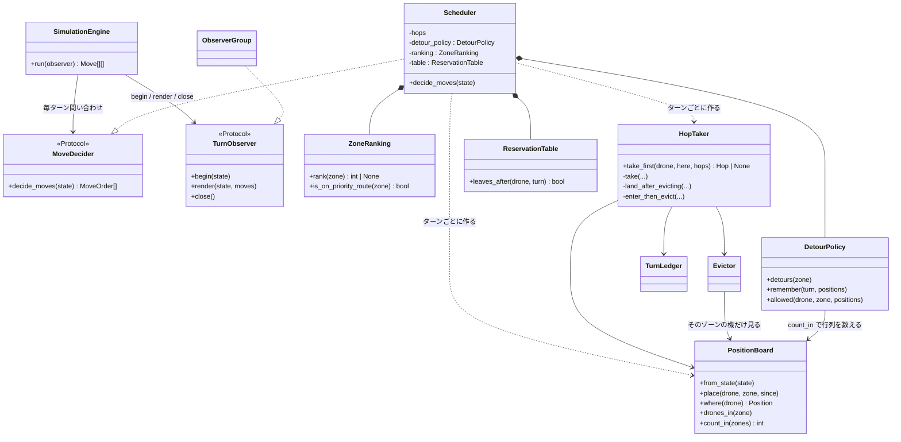
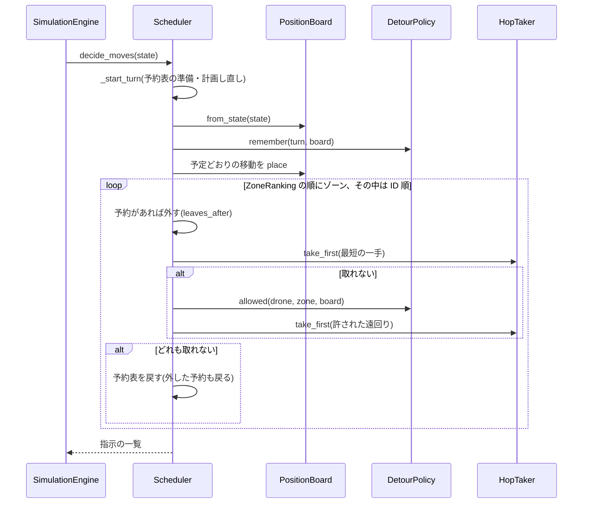

# ワークフロー: 全体レビュー(10観点)を受けたリファクタリング

- 日付: 2026-10-21
- 依頼内容: 10観点の独立レビュー(`docs/research/2026-10-21_code-review.md`)を受けたリファクタリング。範囲と判断は
  `docs/decisions.md` 2026-10-21「全体レビュー(10観点)を受けたリファクタリングの範囲と判断」。ブランチは `feature/refactor_review`。
- 検証の方法: 変更前の develop で、配布マップ・課題の例・revie_case・ランダムなマップ 4,871 枚(計 6,079 枚)のターンログを保存し、
  挙動を変えない各コミットの後にすべて一致することを確かめた。挙動を変える変更(立ち退きが決まった機も判断に回す)だけは差分を確認した
  (2枚が変わり、どちらもターン数は同じ)。

## 変更の一覧(コミット順)

| # | 内容 | 挙動 | 指摘 |
|---|---|---|---|
| 1 | `PositionBoard`(`simulation/positions.py`)を作り、1ターン分の位置とゾーンごとの機数を持たせる。`Position` は NamedTuple に | 同じ。3,000機で 318秒 → 13秒 | R7-2, R3-8, R4-4, R5-3, R8-4 |
| 2 | このターンに立ち退きが決まった未判断の機も判断に回す | 2/6,079 枚で変わる(ターン数は同じ) | R1-1, R1-2 |
| 3 | 最小カットのコード(3ファイル)と、実行に使われないもの(`best_route`/`Route`、`emit`、`WAITING`、`free_capacity`、`turns_remaining`、`formatter` 引数、のちに `has_room`、`planned`)を削除 | 同じ | R6-1〜9 |
| 4 | マップを `utf-8-sig` で読む(BOM を読み飛ばす) | BOM 付きのマップが通る | R3-5 |
| 5 | `Move` に出発で使った接続(`connection`)を持たせ、frozen に。`Move.text` で `D<id>-<行き先>` を作る | 出力は同じ | R11-1, R8-3, R6-16 |
| 6 | エンジンは `MoveDecider`(`decide_moves` だけの Protocol)と `TurnObserver` を受け取る。`CompositeVisualizer` は `simulation/observer.py` の `ObserverGroup` に。`Application` はスケジューラの作り方を受け取る | 同じ | R4-1, R5-1, R5-2 |
| 7 | 規則の共通化: `Zone.capacity`・`Zone.arrival_turn`、`ReservationTable.leaves_after`、`Network.connection_named`、`Pathfinder._costed_moves`・`route_cost`、`UniqueConnection` は `connection_between` を使う | 同じ | R4-2, R4-3, R4-11, R6-10〜14, R8-13 |
| 8 | `Zone`・`Connection`・`World` を frozen に。`Network` の `zones`・`connections`・`neighbors` を読み取り専用に | 同じ | R8-3, R4-6, R8-10 |
| 9 | `Scheduler` を分割: `HopTaker`(一手の試行。3つの取り方に名前)と `ZoneRanking`(判断順)。名前の修正(`_detour_policy`、`_distance_map`、`_costed_detours`) | 同じ | R4-8, R11-3, R8-6〜8 |
| 10 | docstring の補充(公開のもの全部)と訂正 | — | R2-6, R7-1, R7-7〜12, R1-3, R1-4, R11-9 |
| 11 | README 両版と決定記録の更新 | — | R7-2〜5, R11-4〜6, R11-10, R11-11, R7-4 |

## 構造図(シミュレーションまわり、変更後)

`simulation/` は `visualization/`・`output/` を import しない(パッケージ単位の循環がなくなった)。表示とターンログの出力役は
`TurnObserver` を満たすだけ(相互レビューの後、別名の `Visualizer` と `visualization/base.py` は削除した)。

## 挙動図(1ターンの判断、変更後)

## 行わなかったもの(必要性が低く、変更が大きい)

グラフィカル表示(約600行)とターミナル表示の分割、状態の読み取り専用のビュー(Protocol)、`map_format` の型の Generic 化、
`--visual` の Literal 化、ターン番号の語彙の統一。パーサーの厳格化と出力の安全策は、ユーザーの判断で入れない(決定記録 2026-10-21 の4・8)。
