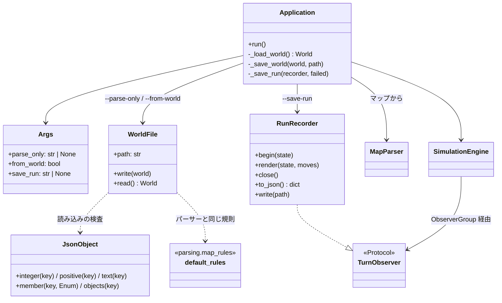
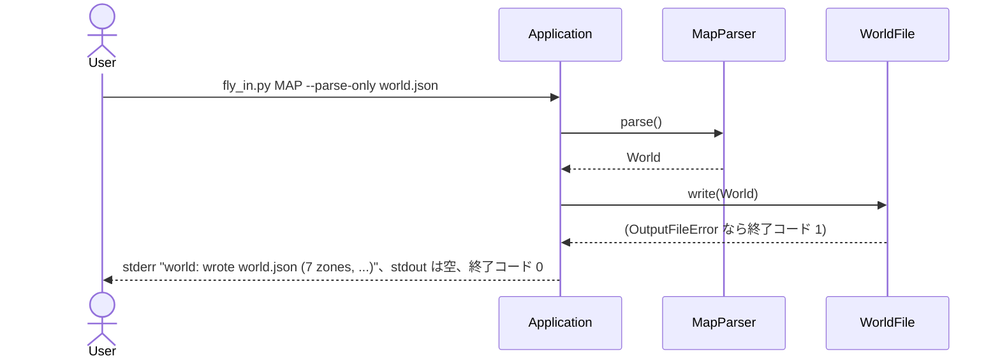
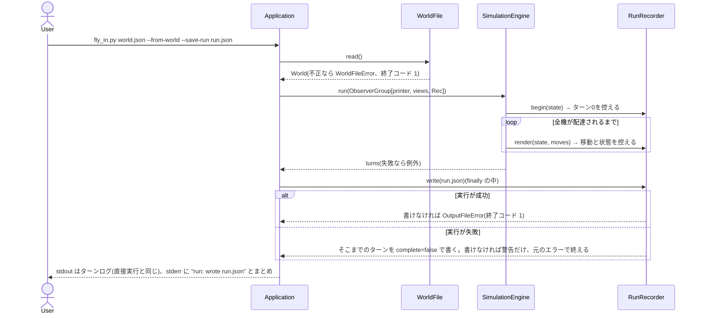

# ワークフロー: パーサーと移動ロジックの単体実行(JSON ファイル経由)

- 日付: 2026-10-22
- 依頼内容: ロードマップ 2(パーサーの単体実行)・3(移動ロジックの単体実行)。段階の間で渡すオブジェクトの中身が見えるよう
  ファイルを経由し、オプションとして用意して README に追加機能として書く。1回の起動で1ターンだけ進める形はユーザー判断で見送った。
- 決定: `docs/decisions.md` 2026-10-22「パーサーと移動ロジックを、JSON ファイルを経由して単体で動かせるようにする」
- ブランチ: `feature/stage_files`

## 全体ワークフロー内の位置づけ

既存の処理の流れ(パーサー → 経路探索 → シミュレーション → 出力)は変えない。2か所の受け渡しにファイルの出入り口を足す。

| 段階 | 入力 | 出力 | 足したもの |
|---|---|---|---|
| パーサー | マップファイル | `World` | `--parse-only FILE`: `World` を JSON に書いて終える |
| 経路探索・シミュレーション | `World` | 各ターンの `Move` と `SimulationState` | `--from-world`: `World` を JSON から読む。`--save-run FILE`: 各ターンを JSON に書く |
| 出力・表示 | 各ターン | ターンログ・表示・まとめ | 変更なし(`--from-world` でも同じ) |

## 変更の一覧(コミット順)

| # | 内容 | ファイル |
|---|---|---|
| 1 | 決定記録 | `docs/decisions.md` |
| 2 | `WorldFileError`・`OutputFileError`。`JsonObject`(型つきの読み取り、場所つきのエラー)・`write_json`。`WorldFile`(`world_to_json` / `world_from_json`) | `droneflow/errors.py`、`droneflow/interchange/json_file.py`・`world_file.py` |
| 3 | `RunRecorder`(`TurnObserver`。各ターンの移動と状態を控える) | `droneflow/interchange/run_file.py` |
| 4 | CLI のオプション3つ(`--parse-only` と `--save-run` は排他) | `droneflow/cli.py` |
| 5 | `Application` の組み立て(`--parse-only` で止める、`--from-world` で読む、`--save-run` で書く) | `droneflow/app.py` |
| 6 | README 両版の「追加機能」、終了コード、コードの構成 | `README.md`、`README.ja.md` |

## 完了条件と確認結果

- `--parse-only` → `--from-world` を通したターンログが、マップを直接実行したものと一致する: 配布マップ・課題の例・revie_case のうち
  正常に終わる 25 枚で一致(エラーになるマップは比較の対象外)。
- 書けない・読めない・不正なファイルは1行のエラーで終了コード 1。`--parse-only` と `--save-run` の同時指定は argparse のエラー(2)。
- flake8、mypy(課題のフラグと `--strict`)問題なし。

## 構造図

## 挙動図

### 1. パーサーだけ(`--parse-only`)

### 2. シミュレーションだけ(`--from-world --save-run`)

